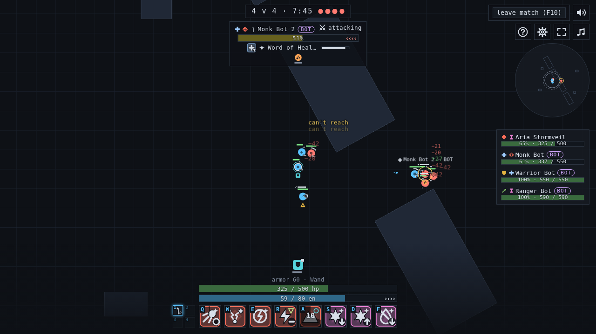
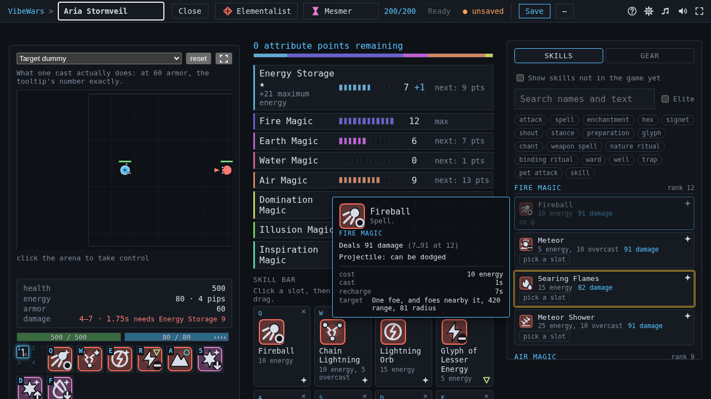
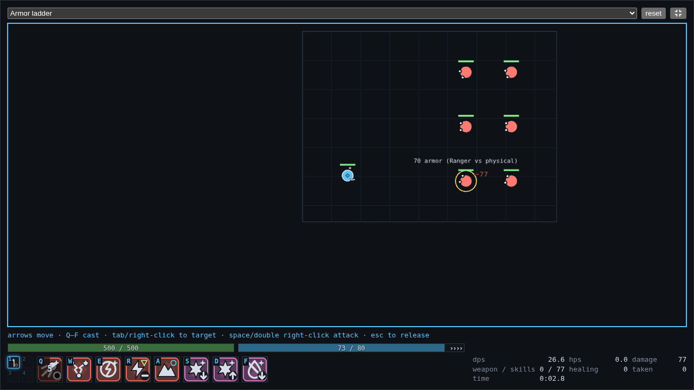
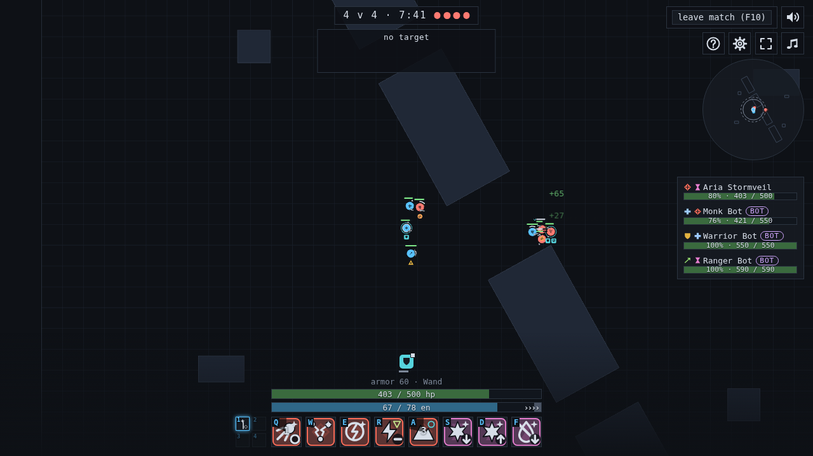

# VibeWars

[](https://github.com/Enteee/VibeWars/releases)
[](https://github.com/Enteee/VibeWars/actions/workflows/ci.yml?query=branch%3Amain)
[](https://github.com/Enteee/VibeWars/actions/workflows/pages.yml)
[](LICENSE)

Team arena PvP in the browser, after Guild Wars 1: two professions,
eight skills on the bar, and real-time fights at 20 Hz, hosted by one
player's browser.

**[▶ Play it now](https://enteee.github.io/VibeWars/next/)** — build a
character, test it on dummies in the Training Ground, then open your
lobby (the lock in the title bar) and send its invite link to your friends. Nothing
to install; see [Play it](#play-it).



A browser-based, minimalist, multiplayer PvP arena game mechanically
inspired by Guild Wars 1 PvP — original implementation, original
geometric visuals, no proprietary GW1 assets or code. Peer to peer: one
player's browser tab hosts the lobby and runs the match, and friends
open its invite link. No accounts, no database, no game server.
Peers find each other through public Nostr relays (Trystero) and then
talk over WebRTC, so the players in a lobby can see each other's IP
address.

See [`docs/product/master-brief.md`](docs/product/master-brief.md) for
the full product brief and sprint roadmap, and [`docs/adr/`](docs/adr/)
for the decisions behind this repository (start with
[ADR-0001](docs/adr/0001-architecture.md)).

## Play it

**Requirements:** a desktop browser, a keyboard and a mouse. VibeWars
does not work on a phone or a touch-only tablet.

Open the GitHub Pages build:
[the latest release](https://enteee.github.io/VibeWars/) or
[the latest `main`](https://enteee.github.io/VibeWars/next/). Every
player is always in a lobby of your own. Open it (the lock in the title
bar), press **Copy invite link** and send it; a friend opens the link,
and the host's mode is the party's. The host's tab runs the match, so it has to stay open: if it
closes, the lobby ends for everyone. The two builds keep separate
saved characters.

In a match, the default keys are:

- **Q W E R** and **A S D F**: the eight skills on your bar.
- **Arrow keys** or a left click on the ground: move.
- **Right click** a foe, or **Tab**: target it. **Space**: attack.
- **Esc**: cancel what you are doing. **F10**: leave the match.

The **Classic** preset puts skills on 1 to 8 and moves with W A S D.
Every key but Esc, Enter, F10 and the mouse can be changed in Options.
[Controls](docs/player/controls.md)
lists them all. [Getting started](docs/player/getting-started.md) walks
through a first match, and the **[?]** button in the game opens the same
Help.

To play your own build, run `pnpm run dev` (see
[Development](#development)), or `pnpm run build` and serve
`apps/web/dist` from any static web server.

If `devenv` is unavailable, any Node 24 with `pnpm@10` works — every
command is a plain `pnpm` script (see `package.json`). This repository's
own development was verified that way; see
[ADR-0007](docs/adr/0007-development-environment.md) for why.

## What works today

- **Real-time authoritative combat** on a fixed 20 Hz tick, run by the
  host: movement, body blocking, line of sight, casting with activation
  and recharge, energy and adrenaline.
- **Over 200 skills** across all ten professions: Warrior, Ranger, Monk,
  Necromancer, Mesmer, Elementalist, Assassin, Ritualist, Paragon and
  Dervish ([Skills and builds](docs/player/skills-and-builds.md)).
- **Mechanics**: conditions, hexes and enchantments, maintained
  enchantments, interrupts, area effects, projectiles, weapon
  auto-attacks and critical hits, knockdowns, spirits, wells, wards and
  traps, minions and pets, weapon sets, morale and resurrection
  ([Combat basics](docs/player/combat-basics.md),
  [Equipment](docs/player/equipment.md)).
- **Twelve original maps**, picked by the lobby host, in seven
  [modes](docs/player/modes.md): Annihilation, Kill Count, Priest
  Annihilation, Guild Battle, Relic Run, King of the Hill and Capture
  Points.
- **Random Arena**: queue for a team size and get matched with other
  players on a random map
  ([Getting started](docs/player/getting-started.md)).
- **Bots** fill empty places in a lobby you host
  ([Bots](docs/player/bots.md)).
- **Character builder** with profession, attribute and equipment rules,
  saved in the browser, and the **Training Ground** beside it to try a
  bar on dummies. The host validates every build and hands an illegal one
  a starter build instead.
- **Team Builds**: teams of their own characters, for planning a roster (see the limits below).
- **Music and sound**, and a **narrow-window layout**.
- **Robustness**: a dropped player's character stays in the match for 30
  seconds and the player can rejoin it; hostile input cannot crash the
  host (fuzz-tested).

Honest limits:

- A **saved team is not taken into a match**. Each player picks their
  own character; the lobby does not assign a team's slots to anyone. A
  team is a planning tool.
- A player in a lobby **without a team** stays in the lobby while the
  match runs; watching a match is not built yet.
- The **host's tab runs the match**: if it closes, the match ends for
  everyone.

## Screenshots







## Repository layout

```text
apps/
  web/      Browser client (HTML/CSS shell + Phaser 4 viewport)
packages/
  game-core/      Pure domain logic: combat, skills, geometry, rules
  game-protocol/  The peer-to-peer wire contract
  game-maps/      Declarative arenas + loader/validator
  game-data/      GW1 reference-skill import pipeline + dev CLI
  game-session/   Peer-to-peer match sessions over a Transport (#15)
docs/
  product/master-brief.md   Product brief and sprint roadmap
  adr/                      Architectural Decision Records
  player/                   The player's guide, also the in-game Help
  art/                      Art direction and asset studies
```

`game-core` depends on nothing else in the workspace and never touches a
socket, a renderer or a clock — which is what makes combat testable
headlessly. See [ARCHITECTURE.md](ARCHITECTURE.md).

## Development

```sh
pnpm run dev      # the whole game, reloading as you edit
```

Opens the client on <http://127.0.0.1:5173>. Editing the client reloads
the page; editing any package rebuilds it. Ctrl-C stops all the watchers.
Two tabs of it can play each other: one hosts, the other joins.

The browser tests build the client with `VITE_VIBEWARS_TRANSPORT=broadcast`,
so their peers are tabs of one browser and need no relay (see
[environment variables](docs/development/environment-variables.md)).

```sh
pnpm run ci       # format check, typecheck, lint, test, build
pnpm run test     # unit, integration, fuzz and headless simulation tests
pnpm run test:e2e # the browser tests, in a real Chromium (needs one installed)
pnpm run ci:full  # ci, then the browser tests
```

`devenv test` runs the same sequence. See
[CONTRIBUTING.md](CONTRIBUTING.md).

### Dev tools

```sh
pnpm --filter @vibewars/game-data run build
node packages/game-data/dist/run-cli.js skills      # inspect skills
node packages/game-data/dist/run-cli.js statuses    # conditions/hexes/enchantments
node packages/game-data/dist/run-cli.js coverage    # imported vs implemented
node packages/game-data/dist/run-cli.js duel elementalist.fireball ranger.troll-unguent
```

The duel runner simulates real combat headlessly and deterministically
from a seed — useful for balance questions and for reproducing bugs.

### Agent swarm

```sh
claude-llc auth     # sign in the company's own credentials, once
claude-llc-init     # check them, set up the board
claude-llc doctor   # what is signed in, and as whom
claude-llc          # start the company, and attach to it
```

VibeWars is built by a company of sandboxed Claude agents, one per role.
Each runs in its own bubblewrap jail on its own `git worktree`, takes its
work from a GitHub board, and coordinates with the others through a
Telegram supergroup, one topic per role. The group doubles as a log and a
remote control you can read on a phone. Why it is built this way:
[ADR-0014](docs/adr/0014-agent-coordination.md) and
[ADR-0015](docs/adr/0015-agent-company.md). What the host needs (cgroup
delegation, user namespaces, credentials, tmux):
[Host prerequisites](docs/development/agent-company-host.md).

## License

AGPL-3.0-or-later; the full text is in [`LICENSE`](LICENSE). No proprietary Guild Wars assets, code or map
geometry are included or depended on; the GW1 skill corpus used for
reference is treated as reference _data_ with recorded provenance, never
a runtime dependency — see [ADR-0004](docs/adr/0004-skill-data.md).
