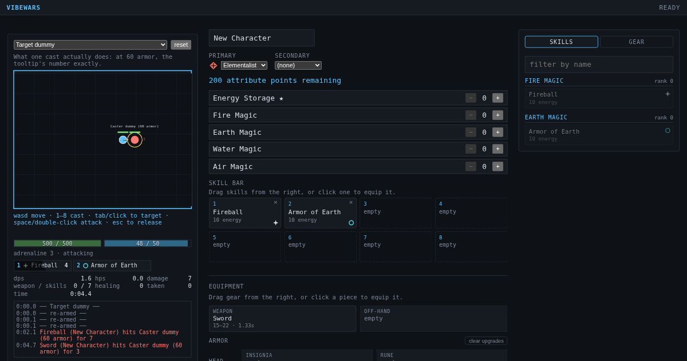

# VibeWars

[](https://github.com/Enteee/VibeWars/releases)
[](https://github.com/Enteee/VibeWars/actions/workflows/ci.yml?query=branch%3Amain)
[](https://github.com/Enteee/VibeWars/actions/workflows/pages.yml)
[](LICENSE)

Team arena PvP in the browser, after Guild Wars 1: two professions,
eight skills on the bar, and real-time fights at 20 Hz, hosted by one
player's browser.

**[▶ Play it now](https://enteee.github.io/VibeWars/next/)** — build a
character, test it on dummies in the Training Ground, then host a lobby
and send its code to your friends. Nothing to install; see
[Play it](#play-it).



A browser-based, minimalist, multiplayer PvP arena game mechanically
inspired by Guild Wars 1 PvP — original implementation, original
geometric visuals, no proprietary GW1 assets or code. Peer to peer: one
player hosts a lobby in their browser tab, which runs the match, and
friends type its short code. No accounts, no database, no game server.
Peers find each other through public Nostr relays (Trystero) and then
talk over WebRTC, so the players in a lobby can see each other's IP
address.

See [`docs/product/master-brief.md`](docs/product/master-brief.md) for
the full product brief and sprint roadmap, and [`docs/adr/`](docs/adr/)
for the decisions behind this repository (start with
[ADR-0001](docs/adr/0001-architecture.md)).

## Play it

Open the GitHub Pages build:
[the latest release](https://enteee.github.io/VibeWars/) or
[the latest `main`](https://enteee.github.io/VibeWars/next/). One person
picks **host a lobby** and reads out the code; the others type it
and pick **join**. The host's tab runs the match, so it has to stay open: if
it closes, the lobby ends for everyone. The two builds keep separate
saved characters.

| Key             | Action                                    |
| --------------- | ----------------------------------------- |
| `W` `A` `S` `D` | Move                                      |
| Left click      | Walk there                                |
| Right click     | Target (double: attack)                   |
| Right drag      | Look around; let go to come back          |
| Wheel click     | Call a foe, or ping                       |
| `1`–`9`, `0`    | Use the matching skill-bar slot           |
| `Tab`           | Target the next nearest enemy             |
| `Shift` `Tab`   | Target the previous one                   |
| `C`             | Target the closest foe                    |
| `T`             | Target the foe your team called           |
| `G`             | Target yourself                           |
| `Space`         | Attack your target with your weapon       |
| `Esc`           | Cancel your cast and your attack          |
| `M`             | Mute or unmute the sound                  |
| `F1`–`F4`       | Swap to weapon set 1–4                    |
| `F10`           | Leave the match (asks first)              |
| `Enter`         | Chat: `!` all, `#` team (lobby and match) |

To leave a match, press `F10` or use **leave match** at the top right; it asks first.

To play your own build, run `pnpm run dev` (see
[Development](#development)), or `pnpm run build` and serve
`apps/web/dist` from any static web server.

If `devenv` is unavailable, any Node 24 with `pnpm@10` works — every
command is a plain `pnpm` script (see `package.json`). This repository's
own development was verified that way; see
[ADR-0007](docs/adr/0007-development-environment.md) for why.

## What works today

- **Real-time authoritative combat** on a fixed 20 Hz tick, run by the host:
  movement, collision, body blocking, line of sight, targeting, casting
  with cast and recharge times, energy and adrenaline economies.
- **Mechanics**: 8 conditions, hexes, enchantments, interrupts, health
  degeneration and regeneration, death, morale and resurrection.
- **12 implemented skills**: 9 of the 16 in a reference corpus imported
  from public GW1 data, plus 3 of our own design. The other 7 need
  mechanics that do not exist yet and are reported as a machine-readable
  gap, with a reason each (`node packages/game-data/dist/run-cli.js coverage`).
- **Four original arenas**: a chokepoint, an open field, split paths and
  a pillar hall, selectable by the lobby host.
- **Lobby** with shareable codes, team assignment, ready state and
  repeatable matches.
- **Character builder** with profession/attribute rules and versioned
  browser-local persistence. The first start rolls you a random starter
  character, with Clone and Reroll on its row: Clone gives you a copy to
  edit. Pick a character on the menu and you take that build into the
  match — the host validates it and hands a random starter build if it
  is illegal, so a build is a request, never a claim.
- **Team builder** for planning a roster: create, rename, add, remove,
  reorder, duplicate and delete, at any team size. A team is a local
  planning tool — see the limits below.
- **Match rules**: score, clock, victory conditions.
- **Robustness**: a dropped player's character stays in the match for
  30 seconds, and the player rejoins it if their connection is back in
  time; hostile input cannot crash the host (fuzz-tested).

Honest limits:

- Area-of-effect, projectile travel time, weapon auto-attacks, knockdowns
  and spirits/wards/traps are **not** implemented. Skills needing them
  are deliberately absent from the catalog rather than present with
  watered-down effects (brief §9).
- A **saved team is not yet taken into a match**. You can build and
  organise a roster, and each player picks their own character from it,
  but the lobby does not assign a team's slots to the players in it.
  Teams are first-class objects in storage (brief §4) and a planning tool
  in practice.
- Kills score for a **team**, not a player. Per-player credit needs
  damage-source tracking that does not exist, and inventing an
  attribution would put a plausible lie on the scoreboard.

## Repository layout

```text
apps/
  web/      Browser client (HTML/CSS shell + Phaser 4 viewport)
packages/
  game-core/      Pure domain logic: combat, skills, geometry, rules
  game-protocol/  The peer-to-peer wire contract
  game-maps/      Declarative arenas + loader/validator
  game-data/      GW1 reference-skill import pipeline + dev CLI
  game-session/   Peer-to-peer match sessions over a Transport (#15)
docs/
  product/master-brief.md   Product brief and sprint roadmap
  adr/                      Architectural Decision Records
```

`game-core` depends on nothing else in the workspace and never touches a
socket, a renderer or a clock — which is what makes combat testable
headlessly. See [ARCHITECTURE.md](ARCHITECTURE.md).

## Development

```sh
pnpm run dev      # the whole game, reloading as you edit
```

Opens the client on <http://127.0.0.1:5173>. Editing the client reloads
the page; editing any package rebuilds it. Ctrl-C stops all the watchers.
Two tabs of it can play each other: one hosts, the other joins.

The browser tests build the client with `VITE_VIBEWARS_TRANSPORT=broadcast`,
so their peers are tabs of one browser and need no relay (see
[environment variables](docs/development/environment-variables.md)).

```sh
pnpm run ci       # format + lint + typecheck + test + build
pnpm run test     # unit, integration, fuzz, benchmark, headless simulation
pnpm run test:e2e # 19 browser tests in a real Chromium (needs one installed)
pnpm run ci:full  # both of the above
```

`devenv test` runs the same sequence. See
[CONTRIBUTING.md](CONTRIBUTING.md).

### Dev tools

```sh
pnpm --filter @vibewars/game-data run build
node packages/game-data/dist/run-cli.js skills      # inspect skills
node packages/game-data/dist/run-cli.js statuses    # conditions/hexes/enchantments
node packages/game-data/dist/run-cli.js coverage    # imported vs implemented
node packages/game-data/dist/run-cli.js duel elementalist.fireball ranger.troll-unguent
```

The duel runner simulates real combat headlessly and deterministically
from a seed — useful for balance questions and for reproducing bugs.

### Agent swarm

```sh
claude-bot architect   # a sandboxed Claude agent, in a role, on Telegram
```

Each role runs in its own bubblewrap jail on its own `git worktree`, and
coordinates with the others through a Telegram supergroup — one topic per
role — which doubles as a log and a remote control you can read on a
phone. Inside the jail, `tg send`/`tg inbox`/`tg wait`/`tg roster` are the
agent's only way out; the bot token stays outside it.

Needs one manager-bot token in `devenv.local.nix`. Setup, the two taps
each new role costs, and why it is built this way:
[ADR-0014](docs/adr/0014-agent-coordination.md). What the host needs
(cgroup delegation, user namespaces, the token file, tmux):
[Host prerequisites](docs/development/agent-company-host.md).

## License

AGPL-3.0-or-later; the full text is in [`LICENSE`](LICENSE). No proprietary Guild Wars assets, code or map
geometry are included or depended on; the GW1 skill corpus used for
reference is treated as reference _data_ with recorded provenance, never
a runtime dependency — see [ADR-0004](docs/adr/0004-skill-data.md).
