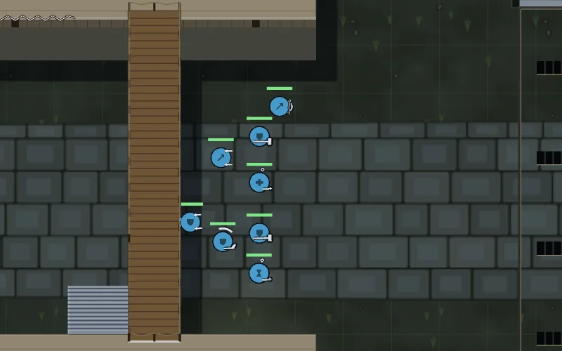
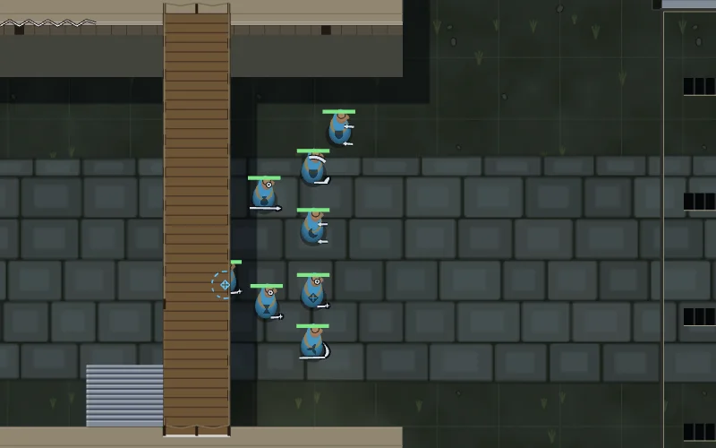
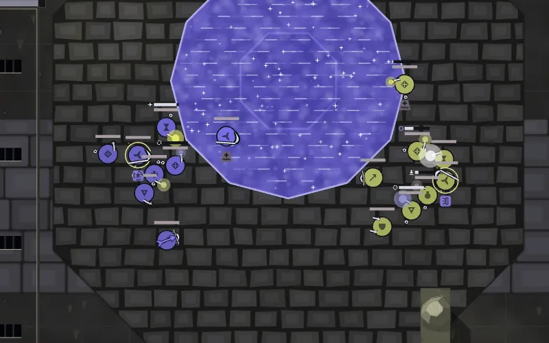
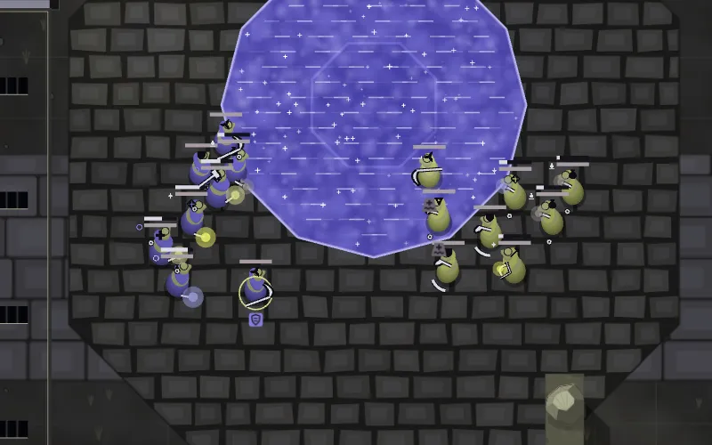
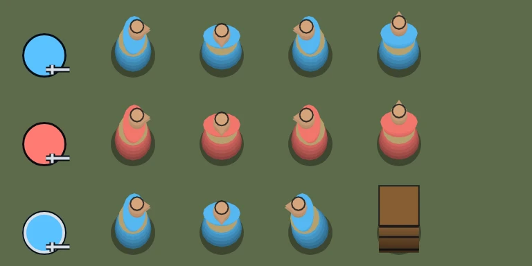
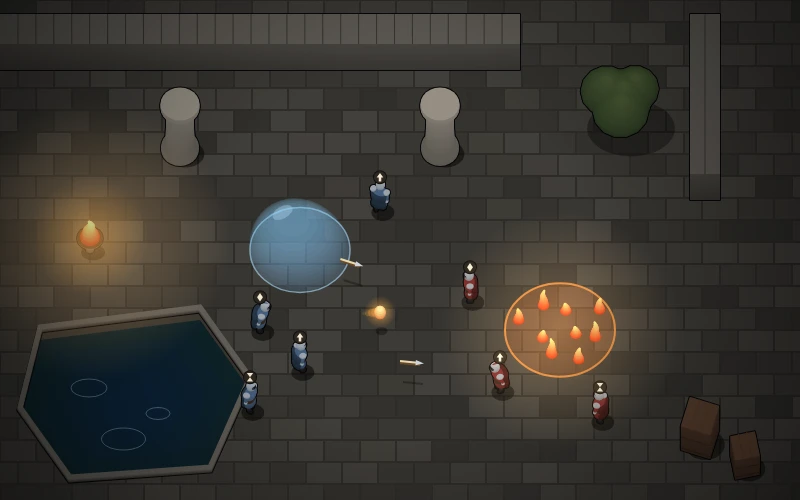
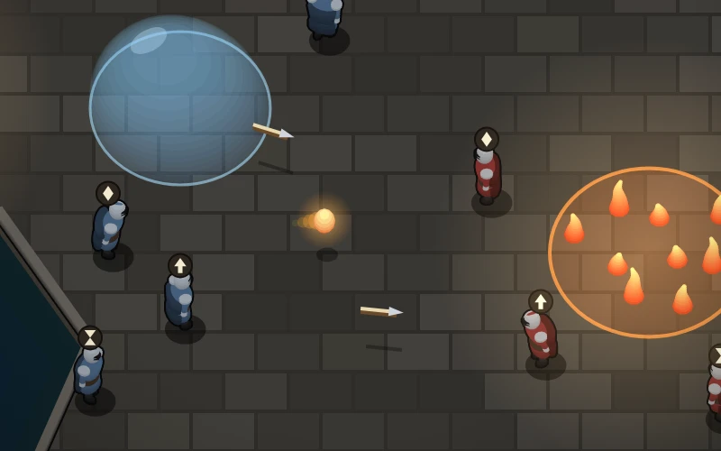

# ADR-0057: The art is grim gothic; bodies are sprite-stacked and baked per heading, world elements are restyled, not stacked

## Status

Proposed (2026-11-25); the art style, grim gothic, approved by the operator on 2026-11-25 (relayed by the manager at 16:14: "go with the DARKER gothic style"; the scope, all of #3974, is operator question Q190, recorded in #4056). Issue #3977, the spike of epic #3974. Builds on ADR-0051 (discrete layers), ADR-0052 (map lighting), ADR-0054 (no baked chunks) and ADR-0056 (cosmetics).

## Context

A body today is a flat disc in the team colour with marks on it (`render/body-painter.ts` `paintStandingBody`). From above it reads as a token, not a figure: it has no height, and turning it only moves the weapon mark. Epic #3974 asks whether sprite stacking can make bodies and props look solid and 2.5D.

Sprite stacking draws an object as N thin horizontal slices, each a few pixels above the last and turned with the object's heading. A top-down 2D renderer then shows volume and a silhouette that turns. Any stacking here has to keep three things:

- the brief's language: circles, lines and polygons, no painted art (`docs/art/visual-style.md`);
- a threat readable in a fraction of a second, colour-blind too;
- the render bench's gates (`docs/development/benchmarks.md`).

## What was tried

The prototype is on `bot/developer@2/issue-3977-spike` (commits 5f3918dca, c041b6abe and 5aab44546), which is not merged. `?stack` switches it on, and `BENCH_STACK=1` makes `pnpm bench:render` load it.

- **Slices generated from our own geometry.** `render/sprite-stack.ts` builds a standing body from 17 slices, bottom up: 2 for the feet, 5 for the robe, 1 for the belt, 3 for the torso and 4 for the head. Every slice is an ellipse or polygon in units of the body radius. Each slice is shaded from dark at the ground to full colour at the top with `scaleColour`, and multiplied by the light at the body's feet (ADR-0052) with `multiplyColour`. Only the top slice's outline is stroked.
- **Turning.** Every slice turns with `facing`. The shoulders are wider across the heading than along it, and the head sits forward of the centre with a nose toward the heading. That is enough to read the heading at a glance (see the turning sheet). The weapon and off-hand marks and the self ring stay flat on the ground disc, where they are today. The profession glyph rides on the top slice (below).
- **Poses as slice offsets.** The walk swings the feet and the robe hem with a stride phase, and the stride phase advances with the distance walked. The cast leans the torso and head forward. There are no extra slices and no extra art.
- **`STACK_STEP` 1.5 px.** A body stands 17 × 1.5 ≈ 26 px tall on screen, under half of `ELEVATION_STEP` (56), so a stacked body never reads as standing on the layer above.
- **Drawn live in the prototype.** Each slice is a `fillPoints` on the body's existing Graphics, so the depth sort, the lighting and the x-ray outline see the same object as today. Under the bridge in the 8v8 shot, `drawHiddenOutlines` still draws the hidden body's outline ring on top. The bench below is why the decision bakes instead.
- **The profession glyph on the top slice.** On the ground disc the 26 px figure covers the glyph, so the first shots lost the threat read. The glyph is now drawn on the top slice: the same glyph, tint and size as today, centred on the body's axis, lifted by the stack height, not turned with `facing`, at full strength, and in its own layer after every slice. The health and cast bars, placed for a flat disc, crossed the top slice and covered it, so they rise to clear the glyph.
- **A crate prop** (`crateSlices`, 14 square slices with three bands) drawn the same way.

### Screenshots

The 8v8 fight is on Arena Crossroads at 800 px, cropped to the fountain as both teams meet, so the team colour and the glyph read against the other team. The deuteranopia pair is the same frame through the deuteranopia matrix the `docs/art/` checks use.

| today                                                                                        | stacked                                                                                          |
| -------------------------------------------------------------------------------------------- | ------------------------------------------------------------------------------------------------ |
|                             |                             |
|  |  |

### Bench

`pnpm bench:render --follow`, `BENCH_MAP=arena-crossroads`, under `company heavy`, on SwiftShader at 1280 × 720. Both looks ran from one build of the spike, served once, `BENCH_STACK=1` adding `?stack`, one run each. The follow case is a Hosted 1v1, so it draws two bodies.

| follow, p50 / p95 ms   | today         | stacked       |
| ---------------------- | ------------- | ------------- |
| bench-flat             | 61.4 / 89.2   | 71.8 / 88.2   |
| bench-flat, update p50 | 3.3           | 7.3           |
| arena-crossroads       | 286.8 / 471.0 | 226.8 / 377.7 |
| crossroads / flat      | 4.67          | 3.16          |

On bench-flat, two stacked bodies add about 4 ms of update, the frame's JS, and about 10 ms of p50. That is 34 filled polygons a frame, each re-tessellated by Phaser's Graphics. Crossroads walked is noisier than the difference: the stacked run measured faster, which it cannot be. Both looks stay well under `BENCH_MAX_FOLLOW_RATIO` (10). The bench has no crowd case, so the cost of 16 bodies with minions and spirits is extrapolated: about 2 ms of update per body, or over 30 ms a frame at 16. That is too much.

## Decision

**Bodies: yes, stacked and baked, behind two gates: the crowd bench and the threat read (below).** A body is drawn as 17 generated slices, `STACK_STEP` 1.5 px, as the prototype draws it, which reads as a figure and turns. It is not drawn live. Each look on the roster is baked at match start, never on first draw, so a new look does not hitch a frame mid-fight, into a small image per heading bucket and pose. That gives 8 headings, and for poses standing, two walk frames and the cast lean. At about 48 × 72 px, an image is 13.8 KB, so a look is 32 images, about 440 KB. A look is the body's colours only: team colour, and cape colours when the cape goes into the stack. The light at its feet (ADR-0052) is the sprite's tint, so the bake never depends on lighting. A 16-player match has at most about 16 looks, about 7 MB of texture, held in one atlas and dropped when the match ends. A frame then draws one small image per body, about 3.5 k px each. At ADR-0054's 50 ns per textured pixel that is under 0.2 ms per body, against about 2 ms live.

This is a decision about small images, not the large ones ADR-0054 rejected. ADR-0054's cost was screens of textured area. Sixteen body images are under a tenth of one screen. The follow-up that builds this must bench a 16-body crowd, live against baked, before it switches the look on. If baked is not faster, the look waits.

**Gated on the threat read, which the spike failed.** In the 8v8 stacked shot the glyph on the top slice does not read. On the red team by the fountain it is a dark smudge on the head, often merged with the head's outline or under a bar, and not one profession can be named, where the same frame drawn today shows every glyph crisply. A threat readable in a fraction of a second is one of the things this decision has to keep. So, like the crowd bench, it is a gate: the follow-up must show the glyph reading at match zoom, today against stacked in the same frame, before it switches the look on. If it does not read, the look waits.

**The profession glyph rides on top of the stack.** It is the exception to "ground marks stay flat". It is a flat badge on the top slice, centred on the body's vertical axis rather than the head's forward offset, not turned with `facing`, drawn after every slice so nothing on the body covers it: the same glyph, tint and size as today, with its dark outline for contrast on any team colour. The ground marks stay flat because they must line up with the footprint and the hit test. The glyph says _who_, not _where_, so a fixed offset over the centre costs no alignment. Over the head is where conditions and the self ring go, and a glyph there piles up with them; beside the health bar fails for bodies that show no bar, and the eye tracks the body, not the bar.

**The art direction is grim gothic, dark: the `gothic` preset of the spike's `styles.js`, approved by the operator on 2026-11-25 for the whole of epic #3974.** The spike mocked up five art styles at game scale (painterly, low-poly, pixel art, grim gothic and voxel; the mockups are on `bot/developer@2/issue-3977-spike`, `preview/styles/`, and [`styles/README.md`](../art/spikes/3977-sprite-stacking/styles/README.md) lists them). The operator picked grim gothic, saw a lighter variant of it, and chose the dark one. Bodies, world elements, skills, ground effects and water all follow it:

- **Palette:** dark and desaturated: flagstone floor `#3a3834`, walls `#5e5a54`, columns `#8a847a`, near-black water `#0e2228`. The mock's steel blue and blood red team colours are not adopted: on the dark floor its red measures 1.22:1, too close for friend and foe. Bodies keep `visual-style.md` §1's friend `#59c2ff` and foe `#ff7b72`, which the dark world makes stand out more, not less.
- **Shading:** high contrast between the lit top and the dark lower slices, ambient occlusion where a body meets the ground, and a 1 px near-black outline `#08080a` on the silhouette.
- **Figures:** helmeted, with a visor and a cape, about 18 sides a slice.
- **Light:** a strong vignette at the screen edge and warm pools of light around fires and braziers, the ADR-0052 lights doing the work.
- **The glyph** sits in a dark disc over the head, which is the badge disc the Consequences below ask the follow-up to try first.

The grade darkens the world, never the actors: bodies, team colours, gameplay marks, hazards and the HUD keep their colours and their §6 contrast. Where this palette and `visual-style.md` disagree, the follow-up that builds the look updates `visual-style.md` in the same PR.

**World elements: restyled to the gothic preview, not stacked.** A crate or pillar does not turn, so it gains nothing from slices: the stacked crate in the turning sheet looks no more solid than today's cover and costs 14 polygons where today's costs a few. Walls, columns, trees, braziers, crates, water, ground effects and skill visuals instead take the gothic palette, outline and light of the preview, drawn the way map art is drawn today (ADR-0051, `map-2-5d`). Follow-up cards of #3974 do that, one kind of element per card, each against the preview. The bench and glyph gates above are for bodies only.

## Considered

- **Live slices every frame**, as the prototype draws them. These need no cache and no atlas, and the lighting is exact, but they cost about 2 ms of update per body on SwiftShader (bench above). Rejected for the crowd.
- **16 heading buckets.** They double the atlas. The spike drew bodies live at any heading, so eight is a guess the follow-up checks against the turning sheet; it moves to 16 only if eight steps visibly.
- **More slices** (one per pixel, as classic sprite stacks are). At 1.5 px a step, 17 slices already read as a figure at our body size, and every slice is another polygon to bake. Rejected.
- **Stacking the ground marks too** (weapon, rings). Lifted, they move with the head and stop lining up with the footprint and the collision radius; on the ground they stay where the hit test is. Rejected.

## Consequences

- **Team colour** is the robe and torso, the largest area, so the team still reads first, and it reads in deuteranopia as today's disc does. The darker lower slices must not drop below the contrast `visual-style.md` asks of the team colour.
- **The glyph's read** on the top slice fails in the spike's shot: it sits on the head's skin tone, a smaller and paler field than the robe, and merges with the head's outline (see the stacked shot). The first thing the follow-up tries is a disc of the badge's own behind it, still on the top slice. Until a shot at match zoom shows the glyph reading as well as today's, the stacked look stays off.
- **The overhead bars** rise by the stack height so they clear the glyph; conditions and the cast badge over the head rise with them.
- **Creatures** (`drawCreature`), and **lying and falling bodies**, stay as they are today: none of them is stacked.
- **Conditions** (`body-conditions.ts`) and **rings** (`body-rings.ts`) stay on the ground disc and over the head, as today. The spike drew neither differently; the follow-up checks each one against the taller silhouette, since a ring under a 26 px body is partly covered at the front.
- **Cosmetics** (ADR-0056): the spike dropped the cape and the swing trail. A cape becomes a few back slices in the cape's colours between the robe and the shoulders, and the swing trail stays a ground effect. The follow-up builds both before it switches the look on.
- **The menu's character figure** (`ui/character-figure.ts`, a 2D canvas) paints with the same `Painter`, so it can take the same slices and should, so the figure in the builder matches the body in the match.
- **Reduced motion**: the stride swing and the cast lean are motion. Under `prefers-reduced-motion` the slices stay still and only turn with the heading, which is state, not animation.
- **The x-ray outline** needs no change: it outlines the footprint, which the stack keeps.
- **The atlas** is rebuilt after a lost WebGL context, as every other texture is, and the bake is a render path that has to stay in step with `sprite-stack.ts` geometry: one source, drawn into the atlas, never a second hand-kept copy.
- The prototype is not merged. Follow-up children of #3974 implement this decision; the `?stack` switch and `BENCH_STACK` do not survive into main.
