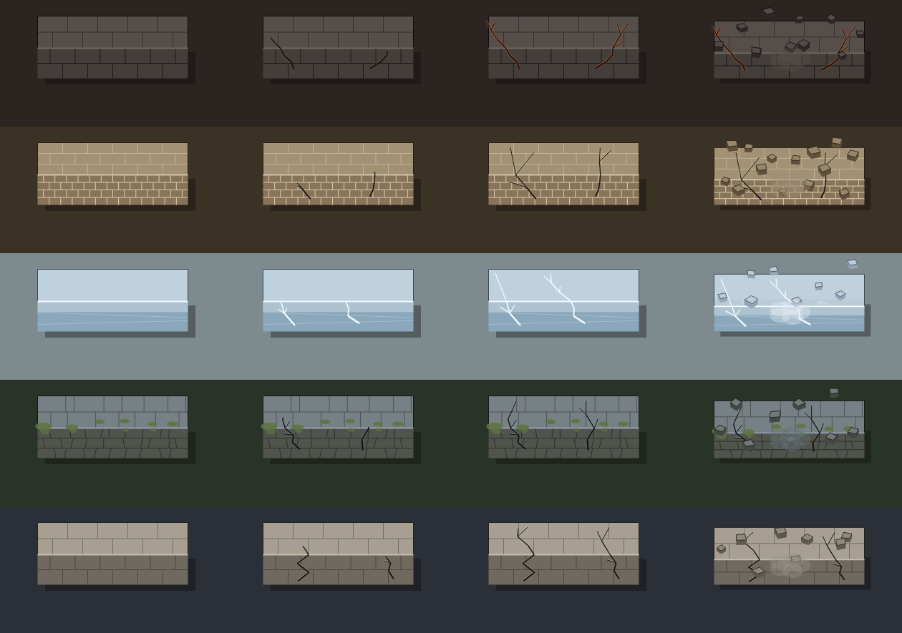

# Portals, barriers, atmosphere (#3030, #3031, #3032)

Studies: `3030-portals.png`, `3031-barriers.png`, `3032-atmosphere.png`.
Regenerate with `node scripts/assets/world-elements-study.mjs docs/art`
(needs inkscape). Rules follow `visual-style.md`.

## Portal (#3030)

- Ring of ten rune stones (`#827b70` / `#6f695f`, lit top `#c4bdb0`) round a
  swirl dish. On: aqua `#5fe0d0` rings and a white core, a rising wisp, a
  cool aqua light. Aqua is help-class, never harmful hue.
- Off: the dish is dark `#12161d` with a dashed grey ring, the rune pips and
  light are gone. Shape differs from on, not only colour.
- Arrival: a white burst and an expanding ring at the exit. The ring is the
  5 s cooldown cue: it fades over the cooldown.
- Entry and exit use the same look; direction is not drawn.
- Light: on, `#5fe0d0`, radiusScale about 1.4, intensity 0.4; off none.

## Energy barrier (#3031)

- Two stone posts `#4b5a70` with aqua lamps, a shimmering curtain `#5fe0d0`
  at 28 % with wavering lines and a bright top and bottom edge.
- Closed: curtain, aqua glow. Open: posts and a faint dashed ghost.
- It blocks bodies, not sight: bodies behind it stay fully drawn, the curtain
  sits over them at low alpha.

## Destructible wall (#3031)

- A block of its biome's material (#3370), a weaker patch of that biome's
  walls: dark basalt blocks with embers in the cracks (volcanic), mud brick
  with straw-pale mortar (desert), blue-white ice, translucent at its top
  edge, that cracks white (snow), mossy field stone (wilds). The hall, the
  heights and every map of one layer keep the chiselled stone of the rock
  study (lit top `#a69f92`, face `#6f695f`, mortar `#4d4943`). Each is
  tinted from its biome's tones and lit as walls are, with a lit top edge,
  a darker face laid in its courses, an outline and a south-east shadow.
- Damage shows as a crack network that grows with it: 2 to 4 origins along
  the wall, about one per 160 units, each a branching line wandering up the
  south face and over the lip onto the top. The first hairline shows at the
  first hit, and most of the network by 20 % health. A hit's new length
  draws in over 0.15 s, and 2 to 4 chips of the face fall off its tip and
  fade. Cracks are 2 px at the origin and 1 px at the tips, with a 1 px lit
  lip over each; volcanic ones glow faintly below half health. A health bar
  shows on hover or when targeted.
- Falling: over 0.6 s the wall sags to 35 % of its height, 8 to 14 blocks
  tumble out on short arcs to both sides, and a dust puff of its material
  hangs for 1 s. It stops blocking at once.
- Crumbled: a pile of its material with the tumbled blocks lying where they
  landed; the wall is gone.

## Atmosphere (#3032)

- Fog bank: layered pale `#c8d4e4` puffs at 18 to 26 % over the ground, under
  bodies, drifting slowly. Cool grey, not acid green: that is poison.
- Smoke: grey puffs that grow and thin as they rise. Steam: white puffs that
  fade out. Both start at a stone vent or a pipe.
- Rain: thin `#bcd4f0` slanted streaks and small ripple ellipses on the
  ground, a faint dark wash, 70 streaks at 0.5 and 160 at 1.0 over this tile.
- Snow: white flakes 1 to 2.6 px, no ground tint. Weather never hides a
  body, projectile or telegraph (§6 rule 3): keep alpha at or under 0.6.
