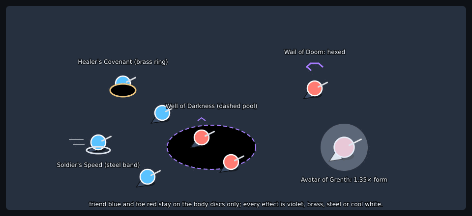

# Skill visuals: a brainstorm board (#3191)

Study, not decided. Ten skills, one per skill type, drawn on the body as it is today (disc, cape, weapon
mark). One board per skill, `3191-<slug>.png`, and one team fight check, `3191-team-fight.png`.
Regenerate with `node scripts/assets/3191-skill-visuals-study.mjs docs/art` (needs inkscape and
imagemagick; the SVG is a build intermediate, not committed). Each board: casting start, mid, release
(top row); the effect at game size, a 3× inset, and how it ends (bottom row). Seed 3191 picked the
skills from `packages/game-core/src/skills/catalog/`.

Rules the study holds:

- **Colour by type, not by skill** (palette: `visual-style.md` §1).

  | Type                     | Language                                                                  |
  | ------------------------ | ------------------------------------------------------------------------- |
  | Damage spell, projectile | warm orb `#ffd23d` / `#ff8a3d`, bright core, ground shadow, short trail   |
  | Magic area, well, hex    | violet `#a77bff`; ground = **dashed** edge, hex = broken hexagon          |
  | Enchantment              | solid brass ring `#e8c27a` at the feet, slow motes                        |
  | Stance                   | flat steel-white band `#dfe7f1` under the feet, speed streaks             |
  | Form                     | the body itself: 1.35× disc, ash cape, cold aura                          |
  | Ritual (spirit)          | pale-green wisp with its own health bar, solid `#76c96f` range ring       |
  | Shout                    | one cool ring `#9fdcff` leaving the caster in 0.3 s, a chevron per ally   |
  | Attack skill             | a thick warm arc and an impact star over the plain swing's thin white arc |

- **Friend blue and foe red stay on bodies.** No effect is large in either.
- **Harmful ground is dashed, help is solid** (`visual-style.md` §6.5). A strike goes 2.5× wide at once
  when it lands, and thins before it ends: width and brightness, not colour, tell the state.
- **A cast shows a cast bar** (`drawCastBar`) and the same three beats for every type, so a player reads
  "start, mid, release" before they know the skill. Instant skills (shout) show none.
- **Nothing covers a body, a health bar or a hazard.** Halos float above the bar; rings and bands sit under the feet.
- **Stacking** (enchantment + stance + hex on one body): ring under the feet and band both fit, the
  band drawn inside the ring; the hex halo floats above. A form plus a hex: the halo scales with the
  body (1.35×). On the layer above or below, the same marks are drawn in that band (ADR-0051), at the band's tone.

## Per skill

| Skill                            | Looks like                                                         | Reduced motion                                             | Reuses or replaces                                    |
| -------------------------------- | ------------------------------------------------------------------ | ---------------------------------------------------------- | ----------------------------------------------------- |
| Glowstone (`elementalist`)       | orb flight with trail, burst on impact                             | trail and burst shimmer stop; the orb and burst frame stay | `projectiles.ts` `SKILL_SPRITE`, `body-impacts.ts`    |
| Chaos Storm (`mesmer`)           | violet dashed pool, swirls, edge 2.5× on landing                   | swirls and breath hold still; the landing edge jump stays  | `AreaFlash` in `arena-snapshot.ts`, zone look         |
| Well of Darkness (`necromancer`) | dark violet pool, rising wisps, curse mark on foes inside          | wisps stop; pool and mark stay                             | zone look; new curse mark in `status-icons.ts` shapes |
| Favorable Winds (`ranger`)       | green wisp spirit and a solid range ring                           | spirit bob stops; ring stays                               | new spirit sprite; ring from zone look                |
| Wail of Doom (`necromancer`)     | broken violet hexagon over the hexed head, the same for both teams | halo spin stops; halo stays                                | `body-rings.ts` hex ring becomes the halo             |
| Healer's Covenant (`monk`)       | brass ring and motes at the feet                                   | motes stop; ring stays                                     | `body-rings.ts` enchant ring                          |
| Soldier's Speed (`warrior`)      | steel band, speed streaks while moving                             | streaks stop; band stays                                   | new band beside `body-rings.ts`                       |
| Avatar of Grenth (`dervish`)     | 1.35× body, ash cape, cold aura                                    | aura breath stops; the changed body stays                  | `body-painter.ts` form scale and cape tint            |
| None Shall Pass (`warrior`)      | a cool ring out in 0.3 s, chevron over allies                      | the ring is a still flash frame; the chevron stays         | `cast-badge.ts` for the chevron                       |
| Mighty Blow (`warrior`)          | thick warm arc, impact star, nudge line                            | arc and star stay as a single frame; no smear              | `body-impacts.ts`                                     |

Images: ten boards of about 17 to 21 KB each and the team fight (18 KB).

