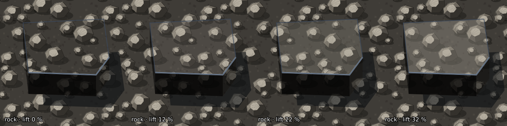
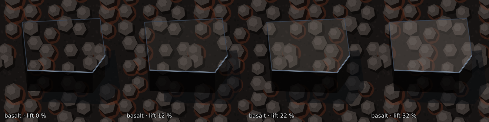

# Wall tops in the outside land's texture (#3808)

Study for the developer. Generated by `scripts/assets/3808-wall-top-study.mjs`
(`ESBUILD=<esbuild> node scripts/assets/3808-wall-top-study.mjs docs/art`, needs
inkscape): it runs the game's own `paintOutsideTile` into SVG, so the tile is
exactly `outside-land.ts`'s.

Each strip is the same wall (one layer, 56 high) at four lifts: 0, 12, 22, 32 %.
The lift is a wash of the kind's own pale tone (`OUTSIDE_LOOK.rock.rim`,
`OUTSIDE_LOOK.basalt.ash`) over the tile, drawn on the wall top only.

## What to build

|                     | Rock                                                                          | Basalt                    |
| ------------------- | ----------------------------------------------------------------------------- | ------------------------- |
| Top texture         | the `outside-rock` tile, from the world origin                                | the `outside-basalt` tile |
| Lift wash           | `0xb4ad9f` at **0.22**                                                        | `0x8c827a` at **0.32**    |
| Face                | flat `wallFace` as today (black 55 % over the land reads as the study's face) | same                      |
| Lip, stroke, shadow | unchanged                                                                     | unchanged                 |

- **Rock, 22 %.** At 0 % the top is the same value as the land and the island
  vanishes; at 12 % it is still weak; at 32 % the boulders grey out. 22 % keeps
  every boulder and makes the top the lightest plane.
- **Basalt, 32 %.** The land is near black, so the lift has to be higher to part
  the top from it; even so the lip is what names the top. Keep the lip
  `wallLit` at full strength on basalt maps. The ember glow in the tile's gaps
  is a hazard-looking orange: the wash dims it, which is wanted (an island must
  not read as a hot zone).
- **Wash order:** tile, then the wash, then the lip and stroke; the face and
  the shadow are drawn before the top, as today.
- **Fallbacks:** `forest` and `deep-water` use the rock tile and the rock lift.
- Reading size: at zoom 1 a boulder is about one body (30 units), so the top
  reads as rock and not as noise; no change to the tile is asked for.

Size: the two PNGs are about 430 KB together.
