# Art direction

How VibeWars looks, and why. Every asset follows this page; a change to the
look starts here, then in the generator, then in the code.

The brief fixes the language (§20): circles, rings, lines, polygons, progress
bars. No painted art. This page adds the rules the brief leaves open: which
colour means what, which shape means what, and how small things may get.

## The one rule

**A player must read a threat in a fraction of a second, at 16 px, colour
blind.** So every meaning is carried by a shape first and a colour second.
Colour alone never decides anything a player has to act on.

About 1 in 12 men are red-green colour blind. "Red is the enemy, green is my
team" is the one pairing they cannot see.

## Palette

The colours already in the client stay. Hex values are the source of truth;
the code and `scripts/assets/icons.mjs` copy them.

### Field

| Token         | Hex       | Use                              |
| ------------- | --------- | -------------------------------- |
| `bg`          | `#0e1116` | Arena floor, page background     |
| `grid`        | `#1a212c` | Arena grid                       |
| `panel`       | `#161b22` | HUD and menu panels, plate cuts  |
| `line`        | `#2b3440` | Hairlines, panel borders         |
| `wall-fill`   | `#202836` | Walls                            |
| `wall-stroke` | `#3b4759` | Wall edges                       |
| `ink`         | `#d7dee8` | Text, neutral icons              |
| `ink-dim`     | `#7d8899` | Secondary text                   |
| `dead`        | `#4a5464` | Corpses (hollow circle, no bars) |
| `edge`        | `#0b0f14` | Body outline, weapon-mark casing |

### Signals (arena)

| Token          | Hex       | Means                                    |
| -------------- | --------- | ---------------------------------------- |
| `target`       | `#ffd866` | Your current target (ring, nothing else) |
| `friend`       | `#59c2ff` | You and your team                        |
| `foe`          | `#ff7b72` | The other team                           |
| `heal`         | `#7ee787` | Health gained, arena health bar          |
| `damage`       | `#ff7b72` | Health lost                              |
| `condition`    | `#ffa657` | Condition markers                        |
| `poison`       | `#b4d62c` | Poison and disease bubbles on a body     |
| `hex`          | `#d2a8ff` | Hex markers                              |
| `enchantment`  | `#56d4dd` | Enchantment markers                      |
| `stance`       | `#f778ba` | Stance markers                           |
| `preparation`  | `#e3b341` | Preparation markers                      |
| `glyph`        | `#c3e88d` | Glyph markers                            |
| `weapon-spell` | `#8b9cff` | Weapon spell markers                     |
| `invulnerable` | `#f5e6b8` | A shrine-raised body's shimmer (#1233)   |
| `altar`        | `#c8a45a` | A Relic Run or King of the Hill altar    |

### HUD bars

The health and energy bars in the match HUD and the Training Ground carry
their numbers in `ink` text, centred over a fill that may be full or nearly
empty. The fill is therefore a dark shade of its signal colour, so the text
reads on the fill and on the empty track alike.

| Token                 | Hex       | Use                                         | `ink` on it |
| --------------------- | --------- | ------------------------------------------- | ----------- |
| `hud-health`          | `#3a6a3e` | Health bar fill                             | 4.7:1       |
| `hud-health-hex`      | `#7a3a7a` | Health bar fill under a health-draining hex | 5.7:1       |
| `hud-health-poison`   | `#66601e` | Health bar fill while poisoned or diseased  | 4.8:1       |
| `hud-health-bleeding` | `#8c4a42` | Health bar fill while bleeding              | 4.9:1       |
| `hud-energy`          | `#2f6787` | Energy bar fill                             | 4.6:1       |

A health bar, yours and the target frame's, takes the tint of the worst
degeneration on its combatant (#807), as GW1: a hex that drains health,
then poison or disease, then bleeding; never a blend. Burning, and a hex
that drains only energy, tint nothing. The deep-wound band is drawn over
any tint, and a corpse is never tinted. The tint is never the only signal:
the status icons and the pips say it too.

### Effects monitor

Your statuses in the match HUD (#834), after the bars, in the order they
were applied: oldest left, a refresh moves to the end. They wrap to a
second row, never `+N`, and with none the monitor takes no room.

| Part         | Look                                                                                                         |
| ------------ | ------------------------------------------------------------------------------------------------------------ |
| Icon         | The status SVG at 24 px, plate and glyph as in the arena                                                     |
| Duration bar | 3 px under the icon, as wide as it, `ink-dim` on `bg`, draining to empty; none for a status with no duration |
| Yours tick   | A 6 px `ink` square edged in `bg`, over the icon's top-right corner: an enchantment you cast                 |

No seconds on the icon, as GW1: the hover says the name, the category,
what it does, who it is from and the whole seconds left.

### HUD layout

The match HUD sits as GW1's does (#1042): what you look at in the fight
is at the screen's two centres, and the arena between them is clear.

```text
 now-playing        [ scoreboard: score · clock · enemies ]        controls
                    [ target frame, effects growing down   ]

                               (arena)                             party

 chat               [ hint / message                       ]
                    [ your effects, growing up             ]
                    [ morale · gear                        ]
                    [ health                               ]
                    [ energy                               ]
                    [ skill bar                            ]
```

Your bars are as wide as the skill bar. The party window (#1055) holds
the right edge, vertically centred.

### Target frame

The match HUD's target frame (#484) is three rows of fixed size, so the
HUD never jumps when a row has nothing to show, and one under them that
grows downward:

| Row     | Shows                                                                                                     |
| ------- | --------------------------------------------------------------------------------------------------------- |
| Header  | Profession icons, the name in `ink`, the "attacking" swords                                               |
| Health  | A `hud-health` bar labelled with the percentage, rounded down; `412 / 480` added for you and allies       |
| Cast    | While the target casts: the type badge, the skill's name, and a 6 px bar filling in `ink`, never blue     |
| Effects | The target's statuses as your effects monitor shows them, at 16 px with a 4 px tick; none, no room (#835) |

A foe shows the percentage alone, as GW1 shows a foe's bar alone. A dead
target has an empty track edged in `dead`. An interrupted cast keeps the
row for 400 ms with a `damage` ✕ and edge, a cancelled one dimmed, as the
skill slot does (#300). Armor is in the frame's hover title.

### Match summary

When a match ends (#1057), a table per team sits under the result banner:
yours on the left, or team 1 for a spectator. A queued match carries it
on to the queue screen, under the outcome line.

| Name | Damage | Healing | Taken | Kills | Deaths | Interrupts |
| ---- | -----: | ------: | ----: | ----: | -----: | ---------: |

- `panel` at 92 % under each table, edged in `line`; the caption and the
  column heads in `ink-dim`, the caption uppercase.
- Names left, numbers right in tabular figures, whole, no units. A long
  name is cut with an ellipsis at 9 rem.
- **Your row** has a 3 px `friend` border on its left edge; nothing else
  about it changes.
- **The best of each column**, across the whole match, is `ink` bold, every
  tie included. A column that is zero throughout has no best.
- **Zeros** are `ink-dim`, so the numbers that happened stand out.
- 0.75 rem monospace, both tables side by side: 8v8 fits at 1024 px wide
  with no scroll. It takes no clicks.

### Party window

Your team's health at a glance (#1055), on the right edge, vertically
centred: one row per member, you first, then your pet (#1110), then the
others in seat order. No other creature is listed; alone with no pet,
or spectating, there is no window. A long party starts under the
compass instead of centring (#1056). In the small Training stage it sits
top-left and compact, the side the dummies leave clear.

| Part    | Look                                                                                                                                                     |
| ------- | -------------------------------------------------------------------------------------------------------------------------------------------------------- |
| Panel   | 200 px wide, `panel` at 85 %, 1 px `line` border; its top never above the compass plus 8 px, scrolls past the bottom                                     |
| Row     | Profession icons, the name in `ink`, and under it a 12 px health bar                                                                                     |
| Health  | Built as yours: the same tint, deep-wound band and pips, labelled with the percentage, as the target frame                                               |
| Target  | Your target's row outlined 1 px `target` (`#ffd866`)                                                                                                     |
| Dead    | The name in `dead`, and the word "dead" where the bar was                                                                                                |
| Compact | Past 8 members, name and a 10 px bar on one line, labelled with the percentage alone, so 16 still fit                                                    |
| Pet     | Its row, then Guard, Fight and Heel buttons on one line, `ink` text outlined 1 px `line`; the lit mode inverted, `bg` on `ink`                           |
| Armed   | On the pet's row, right of its bar, the armed pet attack's 24 px icon (#1167), shaded `recharge-shade` clockwise from 12 as it lapses; its name on hover |

No energy, as GW1. A click on a row targets that member, yourself too.

### Professions (menus only)

Never used in the arena: there, colour means team.

| Profession   | Hex       | Silhouette               |
| ------------ | --------- | ------------------------ |
| Warrior      | `#e3b341` | Shield                   |
| Ranger       | `#8fd36b` | Arrow, pointing up-right |
| Monk         | `#9ecbff` | Plus                     |
| Necromancer  | `#3fb68b` | Downward triangle, eye   |
| Mesmer       | `#e87fd0` | Hourglass                |
| Elementalist | `#ff6e5a` | Diamond, quartered       |
| Assassin     | `#c0405e` | Crescent moon            |
| Ritualist    | `#a9e5e0` | Spirit urn               |
| Paragon      | `#f0883e` | Two rank chevrons        |
| Dervish      | `#c9a27e` | Three whirling blades    |

The ten silhouettes stay distinct with the colour removed. Ten hues on a dark
field cannot all be far apart (closest pair: elementalist and paragon, ΔE ≈ 26),
so the silhouette identifies the profession and the colour only supports it.

## Shapes

| Thing        | Shape                                                   |
| ------------ | ------------------------------------------------------- |
| Actor        | Filled circle in team colour                            |
| You          | Your team's circle plus an `ink` rim, 2 px inside       |
| Target       | `target` ring, 9 px outside the actor                   |
| Enchanted    | Solid `enchantment` ring, 2.5 px outside the actor      |
| Hexed        | Broken `hex` ring, 8 dashes, 5 px outside the actor     |
| Burning      | Three `condition` flames flickering on the top edge     |
| Bleeding     | `damage` drops falling from the bottom edge             |
| Poisoned     | Two hollow `poison` bubbles rising from its flanks      |
| Dead         | Hollow `dead` circle, no bars                           |
| Creature     | Team hexagon, kind glyph in `edge`                      |
| Cast         | Bar above the health bar, fills as the cast completes   |
| Condition    | Circle plate, glyph inside                              |
| Hex          | Diamond plate, glyph inside                             |
| Enchantment  | Rounded-square plate, glyph inside                      |
| Stance       | Pentagon plate, point up, glyph inside                  |
| Preparation  | Triangle plate, point up, glyph inside                  |
| Glyph        | Triangle plate, point down, glyph inside                |
| Shout        | `ink` hexagon plate, glyph inside                       |
| Chant        | `ink` banner plate, notched at the foot, glyph inside   |
| Echo         | The chant's banner, swallowtail foot: a chant answered  |
| Weapon spell | Shield plate, glyph inside                              |
| Skill effect | `ink-dim` wide capsule plate, glyph inside              |
| Item         | `ink` urn plate, glyph inside (#1434)                   |
| Area flash   | Caster's team colour ring at the area's true radius     |
| Ward         | Owner's team colour disc, faint, its skill's icon in it |
| Trap         | `friend` rim alone, its skill's icon in it; yours only  |
| Swing flash  | Attacker's team colour arc between it and its target    |
| Skill impact | Burst of 8 spikes (hurt) or a glow (helped), 0.3 s      |
| Projectile   | Weapon silhouette, tinted the shooter's team colour     |
| Weapon mark  | `ink` weapon held in the hands, one shape per weapon    |
| Walk marker  | `ink` cross of four ticks where you clicked the floor   |
| Called foe   | `condition` chevron pointing down, over its name        |
| Ping         | `friend` pin on the spot, a `friend` ring growing off   |

The status plates differ in outline as well as colour. Hex purple and
enchantment teal are close for a deuteranope (simulated ΔE ≈ 18); diamond
against square is not. The stance pentagon (pink, point up) differs from all
three by its outline; its pink sits next to `foe` red, but a plate is never
an actor, so the shape settles it.

| Stance status | Glyph                                          |
| ------------- | ---------------------------------------------- |
| `sprint`      | Two forward chevrons: move 25% faster          |
| `dash`        | Arrowhead trailing three lines: run 50% faster |

The preparation triangle (amber, point up) is the fifth outline. Its amber
sits near `target` yellow, but a plate is never a ring round an actor.

| Preparation status | Glyph                                        |
| ------------------ | -------------------------------------------- |
| `apply-poison`     | One drop: your attacks poison (Apply Poison) |

The glyph triangle (lime, point down) is the preparation's turned over:
one readies your attacks, the other your next spells. Its lime sits near
`heal` green, but a plate is never a bar.

| Glyph status             | Glyph                                     |
| ------------------------ | ----------------------------------------- |
| `glyph-of-lesser-energy` | A bolt: your next spells cost less energy |

The chant banner (`ink`, notched at the foot) is the shout's hexagon's
kin: both are the Paragon's voice, in `ink`, told apart by outline. The
weapon-spell shield (periwinkle) is the eighth outline; its periwinkle
sits near hex purple, but the shield against the diamond settles it.

| Chant or weapon spell status | Glyph                                         |
| ---------------------------- | --------------------------------------------- |
| `anthem-of-flame`            | A flame: your next attack skill burns         |
| `weapon-of-warding`          | A sword held up: warded until its bearer hits |

### Area flash

Where an area skill lands (#5), the scene flashes the area it hit:

- **Colour is the caster's team**: `friend` for your side's splash, `foe`
  for theirs. Never `target` yellow, which means "your target" and nothing
  else.
- **A 2 px ring at the area's true radius**, over a fill of the same colour
  at 12 % alpha. The ring shows exactly who could be hit. It does not grow or
  shrink, because an animated radius would misstate the area.
- **It fades from full to zero alpha over 0.4 s**, then is removed, so a
  Barrage volley never stacks into a solid disc.
- **It is drawn under the actors** and over the grid and walls, so it never
  hides a health bar, a status plate or a target ring.

It cannot be confused with the target ring. The target ring is yellow and
hugs one actor (9 px outside a radius of 14). The flash is team-coloured,
at least 40 units in radius, and gone in under half a second.

### Ward, well and pulse

A ward (#1087), a well (#1104, on the corpse it exploited) or a pulse
(#1113, as Symbol of Wrath or a sprung Flame Trap) lies on the ground for
as long as it lasts, all drawn the same:

- **Colour is its owner's team**, `friend` or `foe`, as the area flash's.
- **A fill at 15 % alpha and a 1.5 px rim at 60 %**, at its true radius:
  who stands inside it is who it reaches. It does not fade or pulse, and
  does not change as it nears its end.
- **Its skill's icon at the centre**, 22 units across at 55 % alpha.
- **It is drawn under the grid, the walls and every body**, so a ward
  never hides who stands in it.

A pulse flashes each time it lands: the area flash, at its radius, from
the pulse's log entry, so a symbol reads as striking once a second.

It cannot be confused with the area flash, which is gone in 0.4 s, or a
ping, which is a pin and a growing ring.

### Trap

A trap (#1105) is drawn as a ward is, with no fill: the rim alone, at
the radius its spring hits, with its skill's icon at the centre. Only
its own team ever sees one, so it is always `friend`. An open ring
reads as "waiting", a filled disc as "acting now".

### Swing flash

When a weapon attack lands or misses (#161), the scene flashes the swing:

- **A 2 px arc in the attacker's team colour**, 90° wide, centred on the
  direction from the attacker to its target, at the attacker's radius + 6.
  Drawn in code, not a sprite. Your own swing gets a 1 px `ink` line along
  its outer edge, as your circle gets its rim.
- **It fades from full to zero alpha over 120 ms**, so a dagger's rapid hits
  read as separate flashes, never as a standing ring.
- **It hugs the attacker, never the target.** The target ring hugs the
  target, is yellow, and does not fade, so the two cannot be confused.
- **Off under reduced motion.** The damage number still says what happened.

### Skill impact

When a skill lands (#1139), every body it touched flashes for 0.3 s, the
caster too when it gains (life steal's heal, a stance on yourself). Plain
attacks, misses, blocks and dodges flash nothing: the swing flash and the
number say those.

- **Two shapes, so it reads without colour.** A **burst** when the skill
  hurt or hindered that body: 8 spikes of 1.5 px at π/8 + kπ/4, from
  r + 1 + 2p out to r + 3 + 3p. A **glow** when it helped: a tint over
  the body at 35 % alpha, and a 1.5 px ring closing in from r + 6 to r + 2.
  p runs 0 to 1 over the 0.3 s; both fade from full alpha to zero. Harm
  beats help on one body.
- **Colour is the skill type's** where the palette has one (`hex`,
  `enchantment`, `stance`, `preparation`, `glyph`, `weapon-spell`).
  Otherwise what it did: a burst is `damage`, or `condition` if it only
  applied conditions; a glow is `heal`.
- **It stays inside r + 6**, clear of the target ring at r + 8 and the
  health bar, over the rings, weapon and bars, under the icons, names and
  numbers. A newer impact on a body replaces the older one.
- **Reduced motion: the frozen form**, held 0.3 s at full alpha, then
  removed. The burst's spikes at p = 0.5, the glow's ring at r + 4.

Geometry: `apps/web/src/render/body-impacts.ts`.

### Walk marker

Where you click the floor to walk (#310), the scene marks the spot:

- **Four short `ink` ticks in an ×**, at 45°, 135°, 225° and 315°. Each runs
  from 3 to 8 units out from the click point, and the centre stays open.
  Drawn in code, cased like the weapon mark: a 4 px `edge` casing first, then
  a 2 px `ink` core, butt ends.
- **It fades from full to zero alpha over 400 ms**, then is removed. A new
  click removes the old marker at once, so there is only ever one. It shows
  even when the walk is cut short or ends at the nearest reachable point.
- **It is drawn under the actors**, with the area flash, so it never hides a
  body, a bar or a plate.
- **Only you see it.** It is client-only, so it is `ink`, the colour of "you"
  (your rim, your weapon mark), never a team colour.
- **Reduced motion:** held at full alpha for 400 ms, then removed.

Why not a ring: every ring on the floor already means something. A
team-coloured ring that fades in 0.4 s is the area flash, a yellow ring is
your target, and a small ink ring beside a body is a focus. An × of ticks
is the only shape here that is a point, not a thing, and the open centre
shows exactly where you clicked.

### Calls and pings

A wheel click calls a foe for your team, or pings the point under it, on
the ground or on an ally (#443, #1055). Each has a shape nothing else in
the arena has, so none can be taken for the target ring, the off-hand
focus or the area flash.

- **The called foe** wears a chevron pointing down at it, its tip 4 px
  above the name label's top, so it clears the name at every zoom. The two arms are 6
  units wide and 6 tall, a 3 px `condition` core on a 5 px `edge` casing.
  `condition` because a call says "hurt this one", and orange is the
  colour of what hurts; it is over the body, where no plate ever sits. Your
  team sees it, you included; the other team never does. It goes when the
  foe dies or leaves, or your team calls another.
- **A ping** is a `friend` pin standing 14 units tall on the spot: a 2 px
  needle on a 4 px `edge` casing, and a 3.5-unit head with an `edge` rim.
  Round it, a 2 px `friend` ring grows from 6 to 26 units and fades out
  over the ping's 2.6 s. The area flash is a ring at the area's true
  radius, fading in 0.4 s, with nothing standing in it; a ping is small,
  slow, and has its pin. Under the actors, as the walk marker is. Reduced
  motion: the ring holds at 6 units, whole, until the ping goes.

### Compass

GW1's radar (#486), top right under the match buttons: a disc 160 px
across (120 px on a window under 1280 px wide), centred on you, north up,
showing everything within the arena's longer side, at most 1700 units
(`RANGE_COMPASS`), so a small arena fills the disc. It never rotates, as
the arena does not. A body beyond it is not on it: the edge markers
(#440) give direction, the compass gives distance.

- **Disc**: `panel` at 85 %, a 1 px `line` rim.
- **Rings**: two 1 px `ink-dim` circles round you, the earshot (350,
  solid) and cast range (420, dashed). Thin, dim and centred on you, so
  neither reads as the target ring or an area flash.
- **Walls**: 1 px `wall-stroke` outlines, clipped to the disc.
- **Bodies**: 3 px dots, `friend` or `foe`, on a 1 px `edge` rim; you at
  the centre with an `ink` rim, as in the arena, dead or not. A creature
  (#1052) is a 2 px dot, so it never reads as a player. Corpses are not
  shown.
- **Your target**: a 1 px `target` ring 2 px outside its dot.
- **The called foe**: a small `condition` chevron over its dot.
- **A Relic Run or King of the Hill altar** (#1388, #1377): a filled `altar`
  `◆`, 10 px tip to tip, on a 1 px `edge` rim, under the bodies. Not
  pinned to the rim when out of reach.
- **A Capture Points shrine** (#1407): a 12 px `□`, a 1.5 px stroke in
  its owner's colour, `friend` or `foe`, `ink-dim` while nobody holds it.
  Its capture progress is the arena's to show, not the compass's.
- **Pings**: a 1 px `friend` ring growing from 3 to 10 px and fading over
  the ping's life. Reduced motion: it holds at 3 px, whole.

Clicking it does nothing. Spectators have none.

### Damage and heal numbers

Above a body, the column is already full: the health bar at r + 8 … r + 12,
the cast bar at r + 15 … r + 19 with its type badge left of it at
r + 13 … r + 21 (#1125), the name with its bottom 3 px over that. A
number that starts on the bar and rises through the name hides both, and the
name it hides is your target's.

- **Numbers, names and the status `+N` keep their size on screen** at
  every zoom step and window size (#456), as GW1's do: 11 px, 13 px for a
  skill's number, 17 px for a critical hit. Their rise, their stacking and
  the gaps that place them are screen px too; the bodies, bars, icons and
  rings they sit by scale with the world. Zoomed out, a name is wider than
  the world between two bodies, so names overlap sooner: another reason
  only the target's and the hovered body's show.

- **They rise beside the body, not over it.** Left-aligned at x = r + 4 to
  the right of the centre, clear of the 34-px bar, with the first line's
  bottom at y = 8 below the centre.
- **They rise straight up, 24 px a second for 1.2 s**, so at full zoom a
  single number ends with its top at 34 above the centre, still under the name.
- **Numbers landing together stack a line apart, upward, at most four** (#54).
  A second line reaches the name's band late in its rise, so a burst may
  brush the name for a moment; a single hit, the common case, never does.
- **Every number wears a 3 px `edge` outline**, stroke under fill (in
  Phaser: `stroke: "#0b0f14", strokeThickness: 3`). In melee the attacker
  stands where the target's numbers rise, so they cross their body, bar and
  name. Plain, they are 1.0 to 1.9:1 there: a heal over a full health bar is
  the bar's own green and vanishes. On the outline they are 7.6:1 (damage)
  and 12.5:1 (heal), whatever lies under them. Weapon hits keep their 0.8
  alpha, outline included. `node scripts/assets/number-outline-study.mjs`
  draws the study below.

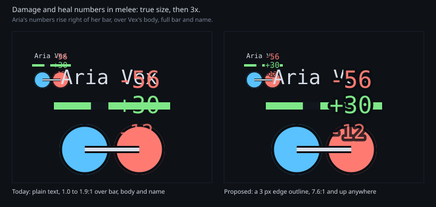

### Projectiles

Ranged weapon shots in flight (#161). Each is a sprite on a 32×12 grid,
pointing along +x, centred on the shot's position. The scene rotates it to
the heading and tints it to the shooter's team colour (`friend` or `foe`).
The sprites are white under a `bg` outline, so the tint gives the exact team
colour and the outline keeps them off the floor. A flying spell (#1176) is
white and light grey the same way: the grey part stays a darker tone of the
team colour, so a spell is told from another by its silhouette and a friend
from a foe by the tint. Element colour is not baked in: it would multiply
with the team tint and lose the team.

| Sprite          | Weapons                             | Silhouette                                 |
| --------------- | ----------------------------------- | ------------------------------------------ |
| `arrow`         | Bows                                | Thin shaft, triangular head, chevron tail  |
| `spear`         | Spear                               | Thicker shaft, long leaf blade, no tail    |
| `bolt`          | Wand, staff                         | Round orb with a tapering comet tail       |
| `fireball`      | Fireball                            | Round head, ragged flame tail              |
| `lightning-orb` | Lightning Orb                       | Round head, jagged sparks forking back     |
| `ice-shard`     | Shard Storm                         | Long faceted diamond, a pale top facet     |
| `water-trident` | Water Trident                       | Shaft, three parallel prongs on a crossbar |
| `ebon-hawk`     | Ebon Hawk                           | Hooked beak, wings swept back              |
| `stone`         | Stoning                             | Rough boulder, chips flying off behind     |
| `thrown-dagger` | Disrupting Dagger, Crippling Dagger | Grey hilt and crossguard, long white blade |

Drawn at 32×12 px, over the actors and under the HUD: a shot is
gameplay information, and the player has to see where it will land in time
to step aside. Projectiles stay on under reduced motion.

**How a shot ends.** When a shot leaves the state, its sprite does not pop
out. It holds at the end of its flight, its aim point, and fades from full
to zero alpha over 120 ms, as the swing flash does. A shot cut short by a
wall (#215) ends at the wall's face, so the arrow is seen to stop on the
stone; a dodged shot ends where its target was. Both are the same fade:
the damage number, or its absence, says which. Under reduced motion it is
removed at once.

### Player mark

The body is a circle at the collision radius, r = 14 (#166). Everything on
it is drawn in code. `node scripts/assets/player-mark.mjs` draws the
reference sheet [`player-mark.svg`](player-mark.svg) at true size and at 4×,
off-hands included.
The main menu draws its characters with the same code
(`render/body-painter.ts`, #1250): your own standing body, its primary
profession's glyph inside, holding what the character enters a match with.

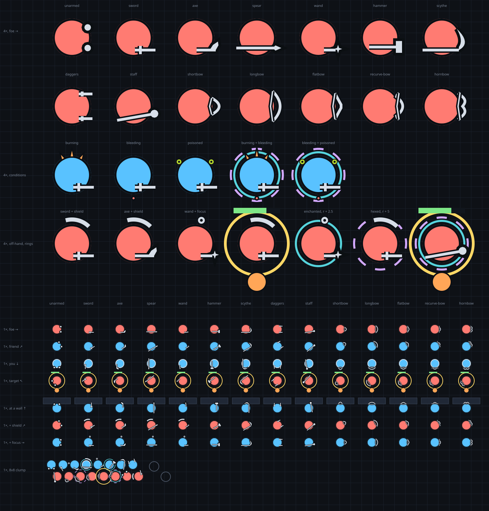

Outward from the centre:

| Ring       | Radius              | Style                                                 |
| ---------- | ------------------- | ----------------------------------------------------- |
| Body       | 0 … r               | Team colour fill                                      |
| Edge       | r − 1.5 … r         | 1.5 px `edge` `#0b0f14`, living only                  |
| Self rim   | r − 3 … r − 1       | 2 px `ink`, your own body only                        |
| Off-hand   | r … r + 7           | See below, living only, left side                     |
| Weapon     | centre … r + 7.5    | See below, living only                                |
| Enchant    | r + 1.75 … r + 3.25 | 1.5 px `enchantment`, while enchanted                 |
| Hex        | r + 4.25 … r + 5.75 | 1.5 px `hex`, 8 dashes, while hexed                   |
| Conditions | r − 1 … r + 6       | Flames top, drops bottom, bubbles at 10 and 2 o'clock |
| Target     | r + 8 … r + 10      | 2 px `target`, your target only                       |

**The target ring sits at r + 9** (operator, Q26), its 2 px stroke from
r + 8 to r + 10, so nothing on the body reaches it: the weapon mark stops at
r + 7.5 and the off-hand mark inside r + 7. It is still drawn last. Its top
passes under the health bar (r + 8 … r + 12 above the centre) and its bottom
under the first status plate (from r + 6 below), both drawn over it; the
sides, where you look for it, stay clear.

**The enchantment and hex rings** (#1117) say a living body is enchanted or
hexed, one ring per category however many: the status row says which. The
hex ring is broken into 8 dashes at 50% duty, one centred on 12 o'clock, as
the broken-ring hex badge; solid against broken still reads without the
colour. Both stay inside r + 6, clear of the target ring and the status row.
They are drawn on the body, under every mark, so the weapon and the off-hand
cross them. They are static, reduced motion or not; a knocked-down body keeps
them round its centre, and a corpse wears none.

**The invulnerable shimmer** (#1233) says a body a shrine raised takes
nothing for now (#1208): a solid `invulnerable` ring where the hex ring
goes, which it never meets, since a raise starts with no hex and refuses
every new one. Its alpha pulses between 0.35 and 1 every 0.8 s; under
reduced motion it holds at 1. It is gone the frame the window ends.

**The condition cues** (#1138) say a living body is burning, bleeding or
poisoned: three `condition` flames on its top edge, 3 wide, flickering
between r + 3 and r + 6 every 0.3 s; a `damage` drop falling from its
bottom edge to r + 6, one every 0.4 s, alternating sides; two hollow
`poison` bubbles rising 4 from its rim at 10 and 2 o'clock over 1.2 s,
growing as they rise, on a dark halo. Disease shows as poison. Shape
tells them apart without the colour: triangles up, dots down, hollow
circles. At most two per body, burning before bleeding before poisoned;
the third stays in the status row. Each body runs its own phase, from
its id, so a burning team does not flicker in step. They draw over the
rings and under every mark. Under reduced motion they are the same marks,
frozen: flames at 4.5, 6 and 4.5, one drop at r + 3, the bubbles
half-risen, all opaque. A corpse shows none; crippled, blind, weakness,
dazed, deep wound and cracked armor have no cue.

**The weapon mark** (#188, #418) is the weapon held in the hands: one
silhouette for each of the 14 weapons. The shapes are data in
`apps/web/src/render/weapon-mark-geometry.ts`, in the body's local frame
(+x is the facing, +y the right hand, r = 14); the renderer, this sheet
(`node scripts/assets/player-mark.mjs`) and later the icons all read that
one file. Every point stays within **r + 5.5** of the centre; the 4 px casing
then ends by r + 7.5, short of the target ring. Strokes are 4 px `edge` under
2 px `ink`; filled shapes get the same casing and an `ink` fill; a bow's
string is the only thin line, 3 px `edge` under 1 px `ink`. Ends are butt,
because Phaser Graphics strokes have no caps. `ink` alone vanishes over the
bright body (1.5:1 on `friend`, 1.9:1 on `foe`); the casing is 9.7:1 and 7.6:1.

Where it is held:

- **One-handed** (sword, axe, spear, wand): gripped on the **right** rim, about
  9 units right of the centre, pointing forward. The off-hand is on the left,
  so a loadout reads as left hand plus right hand.
- **Two-handed**: bows are held across the front with a string; daggers are a
  short blade in each hand; hammer, scythe, staff and spear are long hafts across the
  body. Spear, scythe and staff butts poke out behind the body, a length cue
  (operator Q52).
- **Unarmed**: two fists at the front rim, so a bare-handed player still shows
  a facing.

| Weapon      | Grip | Shape (local frame, world units)                                           |
| ----------- | ---- | -------------------------------------------------------------------------- |
| unarmed     | –    | two 12-gon discs, r 2.4, at (11.5, ±7.5)                                   |
| sword       | 1H   | blade (1, 9)→(16, 9); crossguard (5, 6)→(5, 12)                            |
| axe         | 1H   | haft (1, 9)→(15, 9); head turned inward, a five-point polygon to (17, 5.5) |
| spear       | 1H   | shaft (−15, 7.5)→(12.5, 7.5); leaf head to (17.9, 7.5)                     |
| wand        | 1H   | stick (4, 9)→(12.5, 9); four-point star, outer 3, at (14.3, 8.2)           |
| hammer      | 2H   | haft (−8, 6.8)→(11.5, 6.8); block head (11.5…16, 2.4…11)                   |
| scythe      | 2H   | haft (−14, 9)→(12.5, 9); crescent blade sweeping out to the left           |
| daggers     | 2H   | a blade (5, ±9)→(15, ±9) with a guard at x = 7.5, in each hand             |
| staff       | 2H   | diagonal pole (−12, 10.2)→(13.2, 5.8); orb r 2.9 at (15.2, 5.4)            |
| shortbow    | 2H   | limb x = 17.5 − 5.5·(y/6)², y ±6: the smallest span                        |
| longbow     | 2H   | limb x = 17 − 5.5·(y/11)², y ±11: the widest span                          |
| flatbow     | 2H   | straight limbs from (12, ±9.5) to a flat grip at x = 16.5                  |
| recurve-bow | 2H   | limb x = 16.5 − 4.5·(y/7)², tips flicking forward to (13.8, ±9.6)          |
| hornbow     | 2H   | two humps with a dip at the grip, tips at (13.4, ±10)                      |

The five bows differ by span and limb shape, which matches how their ranges
differ. The string runs from one limb tip to (tip.x − 1.5, 0) to the other.
The exact numbers are in the geometry file; the table is the summary.

Why not the first draft: the first mark was a line from the centre with a
small tip at r + 3. Six families covered 14 weapons, the tip lived in a
3-unit band, and the centre-line read as a facing arrow rather than a weapon
in a hand; unarmed drew nothing, so its facing was invisible. Before that, a
symmetric axe wedge and a dagger V at the line end read as an arrowhead and a
fletching, and tips running to r + 7 cut through the target ring.

In Phaser: one `beginPath`, the strokes and fill outlines as
`moveTo`/`lineTo`, one `strokePath` for the casing and one for the core, one
`fillPoints` per fill, plus one thin pass over the strings for bows.

**The off-hand mark** (#275) sits on the off-hand side, the left of the
facing (in screen coordinates, y down: facing angle − 90°), the side the axe
head already hangs on. It is cased like the weapon mark, `edge` under `ink`,
so it reads over the floor and over a neighbour's body: `ink` on `edge` is
14.2:1, and the casing is 9.7:1 on `friend` and 7.6:1 on `foe`.

| Off-hand | Geometry (world units, angles from the facing, toward the left)                                                                       |
| -------- | ------------------------------------------------------------------------------------------------------------------------------------- |
| shield   | arc on the body's centre, radius r + 3.5, from 45° to 105°; 5 px `edge` casing (r + 1 … r + 6) under a 3 px `ink` core; butt ends     |
| focus    | ring of radius 1.75, centred at r + 3.5 and 75°; 3 px `edge` casing under a 1.5 px `ink` core; r + 0.25 … r + 6.75, hole shows `edge` |
| none     | nothing: no off-hand equipped, or a two-handed weapon                                                                                 |

Why it reads, and what it is not:

- **Clear of the weapon.** One-handed weapons sit on the right, and the
  off-hand only exists with them, so the two never share a side. Rows 6 and 7
  of the sheet put every one-handed weapon beside each off-hand.
- **Shield and focus differ by shape and size**: a 60° band hugging the body
  against a 5 px ring just off it. At true size the focus reads as a
  bright dot, the shield as a bracket.
- **Not a second weapon.** Nothing runs from the centre, so two sticks
  never appear.
- **Not the swing flash**, which is a 2 px team-coloured arc at r + 6,
  centred on the facing, spanning ±45°, and fades in 120 ms. The shield is
  `ink`, standing, and begins where the flash ends.
- **Not a status, area flash or self rim.** Statuses are plates under the
  body; the area flash is a team-coloured ring at 40 units or more; the self
  rim is inside the body. The off-hand is `ink`, partial and outside.
- **Draw order**: body, edge, self rim, off-hand, weapon mark, target ring.
  In Phaser the shield is one `arc` path stroked twice, the focus one
  `strokeCircle` per colour: two calls per actor.

### Weapon motion

Every auto-attack plays on the held weapon mark (#536). The motion is a
_pose_ on the shipped geometry: it turns and moves the mark about a pivot,
scales one accent, flexes a bow. It adds no shape but a nocked arrow while a
bow is drawn. Poses and timings are data in
`apps/web/src/render/weapon-pose.ts`; `node scripts/assets/weapon-motion.mjs`
draws [`weapon-motion.svg`](weapon-motion.svg) from `weaponPose()` itself, so
the sheet cannot drift from the game. Each row is one weapon at 4×: rest,
half wind, full wind, half strike, hit, early and late recovery.

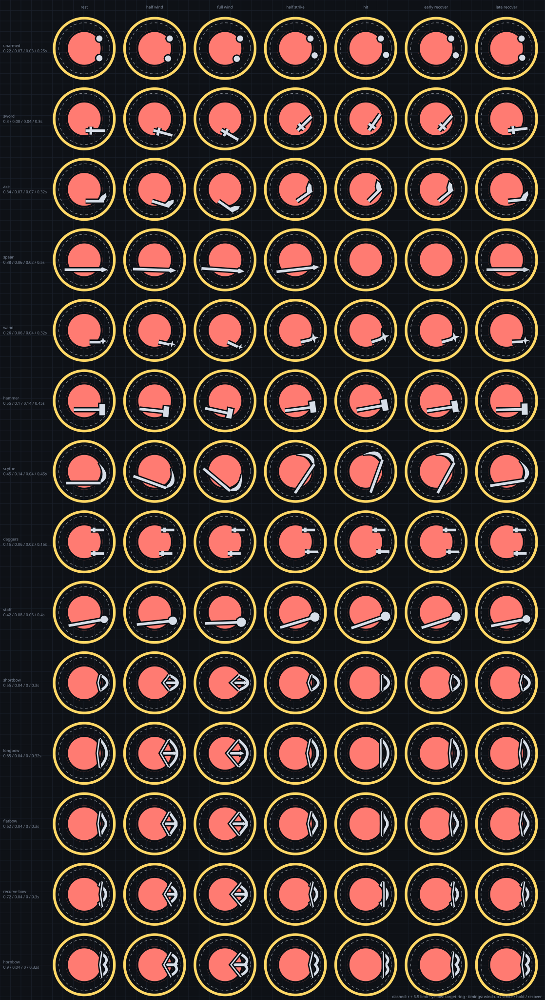

- **Four phases.** Wind-up (the weapon cocks back, `easeInOut`), strike
  (`easeOutCubic`, so it arrives fast and stops on the hit), hold (a beat on
  impact, for the axe and hammer) and recovery (`easeInOut` back to rest).
  Their sum fits inside the attack interval, so two swings never overlap and
  the mark rests between them.
- **The strike ends exactly on the hit** for melee and on the release for
  ranged weapons: the pose at the hit is the sheet's "hit" column. The
  pose follows the host's swing timer (#560), so the first swing winds up
  too, and one cut short eases back to rest. An attack skill winds up over
  its whole activation instead, on the host's cast timer (#562): rest at
  the cast's start, the strike's start at its end. A bow's release is the
  end of the activation, not the arrow appearing.
- **The wind-up is a tell.** A defender should read it: the hammer's 0.55 s
  lift and the longbow's 0.85 s draw are slow on purpose (operator,
  2026-10-25). A quick weapon (daggers 0.16 s, unarmed 0.22 s) gives
  almost none.
- **Never past r + 5.5.** The dashed circle on the sheet is the limit; the
  4 px casing then ends by r + 7.5, short of the target ring (yellow), as
  for the static mark. A pose that crosses it is a bug in `weapon-pose.ts`.
- **The swing flash stays.** The arc at r + 6 still marks the hit for
  everyone; the weapon motion adds to it, it does not replace it.
- **Fists and daggers alternate hands.** A double strike (#561) stabs
  with both: the off hand lands 90 ms after the main hand, and the next
  swing is the main hand's again. The host says which swings struck twice
  only on the hit, so the off hand's wind-up and strike fit in those 90 ms.
  A thrown spear is gone from release until halfway through recovery, then
  slides back in and fades.
- **Reduced motion.** Every mark stays at rest, as the swing flash does:
  the damage number reports the hit, so the motion is decoration.

### Profession in the arena

Decided (Q25, Q29, Q32): placement **A**. The primary glyph shows at 11 px
in `ink` before the name, and hides with it. The target panel shows the
primary and the secondary in their profession colours (#281).

**Profession icons have no painted cuts.** The scene draws them with a tint
fill, which paints every opaque pixel `ink`. So the necromancer's eye and
the elementalist's split are transparent holes (fill-rule evenodd), not
`panel`-coloured shapes on top. A painted cut would vanish and leave a plain
triangle and a plain diamond. Every other icon family keeps its plates and
plate-coloured cuts, because they are never tinted.

The study that chose A, `node
scripts/assets/profession-badge-study.mjs` draws three placements of the
existing profession glyphs, all in `ink`, because in the arena colour means
team:

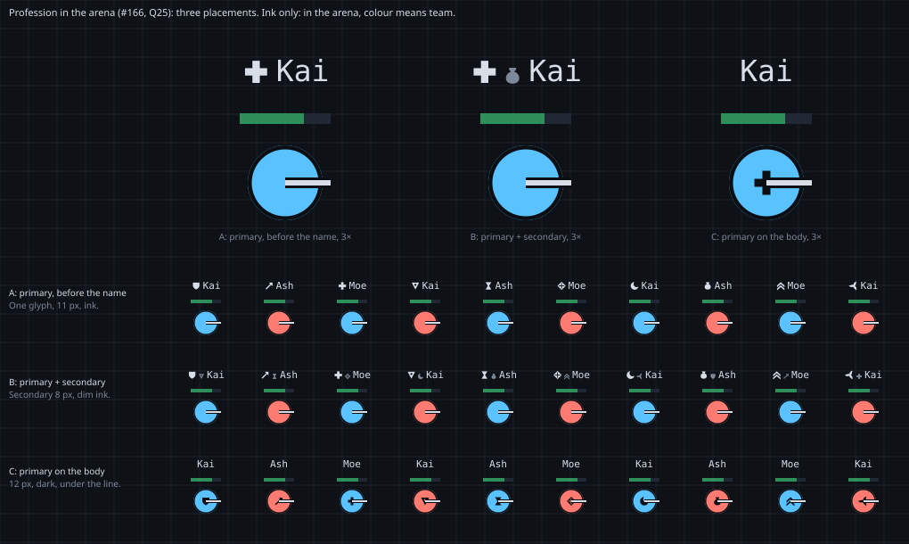

- **A: the primary, 11 px, before the name.** All ten read at true size.
- **B: A, plus the secondary at 8 px in dim ink.** The secondary is mush at
  that size; at 11 px the name plate doubles in width over a 34 px bar.
- **C: the primary on the body.** At full ink under the weapon mark (#188),
  the line runs across a plate as loud as itself, so neither reads. That was
  true of a full-ink plate; B of the body study below fixes it.

It recommended A, with the pair in the target panel, where there is room
and the profession colours are allowed.

#### The glyph inside the body

Decided (Q104, Q105): option **B** of the body study. Players on the map
were hard to tell apart with the glyph only before a name that hides, so
every body also shows its primary profession's glyph inside its circle
(#1037):

- **13 world units** square, centred on the body (radius 14), **upright**: it
  never turns with facing. World sized, so it scales with the body at every
  zoom.
- Painted in `edge` at **60 %**: a dark mark on the team colour, never the
  profession colour. The self rim stays over it.
- **Under** the off-hand and weapon marks. The scene draws in layers, bottom
  up: bodies, body glyphs, every mark on a body (off-hand, weapon, target
  ring, call chevron, bars), then shots, status icons, names
  and numbers. So in a clump a neighbour's weapon crosses your body: the
  weapon is the more urgent read.
- **A corpse**: the glyph in `dead` at full opacity, same size, inside the
  hollow circle, so you can tell whom to resurrect or exploit.
- **Knocked down**: centred, upright, scaled by the lying width (0.55, about
  7 units), so it stays inside the flattened disc.
- No profession: no glyph, as the name plate does.

B works where C did not because the glyph is a 60 % shadow under the
weapon, not a full-ink plate beside it: the weapon line keeps its contrast
across it, and the glyph still reads round it.

`node scripts/assets/profession-body-study.mjs` draws the three options at
the four camera zooms: A, 9 units in full `edge`; B, 13 units at 60 %; C,
a fixed 11 screen px, which crosses every weapon at Wide.

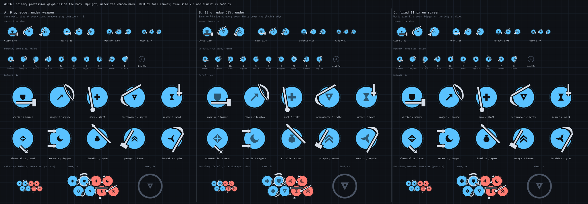

### Guild cape (decided: A of the motion study)

GW1 guilds wear a cape (#481, #1410). A body is a team-coloured disc seen
from above, so the cape goes **behind it, opposite its facing**: the weapon
and the off-hand are in front and to the left, and the team colour is the
disc, which no variant covers more than a sliver of. The cape is two colours
from a fixed palette of eight (gold, violet, white, black, lime, orange, teal,
pink: none near cyan-blue or coral) and one emblem of eight geometric shapes
(disc, bar, chevron, diamond, triangle, cross, ring, half-disc).
`node scripts/assets/cape-study.mjs` draws all three on ally and enemy
bodies, facing right and up, in a clump, as the menu figure, and in the designer:

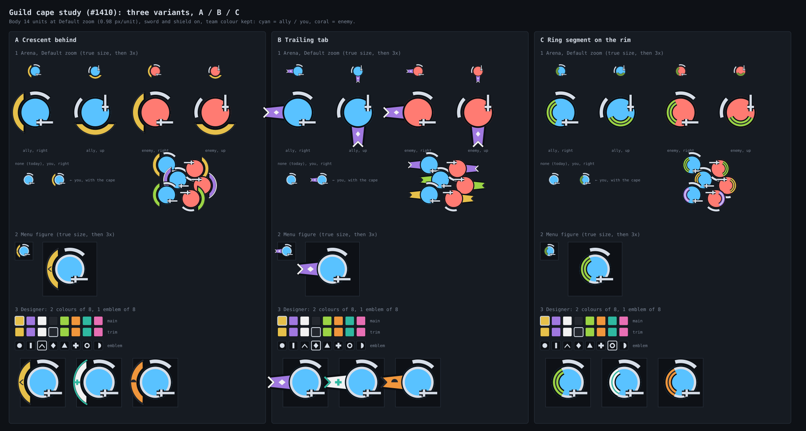

The same three in a 4v4 mid-fight frame at 2x zoom, with the menu figure (made by the same script):

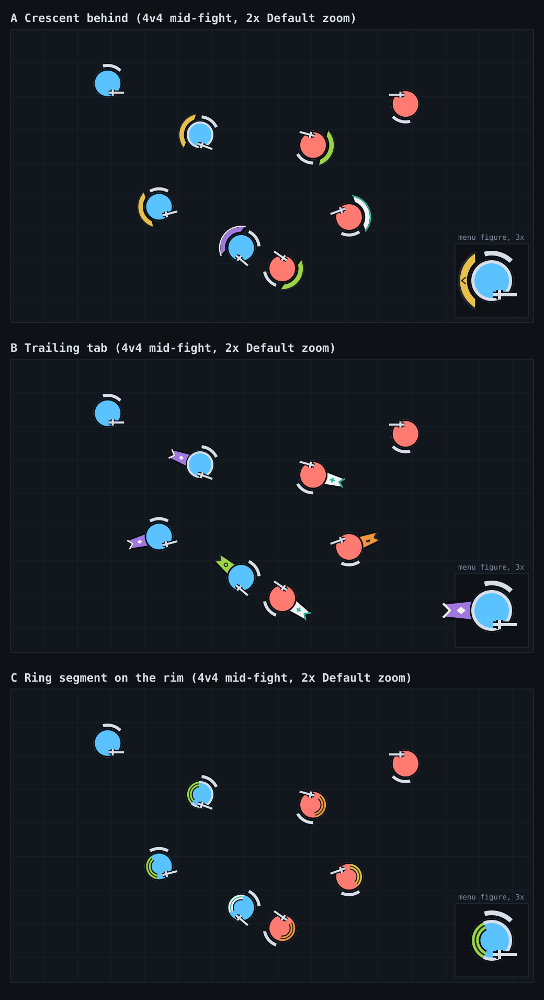

- **A, a crescent behind.** One `fill` path (two arcs) plus one trim stroke,
  drawn before the disc: 3 Painter calls, and `paintStandingBody` gets a
  `cape` drawn first. It hugs the disc 7 units out, so it widens the body's
  silhouette by half its radius at the back and reads as "someone has a cape"
  at Default zoom; the trim reads, the emblem (5 units, 5 px) does not, so it
  is shown only on the menu figure. In a clump it hides behind neighbours
  cleanly. The figure box needs 8 px more room.
- **B, a trailing tab.** One polygon, one trim polyline, an emblem: 4 calls.
  The strongest read of facing as well (the tab points opposite the sword),
  and the emblem is a diamond-sized 5 px at Default, legible. But it is 17
  units long, longer than any other mark: in a clump tabs cross neighbours'
  bodies and can be taken for a projectile or a skill cue. Needs the most
  figure room (17 px).
- **C, a ring segment on the rim.** Three arc strokes inside the disc, drawn
  after it: 3 calls, no extra silhouette, no room needed. But it eats the
  disc's team colour at the back and sits next to the off-hand arc, and at
  Default it is a 4 px green smear: team colour is hurt, no emblem fits.
- **Decided: B** (the operator's pick, #1410; implementation was #1422),
  since replaced by A of the motion study below (#1699). The tab's clump
  noise is accepted for the clearest guild read. My own
  recommendation was A: It adds a clear guild signal on the one side no
  mark uses, costs no more than the existing marks, never touches the
  disc, and keeps team colour the strongest read. Show the emblem only in the
  menu, the designer and the roster. B is the pick if the operator wants the
  cape to read at a glance and accepts the clump noise.

#### Guild cape in motion (decided: A, the rim band that peels into a tab)

The operator asked for a cape that is nearly invisible when its wearer
stands still, unfolds when it walks, trails opposite the movement (not the
facing) and lags a turn. `node scripts/assets/cape-motion-study.mjs` steps the
physics in JS and writes the clip as SMIL keyframes, so it plays when the SVG
is opened in a browser or on GitHub (SMIL plays inside an image too).
All three share the model the game would run per body, in the
client, from snapshot velocity: a smoothed trail direction (opposite the
movement), an unfold amount `u` that is itself lagged (so one step never
unfolds it), and a chain of nodes each pulled to a point on the trail line by
a damped spring, softer towards the free end. Folded, the cloth hides under the
disc and only a thin border arc stays on the rim: the team colour is never
covered and the cape's side is still told. Each clip shows standing, walking
right, turning and walking up, stopping, one step, a strafe (facing right,
moving down: the cape follows the movement, not the facing) and two bodies
walking past each other, plus a standing, a knocked down and a dead body.


- **A, a rim band that peels into a tab.** One node. Draws the border arc (2
  calls), the tab polygon, its trim and the emblem: 5 Painter calls; 7 floats of
  state per body. At full unfold it is the widest of the three (about 20
  units across at the root), and passing a neighbour it hides most of the
  other body's rim.
- **B, one cloth panel on a two-segment chain.** The decided tab, now
  moving. Border arc (2), panel polygon, trim, emblem: 5 calls; 11 floats per
  body. 17 units long at full unfold, as today, so nothing grows. The
  panel bends round a turn and swings out behind a strafe; the emblem rides
  the first segment and stays readable.
- **C, a pair of streamers.** Two three-node ribbons. Border arc (2), two
  ribbons, two trims: 6 calls; 26 floats per body. The thinnest and the
  least in the way (a pass-by hides almost nothing) but it reads as hair
  or tentacles at Default zoom, has no room for the emblem, and the strands
  tangle visually in a clump.

Knocked down: speed is zero, so it settles to the border. Dead: no cape.
One step: `u` is lagged, so a 0.2 s step does not fully unfold: no flicker. At Default zoom a body is 28 px across and the cape at most 17 px
past its rim; the border arc is 1.5 px.

**Decided: A** (the operator's pick, #1686; implementation is #1699,
`apps/web/src/render/cape-motion.ts`). The arena steps one cape per caped
living body every frame from its drawn movement; the menu figure stands, so
its cape is folded. The study's springs are tuned for its clip, a body that
runs at 40 units/s and takes 0.09 s to reach it; a game body runs at 180 and
starts at once, so the cape sees the game's velocity scaled to the clip's
and lagged as its body was, and a running body looks exactly like the clip.
A jump of more than 3 radii in a frame (a shadow step, a respawn) starts the
cape over, folded. A 0.2 s step peaks at `u` 0.61 in the study's own
numbers, short of a walk's full unfold.

My recommendation was B. It is the shape the operator already picked, so the
guild read and the emblem carry over, it moves with the most readable lag,
and its length is unchanged so the clump noise #1410 accepted does not
grow. A is the fallback if a bolder silhouette is wanted; C is the one to pick
if neighbours being covered is the worry above all.

### Name labels (study, not decided)

Every body carries its name, 11 px and centred, so two bodies a name's
width apart already collide, and a team fight smears names over the bars.
Issue #253 proposes names only on your target and the body under the cursor,
with Alt showing them all. `node scripts/assets/name-label-study.mjs` draws
the same 8v8 clump both ways:

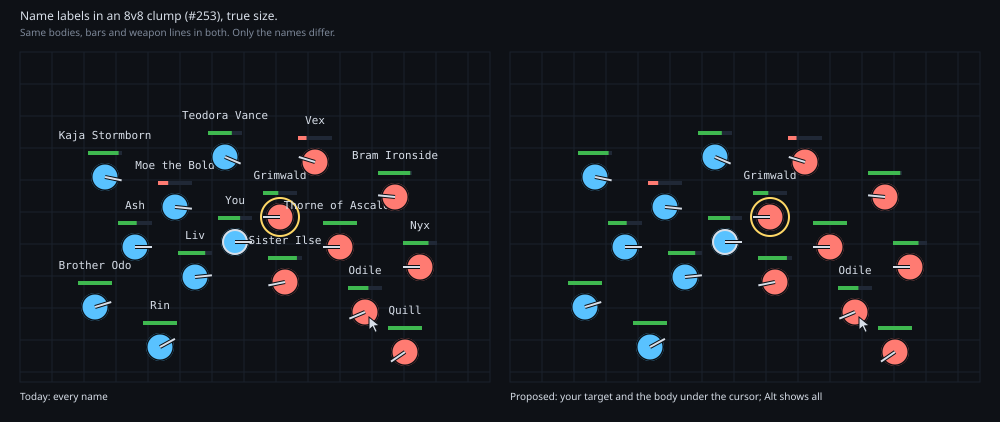

### Weapon and off-hand icons

The pickers and the target frame (#419) show a weapon or off-hand as its arena
mark, turned to point up and fitted to the 24 grid, so what you pick is what
you spot in the fight. Drawn from the same geometry as the arena
(`weapon-mark-geometry.ts`): a 2-unit `ink` core (2.3 px at 28 px) in a
3.6-unit `edge` casing, bow strings in the thin 1-unit weight, filled heads
cased thinner. No body disc. Unarmed is the two fists. The shield is its arc
and the focus its ring, scaled up (the ring in the same weight, or its hole
closes). Ink, never team colour: an icon in a menu names a thing, not a side.

### Skill type badges

The corner badge on a skill slot. Ink on the slot, except the two that leave a
marker on someone, which carry that marker's colour. A stance marks you, so
it carries the stance colour too, a preparation its amber, a glyph its
lime and a weapon spell its periwinkle.

| Type           | Badge                                     |
| -------------- | ----------------------------------------- |
| Attack         | Blade                                     |
| Spell          | Four-point star                           |
| Enchantment    | Solid teal ring                           |
| Hex            | Broken purple ring                        |
| Stance         | Pink pentagon ring                        |
| Preparation    | Amber triangle ring                       |
| Glyph          | Lime triangle ring, down                  |
| Weapon Spell   | Periwinkle shield ring                    |
| Signet         | Ring with a seal on top                   |
| Shout          | Mouth and two sound waves                 |
| Chant          | A note                                    |
| Nature Ritual  | A sprout                                  |
| Binding Ritual | An urn on a base line                     |
| Ward           | A ring on the ground, a post at its heart |
| Skill          | Square                                    |

**On the cast bar** (#1125). While a body casts, the same badge stands just
left of its arena cast bar, so you can tell a hex from a spell before you read
the name: 8 world units square, 1 unit clear of the bar, centred on it, so it
spans r + 13 … r + 21 above the body, clear of the health bar. It scales with
the bar under zoom, is drawn over the marks and under names and numbers (a
long name may cover its top edge), and goes with the bar. A skill the client
does not know has no badge. Static: reduced motion changes nothing.

### Skill icons

One icon per implemented skill (#719), on the 24 grid, in
`apps/web/public/icons/skill/<skill-id>.svg`. The approved study is
`skill-icon-study.svg` (`scripts/assets/skill-icon-study.mjs`).

An icon is a **profession plate**, **one glyph** and an optional **modifier**.
The type badge (the table above) and the elite frame are drawn by the UI around
it, not baked in, so one file serves every screen.

| Layer    | Carries         | Rule                                                                       |
| -------- | --------------- | -------------------------------------------------------------------------- |
| Plate    | Profession      | Rounded square, the profession colour at 30% over `plate`, a 1 unit rim    |
|          |                 | in full, its silhouette as a 20% watermark                                 |
| Glyph    | Primary effect  | One shape from the table below, `ink` with a `bg` casing, in the box 3..21 |
| Modifier | How it bends it | Bottom right, on a dark disc, `ink`: up, down, less, area, clock, stun,    |
|          |                 | bleed, self, bolt, half, plus, corpse (every corpse skill),                |
|          |                 | take (what another has)                                                    |

- **Shape first.** Glyph and modifier are `ink` only; the plate's hue is
  decoration, so every icon reads with the colour taken out.
- **Every skill is its own picture.** A row in `scripts/assets/skill-icons/<profession>/`
  names a skill's glyph and modifier, and a test fails if two rows match. Start
  from the glyph for the skill's primary effect; the modifier tells apart the
  ones that share it (heal, energy and armor repeat).
- **The glyph leaves the plate showing** and keeps clear of the bottom right
  corner, which the modifier owns.
- **Sizes.** 48 px on the combat bar and in the build editor, 24 px in library
  rows, 20 px inline, 16 px the floor.
- **Unknown skill id.** A bare plate with no glyph (`unknown.svg`).
- **Glyph vocabulary** (grows by effect, not by skill): the `means` lines of
  `scripts/assets/glyphs/`, which `node scripts/assets/icons.mjs --vocabulary`
  prints. A new primary effect adds a glyph; a new skill adds a row.

### Skill slot states

A skill slot says what its cast is doing (#300). Every state is one 2 px ring
_inset_ in the slot, so it is never confused with the ready flash's outer ring
and the layout never moves. It sits above the recharge wipe and under the
hotkey.

| State          | Ring              | Content                   | Glyph        | Time                  |
| -------------- | ----------------- | ------------------------- | ------------ | --------------------- |
| `casting`      | `ink`, pulsing    | as is                     | none         | while it casts        |
| `interrupted`  | `damage`, steady  | 0.6 alpha                 | `damage` `✕` | 400 ms                |
| `cancelled`    | `ink-dim`, steady | 0.6 alpha                 | none         | 400 ms                |
| `cast fill`    | as `casting`      | `ink` 18% from the bottom | none         | while it casts        |
| `out of range` | none              | as is                     | `ink` `↔`    | while it cannot reach |

- **Casting** pulses its opacity from 0.65 to 1 over 700 ms. Under reduced
  motion the ring is steady.
- **Both failures dim the slot**, because the cast did not go off. They
  differ by ring colour _and_ by the glyph, so an interrupt reads without
  colour (#75). Never the recharge shade: a cancelled skill does not
  recharge.
- **Casting fills the slot** (#485): `ink` at 18% alpha rises from the bottom
  as the cast goes, under the ring and over nothing else, and goes the frame
  the cast does. It is not the recharge wipe, which is a dark clock sweep.
  It moves under reduced motion too: it is information, not decoration.
- **Out of range** (#485): with a target selected, a slot whose skill cannot
  reach it (too far, or a wall in the way) shows a `↔` in `ink` after its cost,
  which stays as it is: a struck cost would read as unaffordable. In the
  Training Ground row, which shows no cost, the `↔` follows the name. A shape, never only a colour, and a hint, not a gate:
  it combines with the unaffordable dimming.
- **The `✕` must win at a glance.** On the HUD it is about half the slot's
  height (1.9rem), centred over the name and cased in `bg`. In the Training
  Ground row it sits at the right end, at row height.
- **An echo's copy** (#1154): a slot an echo filled carries a 3 px
  `enchantment` strip along its bottom edge, over the recharge wipe and
  clear of its number, under the hotkey and the `↔`, draining from full
  to empty over the copy's 20 s; the tooltip adds "Echoed: 12 s left".
  Under reduced motion it steps once a second.

### Elite frame

An elite skill (#459) wears a **doubled** frame in `elite` `#d4a72c`, 3 px
(`border: double`), wherever a skill is drawn: HUD slot, Training Ground
row, build-editor slot, library box and tooltip. Doubled rather than only
gold, so it reads in greyscale (#78). It is the slot's border, so the
state rings above sit inside it; a negative margin keeps the slot's size.
Gold is `elite` only, not `target` (`#ffd866`), which stays in the arena.

### UI controls

Buttons and indicators in the HUD and menus. Ink on the panel. The states of one control
differ by shape, so the icon shows the current state at a glance.

| Icon        | Means                  | Shape                          |
| ----------- | ---------------------- | ------------------------------ |
| `sound-on`  | Sound is on            | Speaker, two waves             |
| `sound-off` | Sound is muted         | Speaker, a cross               |
| `music-on`  | Music is on            | Beamed eighth notes            |
| `music-off` | Music is muted         | The notes under a slash        |
| `attacking` | You are auto-attacking | Two crossed swords, guards low |

`attacking` has two blades, so at 16 px it never reads as the one-sword
`attack` skill type badge.

In the menu's character list the random starter character carries a
RANDOM tag in ink, the shape of the red INVALID tag, and a dashed row
outline, so it differs from your own characters by shape, not only colour.

UI text is sentence case: "Edit team", "New character", "Save". A small
uppercase field label is styled so by CSS; the words themselves stay sentence case.

### Title bar study (#1251)

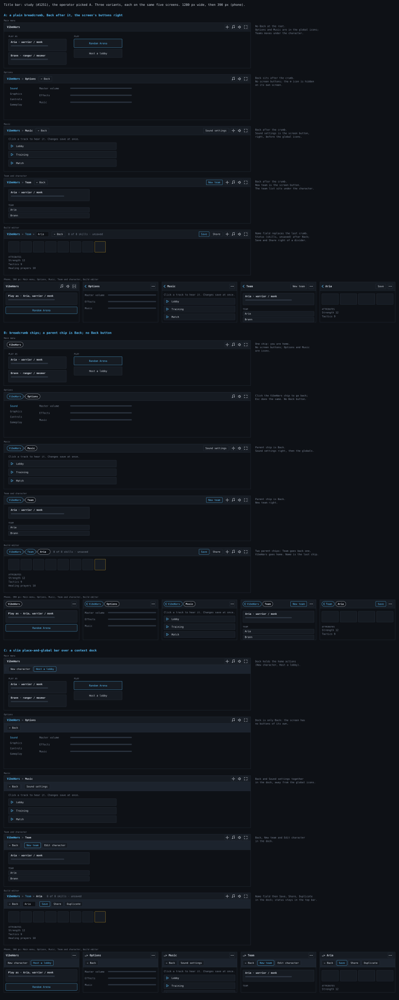

**Decided: A, the plain breadcrumb** (the operator's pick, #1251), and built
(#1272): `screenBar` fills the top bar, and no screen has a header of its own.
B and C stay on the sheet as the road not taken. The operator likes the top bar
and dislikes the header on every other menu screen, so the study moves each
screen's title and controls into the bar as a breadcrumb. The Team list
moves under the character on the main menu. Each variant is drawn on the same
five screens (main menu, Options, Music, Team and character, build editor) at
1280 px and 390 px; `node scripts/assets/titlebar-study.mjs` regenerates the
sheet.

- **A: plain breadcrumb.** `VibeWars > Options`, then a Back button, the
  screen's own buttons right of a divider, the global icons (Options, music,
  mute, fullscreen) at the far right; a screen's own icon is hidden on itself.
  Cost: the smallest. Every `screenBar` header goes, the top bar gains a slot
  per screen. Phone: a back chevron and the place name, the primary action
  and a ⋯ overflow.
- **B: chips.** Each crumb is a chip; a parent chip is Back and Esc does the
  same, so there is no Back button and the editor's name field is its last
  chip. Cost: the same as A plus a chip component; Back is less discoverable.
  Phone: the parent chip (with its chevron) and the place chip.
- **C: context dock.** A slim bar holds the breadcrumb and global icons; a dock
  right under it holds Back and the screen's actions, grouped. Cost: the
  tallest (two rows, about 80 px), but the screen's buttons are never mixed with
  the global ones. Phone: the dock scrolls sideways, with a fade at its edge.

### Solo and Team Play (#1449; decided: B, the card table)

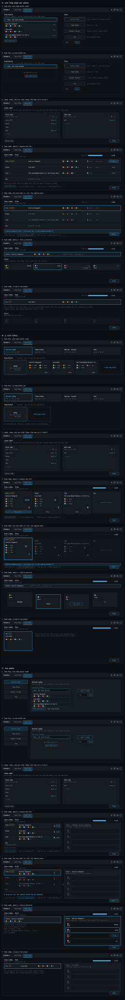

**Decided: B** (the operator's pick, #1449; implementation #1453, #1460, and
the host logic and wire in #1458 with ADR-0040). A and C stay on the sheet as
the road not taken. Supersedes the Teams study (#1439). The title bar reads
`VibeWars | [Solo Play] [Team Play]` in all three, the active one filled and
underlined; `[Teams]` and `[Music]` are gone and the ♪ icon stays. Solo Play is
today's main screen. Team Play replaces the character roster with a **Team
Build** pick: optional, "None, the team decides" is the default row. A Team
Build has its own characters (name, profession) and is made in the team builder;
it has nothing to do with the Solo roster. The lobby (frame 3) is the same in
all three because the design fixes it: players pick a side, the host sets a bot
count per side, everyone Ready opens the Team Lobby. Every variant shows seven
frames: Team Play with and without Team Builds, the lobby, the vote, a
three-way tie broken by the captain, the slot claim, and a side of one player.
`node scripts/assets/team-play-study.mjs` regenerates the sheet.

- **A: one long page per phase.** Team Play is the Team Build list on the left
  (None first, Edit on each row, "New team build") and the four modes as big
  buttons on the right. The Team Lobby is a table: one row per player with
  proposal, characters, votes, a Vote button; the rules sit in a legend under
  it. Phase 2 swaps the table for a one-line summary of the winner and a row
  of slot cards. Cost: the least new UI (rows, buttons, existing list
  components), but each phase is a different page and the tally is easy to
  read yet gives no sense of a table.
- **B: a card table.** Team Play is four mode tiles across the top and Team
  Build cards below, with "None" as the first, dashed card. In the Team Lobby
  each proposal is a card with its characters and the voters' initials as
  tokens; you click a card to vote, the tie winner is lifted and the rest fade.
  Phase 2 turns the winner into four seats to sit in. Cost: a card component
  and a seat component, the most new styling; the clearest "who is for what".
- **C: two panes.** Team Play lists the modes on the left; the pane on the right
  holds the Team Build picker (a dropdown, "Edit team builds…" and "New team
  build" in it) and Host or Join. The Team Lobby keeps proposals left and the
  slots right on one screen: the slots are a locked preview of the leading
  proposal during the vote, then unlock when it ends. Cost: one screen for
  both phases, so no page change for the wire state, but the two panes narrow
  every row to 600 px, so long Team Build names are cut early.

Edge cases drawn: no Team Builds saved, a long Team Build name (cut with an
ellipsis), a player who proposes nothing (Dax), a side of one player (Red: Eli
and three bots), who needs no vote. Every proposal is exactly the side's size
(four), so Blue's four players fill four seats and draw no bot. Two rules
the study had to guess were settled in #1458 (ADR-0040), and the frames
follow it: a side with no proposals plays the house team (starter
builds); and a human who has not
claimed a slot when the clock ends gets the lowest free one, so only slots no
human is left to take become bots.

### Game modes (#1522; C picked)

`scripts/assets/game-modes-study.mjs` draws `docs/art/game-modes-study.svg`:
three variants at 1280 px, desktop only. It supersedes the Solo and Team Play
tab split. Each variant shows the title bar in three states (your own code with
Copy; a friend's code being typed with Join lit; a guest in a friend's lobby
with the way back), the five mode icons (Random Arena, Team Arena, Heroes'
Ascent, GvG, Hosted Game) at 24 and 32 px, Random Arena with and without a
character, Team Arena alone and with three friends joined, and Hosted Game.
Team Arena stands for Heroes' Ascent and GvG: only the side size and the goal
line change. The icons are placeholder art; the picked set is finished on the
implementation card. The cost of "every player always hosts a lobby" (`main.ts`,
`net/session.ts`) is the same in all three and needs an ADR.

- **A: icons and code on one row.** The operator's sketch: one 44 px bar. Only
  the host picks the mode; a guest's icons dim. Joining closes your own lobby
  and your friends fall back to theirs. The Team Builder is a side pane. Code:
  the cheapest bar (a row of five buttons and a code field), a Team Lobby plus
  Builder screen with two columns, and the lobby-closes rule is the simplest
  session change.
- **B: labelled icons, the code at the right.** A 66 px bar with a name under
  each icon, so no hover is needed. Anyone in the lobby picks the mode, the
  last click wins. Joining leaves your lobby open and ownerless. The Team
  Builder is a tab. Code: a taller bar, a tab strip, a "who switched the mode"
  message, and the hardest session change: a lobby that outlives its host's
  absence.
- **C: a mode rail on the left.** The bar holds only the name and the code;
  the rail holds the modes, solid icons at 32 px. Only the host picks. Joining
  takes your whole party along. The Team Builder sits below the Team Lobby.
  Code: a new rail layout that narrows every screen by 76 px, and a party
  that moves as one, which is a new message on the wire.

The operator picked **C** (2026-10-30), with Character Builder and Team
Builder at the rail's bottom, below a divider. Card 1 of the split (#1525)
builds the rail, a screen per entry and the title bar's Lobby Key and Join;
the rail's icons live in `apps/web/public/icons/mode/`, drawn by the
`mode` family of `scripts/assets/icons.mjs` (#1554).

### Mode icons (#1554)

Solid ink shapes, one drawing each, even-odd holes (the rail masks them, so
only the shape counts, never a colour). Each differs in silhouette: a player
tells Team Arena from GvG without the label.

| File            | Entry          | Drawing                                           |
| --------------- | -------------- | ------------------------------------------------- |
| `random-arena`  | Random Arena   | A tilted die with five pips: the luck of the draw |
| `team-arena`    | Team Arena     | Two shields side by side, the near one solid      |
| `heroes-ascent` | Heroes' Ascent | A stepped altar with a flame on top               |
| `gvg`           | GvG            | A keep with a pennant on a tall pole              |
| `hosted-game`   | Hosted Game    | An arched door with a keyhole                     |
| `characters`    | Character      | One helmet, crest up, an eye slit                 |
| `teams`         | Team Builder   | Three helmets in a row, the middle one taller     |

## Creatures

Pets, minions and spirits must read as not-a-player at a glance and say what
they are (#1158). A creature's radius is 10 to a player's 14.
`scripts/assets/creature-study.mjs` drew three directions in
`docs/art/creature-study.svg`: true size, then 4x, ally, foe and dead. Team
colour stays the fill or outline everywhere.

- **A, a silhouette per family.** Wolf a teardrop pointing along its facing,
  minion and horror spiked stars, spirit a ring with a tail. Reads at true
  size without a glyph: nothing here is a circle. Fails: it says "kind of
  thing", not which one (minion against horror is only star points), and a
  dead creature is a dashed shape that needs the dash to be seen at 1x. The
  facing tip also eats into a neighbour in a crowd of 32.
- **B, a ghost body.** A team outline round a dim fill, a kind glyph inside.
  Reads as "not solid, not a player" at once and the glyph names the kind.
  Fails: at true size the glyph is 6 px and the paw and the skull blur; the
  dim fill weakens team colour, the one rule, so a foe is only its ring.
- **C, a hexagon plate.** Every creature a solid team hexagon with the glyph
  cut from it. Keeps full team colour, the corner shape alone separates it
  from a player's circle, and the glyph is dark on bright, so it holds at 1x
  better than B. Fails: one shape for every family, so only the glyph tells
  kinds apart.

**Decided: C** (operator, #1158; built in #1162). Every creature, pets
included, is a solid team-colour hexagon, pointy top, circumradius 1.1 ×
its radius, upright whatever its facing, with the same `edge` as a
player's body. No wolf tip from A: a pet's heading is not worth a second
shape. Inside, upright and opaque, sits its kind glyph in `edge`: paw
(pet), skull (bone minion), horned skull (bone horror), wisp (spirit). The
skull's eyes are holes, so the plate shows through. A creature has no
profession glyph, weapon or off-hand. Knocked down, it keeps its shape. A
dead pet is its hexagon hollow, `dead` and dashed, its glyph `dead`;
minions and spirits vanish. The glyphs are `creature/*.svg`, generated by
`scripts/assets/icons.mjs`; the shapes are `apps/web/src/render/creature-shape.ts`.
The study stays in `creature-study.svg` for the rejected directions.

## Sizes

- Icons are drawn on a 24×24 grid with strokes of at least 2 units.
- **16 px** is the smallest size anything renders at, and it is the size
  status icons are drawn at in the arena (`STATUS_ICON_SIZE`, no camera
  zoom). So every status glyph, not just its plate, must read at 16 px.
  Check it at true scale, under an actor of radius 14, not enlarged on its
  own.
- A glyph must leave most of its plate showing: if the glyph fills the
  plate, the plate's outline is all that is left and the category stops
  reading.

## Why the arena looks the way it does

Measured with the Machado (2009) colour-blindness simulation, CIE76 ΔE;
below ~20 is hard to tell apart, below ~10 is the same colour.

- **Both teams used to be green against red: ΔE 11 for a deuteranope**, which
  is the same colour. Allies are now `friend` blue and "you" get the `ink`
  rim (#76). Blue against red is ΔE 77 for a deuteranope and 56 for a
  protanope. Blue therefore means friend and nothing else: the cast bar is
  `ink`, not blue.
- **Heal and damage numbers differ by red and green (ΔE 11)**, so they carry
  a `+` or `−` sign, which means the same thing to everyone (#76).
- **Statuses are icons, not dots** (#77): the plate gives the category and the
  glyph the status.
- **Skill slots carry the type badge, and the editor the profession icon**
  (#78).
- **HUD bar numbers used to be `ink` on `heal` and `friend`: 1.1:1 and
  1.5:1**, which is unreadable. Dark text would vanish over the empty track
  once health drops, so the fills are dark shades instead, at least 4.5:1
  under `ink` (WCAG AA).

## Assets

All generated by `node scripts/assets/icons.mjs`, committed with the
generator. Never hand-edit an output file; change the script and re-run.

| Family     | Path                                |
| ---------- | ----------------------------------- |
| Profession | `apps/web/public/icons/profession/` |
| Skill type | `apps/web/public/icons/skill-type/` |
| Skill      | `apps/web/public/icons/skill/`      |
| Status     | `apps/web/public/icons/status/`     |
| UI         | `apps/web/public/icons/ui/`         |
| Projectile | `apps/web/public/icons/projectile/` |
| Weapon     | `apps/web/public/icons/weapon/`     |
| Off-hand   | `apps/web/public/icons/offhand/`    |

Each file is a flat SVG of 150–1,200 bytes with colours baked in, because Phaser
rasterises SVG textures without CSS. Projectiles are the one exception: white,
for the scene to tint. In HTML, show one with a plain ``.

The arena does not load the files one by one: it draws frames of one sheet,
`icons/atlas/arena.svg` with its frame map, which Vite composes from these
files at build and dev time (`apps/web/plugins/arena-atlas.ts`, #1671), each
at its texture size from `apps/web/src/render/arena-atlas.ts`. It is not in git.

Adding a skill: add a file `scripts/assets/skill-icons/<profession>/<issue>-<slug>.mjs`
with its rows and re-run. Adding a status: the same in
`scripts/assets/status-icons/<profession>/`, by the game-core file that declares its
id (`common/` for `common.ts`). Adding a glyph: a file `scripts/assets/glyphs/<issue>-<slug>.mjs`.
A card adds files and edits nobody else's, so two icon cards never conflict (#2021).
A stand-in until its art card is `<issue>-stand-in.mjs`; the art card deletes it.
Adding a profession, skill type or UI control: add one entry to the
matching table in the generator, re-run it, and add a row to this page.

## Sound

Sound follows the one rule too: a player must tell what happened without
looking. So each event gets its own timbre, not just its own pitch, and the
sounds that fire most often are the shortest and quietest. You hear only what
concerns you, never the whole arena (#104).

| id                 | Plays when                          | Length | Peak     | Character                            |
| ------------------ | ----------------------------------- | ------ | -------- | ------------------------------------ |
| `cast-self`        | you start a cast                    | 0.25 s | −16 dBFS | Soft rising sine shimmer             |
| `cast-target`      | your target starts a cast           | 0.14 s | −4 dBFS  | Two sharp high ticks: interrupt now  |
| `hit-dealt`        | you deal damage                     | 0.12 s | −6 dBFS  | Dry noise crack over a quick drop    |
| `hit-taken`        | you take damage                     | 0.20 s | −5 dBFS  | Low, dull thud                       |
| `heal`             | you are healed                      | 0.32 s | −12 dBFS | Soft bright two-note chime, a fifth  |
| `interrupt`        | a cast is interrupted, by or on you | 0.25 s | −2 dBFS  | Broadband crack into a buzzy fall    |
| `interrupt-missed` | your interrupt hit nothing          | 0.10 s | −14 dBFS | Muted low click: "wasted"            |
| `death`            | anyone dies                         | 0.60 s | −6 dBFS  | Long low fall with a breath of noise |
| `refused`          | the server refuses your cast        | 0.16 s | −12 dBFS | Tiny falling two-note blip           |
| `weapon-swing`     | your weapon attack misses           | 0.16 s | −14 dBFS | Dry, pitchless airy whoosh           |
| `bow-release`      | you fire a ranged weapon            | 0.18 s | −13 dBFS | Soft low string pluck, a tiny snap   |
| `objective-ours`   | your team scores an objective       | 0.48 s | −8 dBFS  | Bright rising fifth, brass on a sine |
| `objective-theirs` | the foe scores an objective         | 0.48 s | −9 dBFS  | The same fifth falling, darker       |

Rules:

- **Loudness:** `interrupt` is the loudest, `cast-self` the quietest, and no
  peak goes above −1 dBFS after encoding.
- **No clicks:** every sound fades in and out over 5 ms.
- **Interrupt is the only harsh sound.** Interrupts are where skill play
  lives; nothing else may sound like one. `cast-target` is the only one with
  ticks, so the interrupt cue is unmistakable.
- **Nothing pitched repeats fast.** The hits have almost no pitch, because
  they fire many times a second in a team fight.
- **Budget:** at most 10 KB each and 48 KB for the set, as mono MP3 at
  22.05 kHz, 48 kbit/s. MP3 because every browser's Web Audio decodes it.
- **Exactly one file per id** in `apps/web/src/audio/sound-ids.ts`. An asset
  nobody plays is dead weight.
- **Synthesised, never sampled.** All generated by `scripts/assets/sfx.sh`
  (sox and ffmpeg, both in devenv) into `apps/web/public/sfx/`,
  byte-identical on re-run. Change the script and re-run; never hand-edit an
  output file.

Play them through Web Audio with each buffer decoded once at load, not through
`<audio>` elements: a hit must start within a frame of the damage number.

## Music

Music is mood; sound effects are information. A player must never mistake a
musical note for a cue, and must never lose a cue under the music. The music
is Strudel source we write (`apps/web/src/music/tracks/<id>.strudel.js`), one
file per track, played by the music host and driven by the game's intensity
(epic #366). Everything here serves one idea: the soundtrack of a Guild Wars
fight, orchestral, Celtic and medieval, small enough to load over a LAN.

**Evoke, never copy.** No melody, progression or motif from any existing
score, and no place names from the game that inspired this one.

### Palette

Every sound a track plays is either one of Strudel's built-in oscillators or
a key of `apps/web/public/music/samples/strudel.json`. Nothing else, and
nothing from a CDN. The allowed set is exactly that file plus the built-ins,
so there is no second list to drift.

| Voice                | How it is made                                              |
| -------------------- | ----------------------------------------------------------- |
| Strings (sustained)  | `supersaw`, 2–3 voices, slow attack, low-pass that opens    |
| Strings (pizzicato)  | `pizz` samples                                              |
| Cello, low brass     | `sawtooth` with a low-pass envelope (`lpenv`, `lpa`, `lpd`) |
| Horn, brass stabs    | `sawtooth`, faster envelope, `lpf` 1–1.5 kHz                |
| Choir "ah"/"oh"      | `sawtooth` through `.vowel("a")`                            |
| Sub, bass            | `sine`, `triangle`                                          |
| Harp, lute           | `harp`, `strum` samples                                     |
| Flute, tin whistle   | `recorder`, `whistle` samples                               |
| Timpani, war drum    | `timp`, `taiko` samples                                     |
| Hand drum, snare     | `frame`, `snare` samples                                    |
| Bells, metal, cymbal | `bells`, `anvil`, `gong`, `crash`, `swell` samples          |

Samples are cut from VCSL (CC0) by `scripts/assets/music-palette.sh` into mono
MP3, 32 kHz, 40 kbit/s. The set is about 0.55 MB; the budget is 3 MB. VCSL is
credited in Options → Third-party licences (ADR-0039). A map of pitched samples
has note-name keys; unpitched hits are arrays (`s("taiko:1")`). A key with
`#` in it is stored as `s` in the file name, because `#` starts a URL fragment.
The host must pass the base URL itself (`samples(map, base)`, with a trailing
slash): Strudel does not derive it from the map's URL.

### Loudness

- Music sits **under** the sound effects. Target **−18 LUFS integrated** at
  intensity 2 (or the top level of a track with fewer layers), true peak
  below −5 dBFS, before the host's music bus.
- Measured on an offline render of eight cycles: layers rise by 1–3 LU per
  level, so a fight sounds bigger without getting louder than a cue.
- The checker's summed gain of everything sounding at once stays at or below
  2 at every level (provisional, #508), and is a pessimistic bound, not a
  loudness. Keep one `.postgain()` per track.
- The checker also prices what the audio thread must do (#508): a DSP cost per
  level, at most 90 (provisional). A supersaw costs its `unison` voices, a
  `vowel` five filters, and a chord pad is five notes that overlap their
  release with the next chord: prefer fewer notes, `unison(2)` and a
  `lpq` over `vowel`. `pnpm music:check <id>` names who sounds at the peak.
- Every track uses one reverb: `.room(x).roomsize(6).orbit(2)` on the wet
  voices, nothing else on orbit 2 (`MUSIC_ROOMS`). Orbit 1 is the default
  room.

### Never in the music

- A high double tick (that is `cast-target`).
- A broadband crack into a buzzy falling tone (that is `interrupt`).
- A short falling two-note blip (that is `refused`).
- Anything above 4 kHz that is loud and short. Highs are for air and bells.

### Moods

| Mood        | Sounds like                                               | Tracks                         |
| ----------- | --------------------------------------------------------- | ------------------------------ |
| atmospheric | Open fifths, flute over harp, long reverb                 | first-light, jungle-veil       |
| melancholy  | Low strings, sparse harp, minor, lots of air              | ashen-fields                   |
| adventurous | Horn call, striding bass, frame drum, tin whistle         | northern-pass                  |
| mysterious  | Odd-length phrases, pizzicato, breathy flute, drones      | jungle-veil, glass-dunes       |
| epic        | Choir, timpani, brass melody, big open voicings           | hall-of-champions, glass-dunes |
| action      | Driving drums, string ostinato in sixteenths, short brass | clash-of-banners, ember-deep   |
| tense       | Heartbeat sub, trembling strings, the filter opening      | last-stand                     |
| dark        | Low brass, anvil, a grinding ostinato, phrygian colour    | ember-deep, last-stand         |
| triumphant  | Brass chorale, choir, bells; noble, never cheesy          | victors-hymn                   |

### Intensity

`layer(n, pattern)` plays only while the director's intensity is at least `n`.
Level 0 is a finished, calm version of the track, not the track with holes.

| Level | In game  | A track adds                                         |
| ----- | -------- | ---------------------------------------------------- |
| 0     | calm     | The bed: pad, bass, a sparse lead                    |
| 1     | engaged  | Motion: harp or pizzicato ostinato, light percussion |
| 2     | fighting | Drums, brass, the full melody                        |
| 3     | peak     | War drums doubled, choir, filter fully open          |

A track declares `layers` = its highest level plus one. Continuous moves use
`INTENSITY`, e.g. `.lpf(ref(() => 600 + INTENSITY * 900))`.

### Writing a track

1. Pick an id (kebab-case), a key from the scales Strudel's tonal knows, a
   tempo, and a mood. Add the entry to `apps/web/src/music/tracks/manifest.json`.
   List in `colour` every pitch class the track uses on purpose outside its key.
2. The first line of code is `setcpm(bpm / 4)`, under a comment with the id,
   key, bpm and one line of intent.
3. Chords only via `chord("…").voicing()`, in jazz spellings (`Ab^9`, `Cm9`,
   `Cadd9`). Never `note("c'min9")`, never `.arp()`: index into the chord with
   `n("0 2 4").chord(P).voicing()`.
4. Scales with a name of two words use tonal's one-word alias in `.scale()`:
   `e5:spanish` is E phrygian dominant. `e5:phrygian dominant` fails silently.
5. No two tracks share a progression. Each is recognisable within four cycles.
6. Run the checker at every level, then render and measure. Fix anything that
   prints `[tonal] error` or `unknown chord`: the track loses a voice and
   still "passes".
7. Quotes in `.strudel.js` are deliberate: double quotes are mini-notation.
   Prettier does not touch these files.
