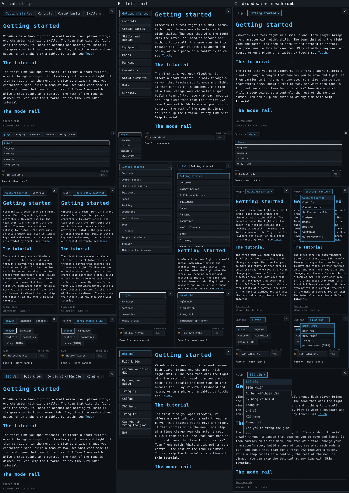

# Flyout navigation study (#4186)

One way to move between the sub-pages of a top-bar flyout. Three proposals, each mocked **in the running client** (a throwaway DOM and CSS override run by `scripts/assets/flyout-nav-study.mjs` against a built client; nothing in `apps/web` changes). The overview is [`flyout-nav-study.png`](flyout-nav-study.png): a column per proposal, and per column Help and Options on desktop (1280 × 720), then on a phone (390 × 844), the narrow row showing a second state (A: the strip scrolled to its end; B: the page after a drill-down; C: the list open). Every panel is in [`flyout-nav-study/`](flyout-nav-study/) at full size (`a-`, `b-`, `c-` for the proposal, `today-` for the client as it is). `long-` panels carry the longest real titles.

## Which flyouts

Every `attachTopbarPopover` user:

| flyout        | file                    | sub-pages now                                                                    | would have                       |
| ------------- | ----------------------- | -------------------------------------------------------------------------------- | -------------------------------- |
| Help          | `help-screen.ts`        | 14 pages in a `<select>` (12 docs, Trailer, Third-party licences)                | yes: this is the list that grows |
| Options       | `options-screen.ts`     | 5 sections (player, language, controls, cosmetics, relay) in a left rail already | yes                              |
| Leaderboard   | `leaderboard-window.ts` | none: standing and one list                                                      | only if it gains a second board  |
| Music         | `jukebox.ts`            | none                                                                             | no                               |
| Queue         | `queue-popover.ts`      | none                                                                             | no                               |
| Skill filters | `skill-library-view.ts` | none: a filter popover, not pages                                                | no                               |

So the study mocks the two that have pages. Today's Options is already **B** on desktop, and on a phone its list collapses into a wrapping block above the page (`today-options-narrow.png`); Help is the odd one out.

## The three

**A, tab strip.** A tablist under the title. Fits Options (5 short tabs, no scroll). On Help 14 tabs are about three screens wide: the strip scrolls sideways with a faded edge, and a page past the fold is reachable only by scrolling or by the arrow keys (`a-help-narrow-end`). The selected tab must be scrolled into view.

**B, left rail.** A vertical list beside the page: what Options has. Help gets the same rail, so both flyouts match and all 14 pages are visible at once. Narrow: the rail becomes a list and a tap drills into the page, whose bar has a back arrow and the page title (`b-*-narrow` is the list, `b-*-narrow-page` the page). Costs about 11 rem of width on desktop, so the Help flyout would widen to about 800 px, and a drill-down adds a step on a phone.

**C, dropdown with breadcrumb.** "Help › Getting started ▾": the page name is a button that opens a list. Costs no width and scales to any page count, at the price of hiding the pages until it is opened (a second click for every page change) and of a breadcrumb that is one level deep today. Narrow it is the same control and the list covers the top of the page.

## Keyboard and focus

|     | pattern                                                                                    | keys                                                                                                                                                                                                         | focus                                                                                                                                                         |
| --- | ------------------------------------------------------------------------------------------ | ------------------------------------------------------------------------------------------------------------------------------------------------------------------------------------------------------------ | ------------------------------------------------------------------------------------------------------------------------------------------------------------- |
| A   | `role=tablist` with `role=tab`, `aria-selected`, roving `tabindex`                         | ← → move and select (automatic activation, the page is a cheap swap); Home / End first / last; Tab leaves the strip for the page                                                                             | the selected tab holds the one tab stop; Esc closes the flyout as now                                                                                         |
| B   | `<nav aria-label>` of buttons, `aria-current="page"` (what Options does)                   | ↑ ↓ move between buttons, Enter opens; Tab walks them (no roving needed at 5 to 14 items); Home / End first / last. Narrow: Enter drills in, the back button or Esc returns to the list, a second Esc closes | on drill-down focus moves to the page heading; on back it returns to the rail entry that was open                                                             |
| C   | menu button: `aria-haspopup="listbox"`, `aria-expanded`, a `role=listbox` of `role=option` | Enter / Space / ↓ open on the current page; ↑ ↓ move, Home / End ends, type-ahead; Enter picks and closes; Esc closes the list only, not the flyout                                                          | focus moves into the list on open and back to the button on close; #4090's modal focus hold applies to the flyout as it does today, and the list is inside it |

## Longest label

Measured over `docs/player/*/` titles and `options.*` in `i18n/locales/*`: Vietnamese "Các yếu tố trong thế giới" (26 characters) and Portuguese "Noções básicas de combate" (25) for Help; Russian "ретранслятор (TURN)" (19) for Options. The `long-` panels use them.

- **A:** a tab never wraps, so a long label only widens the strip; Help is already scrolling, and Options at 19 characters scrolls on a phone. Nothing is cut.
- **B:** the rail wraps the label to two lines (see `b-help-long-*`); no cut, the rail grows taller. Rail width stays 11 rem.
- **C:** the trigger and the list widen to the longest label; on a phone the list is as wide as the flyout and still fits 26 characters. No cut.

## Recommendation

**B.** Options already uses it, so it is one change (Help) rather than two; the rail shows all 14 pages with no scrolling and no second click; it wraps long labels without losing any; and the narrow list → page drill-down is the usual phone pattern. A scrolls past Help's page count and hides the later pages. C hides every page behind a click and its breadcrumb adds nothing at one level. The cost of B is the Help flyout's width on desktop and the extra step on a phone: both are accepted by Options today.

**The operator's pick is recorded here once made:** _pending_.

## Regenerate

Serve a client built with `VITE_VIBEWARS_TRANSPORT=broadcast VITE_VIBEWARS_SPLASH=off`, then `node scripts/assets/flyout-nav-study.mjs <url> <dir>` writes the panels, and `--sheet <dir> <png>` the overview. The checked-in panels are 64-colour PNG8 of those.
