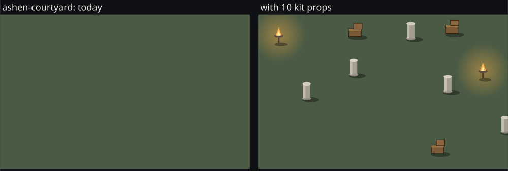
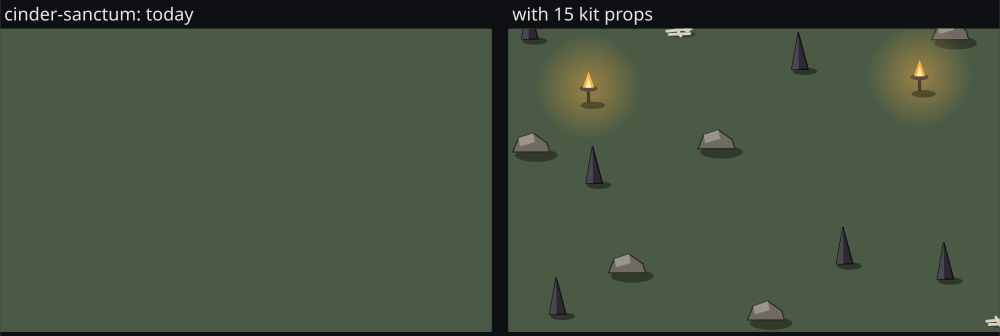
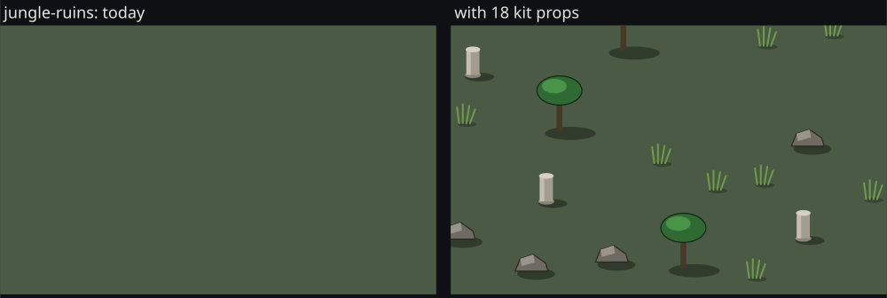

# Populate study: empty ground, a decor kit, a data shape

Study for #4004, first child of epic #3976. It decides what maps may place on
empty ground, so the build cards can be specced without guessing. Follows
[`visual-style.md`](visual-style.md) (§3 shadow and height, §5 timing, §6
readability). Everything here is our own; no GW1 art or names.

## 1. Survey

`scripts/assets/populate-survey.mjs` rasterises each map's **ground layer**
(`groundLayer`) at 20 u. Blocked: outside `bounds`, walls, deep water and pits
of that layer. **Empty** ground is walkable ground at least **100 u from
anything blocked**, so a 200 u disc fits (about 6 bodies across, the card's
"≥ ~4" with room for a prop). Zones, paving, decks, ramps and shallow water
are _not_ counted as blocked, and ground grain does not count as filling: the
numbers say where a prop can stand, not whether a designer wanted it empty.

The shots in [`populate/`](populate/) (800 px, one per map) show the map's
ground green, solids dark, **empty ground shaded and outlined red**, spawns
yellow. Regenerate: `company heavy node scripts/assets/populate-survey.mjs --png`
(about 90 s; the raw numbers are `populate/survey.json`).

Verdict: **empty** ≥ 60 % of the walkable ground is empty, **some gaps** 40 to
60 %, **full** under 40 %. Props column: the count at a working density of
~8 per M u² (the mockups' density), for §4.

|   # | Map                                                           | Biome    | Size (u)  |    Empty ground | Widest gap (u) | Verdict   | Props at ~8 per M u² |
| --: | ------------------------------------------------------------- | -------- | --------- | --------------: | -------------: | --------- | -------------------: |
|   1 | [ashen-courtyard](populate/ashen-courtyard.png)               | hall     | 5120×3840 | 81 % (8.2 M u²) |           1720 | empty     |                   66 |
|   2 | [hall-of-heroes-capture](populate/hall-of-heroes-capture.png) | hall     | 5000×4400 | 81 % (9.7 M u²) |           1528 | empty     |                   78 |
|   3 | [hall-of-heroes-king](populate/hall-of-heroes-king.png)       | hall     | 5000×4400 | 81 % (9.7 M u²) |           1528 | empty     |                   78 |
|   4 | [hall-of-heroes-relic](populate/hall-of-heroes-relic.png)     | hall     | 5000×4400 | 81 % (9.7 M u²) |           1528 | empty     |                   78 |
|   5 | [wardens-gallery](populate/wardens-gallery.png)               | hall     | 5200×2500 | 79 % (6.9 M u²) |           1082 | empty     |                   55 |
|   6 | [cinder-sanctum](populate/cinder-sanctum.png)                 | volcanic | 5600×2800 | 76 % (8.0 M u²) |           1595 | empty     |                   64 |
|   7 | [brazen-causeway](populate/brazen-causeway.png)               | marsh    | 5600×2800 | 75 % (7.2 M u²) |           1102 | empty     |                   57 |
|   8 | [jungle-ruins](populate/jungle-ruins.png)                     | jungle   | 5400×2800 | 75 % (7.8 M u²) |           1128 | empty     |                   63 |
|   9 | [mosslit-cairns](populate/mosslit-cairns.png)                 | wilds    | 5400×3000 | 74 % (7.5 M u²) |           1338 | empty     |                   60 |
|  10 | [threefold-keep](populate/threefold-keep.png)                 | heights  | 5000×4400 | 74 % (8.6 M u²) |           1115 | empty     |                   69 |
|  11 | [moss-vale](populate/moss-vale.png)                           | wilds    | 5000×2600 | 73 % (5.5 M u²) |           1353 | empty     |                   44 |
|  12 | [blackwater-ford](populate/blackwater-ford.png)               | marsh    | 5200×2800 | 72 % (6.3 M u²) |           1219 | empty     |                   50 |
|  13 | [broken-tower](populate/broken-tower.png)                     | heights  | 5400×2800 | 70 % (5.7 M u²) |           1262 | empty     |                   46 |
|  14 | [guild-hall-isle](populate/guild-hall-isle.png)               | coast    | 6000×2600 | 70 % (5.7 M u²) |            840 | empty     |                   45 |
|  15 | [elonian-plateau](populate/elonian-plateau.png)               | desert   | 5520×3360 | 69 % (6.5 M u²) |           1123 | empty     |                   52 |
|  16 | [hollow-deep](populate/hollow-deep.png)                       | cavern   | 6200×2400 | 69 % (4.5 M u²) |           1280 | empty     |                   36 |
|  17 | [barrow-field](populate/barrow-field.png)                     | wilds    | 5400×2600 | 68 % (5.1 M u²) |           1080 | empty     |                   41 |
|  18 | [ember-pits](populate/ember-pits.png)                         | volcanic | 3200×2200 | 68 % (3.5 M u²) |            926 | empty     |                   28 |
|  19 | [arena-crossroads](populate/arena-crossroads.png)             | wilds    | 4400×3000 | 67 % (6.7 M u²) |            960 | empty     |                   53 |
|  20 | [elite-zaishen-battle](populate/elite-zaishen-battle.png)     | hall     | 5400×2400 | 66 % (4.0 M u²) |            840 | empty     |                   32 |
|  21 | [arena-long-hall](populate/arena-long-hall.png)               | wilds    | 4800×2600 | 65 % (5.8 M u²) |            926 | empty     |                   47 |
|  22 | [scarred-earth](populate/scarred-earth.png)                   | volcanic | 5400×2800 | 65 % (5.9 M u²) |           1200 | empty     |                   48 |
|  23 | [shiverpeak-pass](populate/shiverpeak-pass.png)               | snow     | 5100×3450 | 65 % (5.3 M u²) |           1142 | empty     |                   43 |
|  24 | [canthan-terraces](populate/canthan-terraces.png)             | wilds    | 2400×2100 | 55 % (0.8 M u²) |            720 | some gaps |                    6 |
|  25 | [sunken-bastion](populate/sunken-bastion.png)                 | hall     | 2700×1900 | 49 % (1.2 M u²) |            799 | some gaps |                   10 |
|  26 | [arena-canyon](populate/arena-canyon.png)                     | desert   | 2800×1800 | 38 % (0.5 M u²) |            513 | full      |                    4 |
|  27 | [frozen-crossing](populate/frozen-crossing.png)               | snow     | 2600×1940 | 36 % (0.3 M u²) |            520 | full      |                    3 |
|  28 | [sandstone-steps](populate/sandstone-steps.png)               | desert   | 2600×1940 | 35 % (0.5 M u²) |            492 | full      |                    4 |

What it says:

- **Almost every map is empty by this measure.** 23 of 28 are 60 % or more
  empty; the "full" three are the small duel arenas (`arena-canyon`,
  `frozen-crossing`, `sandstone-steps`, 2600 to 2800 u wide), which still
  have 500 u gaps.
- The three **Hall of Heroes** maps share one arena, so they are one job.
- **Biomes with the most to fill:** hall (7 maps, 49 to 81 %), wilds (6),
  volcanic (3). Desert and snow are small maps and lighter.
- Widest gaps (1100 to 1700 u) are 4 to 6 hero-lengths of nothing at all.
  That is where a camper has no cover and the eye has nothing to read.

## 2. The kit

Smallest set that fills the gaps. **Footprint** is the ground circle, world
units. A prop is one of three classes:

- **Decoration**: walk-through, drawn on the ground layer **under bodies**
  (§6 rule 3). No effect on the simulation, sight or nav.
- **Cover**: blocks movement and shots. That is not decor, it is a **wall
  with a look** (§3 below): it enters the sim, the nav graph and the
  visibility gate.
- **Light**: a prop that casts light is also a `lighting.lights` entry,
  named `torch-`, `fire-` or `brazier-` so it flickers (§5, 66 ms).

| Kind                     | Biomes                                                 | Footprint | Class                                                         | Light                           | Animates             |
| ------------------------ | ------------------------------------------------------ | --------: | ------------------------------------------------------------- | ------------------------------- | -------------------- |
| boulder cluster          | wilds, volcanic, desert, snow, jungle, heights, cavern | 90 to 160 | cover (wall, `look: "boulder"`) when ≥ 100 u, else decoration | no                              | no                   |
| ruined column            | hall, jungle, desert                                   |        40 | decoration, tall: fades (below)                               | no                              | no                   |
| broken wall stub         | hall, jungle, desert                                   |  120 × 40 | cover (wall, `look: "ruin"`)                                  | no                              | no                   |
| brazier / fire           | hall, volcanic, cavern, snow                           |        40 | decoration                                                    | **yes**, radius 140, `brazier-` | flame flicker, 66 ms |
| crates / barrels         | hall, coast, marsh                                     |        60 | decoration (cover if stacked ≥ 2 high: wall)                  | no                              | no                   |
| dead tree                | wilds, desert, snow, marsh                             |        50 | decoration, tall: fades                                       | no                              | sway, 4 s, ±2 px     |
| tree                     | wilds, jungle                                          |        70 | decoration, tall: fades                                       | no                              | sway, 5 s            |
| reed / fern / grass tuft | marsh, jungle, wilds, coast                            |        50 | decoration, low                                               | no                              | sway, 3 s            |
| basalt / obsidian spike  | volcanic, cavern                                       |        40 | decoration                                                    | no                              | no                   |
| ice spike                | snow                                                   |        40 | decoration                                                    | no                              | glint, 6 s           |
| bones, banner, cairn     | all                                                    |  40 to 60 | decoration, flat on the ground                                | no                              | banner: ripple, 5 s  |
| cinders / ash drift      | volcanic                                               |       120 | decoration, flat                                              | optional ember `fire-`          | drift, 5 s           |

13 kinds, of which 3 are wall-looks (`boulder`, `ruin`, stacked `crates`).
Per biome a map draws from 4 to 6 kinds, not all.

**What draws over bodies.** Nothing flat does. Tall decoration (column, tree,
dead tree) is the only case; they are drawn **beside, never on a lane**
(§6 rule 3): the placement tool keeps them out of spawn bubbles (300 u),
zones' edges (80 u) and the straight lines between spawn points and
objectives. If a tall prop's silhouette ever overlaps a body, it fades to
0.35 alpha over 0.2 s, exactly as an overhang does
(`OVERHANG_FADE_SECONDS`), and at once under reduced motion. Props that cast
a shadow put it toward +x +y (the sun is north-west, §2).

**Reduced motion.** Every idle loop above holds at its mean under `still`,
as §5 says; none carries information.

## 3. Proposed data shape

For the architect to turn into a schema card and an ADR; a sketch, not code.

```text
decor: [
  { kind: DecorKind, at: { x, y }, layer, rotation?: deg, scale?: 0.75..1.5, variant?: 0..3 },
  ...
]            // required, may be empty, as `gates`; max ~120 per map
```

- `DecorKind` is a closed enum, the 13 kinds above, **minus** the three
  wall-looks.
- **Cover is not decor.** A blocking boulder or ruin is a `walls` entry with
  a new optional `look` (`"rock" | "boulder" | "ruin" | "crates"`, default the
  current plain wall), so the sim, the nav graph, bots and the visibility gate
  already see it. Decor never reaches the sim: it is renderer-only, like
  `ground-dressing.ts`,
  (the schema field is still validated and checksummed with the map).
- **Light** stays in `lighting.lights`; a `brazier` decor entry only draws the
  stand and flame, and the schema's refinement checks a `brazier-` light lies
  within 40 u of one (so art and light cannot drift).
- `layer` is the layer it stands on; `scale` and `rotation` give a map variety
  without more kinds; `variant` picks one of up to 4 pre-drawn shapes.
- Validation: inside `bounds`, not inside a wall, deep water or pit of its
  layer, not within a spawn bubble. These are the same tests the survey
  uses.
- Authoring: a map-tool command scatters a kind into an empty region (seeded)
  and writes the entries, so data is stable and reviewable; hand edits stay
  possible.

## 4. Performance

Static decoration is flat Graphics fills like the map's walls, which ADR-0054
found cheap on software GL; textured sprites are not (#3506). So props are
**vector shapes batched into the map's static layer**, drawn once per
`drawMap`, not per frame. Only animated props (sway, flicker, banners) are
per-frame, and lights are already capped (`MAX_LIGHTS`).

At ~8 props per M u² of empty ground the busiest map needs about **78 props**
(`hall-of-heroes-*`), the median about 50, a duel arena 3 to 5. At ≤ 12
primitive shapes each that is under 1000 shapes in the static layer, and the
animated subset is below 15 % of them. We propose a hard cap of **120 decor
per map** and **16 animated**. perf-sec-qa and lead-dev confirm the budget in
review against `apps/web/src/render` timings; nothing here was benchmarked.

## 5. Mockups

Before and after on three of the emptiest maps, one per hall, volcanic and
jungle (the Hall of Heroes maps are one arena, shown by `ashen-courtyard`,
the emptiest). 1200 × 740 u crops of the widest open ground, props drawn
with a contact shadow and a lit top, seeded; ~8 to 12 KB each.
Regenerate: `node scripts/assets/populate-mockups.mjs`.





The props are flat sketches of the _direction_ (shape, scale, spacing, light),
not final art; the final shapes are one build card per biome.

## 6. Cover and sight lines

Only the wall-looks change sight lines. Per map, the build card must call out
any boulder or ruin placed within 600 u of a spawn-to-objective line; the
architect decides. This study recommends starting with **no new cover** on
the ranked arenas (`arena-*`, `ember-pits`, `canthan-terraces`), decoration
only, so balance is untouched while the look improves.

## 7. Next cards (one map each, `area:maps`)

1. Schema + renderer: `decor` field, the kit's first six kinds, the placement
   tool (architect's ADR first).
2. `ashen-courtyard`, 3. `hall-of-heroes-*` (one arena), 4. `cinder-sanctum`, 5. `jungle-ruins`, 6. `wardens-gallery`, then the rest by the table's
   rank.
