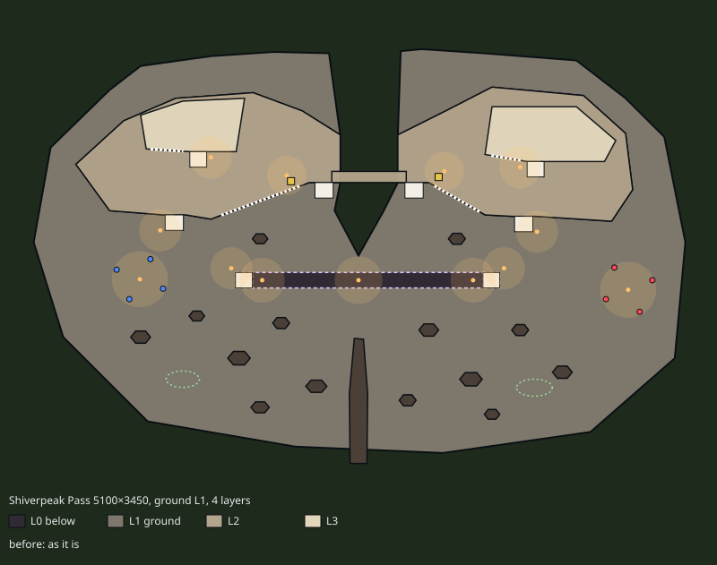
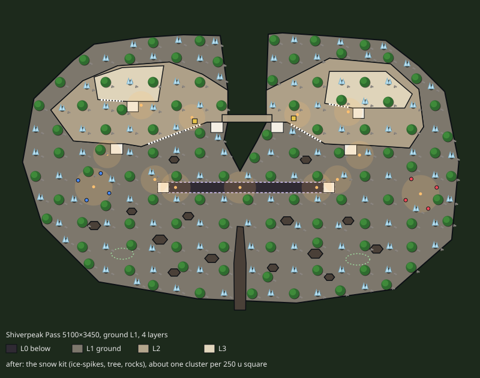
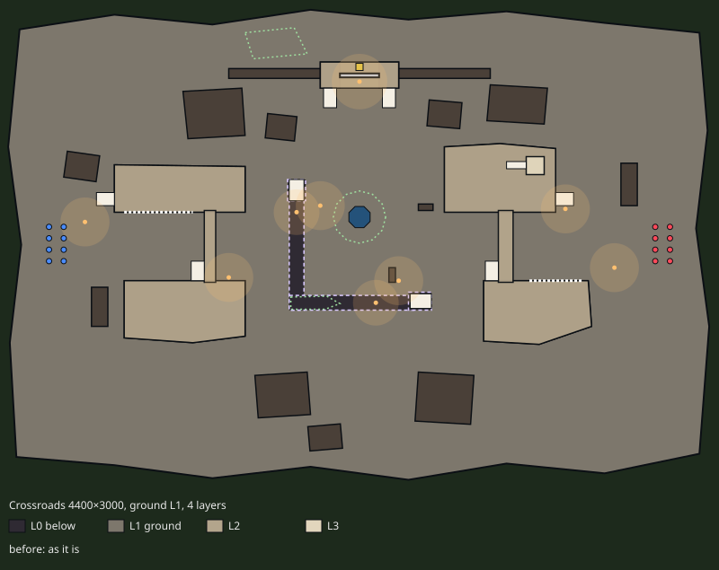
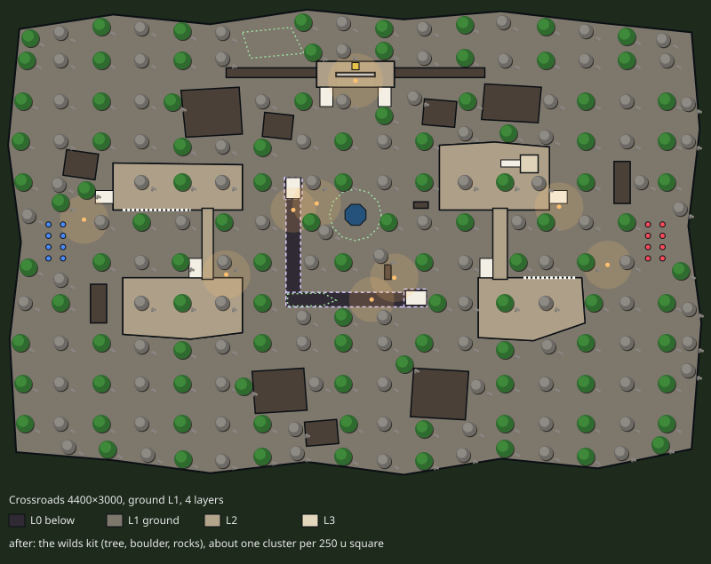
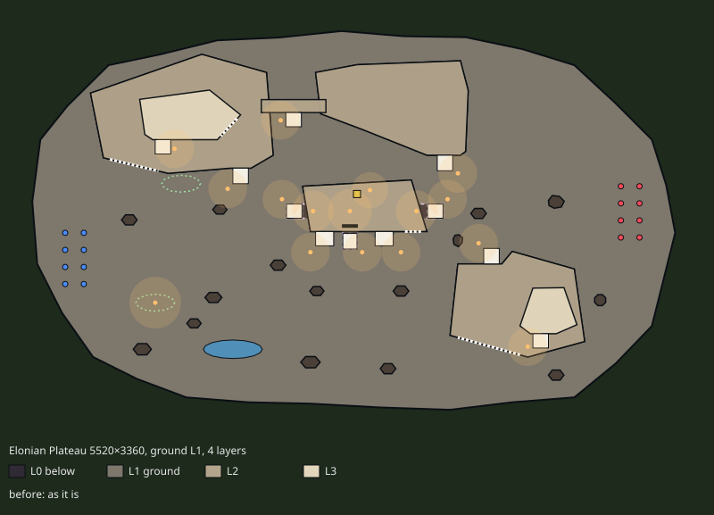

# Populate maps: the survey (#4004)

First study of epic #3976. Maps have walls, water, zones, paving, lights
and atmosphere. The renderer also scatters ground grain per biome
(`apps/web/src/render/ground-dressing.ts`: noise and marks up to 16 u
across). But the map schema has nothing a map can place at a point: no
prop, ruin or plant. This study measures how much empty ground each map
has, proposes the smallest kit to fill it, sketches the data, and mocks up
the three emptiest maps.

Everything here is generated by
`node scripts/assets/populate-survey.mjs docs/art/populate`, run in
`company heavy`. It prints the table below and writes every image in
`docs/art/populate/`.

## 1. Survey

**Empty** ground is walkable ground where a disc 120 u across (about four
bodies) touches nothing but ground grain. That means no wall, map edge,
layer edge, pit, water, zone, stair, roof, gate, objective, spawn, lever or
fire mark. Paving counts as ground, since it is a floor. Spawns and
objectives keep an 80 u bubble. The survey works on a 10 u grid and runs on
every layer, decks included.

**Verdict:** _empty_ when at least 70 % of the walkable ground is empty,
_some gaps_ from 15 %, _full_ below that. Almost every map is mostly bare
floor. The architecture sits along the lanes, and the open ground between
the lanes holds nothing, so a lower bar would call every map empty.

**Clusters** is the kit's estimate: one cluster per 250 u square of empty
ground, about as dense as lights are placed, and 4 sprites per cluster.

Each map's link opens its plan with the empty ground outlined in magenta.

|   # | Map                                                                                  | Biome    | Empty, % of walkable | Empty, u² | Regions | Largest, u² | Clusters (sprites) | Verdict   |
| --: | ------------------------------------------------------------------------------------ | -------- | -------------------: | --------: | ------: | ----------: | -----------------: | --------- |
|   1 | [Shiverpeak Pass](populate/shiverpeak-pass.png) `shiverpeak-pass`                    | snow     |                   90 |     9350k |       6 |       3729k |          150 (600) | empty     |
|   2 | [Crossroads](populate/arena-crossroads.png) `arena-crossroads`                       | wilds    |                   90 |     9709k |       6 |       8778k |          154 (616) | empty     |
|   3 | [Elonian Plateau](populate/elonian-plateau.png) `elonian-plateau`                    | desert   |                   89 |    10792k |       9 |       8399k |          173 (692) | empty     |
|   4 | [Threefold Keep](populate/threefold-keep.png) `threefold-keep`                       | heights  |                   89 |    12615k |       9 |       9111k |          203 (812) | empty     |
|   5 | [Ashen Courtyard](populate/ashen-courtyard.png) `ashen-courtyard`                    | hall     |                   88 |    12795k |      11 |       8842k |          205 (820) | empty     |
|   6 | [Long Hall](populate/arena-long-hall.png) `arena-long-hall`                          | wilds    |                   88 |     9022k |       8 |       7718k |          146 (584) | empty     |
|   7 | [Jungle Ruins](populate/jungle-ruins.png) `jungle-ruins`                             | jungle   |                   87 |    10249k |       6 |       4654k |          164 (656) | empty     |
|   8 | [Hall of Heroes](populate/hall-of-heroes-relic.png) `hall-of-heroes-relic`           | hall     |                   87 |    12177k |       4 |      10084k |          196 (784) | empty     |
|   9 | [Hall of Heroes](populate/hall-of-heroes-king.png) `hall-of-heroes-king`             | hall     |                   87 |    12168k |       4 |      10074k |          196 (784) | empty     |
|  10 | [Hall of Heroes](populate/hall-of-heroes-capture.png) `hall-of-heroes-capture`       | hall     |                   86 |    12071k |       7 |      10084k |          194 (776) | empty     |
|  11 | [The Elite Zaishen Battle](populate/elite-zaishen-battle.png) `elite-zaishen-battle` | hall     |                   86 |     8950k |       6 |       2595k |          144 (576) | empty     |
|  12 | [Barrow Field](populate/barrow-field.png) `barrow-field`                             | wilds    |                   86 |     7925k |       9 |       6386k |          125 (500) | empty     |
|  13 | [Blackwater Ford](populate/blackwater-ford.png) `blackwater-ford`                    | marsh    |                   85 |     8161k |       6 |       3801k |          130 (520) | empty     |
|  14 | [Mosslit Cairns](populate/mosslit-cairns.png) `mosslit-cairns`                       | wilds    |                   85 |    10042k |      14 |       8995k |          163 (652) | empty     |
|  15 | [Broken Tower](populate/broken-tower.png) `broken-tower`                             | heights  |                   84 |     8531k |      10 |       6093k |          138 (552) | empty     |
|  16 | [Scarred Earth](populate/scarred-earth.png) `scarred-earth`                          | volcanic |                   84 |     8242k |      15 |       7597k |          136 (544) | empty     |
|  17 | [The Hollow Deep](populate/hollow-deep.png) `hollow-deep`                            | cavern   |                   83 |     8319k |      15 |       2577k |          133 (532) | empty     |
|  18 | [The Warden's Gallery](populate/wardens-gallery.png) `wardens-gallery`               | hall     |                   81 |     7714k |      15 |       6809k |          131 (524) | empty     |
|  19 | [Moss Vale](populate/moss-vale.png) `moss-vale`                                      | wilds    |                   80 |     7511k |      15 |       3031k |          123 (492) | empty     |
|  20 | [Canyon](populate/arena-canyon.png) `arena-canyon`                                   | desert   |                   78 |     3521k |      13 |       1764k |           63 (252) | empty     |
|  21 | [Canthan Terraces](populate/canthan-terraces.png) `canthan-terraces`                 | wilds    |                   77 |     2598k |       7 |       1215k |           43 (172) | empty     |
|  22 | [Frozen Crossing](populate/frozen-crossing.png) `frozen-crossing`                    | snow     |                   77 |     2505k |      10 |        872k |           40 (160) | empty     |
|  23 | [Ember Pits](populate/ember-pits.png) `ember-pits`                                   | volcanic |                   74 |     3920k |       5 |       3832k |           65 (260) | empty     |
|  24 | [Cinder Sanctum](populate/cinder-sanctum.png) `cinder-sanctum`                       | volcanic |                   73 |     8718k |      13 |       2266k |          141 (564) | empty     |
|  25 | [Sunken Bastion](populate/sunken-bastion.png) `sunken-bastion`                       | hall     |                   72 |     2106k |      10 |        817k |           33 (132) | empty     |
|  26 | [Sandstone Steps](populate/sandstone-steps.png) `sandstone-steps`                    | desert   |                   72 |     1929k |      11 |        769k |           34 (136) | empty     |
|  27 | [Guild Hall Isle](populate/guild-hall-isle.png) `guild-hall-isle`                    | coast    |                   70 |     7504k |      14 |       1339k |          120 (480) | some gaps |
|  28 | [The Brazen Causeway](populate/brazen-causeway.png) `brazen-causeway`                | marsh    |                   58 |     6436k |      19 |       2462k |          108 (432) | some gaps |

What the plans show:

- **Every map is mostly bare floor.** 26 of 28 come out _empty_. On
  Crossroads, Elonian Plateau, Ashen Courtyard and Mosslit Cairns, one
  region covers nearly the whole map. The architecture is a few blocks
  with open floor all round.
- **The decks are as bare as the ground.** The tops of Threefold Keep's
  keep, the Hall of Heroes' tiers and Broken Tower's platforms are wide and
  empty. So are Canyon's rims, which is why Canyon ranks 20th although its
  river bed is busy.
- **Only Guild Hall Isle and Brazen Causeway have _some gaps_.** Their
  water and mire break the ground into many small regions (14 and 19),
  so a build card there fills pockets, not fields.
- No map is _full_.
- The three Hall of Heroes variants share a floor plan, so one card covers
  all three.

## 2. Kit

The kit has twelve kinds. A biome uses three of them: two that stand on
their own, and one that scatters round them. Fires are **not** a new kind.
A `fire-`, `torch-` or `brazier-` light already draws its object
(`apps/web/src/render/light-mark.ts`). A campfire in an empty area is a
light, and it counts against the 32 lights a map may have. Maps use 7 to 22
today.

| Kind         | Footprint, u                    | Collides                                | Drawn                          | Light                     | Animates         |
| ------------ | ------------------------------- | --------------------------------------- | ------------------------------ | ------------------------- | ---------------- |
| `boulder`    | 70–110 across, 40–80 tall       | yes: a wall with a look                 | stands, own shadow             | no                        | no               |
| `column`     | 40 across, 120 tall; drum 50    | the standing column; the fallen drum no | stands; drum under bodies      | no                        | no               |
| `crates`     | 50 × 50, 40 tall, stacks of 1–3 | yes: a wall with a look                 | stands                         | no                        | no               |
| `tree`       | trunk 30, canopy 110            | the trunk only                          | canopy over bodies, fades      | no                        | canopy sway, 4 s |
| `dead-tree`  | trunk 24, branches 90           | the trunk only                          | branches over bodies, fade     | no                        | no               |
| `ice-spikes` | 60–80 across, 60 tall           | yes: a wall with a look                 | stands                         | no                        | no               |
| `rocks`      | 30–50 across, 10 tall           | no                                      | under bodies                   | no                        | no               |
| `bones`      | 40 across, flat                 | no                                      | under bodies                   | no                        | no               |
| `reeds`      | 40–80 across, 40 tall           | no                                      | under bodies, tips cut at 24 u | no                        | sway, 3 s        |
| `banner`     | 12 × 40 on a 60 u pole          | the pole stands beside a wall           | beside a lane, never on it     | no                        | cloth sway, 4 s  |
| `vent`       | 40 across, flat                 | no                                      | under bodies                   | glow painted, not a light | ember pulse, 2 s |
| `mushrooms`  | 30–40 across, 15 tall           | no                                      | under bodies                   | glow painted, not a light | glow pulse, 5 s  |

| Biome      | Stands alone           | Scatters |
| ---------- | ---------------------- | -------- |
| `hall`     | `column`, `crates`     | `banner` |
| `heights`  | `boulder`, `column`    | `banner` |
| `wilds`    | `tree`, `boulder`      | `rocks`  |
| `desert`   | `column`, `boulder`    | `bones`  |
| `volcanic` | `boulder`, `vent`      | `bones`  |
| `snow`     | `ice-spikes`, `tree`   | `rocks`  |
| `marsh`    | `dead-tree`, `reeds`   | `bones`  |
| `jungle`   | `tree`, `column`       | `reeds`  |
| `coast`    | `crates`, `reeds`      | `rocks`  |
| `cavern`   | `boulder`, `mushrooms` | `bones`  |

Every kind follows `docs/art/visual-style.md` and the map-2-5d skill. Each
has a light top, a bright lip, a darker front face and a contact shadow
(§3: 35 % black, 5 right and 6 down). Each is lit by the map's sun and its
lights. Snow `tree` is a pine. Every look is our own, none copied from GW1.

**Readability (§6).** Only two kinds draw over bodies: the `tree` canopy
and the `dead-tree` branches. Both fade the way overhangs do, to 0.35 alpha
over 0.2 s, when a body, projectile or telegraph is under them. The
x-ray outline of rule 7 shows through them, and
`render/visibility-gate.test.ts` holds them to it. Everything else is drawn
under bodies or stands beside a lane. No kind may stand on a zone's edge,
since the survey already keeps the kit off zones.

**Animation (§5).** Idle loops run 2 to 5 s, well under 3 Hz, and are low
contrast. Under reduced motion they hold still.

## 3. Data shape

This is a sketch for the architect's schema card and ADR, not code.

```text
decor: [{ kind, at: { x, y }, layer, rotation?, scale? }]
  kind      rocks | bones | reeds | banner | vent | mushrooms
  rotation  degrees, the look only
  scale     0.75–1.25, the look only

walls: [{ ...rect | polygon, layer, look? }]
  look      boulder | column | crates | ice-spikes | tree | dead-tree
```

- A kind that **collides is a wall with a `look`**. The server already
  blocks movement and sight on walls, so cover needs no new rule. The look
  only changes how the wall is drawn. A `tree` or `dead-tree` wall is its
  trunk, and the canopy is drawn from it.
- A kind that **does not collide is `decor`**. The server ignores it, and
  only the client draws it.
- A fallen `column` drum is `decor` too, as kind `column`, drawn lying
  down. Or the architect drops it from the kit.
- The validator rejects `decor` on water, pits and zones, and off its
  layer's floor, as it does for lights.

## 4. Mockups

These are the three emptiest maps, before and after, drawn on the same plan
as the survey. "After" places one cluster per 250 u square of empty ground:
a kind that stands alone, with one of the scatter kind beside it. The glyphs
are stand-ins for the kit, at its footprint, with a contact shadow.

| Map             | Biome  | Before                                          | After                                         |
| --------------- | ------ | ----------------------------------------------- | --------------------------------------------- |
| Shiverpeak Pass | snow   |   |   |
| Crossroads      | wilds  |  |  |
| Elonian Plateau | desert |   |   |

## 5. Performance

There is no `docs/perf` budget for sprites, draw calls or instances per
map. The budgets that do exist are 32 lights per map and 2 ms a frame for
lighting (ADR-0052). ADR-0054 measured the cost on software GL as
**textured area**, about 50 ns per pixel. Flat `Graphics` fills cost far
less.

The estimate is 4 sprites per cluster: 132 to 820 sprites per map, as in
the table. At the default zoom about a tenth of the map is on screen, so a
busy view holds 13 to 82 sprites.

Each sprite is 40 to 110 u across, call it 60 × 60 px, or 3,600 px. At
ADR-0054's 50 ns per pixel, 82 textured sprites cost about 15 ms a frame on
software GL. That is too much. Hardware GL is far cheaper, but CI and the
promo capture both run software GL.

**Flagged:** Ashen Courtyard (205 clusters), Threefold Keep (203), the Hall
of Heroes variants (194–196), Elonian Plateau (173), Jungle Ruins (164),
Mosslit Cairns (163), Crossroads (154) and Shiverpeak Pass (150). There, a
full kit in the 250 u grid would be the densest prop count in the game.
The study proposes:

- drawing the kit as flat lit `Graphics`, as `structure-art.ts` draws
  rubble, not as textured sprites. That way it costs ADR-0054's flat fill,
  not textured area;
- the build cards placing at most one cluster per 400 u square, about 40 %
  of these counts, on the flagged maps.

lead-dev and perf-sec-qa confirm in review.

## Out of scope

Map data and code changes belong to the build cards: one map per card,
`area:maps`. Balance belongs to the architect. A colliding kind changes
sight lines, so the build cards keep colliders out of the lanes between
spawns and objectives, and each build card names the cover it adds.
