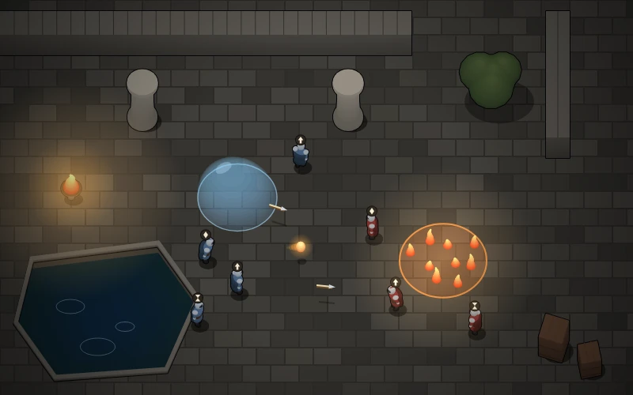
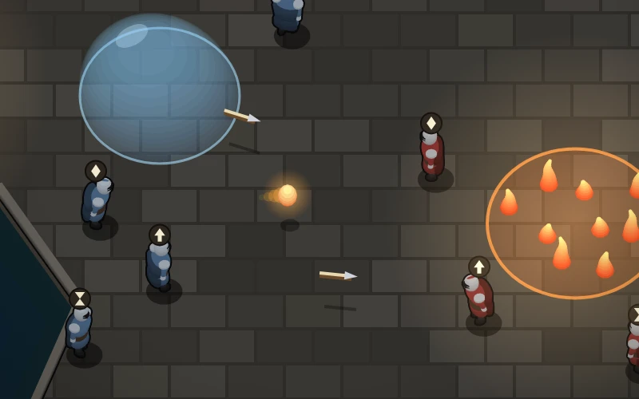

# #3977 art direction: grim gothic, and how to make the art

The operator approved **grim gothic, dark** on 2026-11-25 for the whole of epic #3974 (ADR-0057): bodies, world elements, skills, ground effects and water. Follow-up cards build against these two mockups.

Mockups only, drawn with canvas 2D at game scale (a body has a 12 px radius). The team colours in them are not adopted: bodies keep `visual-style.md` §1's friend and foe colours (ADR-0057). Every style drew the same scene: 7 bodies, walls, columns, a tree, a brazier, crates, a pool, a fire area, a ward dome, a fireball and arrows. The code and the other styles' shots are on `bot/developer@2/issue-3977-spike`, in `docs/art/spikes/3977-sprite-stacking/preview/styles/`: open `styled.html?style=gothic` (`&s=2` for 2×) to redraw it, and `styles.js` holds the `gothic` preset's numbers.

The styles that were weighed:

| Style           | What changes                                                                                                                 |
| --------------- | ---------------------------------------------------------------------------------------------------------------------------- |
| Painterly       | muted earth palette, no outline, smooth shading, hooded figures with capes, soft floor wash                                  |
| Low-poly        | hexagonal slices, 3-step flat shading, bright palette, triangle-faceted floor                                                |
| Pixel art       | rendered at 1/3 resolution and scaled up hard-edged, 4-step shading, 1 px outline                                            |
| Grim gothic     | **approved**: dark, high contrast, helmeted figures with visor and cape, strong vignette and warm light pools                |
| Gothic, lighter | rejected: grim gothic lifted: lighter floor, walls and water, contrast 0.75 → 0.6, half the vignette, brighter team colours. |
| Voxel           | square slices snapped to a 2 px grid, 4-step shading, checker floor                                                          |

## Can the art be something other than code?

Yes. The usual sprite-stacking pipeline is **voxel models exported as slices**, not shapes drawn in code.

| Option                                                                        | Consistency                                                   | Effort                                     | Licence                                                                        |
| ----------------------------------------------------------------------------- | ------------------------------------------------------------- | ------------------------------------------ | ------------------------------------------------------------------------------ |
| Hand voxel models (MagicaVoxel, Goxel, SpriteStack), sliced at build time     | highest: one palette, one grid                                | 1–3 h per prop, more per character         | free tools; the art is ours                                                    |
| A 3D mesh sliced in Blender (a small script of ours)                          | good once colours are snapped to a palette                    | write the slicer once                      | free                                                                           |
| Slices in code (what the spike does)                                          | fully deterministic                                           | slow to make good art; it looks procedural | ours                                                                           |
| AI text/image to 3D (Meshy, Tripo, TRELLIS), then voxelised                   | medium: differs per run, needs palette lock and hand clean-up | fast draft, manual tidy                    | Meshy and Tripo are paid; TRELLIS is MIT; Hunyuan3D excludes the EU, UK and KR |
| AI pixel-art image models (Retro Diffusion, PixelLab, Scenario, a style LoRA) | good with a fixed palette, LoRA and reference images          | low                                        | gives 2D sprites, not slices: concept art only                                 |

People keep AI art consistent with one fixed palette, applied by quantising every export as a build step. They also use one light direction, one grid size, reference images and a style LoRA. Seeds alone do not do it. Purely AI-generated output is not copyrightable (US Copyright Office, 2025), so an open repo cannot really license it, and each asset should record where it came from.

**Not chosen.** ADR-0057 decides that slices are generated from our own geometry, in code, and baked per look at match start: one source, deterministic, team colours and poses as parameters, and no hand-kept art to fall out of step. A voxel pipeline (`.vox` sources, a shared palette, a build step to a slice atlas) is the usual alternative, and is what to revisit if code-drawn slices cannot reach the gothic look. It would need a new ADR.

Sources: MagicaVoxel sprite-stacking guide (medium.com/@avsnoopy), spritestack.io, docs.pixel-composer.com (Slice Stack), replicate.com/blog (Retro Diffusion), copyright.gov/ai, huggingface.co/tencent/Hunyuan3D-2 (licence).
