# Visual style: the 2.5D world

How a map looks, and how to tell that it looks right. This page covers the
**world**: ground, walls, height, light, water, effects and things a player
walks up to. UI, HUD, icons and characters stay in
[`art-direction.md`](art-direction.md).

One owner per topic. [`art-direction.md`](art-direction.md#25d-graphic-layers-direction-d)
owns the planes: deck, ramp, wall, support, deck shadow and the x-ray
outline, with their numbers. This page owns the world palette, light,
texture, animation, readability and the element recipes, and links the
planes rather than copying them.

The brief's language still holds (circles, lines, polygons, no painted art),
and so does the one rule: **a player reads a threat in a fraction of a second,
colour blind.** A look that fails that is wrong however good it is. Everything
here is our own, GW1-like in spirit only: no GW1 art, names or screenshots.

How to read the tables: **now** is what today's renderer does, with the file
that holds it. **Target** needs engine work first, so a map must not rely on
it.

## 1. Palette

A map names its **biome** (`biome` in its JSON, #3172): a small set of base
tones for ground, rock, stone, wood, earth and plants. Its floor, walls, decks,
ramps and stairs draw in them, tinted from the hall's materials
(`BIOME` in `apps/web/src/render/arena-palette.ts`). Biomes may vary the
ground, never the signals, and brass and iron stay as they are. A map of one
layer draws flat whatever its biome, until its family card rebuilds it.

| Biome    | Ground    | Rock      | Plant / earth                            |
| -------- | --------- | --------- | ---------------------------------------- |
| Hall     | `#26303f` | `#4b5a70` | none (stone and steel)                   |
| Wilds    | `#2a3328` | `#5b5f58` | moss `#4f5e3c`, earth `#5a4630`          |
| Heights  | `#26303f` | `#4b5a70` | none, decks `#a0b2c7`                    |
| Desert   | `#3b3226` | `#6e6252` | earth `#6e5a40`, scrub `#6a6448`         |
| Volcanic | `#2b2421` | `#4a4340` | earth `#4a3426`, ash scrub `#5a5444`     |
| Snow     | `#7d8a8e` | `#4d4a4a` | slush earth `#6a6050`, plant `#6a6a58`   |
| Marsh    | `#2a3430` | `#54594f` | reed `#5c5a3a`, silt `#4a4034`           |
| Jungle   | `#232c26` | `#5a5c52` | vine `#545a38`, clay `#5a4a30`           |
| Coast    | `#7d7358` | `#5b6770` | dry olive `#6d6a3e`, tide sand `#5e5644` |
| Cavern   | `#232a33` | `#4a5260` | lichen `#4f4a5c`, silt `#403428`         |

The heights still draw in the hall's tones. The wilds (#3071, Crossroads) keep
the hall's dressed stone and wood, and its moss: a greener moss sits too near
the allies' green. The desert's stone decks are `#c2b296`. The volcanic biome
(#3225, Ember Pits) is a cooling basalt crust, near black and a breath warm, its
stone ash grey `#8c827a`, so lava is by far the hottest thing on its ground. The snow biome (#3286,
Frozen Crossing) is neutral grey at low chroma: its ground is the river ice,
the only floor that shows (the banks are decks), its decks `#9ea4ab`. Snow
stays mid-grey so the friend blue keeps its contrast. The ice is the study's
`#7d8a94` with a little less blue, because the hall's blue grid tinted from
it came too near the friend blue. Open water is the shared deep water look. The marsh biome (#3434, Blackwater Ford) keeps the wilds' dark ground a little cooler, with dry olive reed and silt; its tones are all low chroma and well away from the friend blue, the foe red and the nature green; open water is the shared look. The jungle biome (#3436, Jungle Ruins) is a dark wet floor with mossy grey stone, olive vine and clay; all low chroma, so the nature green and the friend blue stay the loudest things. The coast biome (#3445, Guild Hall Isle) is wet sand and grey rock with dry olive plants beside a deep teal sea; no tone is near the friend blue, the foe red or the nature green. The cavern biome (#3444, The Hollow Deep) is a cold slate under a thin ceiling, its decks dressed slate `#8a909c`; the only colour is the violet glow `#8a6fc9` of its pools, and that is light, never a ground, wall or deck tone, because it sits within a hand's width of the magic violet. No tone is near the friend blue (~200°), the foe red (~5°) or the nature green (~110°).

**The gothic grade** (#4056, Grim gothic, operator Q190): every world material
is drawn in a darker, greyer grade of its biome, so each biome keeps its hues
and reads like the mock's stone hall (`gothic-world.webp`, #3977). `grade` in
`arena-palette.ts` takes HSL lightness `L` to `value · (0.5 + contrast · (L − 0.5))`, clamped,
and scales chroma by `saturation` in the darks, rising smoothly to whole
between lightness 0.45 and 0.75, so light warm tones like sand stay warm
(`GOTHIC_GRADE`: value 0.94, contrast 1.08, saturation 0.6). `value · contrast` is above 1, so two tones never end closer
together than they began: the darks sink and the lit faces hold, and snow
stays pale. Tones below about `#0a0a0a` go to black. It is calibrated
once, on the hall (floor `#26303f` lands within six points of the mock's `#3a3834`, wall top
`#4b5a70` on `#5e5a54`), and the same constants apply to every biome. The
tables here are the tones before the grade. It is applied in one place, where
`biomeMaterials` and `FLAT` are built, and to the land outside a map
(`OUTSIDE_LOOK`). Decor is graded too (#4059), except its fire. Hazards, gameplay
marks, water, fire, a breakable wall's crack glow and bodies are never graded (§6).

**Decor in the gothic look** (#4059): every prop has a 1 px `#08080a` outline
round its top, and its sides darken toward the ground (contrast 0.75, AO 0.5),
so its cap is its lightest part. It stays darker and quieter than a body.

**Overhangs** (#3293) are roofs nobody stands on. They hang at their layer's
height over whoever is under them, with a thin eave below their front edge and
a soft double shade on the ground. Each biome tints the three looks from its own
tones (`overhangColours`):

| Look    | Roof                  | Detail                     | Eave        |
| ------- | --------------------- | -------------------------- | ----------- |
| Awning  | cloth, earth to stone | stripes, a darker earth    | earth, deep |
| Lean-to | timber, the wood      | slats, a darker wood       | wood, deep  |
| Canopy  | leaves, the plant     | clumps, plant toward stone | plant, deep |

An overhang never hides a body. While anyone is under it, or drawn where its
roof is, it fades to 0.35, as a tunnel's cover does.

**Signals are reserved for the fight** and no biome tone may sit within a
hand's width of them on the colour wheel (a quarter of its radius, the
radius being chroma; `arena-palette.test.ts` checks the biome tones):

| Meaning             | Hex                  | Where                                  |
| ------------------- | -------------------- | -------------------------------------- |
| Friend              | `#59c2ff`            | bodies, team marks only                |
| Foe                 | `#ff7b72`            | bodies, team marks only                |
| Danger (warm)       | `#ff8a3d`, `#ffd23d` | lava, fire, strike edges, damage zones |
| Poison (acid)       | `#7fbf2a`, `#c8f05a` | toxic fog, gas                         |
| Help (cool)         | `#3f9fe8`, `#9fdcff` | springs, clear water, healing          |
| Nature (calm green) | `#2f8a3c`, `#76c96f` | groves                                 |
| Magic (violet)      | `#a77bff`            | spires, drains, cold light             |

Environment **may never** be pure friend blue or foe red as a large fill, and
a harmless ground may never use danger orange or acid green. A map's rock,
wall and ground stay desaturated, so every signal colour is the loudest thing
on screen. Shallow water is `#8fb8d6` at 30 %, paler and greyer than a spring.

Colour never decides alone: danger is also **warm** (damage; poison and drain have their own hues, §6), help is
**cool and still**, and each zone kind should have its own outline pattern (target, see §6).

## 1b. Ascent acts

The Heroes' Ascent is a climb with a three-act look (#3589): **volcanic**,
then **underworld**, then **heavenly**. The act belongs to the map, set by
`ascentAct` in its `map.json` (`null` for every map outside the Ascent), and a
map looks the same in every mode. It is a palette and atmosphere arc, not a
copy of any GW1 level, and it is render-only: play stays symmetric.

| Act        | Ground    | Wall / rock | Accent    | Ambient (colour, intensity) | Sun                     | Fog             | View particle |
| ---------- | --------- | ----------- | --------- | --------------------------- | ----------------------- | --------------- | ------------- |
| Volcanic   | `#2b2320` | `#4a4340`   | `#ff6a1a` | `#5a3a2a`, 0.35 to 0.5      | warm, low, `#ffb070`    | none, ash haze  | embers        |
| Underworld | `#1f2428` | `#38424a`   | `#4fd1b5` | `#2a3a44`, 0.25 to 0.4      | none, or weak moonlike  | `#3d5560` banks | none or rain  |
| Heavenly   | `#e8dfc8` | `#b9ad92`   | `#ffcc4d` | `#fff1cc`, 0.7 to 0.9       | strong, high, `#fff4d6` | thin gold haze  | motes, shafts |

The act's ground and wall / rock override the biome's; every other material of the map, its decks, stairs, paving, dressing and breakable walls, is tinted from them (#3618).

- **Volcanic.** Basalt crust lit from below. Lava is the warm rim light; embers
  rise over the view as small, slow, flickering points, never larger than a
  body's hand and always fainter than a strike edge.
- **Underworld.** Slate, cold blue-green light, at least two fog banks per
  layer-0 play area. The world darkens, the actors do not: bodies, team marks,
  rings and telegraphs keep their §1 hex and §6 contrast. Lava here is cooled to
  a dull glow (Cinder Sanctum), so it is the descent from act 1, not a second
  act 1.
- **Heavenly.** Pale stone, gold trim, strong high sun. Motes are slow gold dust;
  at least one light shaft slants from the sun direction onto a point of the
  map. Brightness comes from light, motes and shafts, not from a bloom pass.

**Reserved colours still win.** The accents are trim, light and particles, never
a ground or wall fill: magma `#ff6a1a` and gold `#ffcc4d` sit near the danger
warm pair, so on a harmless surface they stay thin lines or points, and on
screen the real hazard edge must remain the loudest warm thing. The teal
`#4fd1b5` sits between help blue and nature green and is limited the same way.
Ground and wall tones keep their chroma low, so the signal check against
`arena-palette.test.ts` biome tones holds. The heavenly ground is the one pale
floor; friend blue `#59c2ff` and foe red `#ff7b72` bodies still need an
outline on it (§4) to stay clear.

## 2. Light

One sun for every map: **from the north-west (`directionDeg` 315)**, so every
shadow falls south-east, as the deck shadow already does. A map changes the
sun's height and colour, never its direction, so a player learns it once.

| Time of day | Ambient (colour, intensity) | Sun elevation, colour, intensity |
| ----------- | --------------------------- | -------------------------------- |
| Day         | `#b0bcd4`, 0.45             | 50°, `#fff1d6`, 0.55             |
| Dusk        | `#7f86a8`, 0.35             | 25°, `#ffb87a`, 0.5              |
| Indoor      | `#5a6688`, 0.30             | none (the sun skips `indoor`)    |

- **Falloff** is the model's radial quadratic, clipped by shadow polygons
  (ADR-0052). A light's `radius` is where it reaches zero.
- **Warm is fire, cold is magic.** Fire and torches: `#ff9040` (fire, radius
  150 to 260, flicker 0.35) and `#ffb060` (torch, radius 150, flicker 0.2).
  Magic: `#6fa8ff` or violet, radius 150, flicker 0 (it does not flutter).
- **How many.** A light per area, not per object: about one every 250 units
  across open ground, one on each door and lever, one per hearth. A map stays
  at 16 or fewer, half of `MAX_LIGHTS` (32), so zone glow fits.
- **Nothing that matters is darkened.** Bodies never below 0.7
  (`BODY_LIGHT_FLOOR`), surfaces never below 0.45 (`SURFACE_LIGHT_FLOOR`).
  Zones, telegraphs and hidden outlines are drawn after lighting, unlit.

Now: `lighting-pass.ts`, `lighting-model.ts`, the map's `lighting` block.

Worked example, a torch (`torch-light.svg`): a warm pool of radius 150 that
fades to the ambient, on a stand that carries it.

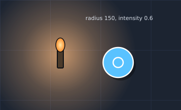

Recipe (now): `{ colour: 0xffb060, radius: 150, intensity: 0.6, flicker: 0.2 }`,
`id` starting `torch-`, placed on the stand's `position`.

A fire light names what carries it by its `id`'s prefix, and that is drawn
under it (`light-mark.ts`): `torch-` a post, `fire-` a ring of stones,
`brazier-` an iron bowl ~28 units across on three short legs, coals and
flame in it (`#ff9040`, `#ffd23d`). A light with no such prefix is a glow
with no drawn source. Keep a brazier off walk lines, pits and water: it is
scenery, with no collision.

In the gothic look (#4057) every fire burns the same warm `#ffbe6e`,
`FIRE_LIGHT_GAIN` brighter and `FIRE_LIGHT_REACH` wider than its map says,
so a pool reads on the dark floor (`warmFireLights`, `lighting-model.ts`),
and adds a warm pool over the lit floor at `FIRE_GLOW` 0.35 of its
intensity, as a tunnel's lights do (`glowOf`, `lighting-pass.ts`).
A fire is a `torch-`, `fire-` or `brazier-` light that is red at heart: a
teal brazier burns magic and keeps its colour. A fire's colour in the map is
not shown; its intensity and radius still set the pool.

The view darkens towards its corners (`vignette-model.ts`): nothing in the
centre third, rising to `VIGNETTE.alpha` 0.6 at a corner, black. It follows
the screen and is drawn over the ground and what is laid on it, under every
gameplay layer (`renderOrder` `vignette`), so a body, a cue or a zone at the
edge of the view keeps its colours. A raised deck's top darkens as the
ground beside it does, masked to the deck and drawn just over its cosmetic
layer (`renderOrder` `deck-vignette`). Fading decks, lowered switched decks,
walls and tall decor keep their light. The HUD is not on the canvas and
never darkens.

## 3. Shadow and height

- **The sun's shadow** is the footprint of what casts it, moved by the sun's
  offset (`sunShadowOffset`; at 50° and one layer of 56 units that is about
  47 units, south-east). Hard edge, no blur, 55 % `#080b10` on the ground.
- **A contact shadow** (target): every body, pillar and prop has a small offset
  shadow at 35 % black, 5 right and 6 down at body size.
- **Height is told in this order:** the top is the lightest plane; its edge
  carries a bright lip; its front face is darker; its shadow lands on the
  ground. A **pit** is the reverse: the floor goes 45 % darker (`pitFloor`),
  and its rim carries the lip. Ramp, wall and deck numbers are in
  [`art-direction.md`](art-direction.md#25d-graphic-layers-direction-d).
- **One step is 56 units** (`ELEVATION_STEP`). There is no in-between height
  except on a ramp.

Worked example, a rock wall (`rock-wall.svg`): irregular outline, noise fill,
a lit top edge, a darker front face, a shadow thrown south-east.

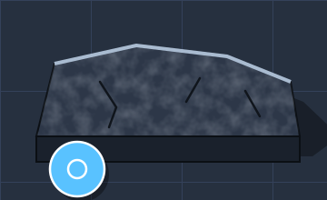

Recipe (now): the palette in `arena-palette.ts`: top `#4b5a70`, face that
shaded 40 %, lit edge `#a9bbd0`, stroke `#3b4759`. On a map with an outline,
the top is the outside land's tile under a wash of its pale tone (rock 22 %,
basalt 32 %; `wall-tops.ts`, [#3808](3808-wall-top-texture.md)), so an island
reads as the same rock as the land round the map. **Target**: irregular
outlines, and the noise fill on a map without one.

## 4. Outline and texture

- **A body** has a 1.5 to 2.5 px dark outline (`#0b0f14`) so it parts from any
  floor. A standing body is a stacked figure (ADR-0057, `sprite-stack.ts`):
  helmeted and caped, 1 px outline `#08080a`, shaded dark at its feet to full
  colour at its cap, its robe in friend or foe colour, its profession glyph
  on a dark badge disc on top. Its outfit follows its primary profession
  and carries one accent of its secondary, the team colour staying torso
  and skirt (#4175, `profession-outfits.ts`, [study](profession-outfit-study.svg)):
  `profession-outfits-match.png`, ally over foe. It turns in 16 headings, the atlas baking
  the nine facing left and mirroring the rest (`bakedFrame`, #4060), and its
  shadow lies on the ground under it, not in its frame. A creature with a
  figure (#4171, `creatureSlices`, after `docs/art/creature-stack-study.md`)
  is stacked the same way, on its team-coloured hexagon plate, which stays
  on the ground and is never baked in; a Ghostly Hero is a pale blue-grey
  body at 0.75 alpha with its axe and no cape, its glyph on a badge on
  top. Pets and NPCs (#4173, `stack-beasts.ts`) turn in 8 headings and
  walk: a pet is a low four-legged animal in warm brown-grey fur, a rat a
  tiny one with a long tail; a guard is steel plate with a spear and a kite
  shield and no cape or glyph, so it never reads as a player; a priest a
  pale hooded robe with a staff; the guild lord the largest figure, 1.25 of
  a body, dark plate trimmed gold `#c9a227`, a dark red cape and a sword.
  Their weapons are baked, so no arms or facing tick are drawn over them.
  Only a knocked-down creature and fallen bodies stay discs. At match zoom:
  `creature-stack-match.png`, discs left, figures right, and
  `npc-stack-match.png` (scene `npc-figures`), a guild hall's guards, lord and
  priest with a pet and rats: discs and figures at Default zoom, then Close.
  **A wall top**, a deck edge and a cover cap have a 1 px gothic outline,
  `WALL_STROKE` `#08080a`, in every biome (#4056); a prop has a 2 px dark outline. **A zone** has a hard
  bright edge, 2 lines wide, never softer than its fill.
- **No fill is flat** (a zone's is not: `zone-painter.ts`, #3052; nor a layered
  map's floor: `ground-dressing.ts`, #3484; nor a wall top on a map with an
  outline: `wall-tops.ts`, #3808; other walls still are). Use noise: fractal noise, 3 octaves, at a scale of
  about **one feature per body** (30 units): grain finer than that is lost at
  zoom 1, coarser reads as a blotch. Keep it at 50 to 80 % opacity over the
  base tone, so the base still names the material.
- **Line weights**, in world units at zoom 1 (`line` = one CSS px): hairline
  1, outline 2, zone edge 2 (`ZONE_EDGE_WIDTH`), shore of deep water 3
  (`WATER_LOOK.deep.shoreWidth`). Heavier edges (3 and 4) are target.
- **Small things stay legible at 16 px.** A prop under 16 px across is a
  mark, not a drawing: one shape, one colour, one outline.

Worked example, mire (`mire.svg`): dull earth, noise, bubble rings, a lumpy
rim in a lighter tone.

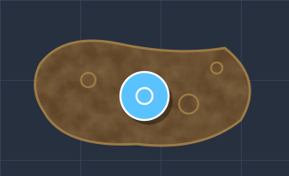

Recipe (now): `ZONE_LOOK.mire` (edge `0x9c7a46`, `painter: "mud"`):
`zone-painter.ts` paints mottled mud with dark pools once per map, and
bubbles swell and pop every frame.

Worked example, ground (`ground-grain.png`, Arena Crossroads, before and
after): the floor mottled in its own tones, grass tufts and stones scattered
on it, the grid over both.

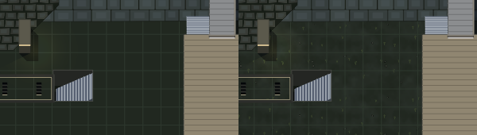

Recipe (now): `ground-dressing.ts` paints one 256-unit tile per biome, once
per game: value noise in 3 octaves (about one feature per 30 units) between
the biome's `GROUND_DRESSING` grain tones (`arena-palette.ts`) at
`GRAIN_ALPHA` 0.65, then its marks, each one shape, one tone and one outline
and at most `MARK_MAX` 16 units. `arena-scene.ts` lays it as a tile sprite
from the world's origin, stencilled to the ground's outline, under paving,
pits and bodies; the grid and the outline's edge draw over it. A patch of
ground redrawn over a tunnel or in front of a pit gets the same tile at the
same place. A map of one layer draws flat, so it has none.

## 5. Animation timing

| Thing            | Timing                                                                                 |
| ---------------- | -------------------------------------------------------------------------------------- |
| Zone fill breath | one cycle every **1.6 s** (`PULSE_SECONDS`), fill alpha ± pulse                        |
| Fire flicker     | two sines, changing every **66 ms** (`FLICKER_INTERVAL_MS`)                            |
| Water ripple     | **5 s** period, 3 units of drift (`RIPPLE_PERIOD_SECONDS`)                             |
| Idle loops       | **1 to 6 s**; never faster than a heartbeat, never above 3 Hz                          |
| Strike telegraph | the edge goes 2.5× wider and the fill 60 % within **0.3 s** of the warning starting    |
| Strike           | full fill, edge stays 2.5× wide                                                        |
| Overhang fade    | to 0.35 alpha and back over **0.2 s** (`OVERHANG_FADE_SECONDS`); at once, reduced      |
| Body walk        | 4 frames per **64 units** walked (`STACK_STRIDE_UNITS`), so a snare slows the stride   |
| Cape settle      | **0.4 s** after a body stops (`STACK_CAPE_SETTLE_SECONDS`), half of it on a pass frame |
| Body breath      | one breath every **3 s** (`STACK_BREATH_SECONDS`), each body at its own phase          |
| Body turn        | **0.12 s** to a new heading (`STACK_TURN_SECONDS`), the short way round                |

- **Danger must read in under 0.3 s**: the telegraph's change is a jump, not
  a fade, and it is a change of **edge width and brightness**, which survive
  colour blindness.
- **Reduced motion** (`still`): breath, ripples, flicker and drift hold still
  at their mean; a body stands, never striding, swaying, breathing or
  leaning, and only its heading turns it. **Telegraph and strike are not decoration**: they stay, as
  states, because a player acts on them.
- Idle motion is calm and low-contrast. The more a thing can hurt, the less
  it may distract from the fight: fog may breathe at 0.14, mire at 0.03.

Now: `zone-look.ts` (`zoneFillAlpha`, `strikeEdgeScale`), `hazard-marks.ts`
(`hazardVisual`), `water-shape.ts`,
`lighting-model.ts` (`flickerAt`), `sprite-stack.ts` (`stackPose`, `stepTurn`).

## 6. Gameplay readability

Every rule below can be checked from one screenshot.

1. **A zone's edge is always visible**: a hard rim, 2 lines wide, over
   water, fog and light.
2. **Signal class sets the hue.** Damage is warm (fire, lava, strike); poison
   is acid green or olive (foul and tainted water); drain is violet (draining
   spire); rockfall is grey. Help is cool blue or green. A harmful thing never
   uses the help blue or green; a harmless thing may not be warm. Pulsing is
   target: vents, gas spouts and rockfall do not pulse today.
3. **Art never hides a body, a projectile or a telegraph.** Decoration sits
   under bodies, and tall props are drawn beside, not on, a lane.
4. **Zone tint stays above water and light** in render order.
5. **Each kind of zone has its own shape language** (target: today every
   edge is a solid line), so two kinds that share a hue still differ: harmful ground has a **dashed** edge, help a **solid**
   one, strike zones a **dashed edge that goes solid** when they fire.
6. **A dark corner is lit enough to fight in**: bodies at 0.7 or more.
7. **Hidden bodies show their x-ray outline** under every cover.
8. **At 16 px** a zone is still told from the next by hue **and** edge.
9. **Colour-blind pass**: view the screenshot in grey; the danger edge and
   the telegraph still stand out.
10. **A flying spell** keeps its own sprite and adds a near-white core on
    its head, a ground shadow on the deck under it and a short warm trail
    behind its tail, all sized from the sprite as drawn; it lands in a
    thick, dark-outlined ember burst reaching past the target ring, and a
    miss shows none (#3292).
11. **An attack skill** strikes a thick warm arc over the plain swing (melee
    only), held whole before it fades, and a thick, dark-outlined gold star
    crossing the body's edge and the target ring. Both hit marks fan out on
    the free sides, clear of the health bar and the damage number, and both
    of those draw over every hit mark and arc (#3292).
12. **A shout or chant** sends one thin cool `#9fdcff` ring from the
    caster's edge to earshot in 0.3 s, fading as it grows, on the ground
    under bodies; an upward chevron in the same blue stands over each body
    of the caster's side it helped, above the health bar and any hex halo,
    for 1 s. Neither is team-coloured (#3301).
13. **A spirit** is a stacked totem (#4171) on its team-coloured hexagon
    plate: a short dark stone base `#4a4a50`, then a wisp column narrowing
    upward over nine slices, pale green `#76c96f` rising to near-white
    `#e8f7e4` and fading as it rises. One heading, one pose: it never
    turns. The whole figure bobs ±2 px over 2 s (still under reduced
    motion). Until its figure is baked it is the flat wisp, a teardrop
    point up round a near-white core, with a 1.5 px team rim. Its range is a solid 1.5 px ring in the same
    green at its aura's real radius, on the ground under bodies, alpha
    0.18, 0.45 while targeted or hovered. Solid, since a spirit's area is
    not harmful ground, whatever it does (#3306).
14. **A cast with a cast time** that is not an attack skill lifts the
    weapon to its wind-up pose in 0.15 s and holds it, with a glow at the
    weapon's far end, past the body, in the type colour (`render/skill-colours.ts`) growing from 7 px,
    alpha 0.4, to 12 px, alpha 0.55; on release the weapon strikes and the
    glow becomes a 16 px white flash, gone in 0.15 s; stopped short, it
    shrinks to nothing and greys in 0.2 s. An instant skill shows none (#3320).
15. **A Necromancer's minion** is a stacked figure (#4172) on its
    team-coloured plate, told apart by silhouette alone; its look icon
    stays the exact name. A **bone minion**, the smallest figure, is a
    hunched skeleton: rib rings in bone `#d8d0bc` round dark gaps, a
    skull on top. A **horror** is the same skeleton, larger and broader,
    and each kind carries its cue: the bone fiend a bone spike off its
    back, the vampiric horror a dark red `#7a1f2b` glow over its ribs,
    the shambling horror stooped and uneven with one arm hanging, the
    jagged horror bone spurs at its shoulders. The **flesh golem** is the
    widest and tallest, a pale flesh mass `#b9a58f` banded by dark
    stitched seams, a fist at each side and a small head. All turn in 8
    headings and walk in stand and two strides; under reduced motion they
    stand, as a body does. No rim teeth: the silhouette is the type cue.

    Worked example (`minion-figures.png`), at match zoom: the discs they
    replace over the figures, bone minion to flesh golem.

    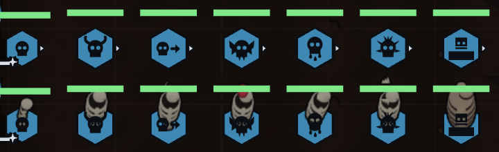

Rules 3 and 7 are checked by CI (#3251): `render/visibility-gate.test.ts`
draws every map through the scene's own map drawing, records each filled
polygon at its depth, and stands a body on every point the simulation lets
one stand, 8 units apart, on every layer. Wherever a structure is painted
over a body, its hidden outline must show there, and nothing static is
painted over the outline. Art that reaches past its occluder fails it,
naming the map, the point and the piece. A fix is in the occluder
(`occludersOf`) or in the art. A map whose geometry hides a body until a
map edit lands goes in `KNOWN_HIDDEN` with its issue. That list only
shrinks: an entry whose map passes fails as stale.

Worked example, toxic fog (`toxic-fog.svg`): soft overlapping puffs inside a
hard dashed edge, so the cloud can move and the boundary cannot.

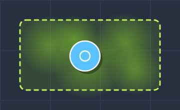

Recipe (now): `ZONE_LOOK["toxic-fog"]` (edge `0xc8f05a`, pulse 0.14,
`painter: "fog"`): overlapping radial-gradient puffs over a 22 % green
wash, and soft puffs that drift inside the edge, never over it.

## 7. Worked examples

The scene sheets come first: they show the 2.5D look this page asks for, as a
whole, before the single elements. Textures (noise, planks, blocks) are
**target**: today the renderer fills walls flat, except a wall top on a map
with an outline, which carries the outside land's tile (#3808), so a sheet shows
where #3052 and #3053 are heading, and a recipe line says "now" only where a
developer can copy the value from main.

### A lit scene

A deck with a ramp and a wall, a pit, a rock outcrop, a torch and a fire, one
sun. Read the height by the lip, the face and the shadow; the light by its
pools, which add on every layer.

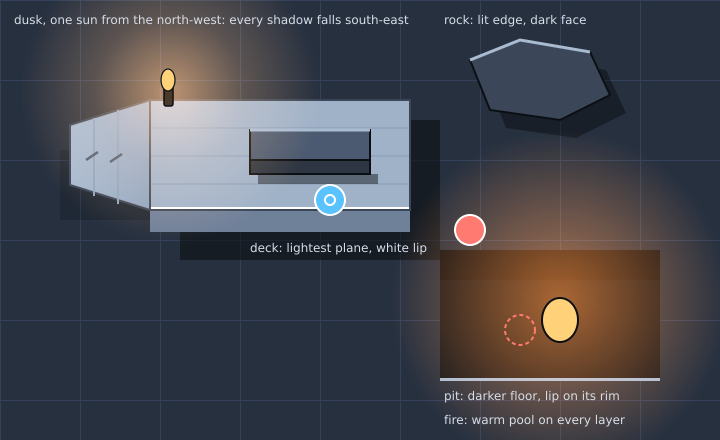

### Heights

Pit, ground and deck at the same scale, with the four cues each time: tone,
lip, face, shadow. Numbers (`pitFloor`, ELEVATION_STEP) are now.

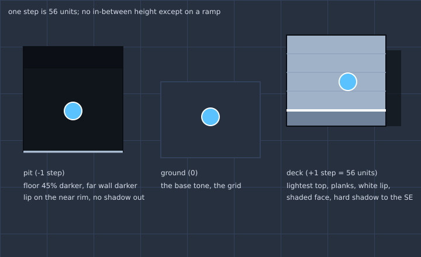

### Walls

Stone, rock and wood: always a lit top edge over a darker face, an outline and
a shadow to the south-east. The blocks, planks and cracks are target.

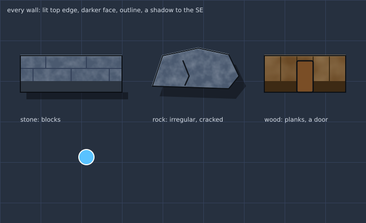

### Materials

Six swatches, each a base tone, noise and a lit top edge. The base colours are
the palette (§1); the noise is target.

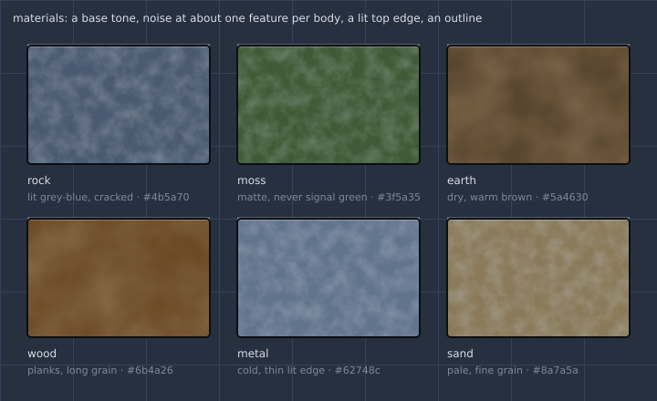

### Lava

Hot core `#ffd23d`, body `#ff5a1f`, crust `#b8401a`, dark cracks, a bright
rim, and a warm light cast outwards. Danger: warm, and the loudest tone in
the room.

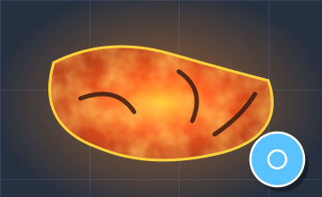

Recipe (now): `ZONE_LOOK.molten` (edge `0xffd23d`, `painter: "lava"`): a
mottled crust split by glowing cracks, beads of lava running down them. Its
`light` (`0xff9040`, 0.9, flicker 0.35) stands on the centroid, reaching 1.6
times the zone's half-diagonal: `zone-light.ts` adds it, the map has none.

### Water, deep and shallow

Deep is dark, still water you cannot see into. Its fill is `0x0e2228`
with 4 rings darkening toward the middle, so it reads as deep. Its edge sinks
into a short pit wall in the floor's pit-wall colour, and a stone lip in the
biome's wall-top colour stands 3 px proud along the shore. The lip and the
ripples are what tell it from a pit or a tunnel mouth. Shallow is the same hue,
lighter and at half alpha, so the floor shows through. It has no lip and no
sunk wall, only a thin lighter shore line: deep against shallow is gameplay,
and reads at a glance. The hue is the same in every biome; only the lip takes
the biome's colour. Both are scenery under the zone tint.

Over both fills lie two layers of liquid cells (#4058): a Voronoi network,
drawn once at load into a 512 px tile that repeats, tinted per depth, at two
scales, baked into each body of water once per map. They hold still: drifting,
they cost too much of a frame (#4078). The gaps between cells are the light.
Ripples are sparse pale ellipses that drift slowly, never sparkles, and hold
still under reduced motion.

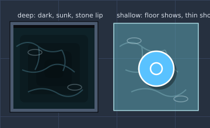

Recipe (now): `arena-palette.ts` `WATER_LOOK.deep` = `{ fill: 0x0e2228,
fillAlpha: 1, rings: 4, ring: 0x040c10, ringAlpha: 0.3, lip: true, ripple:
0xb4d2dc, rippleAlpha: 0.35, cell: 0x3c6a78, cellAlpha: 0.2 }`;
`WATER_LOOK.shallow` = fill `0x5ea8b8` at 0.5, shore `0xa8d8e0` 1 px, cells
`0x8cc0cc` at 0.14. The cells come from `liquid-cells.ts` (seed, site count,
gap, texture size), which the other liquids reuse. The lip, the sunk wall and
the rings are `water-painter.ts` `WATER_ART`.

### Toxic fog

See §6. Acid green, soft body, hard edge.

### Mire

See §4. Earth brown, noise, bubbles.

### Torch light

See §2.

### Rock wall

See §3.

### Door, open and closed

**Shut** is a solid oak bar across the gap, set between two wall stubs.
**Open** is the stubs and a clear gap over a dark sill, the leaves swung back
flat against the walls, so a player sees where it will close. Shape differs,
not only colour.

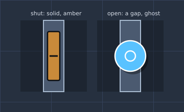

Recipe (#3061, #3053): `gate-mark.ts` `GATE_ART`. Shut, the wall pass draws
the door as a wall box in `GATE_DOOR_LOOK`: oak `#7a4e26`, a seam and two
iron bands `#2a2a30` across its top and round its front, an iron frame
`#3b4759` and a brass knob, lit by `litStructurePalette` like a wall. Open,
`drawGate` lays a dark sill on its layer's ground, iron jamb lines at its
ends, and `openLeaves` stands its two leaves against the walls beyond them,
on the camera's side. Its pressure plate, `paintPlate`, is a stone disc that
stands proud and sinks flush, ringed brass, while held. Study:
`3053-hazards.png`.

### Lever, up and down

The handle **stands** when up and **lies** when down, so the state reads by
shape; the knob is brass `#e8c27a` when up and dull grey `#6a6560` when down. Wooden arm `#8a5a2a`, stone base `#827b70`.

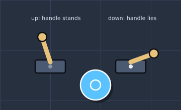

Recipe (#3053): `switch-mark.ts` draws a stone base and a wooden arm,
leaning back when up and lying right when thrown, in `SWITCH_MARK_LOOK`, a
small brass glow round the knob while up. A flip plays a quarter-second
throw (`leverThrown`); under reduced motion it snaps.

### Portcullis, up and down

**Down** is an iron grid filling the gap, its bars spiked at the camera's
side. **Up** is a dark gap between stone jambs with no bars in it, only
their bottom ends showing at the lintel side, so a player sees where it
drops. Both read from the gate's own footprint on its layer, also where a
tunnel's cover hides its face and the raised grid. Shape differs, not
only colour.

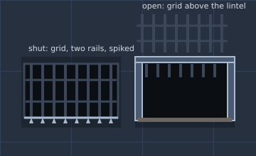

Recipe (#3068, #3644): `gate-mark.ts` `GATE_ART`. Down, the wall pass
draws the dark of the arch as a wall box, bars down its front face, and a
grid over its top in `GATE_PORTCULLIS_LOOK` iron `#3b4759`; on its layer's
ground the grid also fills the footprint, bars across it `BAR_EVERY` apart,
an iron frame, a lit camera-facing edge (`litStructurePalette`) and
`SPIKE`d tips. Up, `drawGate` lays the dark gap in a lit frame, its jambs
and sills, a `STUB` of bars a quarter of its depth at its north
or west side, and hangs the grid above the lintel: only the part of it
that lands north of the footprint is drawn, so a strip deeper than the
lift shows its top end and nothing of it lands in the gap. On a flat map
the hung grid is left out. The study SVG is drawn in
`scripts/assets/visual-style.mjs`.

### Spawn bubble

Before the match starts your team is held in one bubble (#3930): the
convex hull of its spawns grown by `SPAWN_BUBBLE_RADIUS` (81), a circle
for a team of one, a capsule for two, a rounded polygon for more. A **low
curtain** shows where: a wall one body tall (40 units) standing up from the
deck along the team's outline, not a decal on it. Neutral near-white
`#eef6ff`, neither the help blue or green nor a warm harm. Only your own
team's bubble is drawn, at your spawn's layer; a watcher sees none.

- **Rest:** opacity 0.15 at its foot, fading out upward in five slices.
- **Near:** over your last 20 units to the edge it rises to 0.6, on the
  stretch you face it from only: all of it straight ahead, half at 45°, none
  from 90°, measured as round a lone spawn's circle, so along a straight
  side too.
- **Rim:** a solid line on the ground, 2 lines wide over a dark `#1b2029`
  one (§6 rule 1), never under 2 css px on a phone.
- **Shimmer:** three bands climb it every 2.4 s, faintest near the top.
- **Bump:** pulled back by it, a ring ripples out at the contact point for
  0.3 s. Reduced motion keeps the brightening, and drops the shimmer's climb
  and the ripple.
- **Start:** it fades out over 0.3 s, and nothing is left.

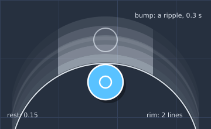

Recipe (#3909, #3930): `team-bubble.ts` `teamBubbleOutline` gives the
outline, `spawn-bubble.ts` `spawnBubbleCommands` the quads, rim and ripple; `arena-scene.ts` `drawSpawnBubble` draws them at the goal-mark
depth of the spawn's layer, over the floor and under every body.

Every SVG here is made by `scripts/assets/visual-style.mjs`; regenerate with
`node scripts/assets/visual-style.mjs`.

## 8. Review checklist

A reviewer or QA ticks these on a map or world-art PR, from a screenshot.

**Tick now** (the renderer does these today):

- [ ] No signal colour is used as scenery.
- [ ] One sun, from the north-west; shadows fall south-east.
- [ ] 16 lights or fewer; fire is warm, magic is cold.
- [ ] Every height step reads: lit top, lip, darker face, shadow or pit.
- [ ] The map names its biome.
- [ ] An Ascent map states its `ascentAct` and follows the §1b palette; bodies and signals read as well in the dark act as in the bright one.
- [ ] Every zone has a visible edge, over water and light.
- [ ] Hue follows signal class (§6 rule 2): harmful never wears help blue or green.
- [ ] Hazards telegraph by edge width within 0.3 s.
- [ ] Nothing hides a body, projectile or telegraph.
- [ ] The screenshot still reads in grey and at 16 px.
- [ ] Reduced motion holds idle loops still and keeps strike states.

**Target** (engine work first; do not fail a map on these until it lands):

- [ ] No fill is flat; texture is about one feature per body.
- [ ] Zone edges differ by pattern (dashed harmful, solid help).
- [ ] Contact shadows under bodies and props.
