# Visual style: the 2.5D world

How a map looks, and how to tell that it looks right. This page covers the
**world**: ground, walls, height, light, water, effects and things a player
walks up to. UI, HUD, icons and characters stay in
[`art-direction.md`](art-direction.md).

One owner per topic. [`art-direction.md`](art-direction.md#25d-graphic-layers-direction-d)
owns the planes: deck, ramp, wall, support, deck shadow and the x-ray
outline, with their numbers. This page owns the world palette, light,
texture, animation, readability and the element recipes, and links the
planes rather than copying them.

The brief's language still holds (circles, lines, polygons, no painted art),
and so does the one rule: **a player reads a threat in a fraction of a second,
colour blind.** A look that fails that is wrong however good it is. Everything
here is our own, GW1-like in spirit only: no GW1 art, names or screenshots.

How to read the tables: **now** is what today's renderer does, with the file
that holds it. **Target** needs engine work first, so a map must not rely on
it.

## 1. Palette

A map names its **biome** (`biome` in its JSON, #3172): a small set of base
tones for ground, rock, stone, wood, earth and plants. Its floor, walls, decks,
ramps and stairs draw in them, tinted from the hall's materials
(`BIOME` in `apps/web/src/render/arena-palette.ts`). Biomes may vary the
ground, never the signals, and brass and iron stay as they are. A map of one
layer draws flat whatever its biome, until its family card rebuilds it.

| Biome    | Ground    | Rock      | Plant / earth                        |
| -------- | --------- | --------- | ------------------------------------ |
| Hall     | `#26303f` | `#4b5a70` | none (stone and steel)               |
| Wilds    | `#2a3328` | `#5b5f58` | moss `#4f5e3c`, earth `#5a4630`      |
| Heights  | `#26303f` | `#4b5a70` | none, decks `#a0b2c7`                |
| Desert   | `#3b3226` | `#6e6252` | earth `#6e5a40`, scrub `#6a6448`     |
| Volcanic | `#2b2421` | `#4a4340` | earth `#4a3426`, ash scrub `#5a5444` |

The heights still draw in the hall's tones. The wilds (#3071, Crossroads) keep
the hall's dressed stone and wood, and its moss: a greener moss sits too near
the allies' green. The desert's stone decks are `#c2b296`. The volcanic biome
(#3225, Ember Pits) is a cooling basalt crust, near black and a breath warm, its
stone ash grey `#8c827a`, so lava is by far the hottest thing on its ground.

**Overhangs** (#3293) are roofs nobody stands on. They hang at their layer's
height over whoever is under them, with a thin eave below their front edge and
a soft double shade on the ground. Each biome tints the three looks from its own
tones (`overhangColours`):

| Look    | Roof                  | Detail                     | Eave        |
| ------- | --------------------- | -------------------------- | ----------- |
| Awning  | cloth, earth to stone | stripes, a darker earth    | earth, deep |
| Lean-to | timber, the wood      | slats, a darker wood       | wood, deep  |
| Canopy  | leaves, the plant     | clumps, plant toward stone | plant, deep |

An overhang never hides a body. While anyone is under it, or drawn where its
roof is, it fades to 0.35, as a tunnel's cover does.

**Signals are reserved for the fight** and no biome tone may sit within a
hand's width of them on the colour wheel (a quarter of its radius, the
radius being chroma; `arena-palette.test.ts` checks the biome tones):

| Meaning             | Hex                  | Where                                  |
| ------------------- | -------------------- | -------------------------------------- |
| Friend              | `#59c2ff`            | bodies, team marks only                |
| Foe                 | `#ff7b72`            | bodies, team marks only                |
| Danger (warm)       | `#ff8a3d`, `#ffd23d` | lava, fire, strike edges, damage zones |
| Poison (acid)       | `#7fbf2a`, `#c8f05a` | toxic fog, gas                         |
| Help (cool)         | `#3f9fe8`, `#9fdcff` | springs, clear water, healing          |
| Nature (calm green) | `#2f8a3c`, `#76c96f` | groves                                 |
| Magic (violet)      | `#a77bff`            | spires, drains, cold light             |

Environment **may never** be pure friend blue or foe red as a large fill, and
a harmless ground may never use danger orange or acid green. A map's rock,
wall and ground stay desaturated, so every signal colour is the loudest thing
on screen. Shallow water is `#8fb8d6` at 30 %, paler and greyer than a spring.

Colour never decides alone: danger is also **warm** (damage; poison and drain have their own hues, §6), help is
**cool and still**, and each zone kind should have its own outline pattern (target, see §6).

## 2. Light

One sun for every map: **from the north-west (`directionDeg` 315)**, so every
shadow falls south-east, as the deck shadow already does. A map changes the
sun's height and colour, never its direction, so a player learns it once.

| Time of day | Ambient (colour, intensity) | Sun elevation, colour, intensity |
| ----------- | --------------------------- | -------------------------------- |
| Day         | `#b0bcd4`, 0.45             | 50°, `#fff1d6`, 0.55             |
| Dusk        | `#7f86a8`, 0.35             | 25°, `#ffb87a`, 0.5              |
| Indoor      | `#5a6688`, 0.30             | none (the sun skips `indoor`)    |

- **Falloff** is the model's radial quadratic, clipped by shadow polygons
  (ADR-0052). A light's `radius` is where it reaches zero.
- **Warm is fire, cold is magic.** Fire and torches: `#ff9040` (fire, radius
  150 to 260, flicker 0.35) and `#ffb060` (torch, radius 150, flicker 0.2).
  Magic: `#6fa8ff` or violet, radius 150, flicker 0 (it does not flutter).
- **How many.** A light per area, not per object: about one every 250 units
  across open ground, one on each door and lever, one per hearth. A map stays
  at 16 or fewer, half of `MAX_LIGHTS` (32), so zone glow fits.
- **Nothing that matters is darkened.** Bodies never below 0.7
  (`BODY_LIGHT_FLOOR`), surfaces never below 0.45 (`SURFACE_LIGHT_FLOOR`).
  Zones, telegraphs and hidden outlines are drawn after lighting, unlit.

Now: `lighting-pass.ts`, `lighting-model.ts`, the map's `lighting` block.

Worked example, a torch (`torch-light.svg`): a warm pool of radius 150 that
fades to the ambient, on a stand that carries it.

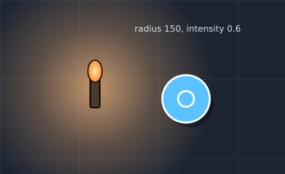

Recipe (now): `{ colour: 0xffb060, radius: 150, intensity: 0.6, flicker: 0.2 }`,
`id` starting `torch-`, placed on the stand's `position`.

## 3. Shadow and height

- **The sun's shadow** is the footprint of what casts it, moved by the sun's
  offset (`sunShadowOffset`; at 50° and one layer of 56 units that is about
  47 units, south-east). Hard edge, no blur, 55 % `#080b10` on the ground.
- **A contact shadow** (target): every body, pillar and prop has a small offset
  shadow at 35 % black, 5 right and 6 down at body size.
- **Height is told in this order:** the top is the lightest plane; its edge
  carries a bright lip; its front face is darker; its shadow lands on the
  ground. A **pit** is the reverse: the floor goes 45 % darker (`PIT_FLOOR`),
  and its rim carries the lip. Ramp, wall and deck numbers are in
  [`art-direction.md`](art-direction.md#25d-graphic-layers-direction-d).
- **One step is 56 units** (`ELEVATION_STEP`). There is no in-between height
  except on a ramp.

Worked example, a rock wall (`rock-wall.svg`): irregular outline, noise fill,
a lit top edge, a darker front face, a shadow thrown south-east.

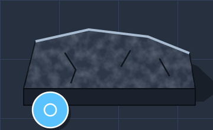

Recipe (now): the palette in `arena-palette.ts`: top `#4b5a70`, face that
shaded 40 %, lit edge `#a9bbd0`, stroke `#3b4759`. **Target**: the noise fill
(fractal, about 0.06 cycles per unit, 50 % opacity) and irregular outlines.

## 4. Outline and texture

- **A body** has a 1.5 to 2.5 px dark outline (`#0b0f14`) so it parts from any
  floor. **A wall** and a prop have a 2 px dark outline. **A zone** has a hard
  bright edge, 2 lines wide, never softer than its fill.
- **No fill is flat** (a zone's is not: `zone-painter.ts`, #3052; walls and floors still are). Use noise: fractal noise, 3 octaves, at a scale of
  about **one feature per body** (30 units): grain finer than that is lost at
  zoom 1, coarser reads as a blotch. Keep it at 50 to 80 % opacity over the
  base tone, so the base still names the material.
- **Line weights**, in world units at zoom 1 (`line` = one CSS px): hairline
  1, outline 2, zone edge 2 (`ZONE_EDGE_WIDTH`), shore of deep water 3
  (`WATER_LOOK.deep.shoreWidth`). Heavier edges (3 and 4) are target.
- **Small things stay legible at 16 px.** A prop under 16 px across is a
  mark, not a drawing: one shape, one colour, one outline.

Worked example, mire (`mire.svg`): dull earth, noise, bubble rings, a lumpy
rim in a lighter tone.

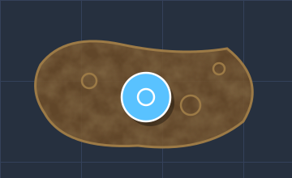

Recipe (now): `ZONE_LOOK.mire` (edge `0x9c7a46`, `painter: "mud"`):
`zone-painter.ts` paints mottled mud with dark pools once per map, and
bubbles swell and pop every frame.

## 5. Animation timing

| Thing            | Timing                                                                              |
| ---------------- | ----------------------------------------------------------------------------------- |
| Zone fill breath | one cycle every **1.6 s** (`PULSE_SECONDS`), fill alpha ± pulse                     |
| Fire flicker     | two sines, changing every **66 ms** (`FLICKER_INTERVAL_MS`)                         |
| Water ripple     | **5 s** period, 3 units of drift (`RIPPLE_PERIOD_SECONDS`)                          |
| Idle loops       | **1 to 6 s**; never faster than a heartbeat, never above 3 Hz                       |
| Strike telegraph | the edge goes 2.5× wider and the fill 60 % within **0.3 s** of the warning starting |
| Strike           | full fill, edge stays 2.5× wide                                                     |
| Overhang fade    | to 0.35 alpha and back over **0.2 s** (`OVERHANG_FADE_SECONDS`); at once, reduced   |

- **Danger must read in under 0.3 s**: the telegraph's change is a jump, not
  a fade, and it is a change of **edge width and brightness**, which survive
  colour blindness.
- **Reduced motion** (`still`): breath, ripples, flicker and drift hold still
  at their mean. **Telegraph and strike are not decoration**: they stay, as
  states, because a player acts on them.
- Idle motion is calm and low-contrast. The more a thing can hurt, the less
  it may distract from the fight: fog may breathe at 0.14, mire at 0.03.

Now: `zone-look.ts` (`zoneFillAlpha`, `strikeEdgeScale`), `hazard-marks.ts`
(`hazardVisual`), `water-shape.ts`,
`lighting-model.ts` (`flickerAt`).

## 6. Gameplay readability

Every rule below can be checked from one screenshot.

1. **A zone's edge is always visible**: a hard rim, 2 lines wide, over
   water, fog and light.
2. **Signal class sets the hue.** Damage is warm (fire, lava, strike); poison
   is acid green or olive (foul and tainted water); drain is violet (draining
   spire); rockfall is grey. Help is cool blue or green. A harmful thing never
   uses the help blue or green; a harmless thing may not be warm. Pulsing is
   target: vents, gas spouts and rockfall do not pulse today.
3. **Art never hides a body, a projectile or a telegraph.** Decoration sits
   under bodies, and tall props are drawn beside, not on, a lane.
4. **Zone tint stays above water and light** in render order.
5. **Each kind of zone has its own shape language** (target: today every
   edge is a solid line), so two kinds that share a hue still differ: harmful ground has a **dashed** edge, help a **solid**
   one, strike zones a **dashed edge that goes solid** when they fire.
6. **A dark corner is lit enough to fight in**: bodies at 0.7 or more.
7. **Hidden bodies show their x-ray outline** under every cover.
8. **At 16 px** a zone is still told from the next by hue **and** edge.
9. **Colour-blind pass**: view the screenshot in grey; the danger edge and
   the telegraph still stand out.

Rules 3 and 7 are checked by CI (#3251): `render/visibility-gate.test.ts`
draws every map through the scene's own map drawing, records each filled
polygon at its depth, and stands a body on every point the simulation lets
one stand, 8 units apart, on every layer. Wherever a structure is painted
over a body, its hidden outline must show there, and nothing static is
painted over the outline. Art that reaches past its occluder fails it,
naming the map, the point and the piece. A fix is in the occluder
(`occludersOf`) or in the art. A map whose geometry hides a body until a
map edit lands goes in `KNOWN_HIDDEN` with its issue. That list only
shrinks: an entry whose map passes fails as stale.

Worked example, toxic fog (`toxic-fog.svg`): soft overlapping puffs inside a
hard dashed edge, so the cloud can move and the boundary cannot.

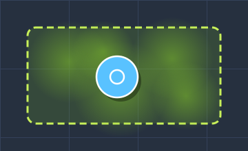

Recipe (now): `ZONE_LOOK["toxic-fog"]` (edge `0xc8f05a`, pulse 0.14,
`painter: "fog"`): overlapping radial-gradient puffs over a 22 % green
wash, and soft puffs that drift inside the edge, never over it.

## 7. Worked examples

The scene sheets come first: they show the 2.5D look this page asks for, as a
whole, before the single elements. Textures (noise, planks, blocks) are
**target**: today the renderer fills walls and ground flat, so a sheet shows
where #3052 and #3053 are heading, and a recipe line says "now" only where a
developer can copy the value from main.

### A lit scene

A deck with a ramp and a wall, a pit, a rock outcrop, a torch and a fire, one
sun. Read the height by the lip, the face and the shadow; the light by its
pools, which add on every layer.

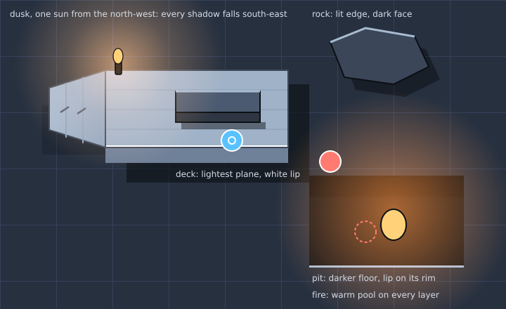

### Heights

Pit, ground and deck at the same scale, with the four cues each time: tone,
lip, face, shadow. Numbers (PIT_FLOOR, ELEVATION_STEP) are now.

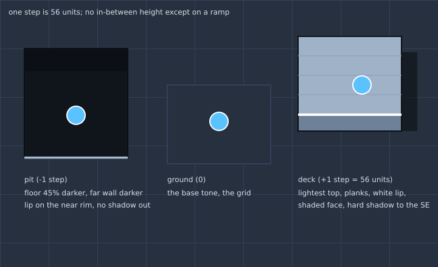

### Walls

Stone, rock and wood: always a lit top edge over a darker face, an outline and
a shadow to the south-east. The blocks, planks and cracks are target.

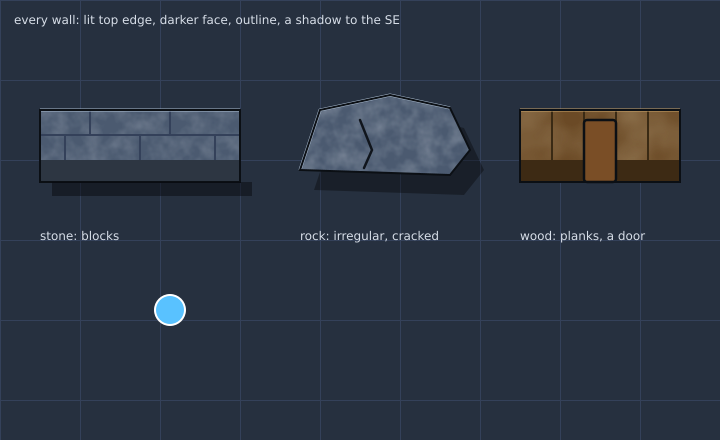

### Materials

Six swatches, each a base tone, noise and a lit top edge. The base colours are
the palette (§1); the noise is target.

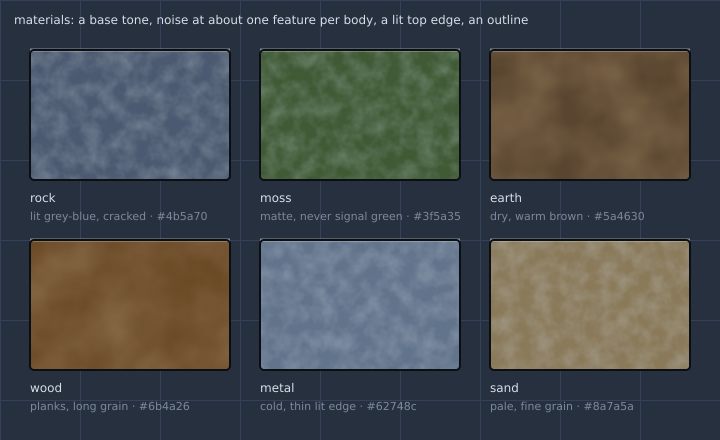

### Lava

Hot core `#ffd23d`, body `#ff5a1f`, crust `#b8401a`, dark cracks, a bright
rim, and a warm light cast outwards. Danger: warm, and the loudest tone in
the room.

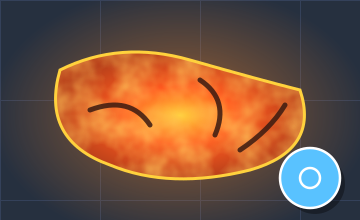

Recipe (now): `ZONE_LOOK.molten` (edge `0xffd23d`, `painter: "lava"`): a
mottled crust split by glowing cracks, beads of lava running down them. Its
`light` (`0xff9040`, 0.9, flicker 0.35) stands on the centroid, reaching 1.6
times the zone's half-diagonal: `zone-light.ts` adds it, the map has none.

### Water, deep and shallow

Deep is dark with a hard pale shore and sparse ripples: a body cannot be
seen through it. Shallow is clear, shows the floor, and ripples more. Both
are scenery under the zone tint.

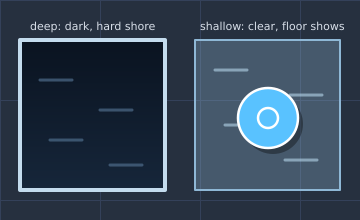

Recipe (now): `WATER_LOOK.deep` = `{ fill: 0x0a1320, fillAlpha: 1, shore:
0xc4dcee, shoreWidth: 3, ripple: 0x4e6c8a, rippleAlpha: 0.7 }`;
`WATER_LOOK.shallow` = fill `0x8fb8d6` at 0.3, shore `0x8fb8d6`.

### Toxic fog

See §6. Acid green, soft body, hard edge.

### Mire

See §4. Earth brown, noise, bubbles.

### Torch light

See §2.

### Rock wall

See §3.

### Door, open and closed

**Shut** is a solid oak bar across the gap, set between two wall stubs.
**Open** is the stubs and a clear gap over a dark sill, the leaves swung back
flat against the walls, so a player sees where it will close. Shape differs,
not only colour.

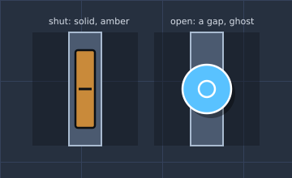

Recipe (#3061, #3053): `gate-mark.ts` `GATE_ART`. Shut, the wall pass draws
the door as a wall box in `GATE_DOOR_LOOK`: oak `#7a4e26`, a seam and two
iron bands `#2a2a30` across its top and round its front, an iron frame
`#3b4759` and a brass knob, lit by `litStructurePalette` like a wall. Open,
`drawGate` lays a dark sill on its layer's ground, iron jamb lines at its
ends, and `openLeaves` stands its two leaves against the walls beyond them,
on the camera's side. Its pressure plate, `paintPlate`, is a stone disc that
stands proud and sinks flush, ringed brass, while held. Study:
`3053-hazards.png`.

### Lever, up and down

The handle **stands** when up and **lies** when down, so the state reads by
shape; the knob is brass `#e8c27a` when up and dull grey `#6a6560` when down. Wooden arm `#8a5a2a`, stone base `#827b70`.

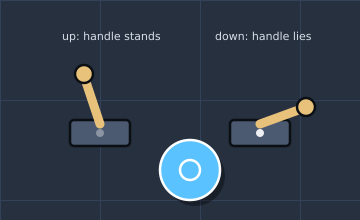

Recipe (#3053): `switch-mark.ts` draws a stone base and a wooden arm,
leaning back when up and lying right when thrown, in `SWITCH_MARK_LOOK`, a
small brass glow round the knob while up. A flip plays a quarter-second
throw (`leverThrown`); under reduced motion it snaps.

Every SVG here is made by `scripts/assets/visual-style.mjs`; regenerate with
`node scripts/assets/visual-style.mjs`.

## 8. Review checklist

A reviewer or QA ticks these on a map or world-art PR, from a screenshot.

**Tick now** (the renderer does these today):

- [ ] No signal colour is used as scenery.
- [ ] One sun, from the north-west; shadows fall south-east.
- [ ] 16 lights or fewer; fire is warm, magic is cold.
- [ ] Every height step reads: lit top, lip, darker face, shadow or pit.
- [ ] The map names its biome.
- [ ] Every zone has a visible edge, over water and light.
- [ ] Hue follows signal class (§6 rule 2): harmful never wears help blue or green.
- [ ] Hazards telegraph by edge width within 0.3 s.
- [ ] Nothing hides a body, projectile or telegraph.
- [ ] The screenshot still reads in grey and at 16 px.
- [ ] Reduced motion holds idle loops still and keeps strike states.

**Target** (engine work first; do not fail a map on these until it lands):

- [ ] No fill is flat; texture is about one feature per body.
- [ ] Zone edges differ by pattern (dashed harmful, solid help).
- [ ] Contact shadows under bodies and props.
