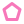

# Основи на битката

## Здраве и енергия

Започваш с 480 **здраве** и 20 **енергия**, а бронята ти добавя енергия: нищо за Warrior, 5 за Ranger, Assassin или Dervish, 10 за всички останали. Тоягата добавя още 10, докато я държиш. Бронята на Dervish добавя и 25 здраве. Руните и моралът променят и двете. Уменията струват енергия, а тя се връща сама, бавно.  **Warrior** и  **Paragon** си я възстановяват най-бавно,  **Ranger** малко по-бързо, всички останали най-бързо.

Стрелките на лентите ти са **пипове**: всяка е здраве или енергия, които се връщат или изтичат, по малко всяка секунда.  **Bleeding**,  **Burning** и  **Poison** изтощават здравето; Regeneration и лечебните заклинания го добавят. Ако си извън битка 5 секунди, здравето ти започва да се връща само, толкова по-бързо, колкото по-дълго стоиш настрана.

## Адреналин

 **Warrior**,  **Paragon** и други имат умения, които струват **адреналин** вместо енергия. Всяко такова умение се зарежда отделно: всеки твой попаднал удар с оръжие дава на всяко от тях заряд, както и понасянето на голям удар. Използването на едно го изпразва и отнема заряд от другите. Ако си извън битка 25 секунди, всички се изпразват.

## Използване на умение

Умението може да изисква момент за **каст**, а после време за **презареждане**, преди да го използваш пак. Ако целта ти е извън обхват, първо отиваш до нея. Движението или Esc отменя каста: енергията е похарчена, но умението не се презарежда. След всяко умение с време за каст, освен  **умение за атака**, има кратка пауза, в която не можеш да действаш.

Умение, което натиснеш, докато използваш друго, или в тази пауза, се **нарежда**: то е следващото и слотът му пулсира, докато дойде редът му. Чака само едно; натискането на друго го заменя. Движение, Esc, прекъсване или поваляне го отменя.

 **Виковете** и  **стойките** никога не се нареждат: задействат се веднага, дори докато кастваш друго умение, в тази пауза или когато си повален. Кастът продължава. Използвани така, те не те отвеждат до целта: извън обхват се отказват.

## Прекъсвания и поваляне

**Прекъсването** спира умението на враг, докато го използва. Енергията му е похарчена и умението се презарежда; някои прекъсвания заключват умението за известно време. Прекъснеш ли твърде рано или твърде късно, не става нищо.

Всяка професия звучи по свой начин, когато използва умение; слушай звука на целта си.

Повечето прекъсвания спират и обикновена атака по средата на замаха: този удар не попада и замахът започва отначало. Враг, който още върви към целта си, няма какво да бъде прекъснато. Прекъсване, чиято карта казва „умение“ или „заклинание“, не засяга обикновена атака.

Някои  **стойки**, като Mantra of Concentration, спират прекъсване, насочено към теб. Никоя от тях не спира поваляне.

**Повален**, за момент не можеш да се движиш, да атакуваш или да използваш умение, освен  **вик** или стойка, а умение в процес на каст се проваля.

## Състояния, проклятия и омагьосвания

**Състоянията** ти вредят, докато изтекат или бъдат премахнати:

| Състояние                                                                                   | Какво прави                                                         |
| ------------------------------------------------------------------------------------------- | ------------------------------------------------------------------- |
|  **Bleeding**                | изтощава здравето                                                   |
|  **Burning**                   | бързо изтощава здравето                                             |
|  **Poison**                      | изтощава здравето                                                   |
|  **Disease**                   | изтощава здравето и се разпространява към същия вид същество до теб |
|  **Crippled**                | движиш се с половин скорост                                         |
|  **Blind**                         | повечето ти атаки не попадат                                        |
|  **Weakness**                | ударите с оръжие са много по-слаби                                  |
|  **Cracked Armor** | по-малко броня                                                      |
|  **Deep Wound**          | по-малко максимално здраве и лечението действа по-слабо             |
|  **Dazed**                         | заклинанията се правят бавно; всяка атака ги прекъсва               |

Слугите (без Месния голем), призраците и духовете не кървят, не се отравят и не се разболяват, а духовете не поемат проклятия и никакво състояние освен **Burning**.

 **Проклятията** ти се налагат от врагове;  **омагьосванията** от теб или от съюзниците ти. Всяко се премахва със свой вид умение. Някои омагьосвания са **поддържани**: траят, докато ги прекратиш, и струват един пип енергия, докато действат. Щракни два пъти върху иконата, за да прекратиш такова.

Няколко умения спират да действат, докато си омагьосан, и започват пак, щом вече не си. Умение, което трае за „следващите N атаки“, брои всяка атака, така че пропуск или блок изразходва една също толкова сигурно, колкото попадение.

## Броня и щети

 **Warrior** и  **Paragon** носят най-много броня;  **Ranger**,  **Assassin** и  **Dervish** по-малко; заклинателите най-малко. Бронята намалява оръжейните, елементалните, хаос и тъмните щети. Светите, сенчестите и безтиповите щети, изтощаването на здраве и кражбата на живот я пренебрегват. Само ударите с оръжие могат да са критични. Някои омагьосвания правят носителя си имунизиран срещу критични удари.

## Смърт, възкресение и морал

В повечето режими мъртвите остават на земята, докато съюзник не ги **възкреси** с умение, като Resurrection Signet, което всеки може да вземе. Някои режими връщат мъртвите на вълни или сами; виж [Режими](modes.md).

Докато си мъртъв, ред под таблото с резултата отброява до завръщането ти
или ти казва да изчакаш възкресяване. Прозорецът на групата показва
отброяването до всеки мъртъв съюзник.

Всяка смърт ти струва 15% **морал**, до -60%: максималното ти здраве и енергия намаляват с него. Всеки враг, убит от отбора ти, връща 2% от него, до 0. В Битка на гилдии държането на поста за знаме го вдига над това, до +10%.
