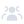
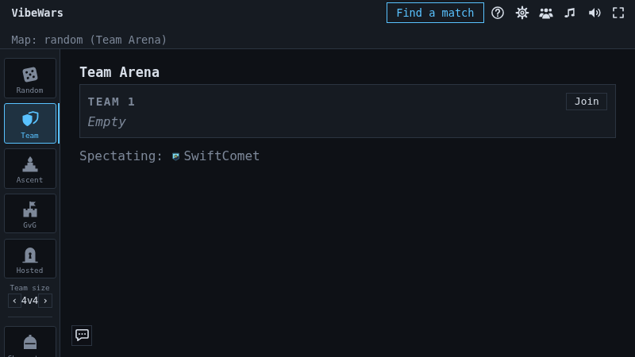

# Erste Schritte

VibeWars ist ein Teamkampf in einer kleinen Arena. Jeder Spieler bringt einen
Charakter mit acht Skills mit. Das Team, das den Kampf gewinnt, gewinnt das Match.
Du brauchst kein Konto und musst nichts installieren: Das Spiel läuft in diesem
Browser-Tab. VibeWars braucht Tastatur und Maus. Auf dem Handy oder einem reinen
Touch-Tablet läuft es nicht: Öffne es am Computer.

## Das Tutorial

Beim ersten Öffnen bietet dir VibeWars ein kurzes Tutorial an: einen Gang durch eine Schlucht, der dir Bewegen und Kämpfen beibringt. Danach geht es im Menü weiter, Schritt für Schritt: Ändere die Ausrichtung deines Charakters, bau ein Team aus zwei, sieh dir an, wofür jeder Modus da ist, und stell dieses Team für ein erstes 2v2-Match in der Teamarena in die Warteschlange. Solange ein Schritt auf ein Bedienelement zeigt, ist der Rest des Menüs abgedunkelt. Mit **Tutorial überspringen** kannst du jederzeit aussteigen.

## Die Modus-Leiste

Die Leiste links im Hauptbildschirm enthält die [Modi](modes.md), von oben nach
unten:  **Zufallsarena**,  **Teamarena**,  **Aufstieg der Helden**,  **GvG** und
 **Gehostetes Spiel**. Unter den Modi steht die **Teamgröße**, `‹ 4v4 ›`: Die Pfeile
springen zur nächstkleineren oder nächstgrößeren Größe, die der Bildschirm spielt.
Jeder Bildschirm merkt sich seine eigene und öffnet mit einer Größe, die er spielt
(GvG mit 8v8). Darunter liegen der  **Charakter-Editor**, in dem du deine Charaktere
baust, und der  **Team-Editor**, in dem du deine
[Team-Builds](skills-and-builds.md#team-builds) baust, dann  **Matches**, die
[beendeten Matches](modes.md#match-berichte), wie ihre Hosts sie melden. Das Spiel
öffnet mit dem, den du zuletzt genutzt hast.

## Einen Charakter bauen

Deine Charaktere sind die Karten im **Charakter-Editor**, die neuesten zuerst, und
der Charakter, den dein erster Start gewürfelt hat, steht immer zuletzt: ein
PvX-Build, nach ihm benannt.

1. Drück **Neuer Charakter**.
2. Wähle eine **Primärklasse**, das, was dein Charakter hauptsächlich ist, und eine
   **Sekundärklasse**, die dir ihre Skills leiht, aber nicht ihr Primärattribut.
3. Fülle die **Skill-Leiste** mit acht Skills aus der Skill-Bibliothek.
4. Vergib deine **Attributpunkte**. Ein Attribut macht die Skills stärker, die es
   nutzen; die Zahlen in der Beschreibung eines Skills ändern sich, während du
   vergibst.
5. Drück **Speichern**.

Der Editor sagt dir, wenn ein Build nicht spielbar ist, zum Beispiel wenn zwei
Elite-Skills auf einer Leiste liegen. Klick auf die Karte eines Charakters oder ihr
**Ändern**, um ihn zu bearbeiten. Ein Charakter ohne Skills spielt auch, nur mit
Auto-Angriff.

Ein Charakter, dessen Regeln sich durch das Spiel geändert haben, zeigt rote
Streifen und **Ungültig**. Du kannst ihn erst spielen, wenn du ihn per **Ändern** zu
einem gültigen Build machst und speicherst.

Unsicher, was du nehmen sollst? Der zufällige Startcharakter ist mit **Zufall** und
einem gestrichelten Rand markiert. **Würfeln** darauf gibt dir einen neuen
Zufalls-Build zum Ausprobieren. Die Zufalls-Builds sind gut bewertete PvP-Builds aus
dem [PvX-Wiki](https://gwpvx.fandom.com/), jeweils so benannt wie im Wiki, mit ihren
Klassen: „Gust (E/Me)“.

Auch der **Team-Editor** beginnt mit einem zufälligen Team-Build, einem fertigen
Team für eine Team-Lobby in jeder Größe, 2v2, 4v4 und 8v8, genauso markiert und immer
zuletzt. Der Team-Editor zeigt die Team-Builds der **Teamgröße** aus der Seitenleiste,
der zufällige gehört also zur dort gewählten Größe. **Würfeln** setzt ein anderes
fertiges Team an seine Stelle. Die fertigen Teams sind die gut bewerteten
PvP-Team-Builds des PvX-Wikis; für eine Größe, die PvX nicht hat, werden PvX-Solo-Builds
zusammengestellt. **Klonen** speichert eine Kopie des angezeigten Teams als deinen
eigenen Team-Build und öffnet sie, damit du sie nach Belieben ändern kannst.

## Eine Zufallsarena spielen

Der schnellste Weg in einen Kampf. Klick in der **Zufallsarena** auf die Karte des
Charakters, den du spielst, wähle mit den Pfeilen der **Teamgröße** in der Leiste
eine Größe, **1v1**, **2v2** oder **4v4**, drück dann **Match suchen** in der Titelleiste
und warte: Du kommst in ein Team mit anderen Spielern, gegen ein anderes Team, auf
einer zufälligen Karte. Die Warteschlange läuft im Hintergrund: Du bleibst in der
Zufallsarena und kannst währenddessen überallhin, zu deinen Builds, deiner
Ausrüstung, den Optionen, der Hilfe oder dem Musik-Editor, aber du kannst weder den
Charakter wechseln noch eine Lobby hosten oder ihr beitreten oder die Teamgröße eines
Modus ändern. Teamarena und die anderen Lobby-Bildschirme sagen dir, dass du in einer
Warteschlange bist; die Teamgröße zeigt in jedem Modus die Größe, mit der du dich
angemeldet hast. Ein Ring, der sich links von **Hilfe** in der oberen Leiste dreht,
zeigt, dass du in der Warteschlange bist; klick darauf für die Warteschlange, die
Wartezeit, wie viele suchen und **Abmelden**. Wird ein Match gefunden, kommst du von
überall auf seinen Versus-Bildschirm. Schließt du den Tab, während du wartest, bist du
sofort aus der Warteschlange.

Wenn das Match endet, kannst du **Nochmal** wählen oder mit dem Team von eben
**Zusammenbleiben**.

Jedes Match endet auf seinen Punkten, ob aus der Warteschlange, gehostet oder
in einer Lobby, und neben ihnen erzählen zwei Diagramme das Match im
Zeitverlauf; der Warteschlangen-Bildschirm zeigt sie nach einem Match aus der
Warteschlange noch einmal. **Du**
zeigt deinen verursachten Schaden, erlittenen Schaden, deine Heilung und
Energie; **Teams** zeigt den Lebenspool jedes Teams über seinem Gesamtschaden.
Markierungen unter der Zeitachse zeigen Kills, Tode, Unterbrechungen,
Eroberungen und Wiederbelebungen: Zeig auf eine oder spring mit Tab zu ihr, um
zu lesen, was passiert ist. Drück auf einen Legendeneintrag, um seine Linie
aus- oder einzublenden. Auf dem Handy stehen die Diagramme unter den Punkten,
die dich und zwei andere zeigen, bis du **Alle zeigen** drückst.

**Spielverlauf** in der oberen Leiste listet deine letzten 50 Matches, die neuesten zuerst: Öffne eines, um seine Punkte und Diagramme noch einmal zu sehen. Sie bleiben nur in diesem Browser. **Meine Spiele** zeigt nur die, die du mit deinem aktuellen Spielerschlüssel gespielt hast.

## Match hosten oder beitreten

Du bist immer in einer Lobby: Ab dem Moment, in dem die Seite öffnet, hostet sie eine
eigene. Die Lobby ist deine Gruppe: **Lobby** in der oberen Leiste, zwischen Optionen
und Musik, öffnet ein Fenster mit dem Einladungslink, Offen/Zu und Verlassen und einer
Liste, wer drin ist; das Abzeichen zählt sie.

- **Einladen:** Drück **Einladungslink kopieren** im Lobby-Fenster und schick den Link
  deinen Freunden. Er enthält den geheimen Schlüssel deiner Lobby, also teile ihn nur
  mit Leuten, die du dabeihaben willst. Weigert sich dein Browser zu kopieren, erscheint
  der Link markiert: Kopiere ihn von Hand.
- **Öffne deine Lobby**, bevor Freunde beitreten: Deine Lobby beginnt **Zu** (ein
  geschlossenes Vorhängeschloss), und niemand kann beitreten, auch nicht mit dem Link.
  Drück **Zu** im Lobby-Fenster, um sie zu öffnen: Es wird zu einer hervorgehobenen
  offenen Tür, **Offen**, und jeder mit dem Link kann beitreten. Drück noch einmal, um
  sie zu schließen: Freunde, die schon drin sind, bleiben, und niemand Neues kommt rein.
  Ein Gast sieht das Schloss und „Lobby geschlossen“ im Lobby-Fenster, solange sie zu
  ist.
- **Beitreten:** Öffne den Einladungslink, den du bekommen hast, in einem neuen Tab oder
  füge ihn in die Adressleiste eines offenen ein. **Lobby beitreten** im Lobby-Fenster nimmt den Link ebenfalls an. Deine eigene Lobby bleibt offen, bis
  der Beitritt durch ist. Danach steht im Lobby-Fenster **Lobby**, und **Verlassen**
  bringt dich zurück in eine neue eigene Lobby mit einem neuen Einladungslink. Ein Link,
  der auf einem Lobby-Bildschirm oder im Match geöffnet wird, bittet dich, erst ins Menü
  zurückzugehen. Bricht deine Verbindung ab, bleibt dein Platz 30 Sekunden reserviert.
- **Jemanden entfernen:** Drück als Host außerhalb eines Matches das **×** neben dem Namen
  eines Spielers im Lobby-Fenster. Er erfährt, dass der Host ihn entfernt hat, bekommt
  eine neue eigene Lobby und kann deiner nicht wieder beitreten, solange sie besteht.
- **Teile dein Relay:** Manche Freunde erreichen dich nur über ein TURN-Relay. Schickt dir
  ein Freund, der eines betreibt, seinen Relay-Link, öffne ihn und drück **Nutzen**: Es wird
  zu deinem Relay und wird in jeder Lobby angeboten, in der du bist, nicht nur in denen, die
  du hostest. Ein Spieler, der den Host nicht direkt erreicht, tritt dann nach ein paar
  Sekunden darüber bei, ohne etwas einzurichten. Jeder Spieler bekommt seinen eigenen
  Login, 1 Stunde gültig und erneuert, solange er bleibt, höchstens 8 Spieler pro Lobby.
  **Optionen → Relay (TURN)** zeigt es: Ein Spieler, der so verbunden ist, liest dort
  **Relay geteilt von** und den Namen dessen, der teilt; während du teilst, steht dort
  **Dein Relay wird mit … Spielern geteilt**. Zum Beenden nimm das Häkchen bei **Mein Relay mit meinen Lobbys teilen** unter
  **Optionen → Relay (TURN)** heraus. Ein Relay, das du dort von Hand einträgst, gehört
  immer nur dir.
- **Deine Gruppe kommt mit:** Hattest du Freunde in deiner Lobby, fragt die obere Leiste
  zuerst (**Beitreten**, um zu gehen, Esc, um zu bleiben), und sobald du drin bist, folgen
  sie dir in die Lobby deines Freundes. Wer nicht reinkommt, weil sie voll ist oder
  inzwischen zu, bekommt eine neue eigene Lobby und erfährt, warum.

**Der Host wählt den Modus** in der Leiste, und alle Bildschirme folgen; die Modi eines
Gasts sind gesperrt. **Charakter-Editor**, **Team-Editor** und **Matches** stehen allen
offen, und sie zu öffnen verlässt die Lobby nicht. Tritt auf dem Bildschirm eines Modus
einem Team bei, und wenn alle drin sind, drückt der Host **Match starten**; Bots spielen
jeden Platz, den niemand nimmt. Die Lobby listet die Spieler nach Namen: Was du spielst,
ist der Charakter, den du in der Team-Lobby wählst, du brauchst also keinen eigenen, um
beizutreten. Die **Zufallsarena** meldet dich nur an, wenn du allein in deiner Lobby bist:
Verlass die Gruppe oder spiel ein Gehostetes Spiel. Sie spielt den dort gewählten
Charakter; wählst du einen anderen, spielst du ihn ab dem nächsten Match.

**Teamarena**, **Aufstieg der Helden** und **GvG** bieten nur die Karten dieses Modus an:
**Teamarena** die für Vernichtung, Kill-Zähler und Priestervernichtung, **Aufstieg der
Helden** die für Reliktlauf, King of the Hill und Punkte erobern und **GvG** die der
Gildenschlacht. **Gehostetes Spiel** bietet jede Karte. Deine **Team-Builds** liegen nur
im **Team-Editor**, und du wählst keinen vor der Lobby. Bei **Gehostetes Spiel** öffnet die
Lobby beim Start des Hosts die [Team-Lobby](modes.md#team-lobby): Schlage dort einen
Team-Build vor, klick auf eine Karte, die die Waffen und Skills jedes Mitglieds zeigt, um
für einen zu stimmen, und klick dann auf einen Platz, um einen seiner Charaktere zu nehmen.
Die Plätze zeigen die Spieler und ihre Klassen; der Name eines Charakters erscheint im Match.

In der **Teamarena** (2, 4 oder 8 pro Seite, die **Teamgröße** des Hosts), im **Aufstieg
der Helden** und in **GvG** (8 pro Seite) ist deine Lobby eine Seite, deine Gruppe, und es
gibt keinen Start und keine Bot-Anzahl: Der Host drückt **Match suchen**. Zuerst kommt die
Team-Lobby, nur mit Team-Builds genau dieser Größe; jeder Platz, den niemand nimmt, ist ein
Bot. Dann kommt die Gruppe in die Warteschlange, und derselbe Ring links von **Hilfe** zeigt
sie an: Sein Fenster nennt die Warteschlange (**Teamarena 2v2**, **Aufstieg der Helden ·
Runde 3**, **Gilde gegen Gilde**) mit der Wartezeit und in der Teamarena, wie viele Teams
suchen, deines eingeschlossen: `2 Teams suchen`. Nur der Host hat dort **Abmelden**. Schließt
der Host den Tab, ist die Gruppe sofort aus der Warteschlange. Taucht ein anderes wartendes
Team desselben Modus auf, spielt ihr auf einer der Karten des Modus gegeneinander, jede Seite
mit ihren eigenen Builds, und kommt danach in eure Lobby zurück. Der Host kann die Warteschlange jederzeit im Fenster des Rings verlassen; ein Gast, der geht, nimmt die ganze Gruppe aus der
Warteschlange. Nach 10 s in der Warteschlange kann der Host auch im Fenster des Rings **Gegen Bots
spielen** drücken: ein Match in deiner eigenen Lobby gegen ein zufälliges vorgefertigtes
Team aus Bots, außer im [Aufstieg der Helden](modes.md#aufstieg-der-helden), der auf ein Team
in deiner Runde wartet.

## Dein Name, Gildenkürzel und Umhang

Öffne die **Optionen** mit dem ⚙ in der oberen Leiste: Der Abschnitt **Spieler** enthält,
was dir gehört, egal was du spielst. Das Spiel gibt dir beim ersten Besuch einen Namen (**Name**)
wie `AshenWolf`; tippe darüber, um ihn zu ändern. Bleibt er leer, spielst du als `Spieler`.
Tippe daneben ein **Gildenkürzel** aus 2 bis 4 Buchstaben oder Ziffern ein, und alle sehen
es hinter deinem Namen, etwa `Ente [VIBE]`. Mit Kürzel erscheint darunter der Designer für
den **Gildenumhang**: Wähle eine beliebige Umhang- und Saumfarbe, zeichne ein Emblem, und dein Körper trägt den
Umhang in jedem Match: Er faltet sich an deinem Rand zu einem schmalen Band, wenn du stehst,
und weht hinter dir, wenn du läufst. Deine Charaktere im Menü zeigen ihn auch. **Kein Umhang**
nimmt ihn ab. Eine Farbe, die dem Blau deines Teams oder dem Rot deiner Gegner zu nahe ist, wird beim Zeichnen ein wenig davon weggerückt, damit kein Umhang wie ein Team aussieht.

Eine Änderung gilt sofort für die Lobby, in der du bist.

**Zeichne dein Emblem.** Das Emblem-Raster aus 16×16 Feldern liegt immer unter Umhang- und Saumfarbe. Wähle eine Farbe oder **Leer**, dann zeichne mit dem **Stift**, radiere mit dem **Radierer** oder färbe eine Fläche mit **Füllen**. **Farbe hinzufügen** gibt dem Emblem eine weitere Farbe, bis zu 15, und der Farbwähler daneben ändert die gewählte Farbe samt allem, was in ihr gezeichnet ist. **Beginnen mit** legt eine von acht Formen in der gewählten Farbe auf das Raster. **Spiegeln** malt die linke und die rechte Hälfte zugleich. **Leeren** leert das Raster, **Rückgängig** geht einen Schritt zurück. Die kleine Ansicht neben dem Raster zeigt das Emblem so groß wie im Match. Jeder Strich wird gespeichert, sobald du ihn beendest. Mit Pfeiltasten und Leertaste zeichnest du auch per Tastatur.

**Gildenlink kopieren** unter dem Umhang-Designer kopiert einen Link mit deinem Kürzel und Umhang. Wer ihn öffnet, wird gefragt **Der Gilde [VIBE] beitreten?**: **Beitreten** gibt ihm dein Kürzel und deinen Umhang, **Nein** ändert nichts. Jeder kann so einen Link schicken, und niemandem gehört ein Kürzel, darum fragt das Spiel immer zuerst.

## Sprache

Das Spiel startet in der Sprache deines Browsers, wenn es sie hat, sonst auf Englisch. Wähle
unter **Optionen → Sprache** eine andere: Die Seite lädt in ihr neu und behält sie ab dann.
Skill-, Karten- und Gegenstandsnamen sind vorerst auf Englisch. Solange du mit anderen in einer
Lobby, in einer Warteschlange oder in einem Match bist, ist die Wahl gesperrt, weil das Neuladen
dich rauswerfen würde. Spielernamen bleiben, wie ihre Spieler sie geschrieben haben.

## Ein Match ansehen

In einer Lobby, in der gerade ein Match läuft, kann jeder ohne Team **Zusehen** drücken. Du siehst
das ganze Match, beide Teams, alles **10 Sekunden verzögert**, damit niemand beim Zusehen dem
anderen Team die Züge verraten kann. Du kannst nicht laufen, anvisieren oder wirken. Die Kamera
folgt einem Spieler: **Tab** folgt dem nächsten lebenden, **Shift+Tab** dem vorherigen, und das
Zielfenster zeigt, wem du folgst. **Esc** oder **Verlassen** bringt dich zurück in die Lobby; das
Match geht ohne dich weiter.

## Online spielen

Online spielst du Peer-to-Peer: Die anderen Spieler in deinem Match sehen deine IP-Adresse.

## Im Match

- Klick auf den Boden, um dorthin zu laufen, oder lauf mit **W A S D** oder den
  Pfeiltasten.
- Klick einen Gegner rechts an, um ihn anzuvisieren, oder drück **Tab** für den nächsten.
  Drück **Space** oder klick den Gegner noch einmal rechts an, um ihn anzugreifen.
- Deine acht Skills liegen auf **1** bis **8**, Feld 1 zuerst. Du kannst auch
  auf einen Skill auf der Leiste klicken.
- **Esc** bricht ab, was du gerade tust. Jede Taste kannst du in den
  **Optionen** unter Steuerung ändern; die Vorlage VibeWars legt die Skills auf
  Q W E R und A S D F und läuft mit den Pfeiltasten. Alle stehen unter
  [Steuerung](controls.md).

Der Knopf [?] oben rechts öffnet diese Hilfe wieder, auch im Match.
