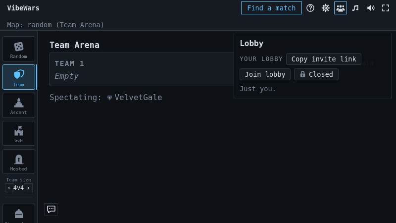

# Modi

Jede Karte spielt einen Modus, und die Lobby nennt ihn unter dem Namen der Karte. Die Modi
sind die Einträge in der Leiste links im Hauptbildschirm. Niemand wählt den Modus einer Karte,
aber der Leisteneintrag, von dem aus du hostest, bestimmt, welche Modi die Karten seiner Lobby
spielen:  **Teamarena** Vernichtung, Kill-Zähler und Priestervernichtung,  **Aufstieg der Helden**
Reliktlauf, King of the Hill und Punkte erobern, und  **GvG** die Gildenschlacht.  **Gehostetes
Spiel** bietet jede Karte. Eine  **Zufallsarena** wählt eine Karte für dich und damit den Modus,
aber nie eine Gildenschlacht, einen Reliktlauf, King of the Hill oder Punkte erobern. Die
Teamarena lost für jedes Match eine ihrer Karten aus, der Aufstieg der Helden beginnt auf seiner
ersten Karte, und nur in einem Gehosteten Spiel wählt der Host.

Zwei Spieler hinter strengen Netzwerken können in einer Warteschlange nicht zueinander finden. Die Warteschlange zählt deshalb nur Spieler, die mit dir spielen können, und sagt es dir. Ein Relay unter **Optionen → Relay (TURN)** hilft.

Jede Karte ist für bestimmte Teamgrößen gemacht, und ein Modus spielt nur eine Karte für seine
Größe: Ein 8v8 quetscht sich nie in eine Arena für 1v1. Die **Teamgröße** in der Leiste springt
nur durch die Größen, die der angezeigte Modus spielt.

| Modus               | Teamgrößen    | Karte                                        |
| ------------------- | ------------- | -------------------------------------------- |
| Zufallsarena        | 1v1, 2v2, 4v4 | für dich ausgelost, passend zur Größe        |
| Teamarena           | 2v2, 4v4, 8v8 | für jedes Match ausgelost, passend zur Größe |
| Aufstieg der Helden | 8v8           | seine Karten der Reihe nach, bis zur Halle   |
| GvG                 | 8v8           | Guild Hall Isle                              |
| Gehostetes Spiel    | alle          | der Host wählt eine passend zur Größe        |

In einer Gildenschlacht, einem Reliktlauf, King of the Hill oder Punkte erobern bekommt ein Ziel
außerhalb des Bildschirms oder unter dem HUD einen umrandeten Pfeil am Bildschirmrand: der
Flaggenstand oder ein Schrein in der Farbe seines Besitzers, grau, wenn er niemandem gehört, der
Altar in Gold. Der gefüllte Pfeil eines Spielers wird darüber gezeichnet.

Ein Match beginnt mit allen festgehalten nahe ihrem Startpunkt: Du kannst ein paar Schritte gehen, aber nicht kämpfen oder Fertigkeiten einsetzen. Eine Zeile oben zählt die Spieler, die das Match geladen haben. Haben alle geladen, zählt sie 10 Sekunden herunter, und das Match beginnt, mit ihm seine Uhr. Auf einen Spieler, der nach 20 Sekunden nicht geladen hat, wird nicht gewartet: Der Countdown beginnt ohne ihn, und er kann später noch dazukommen.

## Vernichtung

**Besiege alle Gegner.** Die Toten bleiben liegen, bis ein Verbündeter sie wiederbelebt, und jeder
Tod kostet Moral. Lösche das andere Team aus, um zu gewinnen. Nach 8 Minuten gewinnt das Team mit
der meisten verbliebenen Moral.

Canyon, Crossroads und Long Hall spielen es, dazu zwei kleine Arenen etwa in der Größe von Canyon:
**Sandstone Steps** (1v1, 2600x1940), eine terrassierte Wüstenstadt mit einem abgesenkten
Brunnenhof, Dächern über ihren Gassen und einer per Hebel verschlossenen Unterführung darunter; und
**Frozen Crossing** (2v2, 2600x1940), ein gefrorener Fluss zwischen zwei erhöhten Ufern, überquert
auf Trittsteinen oder einer Baumstammbrücke, deren mittlere Planke ein Hebel anhebt. Für größere
Teams: **Ashen Courtyard** (4v4, 5120x3840), ein verbrannter, ummauerter Hof mit Wehrgängen und
Türmen oben und einem abgesenkten Brunnenhof unten, dessen Fallgatter am Torhaus von den Mauern aus
bedient wird; und **Moss Vale** (8v8, 5000x2600), ein terrassiertes Tal, von einem tiefen Mühlgraben
zweigeteilt, über den es nur an der Zugbrücke, an der Mühle und durch die Unterführung darunter
hinübergeht. **Canthan Terraces** (1v1, 2400x2100) ist klein, aber steil:
Reisfelder, die einen Hang hinauf zu einer zerstörten Pagode steigen, darunter ein gefluteter
Durchlass, den ein Schleusenhebel als dritten Weg zur Mitte öffnet. **Sunken Bastion** (2v2,
2700x1900) ist klein, aber hoch: eine halb überflutete Festung,
deren Burggraben den Hof teilt; hinüber geht es über eine Zugbrücke, die ein Hebel an jedem Ufer
bedient, über den Wehrgang entlang der nördlichen Ringmauer oder durch den gefluteten Keller
darunter. Und für größere Teams:
**Shiverpeak Pass** (4v4, 5100x3450), ein verschneiter Gebirgspass, von einer Schlucht geteilt, über die
man auf einer Seilbrücke zwischen zwei Felsvorsprüngen kommt, die ein Hebel auf jedem Vorsprung
zieht, durch eine Höhle darunter oder um ihr Ende herum, sobald die Eiswand dort zerbrochen ist;
und **Elonian Plateau**
(8v8, 5520x3360), ein Wüstenplateau mit vier Tafelbergen rund um ein
trockenes Canyonbett: getaktete Aufzüge fahren auf drei davon, ein
natürlicher Bogen verbindet die beiden im Norden, und unter dem mittleren
Grat führt ein Gang hindurch, dessen Tor ein Hebel oben öffnet.

## Kill-Zähler

**Die meisten Kills in 3 Minuten.** Die Toten kehren nach 8 Sekunden an ihrem Spawn zurück, und
Sterben kostet keine Moral. Das erste Team mit 15 Kills gewinnt sofort. Bei Zeitablauf gewinnen die
meisten Kills; bei Gleichstand ist es ein Unentschieden.

Ember Pits spielt es: Lavarinnen mit Steinbrücken darüber, eine Lavaröhre, ein Hebellift
eine Basaltsäule hinauf und Dampfschlote, für jede Teamgröße.

## Priestervernichtung

**Besiege alle Gegner und ihren Priester.** Jedes Team hat einen Priester auf einem Schrein hinter
seinem Spawn. Er bewegt sich nie und greift nie an, heilt aber jeden neben sich, auch Gegner. Alle
2 Minuten bekommt ein Team, dessen Priester lebt, seine Toten auf dem Schrein zurück, mit vollem
Leben und voller Energie. Töte zuerst den Priester, und das andere Team bleibt liegen.

Ein Team verliert, wenn alle Spieler und sein Priester tot sind. Nach 12 Minuten gewinnt die meiste
Moral.

Jungle Ruins (2v2 bis 8v8, 5400x2800) spielt es: überwucherte Tempelruinen, geteilt von einem
Dschungelfluss. Wate durch eine Furt, geh über eine Baumstammbrücke, steig auf die Stufenpyramide
in der Mitte oder nimm den verborgenen Gang darunter, sobald ein Hebel in einem Hof seine Tore
öffnet; Rankenwände lassen sich umhauen.

## Gildenschlacht

**Töte den gegnerischen Gildenlord**, 8 gegen 8. Jede Basis liegt hinter einer Mauer mit zwei Toren;
der Gildenlord steht hinten in seinem Lordraum und schießt mit einem Bogen auf jeden Gegner, den er
sieht. Wachen halten jede Basis: Knights und ein Bodyguard beim Lord, ein Archer hinten im Lordraum,
ein Footman und ein Archer an jedem Tor. Sie kämpfen gegen Gegner nahe ihrem Posten und laufen dorthin
zurück. Solange der Bodyguard lebt, nimmt sein Lord 20 % weniger Schaden, also töte ihn zuerst. Alle
2 Minuten holt der Schrein jedes Teams seine Toten zurück.

Jedes Team hat eine **Flagge** in seiner Basis, und der **Flaggenstand** ist in der Mitte. Visiere
deine Flagge an und drück **Space**, um sie aufzunehmen; trag sie zum Stand, visiere den Stand an und
drück **Space**, um sie zu setzen. Ein Träger läuft langsamer und kann weder angreifen noch
Angriffs-Skills nutzen; er lässt die Flagge fallen, wenn er stirbt, die Waffe wechselt oder **Flagge
ablegen** über seiner Lebensleiste drückt. Setzt du deine auf den Stand, schickt das die Flagge eines
Gegners dort nach Hause. Alle 2 Minuten, die deine Flagge den Stand hält, bekommt dein Team 10 % Moral.

Das Team, dessen Gildenlord stirbt, verliert sofort, ebenso ein Team, dessen Spieler alle tot sind und
das die niedrigste Moral hat. Nach 28 Minuten gewinnt das Team, das dem gegnerischen Gildenlord am
meisten Schaden gemacht hat; ein Gleichstand ist eine Niederlage für beide, denn Unentschieden gibt es
nicht.

Die Anzeigetafel zeigt das Leben jedes Gildenlords, deinen zuerst, wer den Stand hält und wie lange
bis zu seinem Schub, wann die Schreine die Toten als Nächstes zurückholen und in den letzten 3 Minuten
den Schaden jedes Teams am gegnerischen Lord. Darunter nennt eine Zeile, wer eine Flagge trägt. Ein
Schub erscheint als „Moralschub! +10%“ oder „Moralschub beim Gegner“. Auf dem Kompass markiert ♛ jeden
Gildenlord, ⚑ jede Flagge und ◎ den Stand.

Guild Hall Isle (8v8, 6000x2600) spielt es: eine Insel im Meer. Jeder Guild Lord steht oben auf einer Halle, hinter einem Wall; hinaus geht es durch das Torhaus, über den Wall oder einen Steg entlang. Eine Torhaustür öffnet ein Hebel auf dem Wall des Gegners. Der Fahnenständer steht auf einem Podest in der Mitte.

## Reliktlauf

**Trag dein Relikt zum Altar.** Jedes Team hat ein **Relikt** in seiner Basis, und der **Altar** ist in
der Mitte, von beiden Basen gleich weit, über eine Nord- oder eine Südroute; auf dem Kompass erscheint
der Altar als ◆. Visiere dein Relikt an und drück **Space**, um es aufzunehmen. Trag es auf den Altar,
und du bekommst sofort einen Punkt, und das Relikt kehrt in deine Basis zurück. Jeder Punkt wird
angesagt, mit einer Fanfare, die für deine steigt und für ihre fällt. Ein Träger läuft langsamer und
kann weder angreifen noch Angriffs-Skills nutzen. Er läuft durch sein eigenes Team, aber ein Gegner
blockiert ihn weiter. Er lässt das Relikt fallen, wenn er stirbt oder **Relikt ablegen** über seiner
Lebensleiste drückt, und das Relikt bleibt liegen, bis jemand hinkommt. Dein Team nimmt es von dort
auf. Ein Gegner, der es mit leeren Händen erreicht, schickt es nach Hause. Das Relikt eines Gegners in
seiner Basis darfst du nicht anrühren.

Die Toten bleiben liegen, bis ein Verbündeter sie wiederbelebt, und jeder Tod kostet Moral. Lösche das
andere Team aus, um sofort zu gewinnen. Nach 8 Minuten gewinnt das Team mit mehr Punkten; bei Gleichstand
ist es ein Unentschieden. Kills zählen nichts.

Die Anzeigetafel zeigt die Punkte, deine zuerst, und die Uhr. Darunter sagt eine Zeile für jedes
Relikt, wo es ist: `✦ Name` beim Träger, `✦ fallen gelassen` am Boden oder `✦ in der Basis`.

Auch Bots laufen mit dem Relikt: Der nächste zu deinem Relikt holt es, außer du nimmst es gleich selbst
auf. Ein Bot außerhalb des Kampfes geht zuerst; sind alle im Kampf, verlässt der nächste ihn für das
Relikt, damit ein Patt am Altar das Punkten nie stoppt. Ein Heiler oder ein schwer verletzter Bot geht
nur, wenn kein anderer kann, und nie aus einem Kampf. Der nächste zu einem fallen gelassenen Gegnerrelikt
schickt es nach Hause, und der Rest wartet am Altar. Ein Bot, der dein Relikt trägt, läuft direkt zum
Altar; die anderen verlassen das Relikt nur, um gegen einen Gegner in Zauberreichweite zu kämpfen.

Broken Tower (4v4 und 8v8, 5400x2800) spielt es: ein gestürzter Turm auf einem Hügel im Hochland. Steig über die Treppen der Trümmerterrassen zum Altar auf dem Turmstumpf oder nimm den Keller unter dem Hügel, sobald ein Hebel auf der Terrasse seine Tore öffnet; Trümmerwände lassen sich zerschlagen.

### Cinder Sanctum

Hier läuft der Reliktlauf des Aufstiegs der Helden andersherum. Jede Basis hat das Relikt ihres Teams und ihren Geisterhelden, einen Altar gibt es nicht. **Hol das gegnerische Relikt aus dessen Basis und bring es zu deinem eigenen Geisterhelden**, das gibt einen Punkt. Der Geist muss leben und bleibt auf seinem Posten. Dein eigenes Relikt kannst du nicht tragen: Hebst du es dort auf, wo es gefallen ist, geht es nach Hause. Ein Team mit **3 Punkten Vorsprung gewinnt sofort**. Nach 8 Minuten gewinnt das Team mit mehr Punkten, bei Gleichstand das Team, das zuletzt gepunktet hat. Jede Basis belebt alle 2 Minuten ihre Toten und ihren Geist wieder. Bots holen das gegnerische Relikt gemeinsam und bringen es heim.

Cinder Sanctum (8v8, 5600x2800) spielt es: ein Tempel an der Flanke eines Vulkans zwischen zwei Lavaströmen. Überquere sie über eine Brücke oder den Damm zum Heiligtum auf seinem Vorhof; ein Hebel auf dem Vorhof öffnet den verborgenen Gang unter dem Heiligtum, und Aschewände lassen sich zerschlagen. Lava verbrennt.

## King of the Hill

**Führe deinen Geisterhelden auf den Altar und halte ihn.** Jedes Team hat einen **Geisterhelden** in
seiner Basis, einen Geist, der mit einer Axt kämpft und den niemand spielt. Der **Altar** ist in der
Mitte, von beiden Basen gleich weit. In **Threefold Keep** kämpfen drei Teams (zwei, wenn kein drittes frei ist) auf dem Turm einer ummauerten Feste um ihn. Höchstens 12 Punkte pro Team, und stehen alle Gegner bei -60 % Moral, gewinnst du sofort. Die **Hall of Heroes** (8v8, 5000x4400), die Karte
am Ende des Aufstiegs der Helden, ist eine goldene Halle für drei Teams: Der Altar steht auf einem Podest
mit Säulen und sechs Treppen, auf einem Sockel mit einer Galerie hinaus zwischen je zwei Basen, und von
jeder Basis führt eine Krypta unter dem Boden hinauf in den Sockel. Die Kryptatüren sind anfangs zu, und
der Hebel jedes Teams öffnet alle drei. Visiere deinen Geist mit **Rechtsklick** an und drück
**Space**, damit er dir folgt: Er läuft mit dir und kämpft gegen das, was du bekämpfst. Drück noch einmal
Space auf ihn, und er bleibt stehen und kämpft gegen jeden Gegner, der nah kommt. Stirbst du oder gehst,
bleibt er stehen. Hast du deinen Geist im Visier, sagt sein Rahmen, wem er folgt oder dass er bleibt. Eine
Einblendung sagt, wem dein Geisterheld folgt, wann immer sich das ändert, und sein Name über dem Kopf zeigt
seinen Anführer.

Dein Geist hat 640 Leben und schwingt seine Axt mit **Cyclone Axe**, **Disrupting Chop** und **Swift
Chop**, ob er folgt oder bleibt. Er wird stärker, je weiter oben im Aufstieg du bist: Stufe 24 in Threefold
Keep, 28 in der Hall of Heroes. **Töte den Geist des anderen Teams**, und jedes Mitglied deines Teams
bekommt einen **Moralschub von +10 %**, der zuerst eine Todesstrafe aufhebt und nie über +10 % geht. Töte
ihn noch einmal, nachdem er aufersteht, und du bekommst ihn erneut.

Führe ihn auf den Altar oder daran vorbei, und er steigt auf den Altar und bleibt dort. Dort kämpft er
gegen jeden Gegner neben sich, geht ihm aber nie nach. Ein Geist auf dem Altar nimmt ihn von selbst ein:
5 Sekunden stillstehen, seine Wirkleiste füllt sich, er kämpft gegen niemanden. Eine Unterbrechung oder ein
Niederwurf bricht das Einnehmen ab, und es beginnt neu, sobald er kann. Er darf den Altar nur einnehmen,
solange ihn niemand hält oder der Geist des Halters tot ist. Ist das Einnehmen fertig, gehört der Altar deinem
Team.

Das Team, das den Altar hält, bekommt für alle 30 Sekunden einen Punkt, auch während sein eigener Geist tot ist,
bis ein anderes Team ihn einnimmt. Jeder Punkt wird angesagt, wie ein gewertetes Relikt. Ein toter Geist ersteht
2 Minuten später in seiner Basis wieder auf und bleibt stehen, hier und in einem Reliktlauf. In Punkte erobern
ersteht er mit der nächsten Welle der Basis auf. Auf einer Karte mit Priestern ersteht er stattdessen mit der
nächsten Welle des Priesters auf, aber nur, solange der Priester seines Teams lebt. Auf jeder anderen Karte bleibt
ein toter Geist tot, und seine +10 % gibt es nur einmal. Er ist kein Spieler: Sein Tod kostet keine Moral und zählt
nicht für das Auslöschen.

Die Toten bleiben liegen, bis ein Verbündeter sie wiederbelebt, und jeder Tod kostet Moral. Lösche das andere Team
aus, um sofort zu gewinnen. Nach 8 Minuten gewinnt das Team mit mehr Punkten; bei Gleichstand ist es ein
Unentschieden. Kills zählen nichts.

Die Anzeigetafel zeigt die Punkte, deine zuerst, dann den Altar: `▲` und die Zeit bis zum nächsten Punkt des
Halters, in dessen Farbe, oder ein graues `▲ —`, solange ihn niemand hält.

Auch Bots gehen zum Altar: Solange dein Team ihn nicht hält, übernimmt der nächste zu deinem Geisterhelden ihn,
außer du nimmst ihn gleich selbst; ein Heiler oder ein schwer verletzter Bot geht nur, wenn kein anderer kann. Er
führt den Geist auf den Altar und sagt ihm, dort zu bleiben, und der Rest wartet am Altar. Ein Bot, der den Geist
führt, bleibt auf dem Weg nicht zum Kämpfen stehen; die anderen verlassen den Altar nur, um gegen einen Gegner in
Zauberreichweite zu kämpfen. Solange dein Team den Altar nicht hält, tötet jeder Bot zuerst den Geisterhelden des
anderen Teams, sobald er auf dem Altar in ihrer Reichweite steht: Er ist der einzige Gegner, der deinen Geist am
Einnehmen hindert.

Threefold Keep (4v4 und 8v8, 5000x4400) spielt es: eine Feste auf einem Hügel im Hochland, für drei Teams. Steig über die Treppe neben deinem Tor auf den Wehrgang und überquere einen Damm zum Hügel, dann steig zum Altar auf dem Turm. Ein Hebel in jedem Hof öffnet alle vier Tore: deinen Torgang unter der Mauer und das Gewölbe, den langen Weg unter dem Hügel.

## Punkte erobern

**Halte die Schreine.** Die Karte hat fünf **Schreine**: einen an jeder Basis und drei dazwischen, den mittleren
im Freien. Stell dich auf einen Schrein, um ihn einzunehmen. Jedes deiner Teammitglieder darauf ist ein **Pip**,
dein Geisterheld vier; Tiergefährten, Diener und Geister zählen nicht. Mit vier Pips ist ein neutraler Schrein in
8 Sekunden deiner, mit zwei in 16, allein in 32; mehr als vier gehen nicht schneller. Gegner darauf heben deine Pips
eins zu eins auf: Drei von euch gegen zwei von ihnen nehmen ihn mit einem Pip ein, in 32 Sekunden, acht gegen zwei mit
vier, und gleiche Pips halten ihn still. Bei drei Teams bewegt ihn das stärkste mit seinen Pips abzüglich der Pips der
beiden anderen zusammen; sind die beiden anderen in der Überzahl, erobert niemand, und ein Schrein mit Besitzer wird
nur zurück auf neutral geleert. Ein Schrein eines anderen Teams wird zuerst auf neutral geleert und dann für dich
gefüllt, das Einnehmen dauert also doppelt so lang. Geh weg, und sein Fortschritt bleibt, wo er war; ein Schrein, den
du besitzt, bleibt deiner, bis ein Gegner ihn einnimmt. Die Schreine erscheinen auf dem Kompass als □ in der Farbe des
Besitzers.

Alle 30 Sekunden bringt jeder Schrein deines Teams einen Punkt, und eine Einblendung und ein Ton sagen an, was jede
Seite gepunktet hat. Alle 60 Sekunden Match-Zeit erstehen die Toten deines Teams am Schrein deiner Basis mit vollem Leben und voller Energie auf, auch wenn dort ein Gegner steht, außer ihre Moral ist am Tiefpunkt. Die Anzeigetafel zählt bis zur nächsten Welle herunter. Jeder Tod kostet Moral, und ein Geist ersteht mit derselben Welle auf, an seinem eigenen Platz.
Liege **20 Punkte vor** jedem anderen Team, um sofort zu gewinnen. Eine Auslöschung beendet das Spiel nicht, aber ein Team, dessen Spieler alle gegangen sind, scheidet aus. Nach 8 Minuten gewinnt
das Team mit mehr Punkten; bei Gleichstand das, das mehr Schreine hält, dann das Team, das zuletzt allein vorn lag, und
wenn das nie eines war, ist es ein Unentschieden. Kills zählen nichts.

Jeder Schrein ist ein Ring am Boden in der Farbe seines Besitzers, grau, solange er niemandem gehört, mit einem Bogen
darum, der zeigt, wie weit er für den ist, der ihn gerade einnimmt. Die Anzeigetafel zeigt die Punkte, deine zuerst, und
die Uhr.

Bots verteilen sich auf die Schreine, die dein Team noch nicht besitzt, und stehen darauf, bis sie eingenommen sind.
Ein Gegner in Zauberreichweite lockt sie nicht weg: Sie gehen auf einen Schrein in Reichweite und kämpfen von dort.

Scarred Earth (4v4 und 8v8, 5400x2800) spielt es: ein von Kratern zerfurchtes Schlachtfeld in der Dämmerung. Die Schreine stehen auf zerstörten Belagerungstürmen, der mittlere auf dem Deck des großen Turms, jeder neben einem Krater; Hebel auf den Türmen öffnen zwei Gräben unter dem Feld, und zerstörte Palisaden lassen sich zerschlagen.

Im Aufstieg der Helden spielt es The Warden's Gallery (8v8, 5200x2500): eine sonnige Skulpturengalerie unter Oberlichtern. Der mittlere Schrein steht oben auf dem großen Sockel, und jedes Team hat drei nahe seinem Vestibül, einen davon auf einem Sockel; Hebel auf dem großen Sockel öffnen zwei Gewölbe unter dem Boden, und umgestürzte Statuen lassen sich zerschlagen.

## Team-Lobby

Eine gehostete Lobby startet das Match nicht, wenn alle bereit sind. Sie öffnet zuerst die Team-Lobby, in der jede
Seite gemeinsam einen Team-Build wählt und dann seine Charaktere aufteilt. Im Aufstieg der Helden und in GvG ist eine
Seite so groß wie das Team des Modus (8), was die **Teamgröße** in der Seitenleiste gesperrt zeigt. In der Teamarena
wählt der Gruppenleiter mit ihren Pfeilen 2v2, 4v4 oder 8v8, solange die Gruppe nicht in der Warteschlange ist, und der
Rest der Gruppe sieht sie gesperrt. Sie startet mit der Größe, die der Leiter zuletzt in der Teamarena gewählt hat,
anfangs 4v4. Eine Gruppe wählt nie eine Größe unter ihrer Spielerzahl, und eine Gruppe mit so vielen Spielern wie ihre
Größe nimmt niemanden mehr auf („Die Gruppe ist voll.“). Zwei Gruppen treffen sich immer nur bei gleicher Größe, und das
Fenster des Warteschlangen-Symbols in der oberen Leiste nennt sie: „Teamarena 2v2“. In einem Gehosteten Spiel stellt der
Host die Teamgröße vor der Team-Lobby mit ihren Pfeilen ein, 1v1 bis 8v8, und beide Seiten spielen genau so viele; die
Team-Lobby zeigt keine Teamgröße. Ein Gast sieht die des Hosts, gesperrt. Die Kartenliste des Hosts zeigt nur Karten
für diese Größe, und eine Größe, zu der die Karte nicht passt, verschiebt die Lobby auf die erste passende Karte. Sie
fällt nie unter die Spielerzahl einer Seite, und eine Seite mit so vielen Spielern wie die Teamgröße nimmt niemanden mehr
auf. Ein 1v1 listet alle deine Charaktere auf, Teammitglieder mit ihrem Team beschriftet: Klick auf einen, um ihn zu
spielen, oder warte und spiel deinen aktiven Charakter.
**Verlassen** auf deinem Team nimmt dich heraus, ohne die Lobby zu verlassen.
Eine Gruppe in der Warteschlange ([Match suchen](getting-started.md#match-hosten-oder-beitreten) in der Teamarena, im
Aufstieg der Helden oder in GvG) bekommt eine Team-Lobby nur für ihre eigene Seite, so groß wie das Team des Modus
(die gewählte Größe der Teamarena, 8 bei den anderen), egal wie viele in der Gruppe sind; Bots spielen die Plätze, die
niemand nimmt.
Während sie wartet, kannst du die anderen Modi ansehen: Die Gruppe behält ihren Modus und ihre Größe, bis sie die
Warteschlange verlässt.
Jede Phase dauert 30 Sekunden und endet früher, sobald alle in der Team-Lobby bereit sind. Abstimmen und einen Platz nehmen macht dich bereit.

**Abstimmen.** Jeder auf einer Seite darf einen Team-Build genau in der Größe dieser Seite vorschlagen, ein Vorschlag pro
Spieler. Deine Team-Builds öffnen sich über den Tab **Deine Team-Builds** rechts: Suche sie nach Namen, klick auf einen,
um seine Mitglieder zu sehen, dann **Diesen Build vorschlagen**; bei deinem **Vorschlag zurückziehen**. Esc schließt es.
Nur deine Team-Builds dieser Größe und ohne Probleme werden gezeigt; das Fenster sagt, wie viele anderer Größen es
weglässt. Jeder darf für einen der Vorschläge seiner Seite stimmen, auch den eigenen. Jeder Vorschlag ist eine Karte,
die jedes Mitglied mit seinen Waffen zeigt, mit seinen Skills und den Initialen derer, die dafür gestimmt haben: Klick
auf eine Karte, um zu stimmen, oder auf eine andere, um deine Stimme zu ändern; zurücknehmen kannst du sie nicht. Nichts wird für dich vorgeschlagen: Das
Menü erstellt und bearbeitet nur Team-Builds. Ein neuer Vorschlag ersetzt deinen alten, und seine Stimmen gehen auf null
zurück. Die meisten Stimmen gewinnen. Bei einem Gleichstand entscheidet die Stimme des Kapitäns: der Host auf der Seite des
Hosts, auf der anderen der, der zuerst beigetreten ist. Mit Vorschlägen und ohne Stimmen wird einer zufällig gewählt. Ohne
Vorschlag spielt die Seite ein zufälliges vorgefertigtes Team ihrer Größe, wie der Team-Editor dir eines zum Start gibt;
eine Ein-Spieler-Seite spielt einen zufälligen Start-Build. Eine wartende Gruppe, deren Teamplan nicht angenommen wird
(ein fehlender Platz, ein ungültiger Build), spielt ebenfalls ein zufälliges vorgefertigtes Team und erfährt das beim
Start des Matches. Jede Seite würfelt ihr eigenes, also können beide dasselbe spielen. Keine Seite sieht die Vorschläge,
Stimmen oder die Wahl der anderen.

**Nehmen.** Die Charaktere des gewählten Builds sind Plätze, jeder der Charakter mit seinen Waffen über seinen Skills: Klick
auf einen freien Platz, um ihn zu nehmen, oder auf einen anderen freien, um zu wechseln, wer zuerst kommt, mahlt zuerst, einer pro
Spieler. Wer nichts genommen hat, bekommt den ersten freien, und Bots spielen den Rest unter dem Namen ihres Charakters.
Dann startet das Match, oder eine wartende Gruppe kommt in die Warteschlange.

Wer während der Team-Lobby geht, überlässt seinen Charakter einem Bot, sodass die Seite ihre Größe behält. Wer dann
beitritt, sieht nur zu.

Nach einem Team-Match aus der Warteschlange melden sich die Gewinner nach 20 Sekunden von selbst wieder an, und die
Verlierer (auch bei einem Unentschieden) kehren ins Menü zurück; das Match einer Lobby mit Code bringt alle in die Lobby
zurück. Ein Knopf unter dem Ergebnis überspringt die Wartezeit oder geht für Gewinner, ohne sich anzumelden.
Gewinner der Teamarena behalten für das nächste Match ihren Team-Build und jeder seinen Platz, ohne Team-Lobby, außer die Gruppe hat sich seitdem geändert: Jemand ist gegangen, abwesend oder dazugekommen. Dann wählen sie ihr Team neu.
Hat dein Team nicht gewonnen, hält „Anhalten“ diesen Countdown an, damit du das Ergebnis lesen kannst; der Knopf bringt dich dann weiter, wenn du so weit bist.

## Aufstieg der Helden

Ein Aufstieg der Helden aus der Warteschlange hat neun Runden, immer in dieser Reihenfolge: The Hollow Deep (Vernichtung), Blackwater Ford (Priestervernichtung), Barrow Field (Priestervernichtung), Cinder Sanctum (Reliktlauf),
Mosslit Cairns (Punkte erobern), The Brazen Causeway (Priestervernichtung), Threefold Keep (King of the Hill), The Warden's Gallery (Punkte erobern), dann die Hall of Heroes. Während du ein Team suchst, sagt dir das Warteschlangen-Symbol in der oberen Leiste, wo du bist, `Aufstieg der Helden · Runde 2`, und das Lobby-Fenster zeigt die Karte dieser Runde. Du triffst immer nur ein Team in derselben Runde
und wartest so lange wie nötig: Keine Bots springen ein. Die einzige Ausnahme: Ab Runde 2 darf ein Team, das 60 Sekunden allein in seiner Runde wartet, vorrücken. Es trifft auf ein Team, das in einer beliebigen späteren Runde vor der Hall wartet, beide spielen die Karte des weiter fortgeschrittenen Teams, und der Sieger macht von dort aus weiter. Eine Runde auf einer Karte für drei Teams wartet auf drei; zwei
Teams, die 30 Sekunden auf ein drittes gewartet haben, spielen stattdessen gegeneinander, ebenso zwei, deren drittes nie
in der Lobby erscheint. Gewinnst du, steigt deine Gruppe nach 20 Sekunden von selbst zur nächsten Karte auf; gewinnst du
in der Hall, bleibst du, um sie zu verteidigen. Verlierst du oder verlässt ein Match vor dem Ende, beginnt dein nächster
Aufstieg wieder bei Runde 1; das Gleiche gilt, wenn du die Warteschlange oder die Gruppe verlässt. Ein Match, das verloren
geht, weil sein Host gegangen ist, behält deine Runde.

Die Hall lost für jedes Match einen von drei Modi aus: King of the Hill, Reliktlauf oder Punkte erobern, für zwei oder drei Teams. Bei zwei Teams bleibt die dritte Basis geschlossen und mit ihr die Eroberungspunkte auf ihren beiden Galerien. Ein Match in der Hall dauert 11 Minuten, und die meisten Punkte gewinnen; Punkte erobern endet außerdem vorzeitig bei 20 Punkten Vorsprung. Der Tod kostet keine Moral. Die Toten kehren gemeinsam zu jeder vollen Minute der Matchuhr in ihre Basis zurück, ein ausgelöschtes Team ist also nicht geschlagen, ein Team, dessen Spieler alle gegangen sind, aber schon. Bei King of the Hill punktet das Team, das den Altar hält, auch nach dem Tod seines Geists weiter, bis ein anderes Team ihn beansprucht, und seine Toten kehren auf dem Altar zurück. Ein Gleichstand geht an das Team, das zuletzt gepunktet hat, bei Punkte erobern an das Team mit dem letzten Kill.

**Das Gewölbe.** Die Hall bildet sich nur alle 12 Minuten nach UTC, zu :00, :12, :24, :36 und :48. Bis dahin wartet deine Gruppe im Gewölbe: Das Warteschlangen-Symbol zeigt die Zeit bis zur nächsten Öffnung und wer die Hall hält. Bei jeder Öffnung trifft der Halter auf bis zu zwei Herausforderer, oder bis zu drei Herausforderer treffen aufeinander, wenn niemand sie hält. Nur Gruppen, die schon vor der Öffnung warten, sind dabei, und wer keinen Platz bekommt, wartet auf die nächste. Ein Halter ohne Gegner behält die Hall und wartet, ohne dass ein Sieg zählt; ein einzelner Herausforderer wartet ebenfalls. Gewinnt eine Gruppe die Hall, sagt jedes geöffnete Spiel, wer sie nun hält: ihr Anführer oder ihr Gildenkürzel, wenn mehr als die Hälfte der Gruppe es teilt.

Jeder Lauf beginnt mit der **Elite-Zaishen-Schlacht**, ohne Warteschlange: Deine Gruppe gegen sechs von Bots gespielte Zaishen (2 Mönche, ein Elementarmagier und 3 weitere). Sie wird in einer zeremoniellen Arena ausgetragen (8v8, 5400x2400): gestufte Tribünen im Norden und Süden, Statuen auf Sockeln auf dem abgesenkten Boden und unter jeder Tribüne ein Gewölbe, dessen Fallgitter ein Hebel auf der gegenüberliegenden Tribüne öffnet. Die Uhr startet, sobald jemand von euch die Startlinie in der Mitte der Arena überquert oder der erste Zaishen stirbt, je nachdem, was zuerst geschieht. Tötet ihr alle sechs in unter 30 Sekunden, startet die Gruppe mit +10 % Moral; unter 60 mit +8 %, unter 80 mit +6 %, unter 100 mit +4 %, unter 120 mit +2 %; langsamer gibt es nichts. Nach einem Sieg stellt sich die Gruppe von selbst für die erste Karte an. Fällt die ganze Gruppe oder lebt nach Ablauf der 8 Minuten noch ein Zaishen, ist der Lauf vorbei.

Jeder Sieg in einem Lauf bringt **Ruhm**: 1, 2, 3, 4, 6, 8, 12, 16, 20, 24, 28, 32, 36 für die ersten dreizehn, danach je 40, höchstens 300 pro Tag (der Tag wechselt um 15:00 UTC). Die Elite-Zaishen-Schlacht bringt keinen. Dein Gesamtruhm ergibt deinen **Heldenrang**, von 1 bei 25 Ruhm bis 15 bei 100.000, angezeigt als ★ und Zahl neben deinem Namen. Unter Optionen > Spieler siehst du beides. Beides wird auf deinem Gerät gespeichert.

Deine Moral bleibt den ganzen Lauf über erhalten: Mit der Todesstrafe oder dem Bonus, mit dem du eine gewonnene Karte
beendest, beginnst du die nächste, von −60 % bis +10 %. Ein Lauf, der endet, oder ein Spieler, der mitten im Lauf dazustößt,
beginnt bei 0. Dein eigener Tab merkt sie sich, bis du ihn schließt.

Das Team wählt einmal, in der Team-Lobby seiner ersten Karte, und behält seinen Team-Build und seine Plätze für den Rest
des Laufs: Nach einem Sieg meldet es sich ohne Abstimmung und ohne Nehmen wieder an. Wer mitten im Lauf geht, gibt seinen
Platz frei, aber nicht dessen Build. Wer zwischen den Karten neu zur Gruppe stößt, kann nur die freien Plätze nehmen
(**Frei: Mönch-Build**) und spielt den Build dieses Platzes; einen freien Platz, den niemand nimmt, spielt ein Bot. Eine
Niederlage beginnt von vorn: Der nächste Lauf stimmt neu ab. Das Gleiche gilt, wenn du deinem Host in eine andere Gruppe
folgst, deren Host für den alten Lauf nicht bürgen kann. Die Runde merkt sich der Host deiner Gruppe, und nur, bis du den
Tab schließt. Eine Lobby des Aufstiegs der Helden, der per Code beigetreten wurde, spielt die Karte von Runde 1.

Eine Gruppe mit weniger als 8 Spielern geht mit Bots auf den freien Plätzen in die Warteschlange und nutzt dabei ihren Team-Build, aber eine Seite hat immer mindestens einen Menschen, und ein reines Bot-Team ist nie ein Gegner. Verlässt der letzte Mensch einer Seite ein Match, gibt diese Seite auf und ihr Lauf endet.

**Barrow Field** (8v8, 5400x2600) ist eine Arena des Aufstiegs, die du auch in einem Gehosteten Spiel wählen kannst: Priestervernichtung auf einem Moor voller Hügelgräber in der Abenddämmerung, und der Priester erweckt alle 2 Minuten seine Toten. Steig auf ein Hügelgrab, um die Anhöhe zu halten, oder geh den Gräberweg darunter, sobald ein Hebel auf dem fernen Hügelgrab sein Tor öffnet. Trage deine Flagge auf das **Storm Beacon** in der Mitte, und es trifft alle 2,5 Sekunden einen zufälligen Gegner in Hörweite mit 50 Blitzschaden, bis das andere Team dort seine Flagge pflanzt. Jeder Einschlag ist ein Blitz vom Beacon zum Getroffenen, für beide Teams sichtbar.

Drei Aufstiegs-Arenen kannst du auch in einem Gehosteten Spiel wählen: **The Hollow Deep** (8v8, 6200x2400, Vernichtung in einer dunklen Höhle: Man überquert eine Hängebrücke über einer Schlucht, klettert über einen mittleren Felsabsatz oder nimmt die Gruft darunter, sobald ein Hebel auf einem Felsband ihr Tor öffnet), **Blackwater
Ford** (8v8, 5200x2800, Priestervernichtung an einer dunklen Flussfurt: Man watet durch eine seichte Furt, überquert die zerbrochene
Brücke auf ihren Pfeilern über der Mühle oder nimmt einen Durchlass unter der Brücke, sobald ein Hebel an der Mühle
sein Tor öffnet; der Priester holt alle 2 Minuten seine Toten zurück) und **Mosslit Cairns** (8v8, 5400x3000, Punkte erobern auf fünf Steinhügeln, die in der Abenddämmerung vor Moos leuchten: Man erklimmt einen Steinhügel über seine Treppen, hält den großen Steinhügel in der Mitte oder nimmt den Wurzeltunnel unter den südlichen Hügeln, sobald ein Hebel auf einem nördlichen Steinhügel seine Tore öffnet; Wurzelwände lassen sich zerschlagen). Dazu kommt als vierte **The Brazen Causeway** (8v8, 5600x2800, Priestervernichtung auf einem erhöhten Steindamm über einem Sumpf in der Abenddämmerung: Man marschiert über den Damm, sobald ein Hebel im fernen Torhaus sein Bronzetor öffnet, durchquert den Sumpf bis zur Treppe in seiner Mitte oder schlüpft durch einen Durchlass darunter; der Priester holt alle 2 Minuten seine Toten zurück).

Eine Karte kann **Tore** haben: Mauern, die im geschlossenen Zustand Körper, Schüsse und Sicht aufhalten. Stell dich auf die
Druckplatte eines Tors, um es zu öffnen. Es schließt, wenn niemand mehr auf der Platte steht, schiebt jeden im Durchgang auf
die nähere Seite, stoppt Schüsse, die noch unterwegs sind, und kann eine halbe Sekunde lang nicht wieder geöffnet werden. Eine Platte
in der Farbe eines Teams reagiert nur auf dieses Team. Bots stellen sich auf die Platte ihres Teams, wenn kein Gegner in der
Nähe ist.

## Drei Teams

In einem Match mit drei Teams wird das dritte Team zitronengrün gezeichnet, neben dem Blau deiner Seite und dem Rot der anderen,
und trägt ein ◆ vor seinen Namensschildern, Punktezeilen und in der Abschlusstabelle, damit es nie nur an der Farbe erkannt wird.
Die Anzeigetafel nennt dein Team zuerst, dann die anderen der Reihe nach, und die Abschlusstabellen zeigen zuerst dein Team, dann
den Gewinner.

## Match-Berichte

Jedes Match, das zu Ende gespielt wird, in jedem Modus und auch mit Bots, wird von seinem Host als öffentlicher Match-Bericht auf
den Nostr-Relays veröffentlicht, die das Spiel nutzt. Jeder kann ihn lesen, und du kannst dich nicht abmelden. Ein Bericht enthält
den Modus, die Karte, wann das Match endete und wie lange es dauerte, wer gewonnen hat und warum, und von jedem Spieler den Namen
im Spiel, das Gildenkürzel und den Build (seinen GW1-Vorlagencode: Klassen, Attribute und Skill-Leiste, keine Ausrüstung), Bots als
Bots markiert. Der öffentliche Spielerschlüssel jedes Menschen steht auch darin und zeichnet sein Siegel, das Schild neben seinem
Namen; ein Siegel ist nur der Schlüssel, den der Host des Matches gemeldet hat. Dein Name im Spiel und dein Schlüssel stehen in jedem
Bericht eines Matches, das du spielst, also kann jeder diese Matches miteinander verknüpfen. Sonst steht nichts darin, was dich
identifizieren könnte: keine Adresse, keine Peer-ID, keine Lobby. Ein Match, das endet, weil sein Host gegangen ist oder weil alle
gegangen sind, wird nicht veröffentlicht. Berichte kommen vom Host, also kann ein Host einen falsch melden; nichts prüft sie gegen das
Match.

Du siehst sie auf der Seite **Matches**, unter dem Team-Editor: die 50 neuesten der letzten 7 Tage, neueste zuerst, und neue erscheinen, während sie
gespielt werden. Jeder Eintrag ist eine Zeile: die Spieler jedes Teams als Symbol ihrer Primärklasse (fahre mit der Maus darüber für den
Namen), zwei oder drei Teams, der Gewinner unterstrichen, und die Karte, Dauer und Zeitpunkt. Jede Zeile ist mit **vom Host gemeldet**
markiert. Klick auf eine, um die Teams zu sehen, ein Tab pro Team, das des Gewinners zuerst: die Teamkarte. **Klonen** kopiert ein Team
aus einem beendeten Match in deine Team-Builds, jeden Build unter dem Namen seines Spielers, und öffnet es. Bei einer 1v1-Seite speichert Klonen den Build des Spielers als neuen Charakter und öffnet ihn, denn ein Team-Build hat 2, 4 oder 8 Mitglieder.

Jede Zeile beginnt mit dem Symbol ihres Modus, und das Symbol und der linke Rand der Zeile sind in der Farbe des Modus: Orange Zufall,
Blau Team, Gold Aufstieg, Violett GvG, Grün Gehostet. Über der Liste filtern Chips nach **Art** (Zufall, Team, Aufstieg, GvG, Gehostet) und
**Größe** (1v1, 2v2, 4v4, 8v8): Drück beliebig viele, und ein Match erscheint, wenn es zu einer gedrückten Art und einer gedrückten Größe
passt; eine Gruppe ohne gedrückten Chip lässt alles durch. Die Größe ist das größte Team, Bots eingeschlossen, ein 3v2 Gehostetes Spiel
passt also zu keiner Größe. Die Chips bleiben, wie du sie gelassen hast, bis die Seite neu lädt.

**Meine Spiele**, hinter den Chips, listet stattdessen deine eigenen Matches: die letzten 50, die dieser Browser für deinen aktuellen
Spielerschlüssel behalten hat, die neuesten zuerst, egal wie alt und ob veröffentlicht oder nicht, auch eine Elite-Zaishen-Schlacht. Art und
Größe filtern sie weiterhin, und dein Team ist mit **Du** markiert. Öffne eines für drei Tabs: **Builds**, seine Teams mit Klonen wie oben;
**Statistik**, die Punktetabelle, die sein Endpanel zeigte; und **Diagramm**, seine Diagramme. Sie bleiben nur in diesem Browser.

Über den Chips listet der Streifen **Halle der Helden** die letzten 20 Haltephasen auf, die neueste zuerst: den Halter (ein Gildenkürzel oder den Namen des Anführers), die Spieler des Siegerteams, wann der neueste Sieg endete und ab zwei Siegen, wie viele in Folge. Eine Haltephase ist eine ununterbrochene Reihe von Hallen-Siegen desselben Halters. Der Streifen liest die Berichte auf dieser Seite, ignoriert die Chips und bleibt verborgen, wenn keiner davon ein Hallen-Sieg ist. Wie jeder Bericht zeigt er, was der Host des jeweiligen Matches gemeldet hat, und nichts überprüft das.

## Gewertet

Ein Match aus der Warteschlange ohne Bots ist gewertet: siehe [Wertung](ranking.md).
