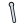

# تجهیزات

بخش **تجهیزات** ویرایشگر بیلد سلاح‌ها و زره‌ات را نگه می‌دارد. سلاح‌ها و
دست دوم‌ها را از کتابخانهٔ سمت راست بکش، یا روی یکی کلیک کن تا تجهیزش کنی. زره
روی پیکره انتخاب می‌شود، پایین‌تر.

## ست‌های سلاح

تا **چهار ست سلاح** با خودت داری، هر کدام یک سلاح و، اگر سلاح یک دست را آزاد
بگذارد، یک دست دوم مثل  **سپر** یا  **کانون**. ست 1 همانی است که با آن شروع می‌کنی؛
بقیه می‌توانند خالی بمانند.

در مسابقه، با **1 تا 4** ست‌ها را عوض کن (**F1 تا F4** در کلیدهای کلاسیک).
تعویض منتظر می‌ماند تا اجرا یا ضربه‌ای که در آن هستی تمام شود؛ حرکت کردن یا Esc
بی‌درنگ تعویض می‌کند. زمان انتظاری ندارد. حمله‌هایت، مهارت‌هایی که سلاح خاصی
لازم دارند، و انرژی بیشینه‌ات همه از ستی که در دست داری پیروی می‌کنند.

سلاح به رتبهٔ 9 در ویژگی‌اش نیاز دارد: کمتر از آن، یک‌سوم آسیبش را می‌زند، و
ویرایشگر این را با رنگ قرمز می‌گوید.  **شمشیر** همیشه Swordsmanship است، اما  **عصا**،
 **چوبدستی**، سپر یا کانون برای ویژگی‌ای ساخته می‌شود که خودت انتخاب می‌کنی: روی دست
آن در پیکره کلیک کن (**6** برای سلاح، **7** برای دست دوم) و یکی را انتخاب کن.

## ارتقاهای سلاح

هر سلاح و دست دوم خانه‌هایی برای ارتقا دارد: یک **پیشوند**، یک **پسوند** و یک
**کتیبه**. برای انتخابشان روی دست در پیکره، یا ردیفش در کنار آن، کلیک کن؛ هر
کدام می‌گوید چه می‌کند.  **چوبدستی**،  **سپر** و  **کانون** پیشوند نمی‌گیرند؛ دست خالی هیچ
کدام را نمی‌گیرد. ارتقا همیشه در بهترین مقدارش است، و هر ست سلاح ارتقاهای خودش
را دارد، پس تعویض ست‌ها ارتقاهایشان را هم عوض می‌کند: سلامتی و انرژی بیشینه با
ستی که در دست داری جابه‌جا می‌شوند. عوض کردن سلاح ارتقاهایی را که هنوز به آن
می‌خورند نگه می‌دارد و به تو می‌گوید کدام‌ها را حذف کرده است.

| ارتقا                     | خانه   | مناسب برای                                                      | اثر                                                                                                            |
| ------------------------- | ------ | --------------------------------------------------------------- | -------------------------------------------------------------------------------------------------------------- |
| Defensive                 | پیشوند |  **عصا** | زره +5                                                                                                         |
| Hale                      | پیشوند | عصا                                                             | +30 سلامتی                                                                                                     |
| Insightful                | پیشوند | عصا                                                             | انرژی +5                                                                                                       |
| of Defense                | پسوند  | هر سلاح رزمی، عصا                                               | زره +5                                                                                                         |
| of Fortitude              | پسوند  | هر سلاح رزمی، عصا، سپر، کانون                                   | +30 سلامتی                                                                                                     |
| of Shelter                | پسوند  | هر سلاح رزمی، عصا                                               | زره +7 (در برابر آسیب فیزیکی)                                                                                  |
| of Warding                | پسوند  | هر سلاح رزمی، عصا                                               | زره +7 (در برابر آسیب عنصری)                                                                                   |
| "Cast Out the Unclean"    | کتیبه  | سپر، کانون                                                      | مدت  **Disease** روی تو را 20% کم می کند          |
| "Fear Cuts Deeper"        | کتیبه  | سپر، کانون                                                      | مدت  **Bleeding** روی تو را 20% کم می کند       |
| "I Can See Clearly Now"   | کتیبه  | سپر، کانون                                                      | مدت  **Blinded** روی تو را 20% کم می کند            |
| "I have the power!"       | کتیبه  | هر سلاح رزمی                                                    | انرژی +5                                                                                                       |
| "Leaf on the Wind"        | کتیبه  | سپر، کانون                                                      | زره +10 (در برابر آسیب سرما)                                                                                   |
| "Like a Rolling Stone"    | کتیبه  | سپر، کانون                                                      | زره +10 (در برابر آسیب خاک)                                                                                    |
| "Live for Today"          | کتیبه  | کانون                                                           | انرژی +15، بازیابی انرژی -1                                                                                    |
| "Not the face!"           | کتیبه  | سپر، کانون                                                      | زره +10 (در برابر آسیب کوبشی)                                                                                  |
| "Only the Strong Survive" | کتیبه  | سپر، کانون                                                      | مدت  **Weakness** روی تو را 20% کم می کند       |
| "Pure of Heart"           | کتیبه  | سپر، کانون                                                      | مدت  **Poison** روی تو را 20% کم می کند             |
| "Riders on the Storm"     | کتیبه  | سپر، کانون                                                      | زره +10 (در برابر آسیب صاعقه)                                                                                  |
| "Seize the Day"           | کتیبه  | عصا، چوبدستی                                                    | انرژی +15، بازیابی انرژی -1                                                                                    |
| "Sleep Now in the Fire"   | کتیبه  | سپر، کانون                                                      | زره +10 (در برابر آسیب آتش)                                                                                    |
| "Soundness of Mind"       | کتیبه  | سپر، کانون                                                      | مدت  **Dazed** روی تو را 20% کم می کند                |
| "Strength of Body"        | کتیبه  | سپر، کانون                                                      | مدت  **Deep Wound** روی تو را 20% کم می کند |
| "Swift as the Wind"       | کتیبه  | سپر، کانون                                                      | مدت  **Crippled** روی تو را 20% کم می کند       |
| "The Riddle of Steel"     | کتیبه  | سپر، کانون                                                      | زره +10 (در برابر آسیب برشی)                                                                                   |
| "Through Thick and Thin"  | کتیبه  | سپر، کانون                                                      | زره +10 (در برابر آسیب سوراخ کننده)                                                                            |

### پیشوندهای رزمی هنگام ضربه

| پیشوند                       | مناسب برای            | هنگام ضربه چه می کند                                                |
| ---------------------------- | --------------------- | ------------------------------------------------------------------- |
| Vampiric                     | هر سلاح رزمی          | 3 سلامتی می دزدد (5 با پتک، داس، کمان ها)؛ بازیابی سلامتی -1        |
| Zealous                      | هر سلاح رزمی          | 1 انرژی به دست می آورد؛ بازیابی انرژی -1                            |
| Sundering                    | هر سلاح رزمی          | 20% احتمال +20% نفوذ در زره                                         |
| Furious                      | رزمی، نه کمان ها      | 10% احتمال آدرنالین دوبرابر                                         |
| Barbed, Crippling, Poisonous | رزمی، نه پتک          | Bleeding، Crippled و Poison که ایجاد می کنی 33% بیشتر دوام می آورند |
| Cruel                        | رزمی، نه کمان ها      | Deep Wound که ایجاد می کنی 33% بیشتر دوام می آورد                   |
| Heavy                        | تبر، پتک، داس، نیزه   | Weakness که ایجاد می کنی 33% بیشتر دوام می آورد                     |
| Silencing                    | خنجرها، نیزه، کمان ها | Dazed که ایجاد می کنی 33% بیشتر دوام می آورد                        |
| Ebon, Fiery, Icy, Shocking   | هر سلاح رزمی          | آسیبش به خاک، آتش، سرما یا صاعقه تبدیل می شود                       |

"هنگام ضربه" یعنی ضربهٔ نشستهٔ یک حمله یا یک مهارت حمله‌ای: ضربهٔ دفع‌شده یا
خطارفته کاری نمی‌کند. عارضهٔ طولانی‌تر عارضه‌ای است که مهارت حمله‌ای‌ات ایجاد
می‌کند.

### ارتقاهایی که به وضعیت تو بستگی دارند

ارتقاهایی که به وضعیت تو بستگی دارند فقط تا وقتی آن وضعیت برقرار است به حساب
می‌آیند. "بالای" یا "زیر نصف سلامتی" دقیقاً به همین معناست: درست در نصف، هیچ
کدام حساب نمی‌شود. وقتی یک بیشینهٔ افزایش‌یافته تمام شود، سلامتی یا انرژیِ بیش
از بیشینهٔ جدید از دست می‌رود.

| ارتقا                                              | خانه، مناسب برای       | چه می کند                                                         |
| -------------------------------------------------- | ---------------------- | ----------------------------------------------------------------- |
| "Strength and Honor"                               | کتیبه، رزمی            | +15% آسیب سلاح بالای نصف سلامتی                                   |
| "Guided by Fate", "Dance with Death"               | کتیبه، رزمی            | +15% آسیب سلاح وقتی افسون شده ای، در یک موضع                      |
| "Too Much Information"                             | کتیبه، رزمی            | +15% آسیب سلاح در برابر دشمن نفرین شده                            |
| "Vengeance is Mine"                                | کتیبه، رزمی            | +20% آسیب سلاح زیر نصف سلامتی                                     |
| "Don't Fear the Reaper"                            | کتیبه، رزمی            | +20% آسیب سلاح وقتی نفرین شده ای                                  |
| "To the Pain!"                                     | کتیبه، رزمی            | +15% آسیب سلاح؛ -10 زره هنگام حمله                                |
| "Brawn over Brains"                                | کتیبه، رزمی            | +15% آسیب سلاح؛ -5 انرژی                                          |
| "Hale and Hearty", "Have Faith"                    | کتیبه، هر سلاح         | +5 انرژی بالای نصف سلامتی، وقتی افسون شده ای                      |
| "Don't call it a comeback!", "I am Sorrow."        | کتیبه، هر سلاح         | +7 انرژی زیر نصف سلامتی، وقتی نفرین شده ای                        |
| of Devotion, of Endurance                          | پسوند، عصا، سپر، کانون | +45 سلامتی وقتی افسون شده ای، در یک موضع                          |
| of Valor                                           | پسوند، عصا، سپر، کانون | +60 سلامتی وقتی نفرین شده ای                                      |
| "Luck of the Draw"                                 | کتیبه، سپر یا کانون    | 20% احتمال که ضربه فیزیکی 5 کمتر آسیب بزند                        |
| "Sheltered by Faith", "Run For Your Life!"         | کتیبه، سپر یا کانون    | ضربه های فیزیکی 2 کمتر آسیب می زنند وقتی افسون شده ای، در یک موضع |
| "Nothing to Fear"                                  | کتیبه، سپر یا کانون    | ضربه های فیزیکی 3 کمتر آسیب می زنند وقتی نفرین شده ای             |
| "Hail to the King", "Faith is My Shield"           | کتیبه، کانون           | +5 زره بالای نصف سلامتی، وقتی افسون شده ای                        |
| "Might makes Right", "Knowing is Half the Battle." | کتیبه، کانون           | +5 زره هنگام حمله، هنگام اجرای طلسم                               |
| "Man for All Seasons", "Survival of the Fittest"   | کتیبه، کانون           | +5 زره در برابر آسیب عنصری، فیزیکی                                |
| "Ignorance is Bliss", "Life is Pain"               | کتیبه، کانون           | +5 زره؛ -5 انرژی، -20 سلامتی                                      |
| "Down But Not Out", "Be Just and Fear Not"         | کتیبه، کانون           | +10 زره زیر نصف سلامتی، وقتی نفرین شده ای                         |

آسیب سلاح همان عدد تصادفی خود سلاح است: آسیب اضافهٔ یک مهارت حمله‌ای بالا
نمی‌رود.

### ارتقاهای طلسم‌گر

ارتقاهای طلسم‌گر فقط روی طلسم‌ها اثر می‌کنند، هر کدام با احتمال خودش وقتی از
یکی استفاده می‌کنی. "ویژگی آیتم" ویژگی‌ای است که عصا، چوبدستی یا کانون برایش
ساخته شده. دو ارتقای نصف‌کننده که هر دو فعال شوند باز هم فقط یک بار نصف
می‌کنند.

| ارتقا                       | خانه، مناسب برای      | چه می کند                                         |
| --------------------------- | --------------------- | ------------------------------------------------- |
| Adept                       | پیشوند، عصا           | 20% احتمال نصف شدن زمان اجرای طلسم های ویژگی آیتم |
| Swift                       | پیشوند، عصا           | 10% احتمال نصف شدن زمان اجرای هر طلسم             |
| of Aptitude                 | پسوند، کانون          | 20% احتمال نصف شدن زمان اجرای طلسم های ویژگی آیتم |
| of Swiftness                | پسوند، کانون          | 10% احتمال نصف شدن زمان اجرای هر طلسم             |
| "Aptitude not Attitude"     | کتیبه، عصا یا چوبدستی | 20% احتمال نصف شدن زمان اجرای طلسم های ویژگی آیتم |
| "Don't think twice"         | کتیبه، عصا یا چوبدستی | 10% احتمال نصف شدن زمان اجرای هر طلسم             |
| of Memory                   | پسوند، چوبدستی        | 20% احتمال نصف شدن شارژ طلسم های ویژگی آیتم       |
| of Quickening               | پسوند، چوبدستی        | 10% احتمال نصف شدن شارژ هر طلسم                   |
| "Let the Memory Live Again" | کتیبه، عصا یا چوبدستی | 10% احتمال نصف شدن شارژ هر طلسم                   |
| "Forget Me Not"             | کتیبه، کانون          | 20% احتمال نصف شدن شارژ طلسم های ویژگی آیتم       |
| "Serenity Now"              | کتیبه، کانون          | 10% احتمال نصف شدن شارژ هر طلسم                   |
| of Mastery                  | پسوند، عصا            | 20% احتمال که ویژگی آیتم برای یک طلسم +1 شود      |
| "Master of My Domain"       | کتیبه، سپر یا کانون   | 20% احتمال که ویژگی آیتم برای یک طلسم +1 شود      |
| of Enchanting               | پسوند، رزمی یا عصا    | افسون هایی که اجرا می کنی 20% بیشتر دوام می آورند |

## زره

زره پنج تکه است: سر، سینه، دست، ساق و پا. هر تکه دو خانهٔ ارتقا دارد:

- یک **نشان**، کمی امتیاز اضافه روی همان تکه: مثلاً زره بیشتر در برابر آسیب
  فیزیکی، یا هنگام حمله؛
- یک **رون**.

**کلاهخود** تو +1 به یک ویژگی دلخواهت اضافه می‌کند.

در ویرایشگر، زره یک پیکره است. روی یک تکهٔ شماره‌دار آن، یا ردیفش در کنار آن،
کلیک کن تا نشان و رونش را انتخاب کنی؛ هر انتخاب می‌گوید روی آن تکه چه می‌کند.
**اعمال نشان روی هر 5** نشانی را که انتخاب کردی روی همهٔ تکه‌ها می‌گذارد. پیکره
نشان و رون هر تکه را نشان می‌دهد، و سلاح‌های ستی را که به آن نگاه می‌کنی، با
ارتقاهایشان، در دست دارد.

## رون‌ها

| رون                                                                                                                                                                                                                                                                                                            | چه می دهد                                 |
| -------------------------------------------------------------------------------------------------------------------------------------------------------------------------------------------------------------------------------------------------------------------------------------------------------------- | ----------------------------------------- |
| رون ویژگی کوچک                                                                                                                                                                                                                                                                                                 | +1 به یک ویژگی                            |
| رون ویژگی بزرگ                                                                                                                                                                                                                                                                                                 | +2 به یک ویژگی، -35 سلامتی                |
| رون ویژگی برتر                                                                                                                                                                                                                                                                                                 | +3 به یک ویژگی، -75 سلامتی                |
|  **Vigor**                                                                                                                                                                                                                                              | سلامتی بیشتر (+30، +41 یا +50)            |
|  **Vitae**                                                                                                                                                                                                                                              | +10 سلامتی                                |
|  **Attunement**                                                                                                                                                                                                                               | انرژی بیشتر (+2)                          |
|  **Clarity**,  **Purity**,  **Recovery**,  **Restoration** | هر کدام دو عارضه را 20% زودتر تمام می کند |
|  **Absorption** ( **Warrior**)                                                                                                                                               | آسیب فیزیکی کمتر از هر ضربه               |

Vitae و Attunement با هم جمع می‌شوند: پنج رون Attunement، +10 انرژی
می‌دهند. هر رون دیگری فقط یک بار حساب می‌شود، هر چند تا که بپوشی. کوتاه
شدن عارضه‌ها از منابع مختلف هم جمع می‌شود، هر کدام از مدت کامل کم می‌شود
و به ثانیهٔ کامل گرد می‌شود: Restoration و "Fear Cuts Deeper" یک
Bleeding هشت ثانیه‌ای را به 4 ثانیه می‌رسانند.

ویرایشگر دو قطعه با رون یکسان، یا با رون‌های یک ویژگی را ذخیره نمی‌کند: فقط قوی‌ترین پاداش حساب می‌شد، در حالی که همهٔ جریمه‌های سلامتی حساب می‌شدند. در ویرایشگر به سلامتی اشاره کنید تا ببینید از کجا می‌آید: پایه، رون‌ها، نشان‌ها و ارتقاها.

رون یک تکه را در همان جایی انتخاب می‌کنی که نشانش را: روی تکه در پیکره کلیک
کن.

ویرایشگر همه چیز را برایت جمع می‌زند: سلامتی، انرژی، زره و آسیب، آن‌طور که
اولین ست سلاحت آن‌ها را دارد.
