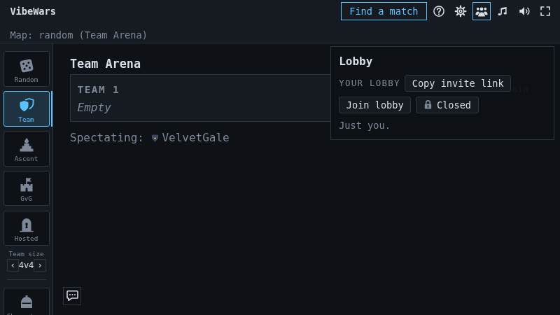

# Modes

Chaque carte joue un mode.
Les modes sont les entrées de la colonne à gauche de l'écran principal.
Personne ne choisit le mode d'une carte, mais l'entrée d'où tu héberges choisit
les modes que jouent les cartes de son salon :  **Arène d'équipe** Annihilation,
Décompte et Annihilation de prêtre,  **Ascension des héros** Course aux reliques,
Roi de la colline et Points de capture, et  **GvG** la Bataille de guilde.
 **Partie hébergée** propose toutes les cartes. Une  **Arène aléatoire** choisit
une carte pour toi, et avec elle le mode, mais jamais une Bataille de guilde,
une Course aux reliques, un Roi de la colline ou des Points de capture. L'Arène
d'équipe tire une de ses cartes à chaque match, l'Ascension des héros commence
sur sa première carte, et seule une Partie hébergée laisse l'hôte choisir, dans la liste Carte au-dessus des équipes.
L'écran d'aucun autre mode n'indique quelle carte vient ensuite : le match
l'affiche pendant son chargement.

Deux joueurs derrière des réseaux stricts ne peuvent pas être appariés entre eux dans une file, alors la file ne compte que les joueurs qui peuvent jouer avec vous, et le dit. Un relais dans **Options → relais (TURN)** aide.

Chaque carte est faite pour certaines tailles d'équipe, et un mode ne joue
qu'une carte faite pour sa taille : un 8v8 ne s'entasse jamais dans une arène
construite pour un 1v1. La **Taille d'équipe** de la colonne ne passe que par
les tailles que joue le mode affiché.

| Mode                | Tailles d'équipe | Carte                                            |
| ------------------- | ---------------- | ------------------------------------------------ |
| Arène aléatoire     | 1v1, 2v2, 4v4    | tirée pour toi, faite pour la taille             |
| Arène d'équipe      | 2v2, 4v4, 8v8    | tirée à chaque match, faite pour la taille       |
| Ascension des héros | 8v8              | ses cartes dans l'ordre, jusqu'au Hall of Heroes |
| GvG                 | 8v8              | Guild Hall Isle                                  |
| Partie hébergée     | toutes           | l'hôte en choisit une faite pour la taille       |

En Bataille de guilde, en Course aux reliques, en Roi de la colline ou en Points
de capture, un objectif hors de l'écran ou sous l'interface reçoit une flèche
détourée au bord de l'écran : le socle ou un sanctuaire à la couleur de son
propriétaire, gris s'il n'est à personne, l'autel en or. La flèche pleine d'un
joueur s'affiche par-dessus.

Un match s'ouvre avec chaque équipe retenue ensemble dans sa zone de départ : tu peux aller n'importe où à l'intérieur et utiliser n'importe quelle compétence, alors prépare enchantements, postures, esprits ou protections avant que les portes s'ouvrent ; l'autre équipe est retenue loin, dans sa propre zone de départ. L'énergie et la santé se régénèrent pendant l'attente, et les bots se préparent aussi. Un mur chatoyant autour de la zone de départ de ton équipe montre jusqu'où tu peux aller. Une ligne en haut compte les joueurs qui ont chargé le match. Une fois que tout le monde a chargé, elle décompte 10 secondes et le match commence, et son chrono avec lui. Un joueur qui n'a pas chargé après 20 secondes n'est pas attendu : le décompte commence sans lui, et il peut encore rejoindre plus tard.

## Annihilation

**Élimine tous les ennemis.** Les morts restent à terre jusqu'à ce qu'un allié
les ressuscite, et chaque mort coûte du moral. Élimine toute l'autre équipe pour
gagner. Après 8 minutes, l'équipe qui a le plus de moral restant gagne.

Canyon, Crossroads et Long Hall le jouent, ainsi que deux petites arènes à peu
près de la taille de Canyon : **Sandstone Steps** (1v1, 2600x1940), une ville du
désert en terrasses avec une cour de puits en contrebas, des toits au-dessus de
ses rues et, sous celles-ci, un passage souterrain fermé par un levier ; et
**Frozen Crossing** (2v2, 2600x1940), une rivière gelée entre deux berges
surélevées, que l'on traverse sur des pierres de gué ou sur un pont de rondins
dont un levier relève la planche du milieu. Pour les plus grandes équipes :
**Ashen Courtyard** (4v4, 5120x3840), une cour fortifiée calcinée, avec chemins
de ronde et tours en haut et une cour de puits en contrebas, dont la herse du
châtelet d'entrée se manœuvre depuis les remparts ; et **Moss Vale** (8v8,
5000x2600), une vallée en terrasses coupée en deux par un profond bief de
moulin, qu'on ne franchit qu'au pont-levis, au moulin et par le passage
souterrain en dessous. **Canthan Terraces** (1v1, 2400x2100) est
petite mais escarpée : des rizières qui montent à flanc de colline jusqu'à une pagode en ruine,
avec en dessous un ponceau inondé qu'un levier de vanne ouvre comme troisième voie vers le
centre. **Sunken Bastion** (2v2, 2700x1900) est petite mais haute : une forteresse à
moitié inondée dont les douves coupent la cour en deux ; on les franchit par un
pont-levis actionné par un levier sur chaque rive, par le chemin de ronde le
long du rempart nord, ou par la cave inondée en dessous.
Et pour les plus grandes équipes : **Shiverpeak Pass** (4v4, 5100x3450), un
col de montagne enneigé fendu par un gouffre, que l'on franchit par un pont de
cordes entre deux corniches, tiré par un levier sur chaque corniche, par une
grotte en dessous, ou en contournant sa pointe une fois brisé le mur de glace
qui s'y trouve ;
et **Elonian Plateau** (8v8, 5520x3360), un
plateau désertique de quatre mésas autour d'un lit de canyon à sec : des
ascenseurs minutés montent sur trois d'entre elles, une arche naturelle
relie les deux du nord, et un passage court sous l'arête centrale, sa herse
ouverte par un levier au sommet.

## Décompte

**Le plus d'éliminations en 3 minutes.** Les morts reviennent à leur point de
départ après 8 secondes, et mourir ne coûte pas de moral. La première équipe à
15 éliminations gagne aussitôt. À la fin du temps, le plus d'éliminations gagne ;
à égalité d'éliminations, on passe en mort subite : plus de chrono, et la
prochaine élimination gagne.

Ember Pits le joue : des rigoles de lave franchies par des ponts de pierre, un
tunnel de lave, un monte-charge à levier sur une colonne de basalte et des
évents de vapeur, pour toutes les tailles d'équipe.

## Annihilation de prêtre

**Élimine tous les ennemis et leur prêtre.** Chaque équipe a un prêtre sur un
sanctuaire derrière son point de départ. Il ne bouge ni n'attaque jamais, mais
soigne tout le monde à côté de lui, ennemis compris. Toutes les 2 minutes, une
équipe dont le prêtre est vivant récupère ses morts sur le sanctuaire, avec
toute leur santé et leur énergie. Tue d'abord le prêtre et l'autre équipe reste
à terre.

Une équipe perd quand tous ses joueurs et son prêtre sont morts. Après 12
minutes, le plus de moral gagne.

Jungle Ruins (2v2 à 8v8, 5400x2800) le joue : des ruines de temple envahies
par la végétation, coupées par une rivière de jungle. Passe un gué, traverse
un pont de rondins, grimpe sur la pyramide à degrés au centre, ou prends le
passage caché en dessous une fois qu'un levier dans une cour en a ouvert les
portes ; les murs de lianes peuvent être abattus.

## Bataille de guilde

**Tue le Seigneur de guilde ennemi**, 8 contre 8. Chaque base se trouve derrière
un mur à deux portes ; le Seigneur de guilde se tient au fond de sa salle et
tire à l'arc sur tout ennemi qu'il voit. Des gardes tiennent chaque base : des
Knights et un Bodyguard près du seigneur, un Archer au fond de la salle du
seigneur, un Footman et un Archer à chaque porte. Ils combattent les ennemis
près de leur poste puis y reviennent. Tant que le Bodyguard vit, son seigneur
subit 20% de dégâts en moins : tue-le d'abord. Toutes les 2 minutes, le
sanctuaire de chaque équipe ramène ses morts.

Chaque équipe a un **drapeau** dans sa base, et le **Socle du drapeau** est au
centre. Cible ton drapeau et appuie sur **Space** pour le prendre ; porte-le
jusqu'au socle, cible le socle et appuie sur **Space** pour le planter. Un
porteur marche plus lentement et ne peut ni attaquer ni utiliser de compétences
d'attaque ; il lâche le drapeau quand il meurt, change d'armes ou appuie sur
**Lâcher drapeau** au-dessus de sa barre de santé. Planter le tien sur le socle
renvoie chez lui un drapeau ennemi qui s'y trouve. Toutes les 2 minutes où ton
drapeau tient le socle, ton équipe gagne 10% de moral.

L'équipe dont le Seigneur de guilde meurt perd aussitôt, tout comme une équipe
dont tous les joueurs sont morts au moral le plus bas. Après 28 minutes,
l'équipe qui a infligé le plus de dégâts au Seigneur de guilde ennemi gagne ;
une égalité y est une défaite pour les deux, car il n'y a pas de match nul.

Le tableau des scores montre la santé de chaque Seigneur de guilde, le tien
d'abord, qui tient le socle et dans combien de temps vient son bonus, quand les
sanctuaires ramènent les morts, et, dans les 3 dernières minutes, les dégâts de
chaque équipe au seigneur ennemi. En dessous, une ligne nomme celui qui porte un
drapeau. Un bonus s'affiche « Bonus de moral ! +10% », ou « Bonus de moral
ennemi ». Sur la boussole, ♛ marque chaque Seigneur de guilde, ⚑ chaque drapeau
et ◎ le socle.

Guild Hall Isle (8v8, 6000x2600) le joue : une île en mer. Chaque Guild Lord se tient au sommet d'une salle, derrière un rempart ; on sort par la porterie, par-dessus le rempart ou le long d'un ponton. Une porte de porterie s'ouvre par un levier sur le rempart ennemi. Le support du drapeau est sur une estrade au centre.

## Course aux reliques

**Porte ta relique à l'autel.** Chaque équipe a une **relique** dans sa base, et
l'**autel** est au centre, à la même distance des deux bases, par une route nord
ou sud ; l'autel s'affiche sur la boussole en ◆. Cible ta relique et appuie sur
**Space** pour la prendre. Porte-la sur l'autel et tu marques un point aussitôt,
et la relique retourne à ta base. Chaque point est annoncé, avec une fanfare qui
monte pour les tiens et descend pour les leurs. Un porteur marche plus lentement
et ne peut ni attaquer ni utiliser de compétences d'attaque. Il traverse sa
propre équipe, mais un ennemi le bloque toujours. Il lâche la relique quand il
meurt ou appuie sur **Lâcher relique** au-dessus de sa barre de santé, et la
relique reste où elle est tombée jusqu'à ce que quelqu'un l'atteigne. Ton équipe
la reprend là. Un ennemi qui l'atteint, les mains vides, la renvoie chez elle.
Tu ne peux pas toucher à une relique ennemie dans sa base.

Les morts restent à terre jusqu'à ce qu'un allié les ressuscite, et chaque mort
coûte du moral. Élimine toute l'autre équipe pour gagner aussitôt. Après 8
minutes, l'équipe avec le plus de points gagne ; à égalité de points, c'est un
match nul. Les éliminations ne marquent rien.

Le tableau des scores montre les points, les tiens d'abord, et le temps. En
dessous, une ligne pour chaque relique dit où elle est : `✦ Nom` sur son porteur,
`✦ au sol` à terre ou `✦ à la base`.

Les bots font aussi la course : le plus proche de ta relique va la chercher, sauf
si tu es sur le point de la prendre toi-même. Un bot hors combat y va d'abord ;
quand tous combattent, le plus proche quitte le combat pour la relique, si bien
qu'un face-à-face à l'autel n'arrête jamais le score. Un soigneur ou un bot
gravement blessé n'y va que si personne d'autre ne peut, et jamais depuis un
combat. Le plus proche d'une relique ennemie tombée la renvoie chez elle, et les
autres attendent près de l'autel. Un bot qui porte ta relique va tout droit à
l'autel ; les autres ne quittent la relique que pour combattre un ennemi qui
arrive à portée de sort.

Broken Tower le joue (4v4 et 8v8, 5400x2800) : une tour effondrée sur une colline des hauteurs. Gravis les escaliers des terrasses de gravats jusqu'à l'autel sur le moignon de la tour, ou passe par la cave sous la colline dès qu'un levier de la terrasse ouvre ses portes ; les murs de gravats peuvent être brisés. À côté de chaque mur de gravats, une herse s'ouvre tant que quelqu'un se tient sur sa plaque de pression.

### Cinder Sanctum

Ici, la Course aux reliques de l'Ascension des Héros se joue à l'envers. Chaque base abrite la relique de son équipe et son Héros fantomatique, et il n'y a pas d'autel. **Prenez la relique adverse dans sa base et apportez-la à votre propre Héros fantomatique** pour marquer un point. Le fantôme doit être vivant, et il reste à son poste. Vous ne pouvez pas porter votre propre relique : la ramasser là où elle est tombée la renvoie chez vous. Une équipe qui mène de **3 points gagne aussitôt**. Après 8 minutes, le plus de points l'emporte, et une égalité revient à la dernière équipe à avoir marqué. Chaque base relève ses morts, et son fantôme, toutes les 2 minutes. Les bots vont ensemble chercher la relique adverse et la ramènent.

Cinder Sanctum (8v8, 5600x2800) le joue : un temple au flanc d'un volcan entre deux rivières de lave. Traversez par un pont ou par la chaussée jusqu'au sanctuaire sur son parvis ; un levier sur le parvis ouvre le passage caché sous le sanctuaire, et les murs de cendre peuvent être brisés. La lave brûle.

## Roi de la colline

**Mène ton Héros fantomatique sur l'autel, et tiens-le.** Chaque équipe a un
**Héros fantomatique** dans sa base, un fantôme qui se bat à la hache et que
personne ne joue. L'**autel** est au centre, à la même distance des deux bases.
Sur **Threefold Keep**, trois équipes (deux si aucune troisième n'est libre) se le
disputent sur la tour d'un donjon muré. Au plus 12 points
par équipe, et si tous les adversaires sont à -60 % de moral, tu gagnes aussitôt. Le **Hall of Heroes** (8v8, 5000x4400), la
carte qui clôt l'Ascension des héros, est une salle dorée pour trois équipes :
l'autel se dresse sur une estrade à piliers de six escaliers, sur un socle d'où
part une galerie entre chaque paire de bases, et une crypte court sous le sol
de chaque base jusque dans le socle. Les portes des cryptes sont d'abord
fermées, et le levier de n'importe quelle équipe les ouvre toutes les trois. Cible ton fantôme avec un **clic droit** et appuie sur **Space** pour
lui dire de te suivre : il marche avec toi et combat ce que tu combats. Appuie
de nouveau sur Space sur lui et il reste où il est, en combattant tout ennemi
qui s'approche. Si tu meurs ou pars, il reste. Quand ton fantôme est ciblé, son
cadre indique qui il suit, ou qu'il reste. Une notification dit qui suit ton
Héros fantomatique à chaque changement, et son nom au-dessus de sa tête montre
son meneur.

Ton fantôme a 640 de santé, et frappe de sa hache avec **Cyclone Axe**,
**Disrupting Chop** et **Swift Chop**, qu'il suive ou reste. Il est d'autant plus
fort que tu es haut dans l'Ascension : niveau 24 sur Threefold Keep, 28 dans le
Hall of Heroes. **Tue le fantôme de l'autre équipe** et chaque membre de ton
équipe reçoit un **bonus de moral de +10%**, qui efface d'abord une pénalité de
mort et ne dépasse jamais +10%. Tue-le de nouveau après sa résurrection et tu
l'obtiens de nouveau.

Mène-le sur l'autel ou au-delà et il monte sur l'autel et y reste. Là, il combat
tout ennemi à côté de lui, mais n'en descend jamais pour le poursuivre. Un
fantôme sur l'autel le prend tout seul : 5 secondes immobile, sa barre
d'incantation se remplissant, sans combattre. Une interruption ou une mise à
terre coupe la prise, et il recommence dès qu'il peut. Il ne peut prendre l'autel
que si personne ne le tient, ou si le fantôme du détenteur est mort. Quand la
prise se termine, l'autel est à ton équipe.

L'équipe qui tient l'autel marque un point pour chaque tranche de 30 secondes où
elle le garde, même quand son propre fantôme est mort, jusqu'à ce qu'une autre
équipe le prenne. Chaque point est annoncé, comme une relique marquée. Un
fantôme mort se relève dans sa base 2 minutes plus tard, sans bouger, ici et en
Course aux reliques. En Points de capture, il se relève avec la prochaine vague
de sa base. Sur une carte avec prêtres, il se relève plutôt avec la prochaine
vague du prêtre, mais seulement si le prêtre de son équipe vit. Sur toute autre
carte, un fantôme mort reste mort, et son +10% ne s'obtient qu'une fois. Ce
n'est pas un joueur : sa mort ne coûte pas de moral et il ne compte pas pour
une élimination totale.

Les morts restent à terre jusqu'à ce qu'un allié les ressuscite, et chaque mort
coûte du moral. Élimine toute l'autre équipe pour gagner aussitôt. Après 8
minutes, l'équipe avec le plus de points gagne ; à égalité de points, c'est un
match nul. Les éliminations ne marquent rien.

Le tableau des scores montre les points, les tiens d'abord, puis l'autel : `▲`
et le temps avant le prochain point du détenteur, à sa couleur, ou un `▲ —` gris
tant que personne ne le tient.

Les bots visent aussi l'autel : tant que ton équipe ne le tient pas, le plus
proche de ton Héros fantomatique s'en charge, sauf si tu es sur le point de le
faire toi-même ; un soigneur ou un bot gravement blessé n'y va que si personne
d'autre ne peut. Il mène le fantôme sur l'autel et lui dit d'y rester, et les
autres attendent près de l'autel. Un bot qui mène le fantôme ne s'arrête pas pour
combattre en route ; les autres ne quittent l'autel que pour combattre un ennemi
qui arrive à portée de sort. Tant que ton équipe ne tient pas l'autel, chaque bot
tue d'abord le Héros fantomatique adverse dès qu'il se tient sur l'autel à sa
portée : c'est le seul ennemi qui empêche ton fantôme de le prendre.

Threefold Keep le joue (4v4 et 8v8, 5000x4400) : un donjon sur une colline des hauteurs, pour trois équipes. Monte sur le chemin de ronde par l'escalier à côté de ta porte et traverse une chaussée jusqu'à la colline, puis grimpe jusqu'à l'autel sur la tour. Un levier dans chaque cour ouvre les trois portes, les passages sous le rempart.

## Points de capture

**Tiens les sanctuaires.** La carte a cinq **sanctuaires** : un près de chaque
base et trois entre les deux, celui du centre à découvert. Tiens-toi sur un
sanctuaire pour le capturer. Chaque membre de ton équipe dessus est un **pip**,
ton Héros fantomatique en vaut quatre ; familiers, serviteurs et esprits n'en
valent aucun. Avec quatre pips, un sanctuaire neutre est à toi en 8 secondes,
avec deux en 16, seul en 32 ; au-delà de quatre, ça ne va pas plus vite. Les
ennemis dessus annulent tes pips un pour un : trois d'entre vous contre deux
d'entre eux le prennent à un pip, en 32 secondes, huit contre deux à quatre, et
des pips égaux le figent. Avec trois équipes, la plus forte le fait avancer de
ses pips moins ceux des deux autres réunies ; si les deux autres la dépassent,
personne ne capture, et un sanctuaire déjà possédé est seulement ramené au
neutre. Un sanctuaire d'une autre équipe est d'abord ramené au neutre, puis
rempli pour toi : le prendre prend donc deux fois plus de temps. Pars et sa
progression reste où elle était ; un sanctuaire à toi reste à toi jusqu'à ce
qu'un ennemi le prenne. Les sanctuaires s'affichent sur la boussole en □ à la
couleur de leur propriétaire.

Toutes les 30 secondes, chaque sanctuaire de ton équipe marque un point, et une
notification et un son annoncent ce que chaque camp a marqué. Toutes les 60
secondes de temps de match, les morts de ton équipe se relèvent au sanctuaire de
ta base avec toute leur santé et leur énergie, même si un ennemi s'y tient, sauf
si leur moral est au plancher. Le tableau des scores décompte jusqu'à la
prochaine vague. Chaque mort coûte du moral, et un fantôme se relève à la même
vague, à sa propre place. Prends **20 points d'avance** sur toutes les autres
équipes pour gagner aussitôt. Éliminer toute une équipe ne termine pas la partie, mais une équipe dont tous les joueurs sont partis est éliminée. Après 8 minutes,
l'équipe avec le plus de points gagne ; à égalité, celle qui tient le plus de
sanctuaires, puis l'équipe qui a été seule en tête en dernier, et si aucune ne
l'a été, c'est un match nul. Les éliminations ne marquent rien.

Chaque sanctuaire est un anneau au sol à la couleur de son propriétaire, gris si
personne ne le possède, avec un arc qui montre où il en est pour celui qui le
prend. Le tableau des scores montre les points, les tiens d'abord, et le temps.

Les bots se répartissent sur les sanctuaires que ton équipe n'a pas encore et
s'y tiennent jusqu'à leur prise. Un ennemi à portée de sort ne les attire pas :
ils montent sur un sanctuaire à portée et combattent depuis celui-ci.

Scarred Earth (4v4 et 8v8, 5400x2800) le joue : un champ de bataille criblé de cratères au crépuscule. Les sanctuaires se dressent sur des tours de siège détruites, celui du centre sur la plate-forme de la grande tour, chacun près d'un cratère ; des leviers sur les tours ouvrent deux tranchées sous le champ, et les palissades détruites peuvent être brisées.

Dans l'Ascension des héros, The Warden's Gallery (8v8, 5200x2500) le joue : une galerie de sculptures ensoleillée sous des verrières. Le sanctuaire du centre se dresse au sommet du grand socle, et chaque équipe en a trois près de son vestibule, dont un sur un socle ; des leviers sur le grand socle ouvrent deux cryptes sous le sol, et les statues renversées peuvent être brisées.

## Salon d'équipe

Un salon hébergé ne lance pas le match quand tout le monde est prêt. Il ouvre
d'abord le Salon d'équipe, où chaque camp choisit ensemble un Build d'équipe puis
se répartit ses personnages. En Ascension des héros et en GvG, un camp fait la
taille de l'équipe du mode (8), que la **Taille d'équipe** de la barre latérale
affiche, verrouillée. En Arène d'équipe, le chef du groupe choisit 2v2, 4v4 ou
8v8 avec ses flèches tant que le groupe n'est pas en file, et le reste du groupe
la voit verrouillée. Elle commence à la dernière taille choisie par le chef en
Arène d'équipe, 4v4 au début. Un groupe ne choisit jamais une taille inférieure
à son nombre de joueurs, et un groupe qui a autant de joueurs que sa taille
n'accepte plus personne (« Groupe complet. »). Deux groupes ne se rencontrent
qu'à la même taille, et la fenêtre de l'icône de file dans la barre du haut la
nomme : « Arène d'équipe 2v2 ». En Partie hébergée, l'hôte fixe la taille
d'équipe avec ses flèches, de 1v1 à 8v8, avant le Salon d'équipe, et les deux
camps jouent exactement ce nombre ; le Salon d'équipe n'affiche pas de Taille
d'équipe. Un invité voit celle de l'hôte, verrouillée. La liste de cartes de
l'hôte, au-dessus des équipes, n'affiche que les cartes faites pour cette taille, et une taille qui ne
convient pas à la carte fait passer le salon à la première carte qui convient.
Elle ne descend jamais sous le nombre de joueurs d'un camp, et un camp qui a
autant de joueurs que la taille d'équipe n'accepte plus personne. Un 1v1 liste
tous tes personnages, les membres d'équipe étiquetés avec leur équipe : clique
sur l'un pour le jouer, ou attends et joue ton personnage actif.
**Quitter** sur ton équipe te retire de celle-ci sans quitter le salon.
Un groupe en file ([Trouver un match](getting-started.md#héberger-ou-rejoindre-un-match)
sur Arène d'équipe, Ascension des héros ou GvG) reçoit un Salon d'équipe de son
seul camp, de la taille de l'équipe du mode (la taille choisie en Arène d'équipe,
8 pour les autres) quel que soit le nombre de joueurs du groupe ; les bots jouent
les places que personne ne prend. En file, tu peux parcourir les autres modes :
le groupe garde son mode et sa taille jusqu'à ce qu'il quitte la file.
En Arène d'équipe et en GvG, un groupe qui a attendu 30 s joue des
échauffements contre des bots, toujours en file, jusqu'à ce qu'une équipe soit
trouvée ([échauffements](getting-started.md#héberger-ou-rejoindre-un-match)).
Chaque étape dure 30 secondes et se termine plus tôt quand tout le monde dans le
Salon d'équipe est prêt. Voter et prendre une place te marquent comme prêt.

**Vote.** Toute personne d'un camp peut proposer un Build d'équipe d'exactement
la taille de ce camp, une proposition chacun. Tes Builds d'équipe s'ouvrent depuis
l'onglet **Tes Builds d'équipe** à droite : cherche-les par nom, clique sur l'un
pour voir ses membres, puis **Proposer ce build** ; sur les tiens, **Retirer la
proposition**. Esc le ferme. Seuls tes Builds d'équipe de cette taille et sans
problème sont listés ; le panneau indique combien il en masque d'autres tailles.
Chacun peut voter pour l'une des propositions de son camp, la sienne comprise.
Chaque proposition est une carte montrant chaque membre tenant ses armes, avec
ses compétences, et les initiales de ceux qui ont voté pour elle : clique sur une
carte pour voter, ou sur une autre pour changer ton vote ; tu ne peux pas le retirer. Rien n'est proposé
à ta place : le menu sert seulement à créer et modifier des Builds d'équipe. Une
nouvelle proposition remplace ton ancienne, et ses votes retombent à zéro. Le plus
de votes l'emporte. En cas d'égalité, le vote du capitaine décide : l'hôte du côté
de l'hôte, le premier arrivé de l'autre côté. Avec des propositions sans vote,
l'une est tirée au hasard. Sans proposition, le camp joue une équipe préréglée au
hasard de sa taille, du genre de celle avec laquelle l'Atelier d'équipes te fait
démarrer ; un camp d'un seul joueur joue un build de départ aléatoire. Un groupe
en file dont le plan d'équipe n'est pas accepté (une place manquante, un build
illégal) joue aussi une équipe préréglée au hasard, et en est informé à l'ouverture
du match. Chaque camp tire la sienne, les deux peuvent donc jouer la même. Aucun
camp ne voit les propositions, les votes ou le choix de l'autre.

**Choix des places.** Les personnages du build choisi sont des places, chacune le
personnage tenant ses armes au-dessus de ses compétences : clique sur une place
libre pour la prendre, ou sur une autre place libre pour changer, premier arrivé premier
servi, une chacun. Celui qui n'a rien pris reçoit la première place libre, et les
bots jouent le reste, sous le nom de leur personnage. Ensuite le match commence,
ou un groupe en file entre dans la file.

Celui qui part pendant le Salon d'équipe laisse son personnage à un bot, le camp
garde donc sa taille. Celui qui arrive à ce moment ne fait que regarder.

Après un match d'équipe en file, ses gagnants repartent en file tout seuls après
20 secondes, et ses perdants (un match nul aussi) retournent au menu ; le match
d'un salon à code ramène tout le monde au salon. Un bouton sous le résultat saute
l'attente, ou, pour les gagnants, part sans repartir en file.
Les gagnants de l'Arène d'équipe gardent leur build d'équipe et la place de chaque joueur pour le match suivant, sans salon d'équipe, sauf si le groupe a changé entre-temps : quelqu'un est parti, absent ou arrivé. Ils choisissent alors à nouveau leur équipe.
Si ton équipe n'a pas gagné, Arrêter fige ce compte à rebours pour que tu puisses lire le résultat ; le bouton t'emmène ensuite quand tu es prêt.

## Ascension des héros

Une Ascension des héros en file se joue en neuf manches, toujours dans cet
ordre : The Hollow Deep (Annihilation), Blackwater Ford (Annihilation de prêtre), Barrow Field (Annihilation de prêtre), Cinder Sanctum (Course aux reliques), Mosslit Cairns (Points de capture), The Brazen Causeway (Annihilation de prêtre), Threefold
Keep (Roi de la colline), The Warden's Gallery (Points de capture), puis le Hall of Heroes. Pendant que tu cherches une équipe, l'icône de file dans la barre du haut dit où tu en es, `Ascension des héros · manche 2`, et la fenêtre Salon montre la carte de cette manche.
Tu ne rencontres jamais qu'une équipe à la même manche, et tu en attends une aussi
longtemps qu'il faut : aucun bot ne comble. Seule exception : à partir de la manche 2, une équipe seule à sa manche pendant 60 secondes peut prendre de l'avance. Elle rencontre une équipe qui attend à n'importe quelle manche ultérieure avant le Hall, les deux jouent la carte de l'équipe la plus avancée, et la gagnante continue à partir de là. Une manche sur une carte faite pour
trois équipes en attend trois ; deux équipes qui ont attendu une troisième pendant
30 secondes jouent l'une contre l'autre, tout comme deux dont la troisième ne se
présente jamais dans le salon. Gagne, et ton groupe monte tout seul à la carte
suivante après 20 secondes ; gagne dans le Hall of Heroes, et tu y restes pour le
défendre. Perds, ou quitte un match avant sa fin, et ta prochaine Ascension
recommence à la manche 1 ; pareil si tu quittes la file ou le groupe. Un match
perdu parce que son hôte est parti garde ta manche.

Le Hall tire au sort un de trois modes pour chaque match : Roi de la colline, Course aux reliques ou Points de capture, pour deux ou trois équipes. À deux, la troisième base reste fermée, et avec elle les points de capture de ses deux galeries. Un match dans le Hall dure 11 minutes et le plus de points gagne ; les Points de capture se terminent aussi plus tôt sur une avance de 20. La mort ne coûte pas de moral. Les morts reviennent ensemble à leur base à chaque minute pleine de l'horloge du match : une équipe décimée n'est donc pas battue, mais une équipe dont tous les joueurs sont partis est éliminée. Au Roi de la colline, l'équipe qui tient l'autel continue de marquer après la mort de son fantôme, jusqu'à ce qu'une autre équipe le prenne, et ses morts reviennent sur l'autel. Une égalité va à l'équipe qui a marqué en dernier ou, aux Points de capture, à celle qui a fait le dernier kill.

**La Chambre forte.** Le Hall ne se forme que toutes les 12 minutes à l'heure UTC, à :00, :12, :24, :36 et :48. D'ici là, votre groupe attend dans la Chambre forte : l'icône de file indique le temps avant la prochaine ouverture et qui tient le Hall. À chaque ouverture, le détenteur affronte jusqu'à deux prétendants, ou jusqu'à trois prétendants s'affrontent si personne ne le tient. Seuls les groupes qui attendaient avant l'ouverture participent, et ceux qui restent sans place attendent la suivante. Un détenteur sans adversaire garde le Hall et attend, sans victoire comptée, et un prétendant seul attend aussi. Quand un groupe gagne le Hall, chaque jeu ouvert annonce qui le tient : son chef, ou son tag de guilde si plus de la moitié du groupe le partage.

Ton moral te suit tout au long de la course : la pénalité de mort ou le bonus
avec lequel tu termines une carte gagnée est celui avec lequel tu commences la
suivante, de −60 % à +10 %. Une course qui se termine, ou un joueur qui rejoint en
cours de route, repart de 0. Ton propre onglet s'en souvient, jusqu'à ce que tu
le fermes.

L'équipe choisit une fois, dans le Salon d'équipe de sa première carte, et garde
son Build d'équipe et ses places pour le reste de la course : après une victoire,
elle repart en file sans vote ni choix de places. Celui qui part en pleine course
libère sa place mais pas son build. Un nouveau venu dans le groupe entre deux
cartes ne choisit que parmi les places vacantes (**Libre : build Moine**), et joue
le build de cette place ; une place vacante que personne ne prend revient à un
bot. Une défaite fait tout recommencer : la course suivante revote. Pareil si tu
suis ton hôte dans un autre groupe, dont l'hôte ne peut pas répondre de l'ancienne
course. La manche est retenue par l'hôte de ton groupe, et seulement jusqu'à ce
que tu fermes l'onglet. Un salon d'Ascension des héros rejoint par code joue la
carte de la manche 1.

Un groupe de moins de 8 entre en file avec des bots aux places vides, selon son Build d'équipe, mais un camp compte toujours au moins un humain, et une équipe de bots n'est jamais un adversaire. Si le dernier humain d'un camp quitte un match, ce camp déclare forfait et sa course s'arrête.

**Barrow Field** (8v8, 5400x2600) est une arène de l'Ascension que tu peux aussi choisir en Partie hébergée. C'est une Annihilation de prêtre sur une lande de tertres funéraires au crépuscule, où le prêtre relève ses morts toutes les 2 minutes. Grimpe sur un tertre pour tenir les hauteurs, ou prends le passage des tertres en dessous une fois qu'un levier sur le tertre lointain en ouvre la grille. Porte ton drapeau sur le **Storm Beacon** au centre : il frappe un ennemi au hasard à portée d'oreille pour 50 dégâts de foudre toutes les 2,5 secondes, jusqu'à ce que l'autre équipe y plante son drapeau. Chaque frappe est un éclair du phare vers sa victime, visible par les deux équipes.

Trois arènes d'Ascension se choisissent aussi en Partie hébergée : **The Hollow Deep** (Annihilation 8v8, 6200x2400, dans une caverne obscure : on franchit un pont de corde au-dessus d'un gouffre, on passe par une corniche centrale, ou on prend la crypte en dessous une fois qu'un levier sur une saillie en ouvre la grille), **Blackwater Ford**
(Annihilation de prêtre 8v8, 5200x2800, à un sombre gué de rivière : on traverse un haut-fond à gué, on franchit
le pont brisé sur ses piles au-dessus du moulin, ou on prend un ponceau sous le pont une fois qu'un levier sur le
moulin en ouvre la herse ; le prêtre relève ses morts toutes les 2 minutes) et **Mosslit Cairns** (Points de capture 8v8, 5400x3000, sur cinq collines à cairns luisantes de mousse au crépuscule : on gravit un cairn par ses escaliers, on tient le grand cairn du milieu, ou on prend le tunnel de racines sous les collines du sud une fois qu'un levier sur un cairn du nord en ouvre les portes ; les murs de racines peuvent être brisés). La quatrième est **The Brazen Causeway** (Annihilation de prêtre 8v8, 5600x2800, sur une chaussée de pierre surélevée au-dessus d'un marais au crépuscule : on marche le long de la chaussée une fois qu'un levier dans le châtelet du fond en ouvre la porte de bronze, on traverse le marais jusqu'aux escaliers en son milieu, ou on se glisse par un ponceau en dessous ; le prêtre relève ses morts toutes les 2 minutes).

Une carte peut avoir des **portes** : des murs qui arrêtent les corps, les tirs et
la vue quand ils sont fermés. Tiens-toi sur la plaque de pression d'une porte pour
l'ouvrir. Elle se ferme quand il n'y a plus personne sur la plaque, en poussant
ceux qui sont dans l'embrasure vers le côté le plus proche et en arrêtant les tirs
encore en route, et ne peut plus être ouverte pendant une demi-seconde. Une plaque à la
couleur d'une équipe ne répond qu'à cette équipe. Les bots se tiennent sur la
plaque de leur équipe quand aucun ennemi n'est proche.

Chaque parcours commence par la **Bataille des Zaishen d'élite**, sans file d'attente : votre groupe contre six Zaishen joués par des bots (2 Moines, un Élémentaliste et 3 autres). Elle se livre dans une arène cérémonielle (8v8, 5400x2400) : des gradins étagés au nord et au sud, des statues sur des socles sur le sol en contrebas, et sous chaque tribune une crypte dont la herse s'ouvre avec un levier sur la tribune d'en face. Le chrono démarre quand l'un de vous franchit la ligne de départ au milieu de l'arène ou quand le premier Zaishen meurt, selon ce qui arrive en premier. Tuez les six en moins de 30 secondes et le groupe commence le parcours à +10 % de moral ; en moins de 60, +8 % ; en moins de 80, +6 % ; en moins de 100, +4 % ; en moins de 120, +2 % ; plus lentement, rien. En cas de victoire, le groupe rejoint seul la file de sa première carte. Si tout le groupe tombe, ou si un Zaishen est encore en vie à la limite de 8 minutes, le parcours est terminé.

Chaque victoire d'un parcours rapporte de la **renommée** : 1, 2, 3, 4, 6, 8, 12, 16, 20, 24, 28, 32, 36 pour les treize premières, puis 40 chacune, au plus 300 par jour (le jour change à 15:00 UTC). La Bataille des Zaishen d'élite n'en rapporte pas. Votre renommée totale fixe votre **rang de héros**, de 1 à 25 de renommée à 15 à 100 000, affiché par ★ et un nombre à côté de votre nom. Options > Joueur montre les deux. Les deux sont conservés sur votre appareil.

## Trois équipes

Dans un match à trois équipes, la troisième équipe est dessinée en vert citron, à
côté du bleu de ton camp et du rouge de l'autre, et porte un ◆ devant ses tags de
nom, lignes de score et tableau de fin de match, pour qu'on ne la distingue jamais
par la seule couleur. Le tableau des scores se lit ton équipe d'abord, puis les
autres dans l'ordre, et les tableaux de fin de match mettent ton équipe d'abord,
puis le gagnant.

## Historique des matchs

Chaque match joué jusqu'à sa fin, dans n'importe quel mode et avec bots compris,
est publié par son hôte sous forme de fiche de match publique sur les relais Nostr
utilisés par le jeu. N'importe qui peut la lire, et on ne peut pas s'y soustraire.
Une fiche contient le mode, la carte, l'heure de fin et la durée du match, qui a
gagné et pourquoi, et le nom en jeu, le tag de guilde et le build de chaque joueur
(son code de modèle GW1 : professions, attributs et barre de compétences, sans
équipement), les bots étant marqués comme tels. La clé de joueur publique de chaque
humain y figure aussi, et dessine son sceau, le bouclier à côté de son nom ; un
sceau n'est que la clé déclarée par l'hôte du match. Ton nom en jeu et ta clé sont
dans chaque fiche d'un match que tu joues, n'importe qui peut donc relier ces matchs
entre eux. Rien d'autre qui puisse t'identifier n'y figure : ni adresse, ni
identifiant de pair, ni salon. Un match qui se termine parce que son hôte est parti,
ou que tout le monde a quitté, n'est pas publié. Les fiches sont déclarées par
l'hôte, un hôte peut donc se tromper ; rien ne les vérifie par rapport au match.

Tu les trouves sur la page **Matchs**, sous l'Atelier d'équipes : les 50 plus récentes des 7 derniers jours,
de la plus récente à la plus ancienne, les nouvelles apparaissant au fil des matchs.
Une ligne tient sur une seule ligne : les joueurs de chaque équipe sous l'icône de
leur profession principale (survole pour le nom), deux ou trois équipes, le gagnant
souligné, et la carte, la durée et quand. Chaque ligne est marquée **déclaré par
l'hôte**. Clique sur l'une pour voir les équipes, un onglet chacune, le gagnant
d'abord : la carte d'équipe. **Cloner** copie une équipe d'un match terminé dans tes
Builds d'équipe, le build de chaque joueur sous son nom, et l'ouvre. Pour un camp 1v1, Cloner enregistre le build du joueur comme nouveau personnage et l'ouvre, car un Build d'équipe compte 2, 4 ou 8 membres.

Chaque ligne commence par l'icône de son mode, et l'icône et le bord gauche de la
ligne sont à la couleur du mode : orange Aléatoire, bleu Équipe, or Ascension, violet
GvG, vert Hébergé. Au-dessus de la liste, des pastilles filtrent par **Type**
(Aléatoire, Équipe, Ascension, GvG, Hébergé) et **Taille** (1v1, 2v2, 4v4, 8v8) :
appuie sur autant que tu veux, et un match s'affiche s'il correspond à un type activé
et à une taille activée ; un groupe sans rien d'activé laisse tout passer. La taille
est celle de la plus grande équipe, bots compris : une Partie hébergée en 3v2 ne
correspond donc à aucune taille. Les pastilles restent comme tu les as laissées
jusqu'au rechargement de la page.

**Mes parties**, après les pastilles, liste plutôt tes propres matchs :
les 50 derniers que ce navigateur a gardés pour ta clé de joueur
actuelle, les plus récents d'abord, quel que soit leur âge, publiés ou
non, une Bataille des Zaishen d'élite aussi. Type et Taille les filtrent
toujours, et ton équipe est marquée **Vous**. Ouvres-en un pour trois
onglets : **Builds**, ses équipes avec Cloner comme plus haut ;
**Statistiques**, le tableau des scores que montrait son panneau de fin
; et **Diagramme**, ses graphiques. Ils ne sont gardés que dans ce
navigateur.

Au-dessus des filtres, le bandeau **Hall des héros** liste les 20 dernières tenues, de la plus récente à la plus ancienne : le détenteur (un tag de guilde ou le nom du chef), les personnes de l'équipe gagnante, la fin de la victoire la plus récente et, à partir de deux victoires, le nombre d'affilée. Une tenue est une suite ininterrompue de victoires au Hall par le même détenteur. Le bandeau lit les enregistrements de cette page, ignore les filtres et reste masqué si aucun n'est une victoire au Hall. Comme tout enregistrement, c'est ce qu'a signalé l'hôte de chaque match, et rien ne le vérifie.

## Classé

Un match de la file sans bot est classé : voir [Classement](ranking.md).
