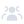

# Getting started

VibeWars is a team fight in a small arena. Each player brings one
character with eight skills. The team that wins the fight wins the
match. You need no account and nothing to install: the game runs in
this browser tab. Play it with a keyboard and mouse, or on a phone or a
tablet by touch: see [Touch](controls.md#touch).

## The tutorial

The first time you open VibeWars, it offers a short tutorial: a walk through a canyon that teaches you to move and fight. It then carries on in the menu, one step at a time: change your character's spec, build a team of two, see what each mode is for, and queue that team for a first 2v2 Team Arena match. While a step points at a control, the rest of the menu is dimmed. You can skip the tutorial at any time with **Skip tutorial**.

## The mode rail

The rail down the left of the main screen holds the
[modes](modes.md), top to bottom:  **Random Arena**,  **Team Arena**,
 **Heroes' Ascent**,  **GvG** and  **Hosted Game**. At the bottom of the
modes is the **Team size**, `‹ 4v4 ›`: the arrows step to the next
smaller or larger size the screen plays. Each screen remembers its own,
and opens at a size it plays (GvG at 8v8). Below that are  **Character Builder**, where you
make your characters, and  **Team Builder**, where you make your
[Team Builds](skills-and-builds.md#team-builds), then
 **Matches**, the [finished matches](modes.md#match-records) as their
hosts report them, and your own. The game opens on the
one you used last.

## Make a character

Your characters are the cards of **Character Builder**, newest first,
with the character your first start rolled always last: a PvX build,
named after it.

1. Press **New character**.
2. Pick a **primary profession**, what your character mainly is, and a
   **secondary profession**, which lends you its skills but not its
   primary attribute.
3. Fill the **skill bar** with eight skills from the skill library.
4. Spend your **attribute points**. An attribute makes the skills that
   use it stronger; the numbers in a skill's description change as you
   spend.
5. Press **Save**.

The editor tells you when a build cannot be played, for example when two
elite skills are on one bar. Click a character's card, or its **Edit**,
to change it. A character with no skills yet plays too, with auto-attack
only.

A character the game's rules changed under shows red stripes and
**Invalid**. You cannot play as it until you **Edit** it into a legal
build and save.

Not sure what to take? The random starter character is marked
**Random**, with a dashed outline. **Reroll** on it gives you a fresh
random build to try. The random builds are well-rated PvP builds from the
[PvX wiki](https://gwpvx.fandom.com/), each named as the wiki names it,
with its professions: "Gust (E/Me)".

**Team Builder** starts with a random Team Build too, a ready-made team
for a Team Lobby at each size, 2v2, 4v4 and 8v8, marked the same way and
always last. Team Builder lists the Team Builds of the sidebar's **Team
size**, so the random one shown is of the size picked there. **Reroll** puts
another ready-made team in its place. The ready-made teams are the PvX
wiki's well-rated PvP team builds; a size PvX has none of gets PvX solo
builds put together. **Clone** saves a copy of the
team shown as your own Team Build and opens it, to change as you like.
A Team Build's size changes in its editor: a smaller size drops the last
members, a larger one adds blank ones.

## Play a Random Arena

The quickest way into a fight. On **Random Arena**, click the card of
the character you play as, pick a team size, **1v1**, **2v2** or
**4v4**, with the arrows of the rail's **Team size**, then press **Find a match** in the title
bar, and wait: you are put in a team with other players, against
another team, on a random map. The queue waits in the background: you
stay on Random Arena and may go anywhere meanwhile, your builds,
equipment, Options, Help or the music editor, but not change character,
host or join a lobby, or change a mode's team size. Team Arena and the
other lobby screens say you are in a queue; the team size reads the size you
queued at, on every mode. A turning ring left of **Help** in the top bar
shows you are queued; click it for the queue, the time waited, how many
are searching and **Leave Queue**. When a match is found you are taken
to its versus screen from wherever you are. Closing the tab while you
wait takes you out of the queue at once.

When the match ends you can **Queue again**, or **Stay together** with
the team you just played with.

Every match ends on its scores, queued, hosted or in a lobby, and beside
them two charts tell the match over time; the queue screen shows them again
after a queued match. **You** draws your
damage dealt, damage taken, healing and Energy; **Teams** draws each team's
health pool above its total damage. Marks under the time axis show kills,
deaths, interrupts, captures and resurrections: point at one, or Tab to it,
to read what happened. Press a legend entry to hide or show its line. On a
phone the charts sit under the scores, which show you and two others until
**Show all**.

**My matches** on the [Matches](modes.md#match-records) page lists your last 50 matches, newest first: open one for its builds, and under **Stats** and **Diagram** its scores and charts again. They are kept in this browser only, for your current player key.

## Host or join a match

You are always in a lobby: from the moment the page opens it hosts one
of your own. The lobby is your party: **Lobby** in the top bar, between
Options and Music, opens a window with the invite link, Open/Closed and
Leave, and a list of who is in it; its badge counts them.

- **Invite:** press **Copy invite link** in the Lobby window and send the
  link to your friends. It holds your lobby's secret key, so share it
  only with people you want in. If your browser refuses to copy, the link
  shows selected: copy it by hand.
- **Open your lobby** before friends join: your lobby starts **Closed**
  (a shut padlock), and nobody can join it, even with the link. Press
  **Closed** in the Lobby window to open it: it turns into a highlighted open
  door, **Open**, and anyone with the link can then join. Press it again
  to close it: friends already in stay, and nobody new gets in. A guest
  sees the padlock and "Lobby closed" in the Lobby window while it is
  closed.
- **Join:** open the invite link you were sent, in a new tab or pasted
  into the address bar of one already open. **Join lobby** in the Lobby window also takes a pasted link. Your own lobby stays open
  until the join is in. Once in, the Lobby window says **Lobby**, and
  its **Leave** takes you back to a fresh lobby of your own, with a new
  invite link. A link opened on a lobby's screen or in a match asks you
  to go back to the menu first. If your connection drops, your seat is held
  for 30 seconds.
- **Remove someone:** as the host, press the **×** next to a player's
  name in the Lobby window, outside a match. They are told the host removed
  them, get a fresh lobby of their own, and cannot rejoin yours while it lasts.
- **Share your relay:** some friends can only reach you through a TURN
  relay. When a friend who runs one sends you its relay link, open it and
  press **Use**: it becomes your relay, and it is offered in any lobby you
  are in, not only ones you host. A player who cannot reach the host
  directly then joins through it after a few seconds, with nothing to set
  up. Each player gets their own login, good for 1 hour and renewed while
  they stay, at most 8 players a lobby. **Options → Relay (TURN)** shows
  it: a player relayed this way reads **Relay shared by** and the sharer's
  name there; while you share, it says **Sharing your relay with** how
  many players. To stop,
  untick **Share my relay with my lobbies** in **Options → Relay (TURN)**. A relay you type in
  there by hand is only ever yours.
- **Your party comes along:** if you had friends in your lobby, the top
  bar asks first (**Join** to go, Esc to stay), and once you are
  in, they follow you into your friend's lobby. Anyone who cannot get in,
  because it is full or was closed meanwhile, gets a fresh lobby of their
  own and is told why.

**The host picks the mode** on the rail, and everyone's screen follows;
a guest's modes are locked. **Character Builder**, **Team Builder** and
**Matches** are open to everyone, and opening one does not leave the lobby. On a
mode's screen, join a team, and when everyone is in, the host presses
**Start match**; bots play every place nobody takes. The lobby lists
players by name: what you play is the character you claim in the Team
Lobby, so you need no character of your own to join. **Random Arena**
queues only while you are alone in your lobby: leave the party, or play
a Hosted Game. It plays the character picked there; pick another, and you
play it from the next match.

**Team Arena**, **Heroes' Ascent** and **GvG** offer only that mode's
maps: **Team Arena** the Annihilation, Kill Count and Priest Annihilation
maps, **Heroes' Ascent** the Relic Run, King of the Hill and Capture
Points maps, and **GvG** the Guild Battle's. **Hosted Game** offers every
map, and its host picks one above the teams. Your **Team Builds** are on **Team Builder** alone, and you pick
none before the lobby. On **Hosted Game**, when the host starts, the lobby
opens the [Team Lobby](modes.md#team-lobby): propose a Team Build there,
click a card, which shows each member's weapons and skills, to vote
for one, then click a seat to take one of its characters. Seats list the
players and their professions; a character's name shows in the match.

On **Team Arena** (2, 4 or 8 a side, the host's **Team size**),
**Heroes' Ascent** and **GvG** (8 a side)
your lobby is one side, your party, and there is no Start or bot count:
the host presses **Find a match**. The Team Lobby comes first, with only
Team Builds of exactly that size; every seat nobody claims is a bot.
Then the party is queued, and the same turning ring left of **Help**
shows it: its window names the queue (**Team Arena 2v2**, **Heroes'
Ascent · round 3**, **Guild vs Guild**) with the time waited, and in
Team Arena how many teams are searching, yours included: `2 teams
searching`. Only the host has **Leave Queue** there. Closing the
host's tab takes the party out of the queue at once. When another
queued team of the same mode turns up, you play them on one of the
mode's maps, each side with its own builds, and come back to your lobby
afterwards. The host can leave from the ring's window at any time; a guest who leaves takes the whole
party out of it. After 10 s in the queue, the host can also press
**Play against bots** in the ring's window: a match in your own lobby against a
random preset team of bots,
except in [Heroes' Ascent](modes.md#heroes-ascent), which waits for a
team at your round.

## Your name, guild tag and cape

Open **Options** with the ⚙ in the top bar: its **player** section
holds what is yours whatever you play. The game gives you
a **Name** on your first visit, like `AshenWolf`; type over it to change
it. Left empty, you play as `Player`. Type a **Guild tag** of 2 to 4 letters
or digits beside it, and everyone sees it after your name, like
`Ente [VIBE]`. With a tag set, the **Guild cape** designer appears under
it: pick any cape colour and trim colour, draw an emblem, and your body
wears the cape in every match: it folds to a thin band on your rim when
you stand and streams out behind you when you move. Your characters in
the menu show it too. **No cape** takes it off. A colour too close to the
blue of your team or the red of your foes is turned a little away from it
when it is drawn, so no cape looks like a team.

A change applies at once to the lobby you are in.

**Draw your emblem.** The 16×16 emblem grid is always under the cape and trim colours. Pick a colour or **Empty**, then draw with the **Pencil**, rub out with the **Eraser**, or flood an area with **Fill**. **Add colour** gives the emblem another colour, up to 15, and the colour picker beside them changes the picked one, along with everything drawn in it. **Start from** puts one of eight shapes on the grid in the picked colour. **Mirror** paints the left and right halves at once. **Clear** empties the grid and **Undo** goes back a step. The small view beside the grid shows the emblem as big as in a match. Each stroke is kept as you finish it. Arrow keys and Space draw from the keyboard too.

**Copy guild link**, under the cape designer, copies a link that carries
your tag and cape. Whoever opens it is asked **Join guild [VIBE]?**:
**Join** gives them your tag and cape, **No** changes nothing. Anyone can
send such a link and nobody owns a tag, so the game always asks first.

## Language

The game starts in your browser's language when it has it, else in
English. Pick another in **Options → Language**: the page reloads in it, and
keeps it from then on. Skill, map and item names and these Help pages
are in English for now. While you are in a lobby with others, in a
queue or in a match, the choice is locked, since the reload would drop
you out. Player names stay as their players wrote them.

## Watching a match

In a lobby whose match is on, anyone not on a team can press **Watch**.
You see the whole match, both teams, everything **10 seconds late**, so
nobody watching can call the other team's moves. You cannot move,
target or cast. The camera follows one player: **Tab** follows the next
one alive, **Shift+Tab** the one before, and the target frame shows
whom you follow. **Esc** or **Leave** takes you back to the lobby; the
match goes on without you.

## Playing online

Online play is peer to peer: the other players in your match see your
IP address.

## In a match

- Click the ground to walk there, or move with **W A S D** or the arrow keys.
- Right click a foe to target it, or press **Tab** for the next one.
  Press **Space**, or right click the foe again, to attack it.
- Your eight skills are on **1** to **8**, slot 1 first.
  Click a skill on the bar to use it too.
- **Esc** cancels what you are doing. Every key can be changed in
  **Options**, under Controls; the VibeWars preset puts skills on Q W E R
  and A S D F and moves with the arrow keys. All of them are in
  [Controls](controls.md).

The [?] button, top right, opens this Help again, in a match too.
