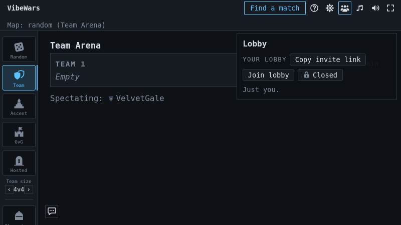

# Játékmódok

Minden pálya egy módot játszik, és a lobbi a pálya neve alatt kiírja,
melyiket. A módok a főképernyő bal oldalán lévő sáv bejegyzései. Egy
pálya módját senki sem választja, de az a sávbejegyzés, ahonnan
létrehozod a lobbit, eldönti, milyen módokat játszanak a lobbi pályái:
a  **Csapataréna** a Megsemmisítést, az Ölésversenyt és a Papirtást, a
 **Hősök Útja** az Ereklyefutamot, A domb urát és a Pontfoglalást, a
 **GvG** pedig a Céhcsatát. A  **Saját játék** minden pályát kínál. A
 **Véletlen Aréna** választ neked egy pályát, és vele a módot, de sosem
Céhcsatát, Ereklyefutamot, A domb urát vagy Pontfoglalást. A
Csapataréna minden meccsre kisorsolja egy pályáját, a Hősök Útja az
első pályáján kezdődik, és csak a Saját játékban választhat a
házigazda.

Két szigorú hálózat mögötti játékos nem kerülhet össze a sorban, ezért a sor csak azokat a játékosokat számolja, akikkel összekerülhetsz, és ezt meg is mondja. Segít egy relay az **Opciók → relay (TURN)** alatt.

Minden pálya bizonyos csapatméretekre készült, és egy mód csak olyan
pályán játszik, amely az ő méretére készült: egy 8v8 sosem zsúfolódik
össze egy 1v1-re épített arénában. A sáv **Csapatméret** nyilai csak
azokon a méreteken lépkednek, amelyeket a megjelenített mód játszik.

| Mód            | Csapatméretek | Pálya                                          |
| -------------- | ------------- | ---------------------------------------------- |
| Véletlen Aréna | 1v1, 2v2, 4v4 | neked sorsolva, a méretre készültek közül      |
| Csapataréna    | 2v2, 4v4, 8v8 | meccsenként sorsolva, a méretre készült        |
| Hősök Útja     | 8v8           | a pályái sorban, egészen a Csarnokig           |
| GvG            | 8v8           | Guild Hall Isle                                |
| Saját játék    | bármely       | a házigazda választ egyet a méretre készültből |

Céhcsatában, Ereklyefutamban, A domb urában vagy Pontfoglalásban a
képernyőn kívüli vagy a HUD alatti célpont körvonalas nyilat kap a
képernyő szélén: a zászlótartó vagy egy szentély a birtokosa színében,
szürkén, ha senkié, az oltár aranyszínben. Egy játékos kitöltött nyila
fölé rajzolódik.

## Megsemmisítés

**Győzz le minden ellenséget.** A halottak addig fekve maradnak, amíg
egy szövetséges fel nem támasztja őket, és minden halál morálba kerül.
Söpörd el a másik csapatot, hogy nyerj. 8 perc után az a csapat nyer,
amelyiknek a legtöbb morálja maradt.

A Canyon, a Crossroads és a Long Hall játssza, valamint két kis aréna,
nagyjából a Canyon méretében: a **Sandstone Steps** (1v1, 2600x1940), egy
teraszos sivatagi város süllyesztett kútudvarral, utcái fölött háztetőkkel,
alattuk pedig karral nyitható aluljáróval; és a **Frozen Crossing** (2v2,
2600x1940), egy befagyott folyó két magas part között, amelyen gázlóköveken
vagy egy rönkhídon kelhetsz át, a híd középső pallóját egy kar emeli fel. A
nagyobb csapatoknak: az **Ashen Courtyard** (4v4, 5120x3840), egy kiégett,
fallal körülvett udvar, fent várfolyosókkal és tornyokkal, lent
süllyesztett kútudvarral, kapuházának csapórácsát a falakról működtetik; és
a **Moss Vale** (8v8, 5000x2600), egy teraszos völgy, amelyet egy mély
malomárok kettévág, és csak a felvonóhídnál, a malomnál és az alatta futó
aluljárón lehet átkelni rajta.
A **Canthan Terraces** (1v1, 2400x2100) kicsi, de meredek: rizsföldek
lépcsőznek fel egy domboldalon egy romos pagodáig, alattuk egy elárasztott
átereszzel, amelyet egy zsilipkar nyit meg harmadik útként a középhez.
A **Sunken Bastion** (2v2, 2700x1900) kicsi, de magas:
egy félig elárasztott erőd, amelynek udvarát vizesárok szeli ketté; át
lehet kelni rajta a mindkét parton karral működtetett felvonóhídon, az
északi várfal mentén futó gyilokjárón vagy a lenti elárasztott pincén át.
A nagyobb csapatoknak pedig: a **Shiverpeak Pass** (4v4, 5100x3450),
egy havas hegyi hágó, amelyet szakadék vág ketté; át lehet kelni rajta a
két sziklapárkány közötti kötélhídon, amelyet mindkét párkányon egy kar
húz be, a szakadék alatti barlangon át, vagy a vége körül, miután az
ottani jégfalat szétverték; és az **Elonian Plateau** (8v8,
5520x3360), sivatagi fennsík négy tanúheggyel egy kiszáradt kanyonmeder
körül: időzített liftek visznek fel hármukra, természetes kőhíd köti össze a
két északit, a középső gerinc alatt pedig átjáró fut, amelynek rácsát egy
fenti kar nyitja.

## Ölésverseny

**A legtöbb ölés 3 perc alatt.** A halottak 8 másodperc után
visszatérnek a kezdőpontjukon, és a halál nem kerül morálba. Az első
csapat, amely eléri a 15 ölést, azonnal nyer. Az idő végén a több ölés
nyer; egyenlő ölésszám döntetlen.

Az Ember Pits játssza: lávaerek kőhidakkal, egy lávaalagút, egy karral
indítható lift egy bazaltoszlop tetejére és gőzkürtők, minden csapatmérethez.

## Papirtás

**Győzz le minden ellenséget és a papjukat.** Minden csapatnak van egy
Papja egy szentélyen a kezdőpontja mögött. Sosem mozog és sosem támad,
de mindenkit gyógyít, aki mellette áll, az ellenségeket is. 2
percenként az a csapat, amelyiknek él a papja, visszakapja a halottait a
szentélyen, teljes Életerővel és Energiával. Öld meg előbb a papot, és
a másik csapat fekve marad.

Egy csapat akkor veszít, amikor minden játékosa és a papja is halott.
12 perc után a legtöbb morál nyer.

A Jungle Ruins (2v2-től 8v8-ig, 5400x2800) játssza: benőtt
templomromok, amelyeket egy dzsungelfolyó szel ketté. Gázolj át egy
gázlón, kelj át egy rönkhídon, mássz fel a középső lépcsős piramisra,
vagy menj át az alatta húzódó rejtett járaton, amint egy udvaron egy
kar kinyitja az ajtajait; az indafalak kivághatók.

## Céhcsata

**Öld meg az ellenséges Céhurat**, 8 a 8 ellen. Minden bázis egy két
kapus fal mögött áll; a Céhúr a nagyúri terme hátulján áll, és íjjal
lő minden ellenségre, akit lát. Őrök védik mindegyik bázist: Lovagok és
egy Testőr a nagyúr mellett, egy Íjász a nagyúri terem hátulján, egy
Gyalogos és egy Íjász mindegyik kapunál. A posztjuk közelében lévő
ellenségekkel harcolnak, és visszasétálnak oda. Amíg a Testőr él, a
nagyura 20%-kal kevesebb sebzést kap, ezért őt öld meg először. 2
percenként minden csapat szentélye visszahozza a halottait.

Minden csapatnak van egy **zászlója** a bázisán, a **zászlótartó**
pedig középen van. Vedd célba a zászlódat, és nyomd meg a **Space**
billentyűt, hogy felvedd; vidd el a tartóhoz, vedd célba a tartót, és
nyomd meg a **Space** billentyűt, hogy leszúrd. A zászlóvivő lassabban
sétál, és nem támadhat, és nem használhat támadókészséget; elejti a
zászlót, amikor meghal, fegyvert vált, vagy megnyomja az Életerő-sávja
fölötti **Zászló le** gombot. Ha a sajátodat leszúrod a tartóra, az
ott lévő ellenséges zászló hazamegy.
Minden 2 percért, amíg a zászlód a tartón van, a csapatod 10% morált
nyer.

Az a csapat, amelyiknek meghal a Céhura, azonnal veszít, és az is,
amelyiknek minden játékosa halott a legalacsonyabb morálon. 28 perc
után az a csapat nyer, amelyik a legtöbb sebzést okozta az ellenséges
Céhúrnak; ha ez egyenlő, az mindkettőnek vereség, mert döntetlen
nincs.

Az eredményjelző mutatja minden Céhúr életerejét, a tiédet elöl, hogy
ki tartja a zászlótartót, és mennyi idő van hátra a növelésükig, mikor
hozzák vissza legközelebb a szentélyek a halottakat, és az utolsó 3
percben mindkét csapat sebzését az ellenséges nagyúrnak. Alatta egy sor
megnevezi, ki visz zászlót. A növelés „Morálnövelés! +10%” vagy
„Ellenséges morálnövelés” felirattal ugrik fel. Az iránytűn ♛ jelöl
minden Céhurat, ⚑ minden zászlót és ◎ a tartót.

A Guild Hall Isle (8v8, 6000x2600) játssza: egy sziget a tengerben. Minden Guild Lord egy csarnok tetején áll, sánc mögött; kifelé a kaputornyon át, a sáncon át vagy egy móló mentén vezet az út. A kapu ajtaját az ellenfél sáncán lévő kar nyitja. A zászlótartó egy emelvényen áll középen.

## Ereklyefutam

**Vidd az ereklyédet az oltárhoz.** Minden csapatnak van egy
**ereklyéje** a bázisán, az **oltár** pedig középen van, mindkét
bázistól ugyanakkora úton, egy északi vagy egy déli útvonalon; az oltár
az iránytűn ◆ jellel látszik. Vedd célba az ereklyédet, és nyomd meg a
**Space** billentyűt, hogy felvedd. Vidd fel az oltárra, és azonnal
szerzel egy pontot, az ereklye pedig visszakerül a bázisodra. Minden
pontot bejelentenek, egy fanfárral, amely a tiédnél emelkedik, az
övéknél ereszkedik. Az ereklyevivő lassabban sétál, és nem támadhat,
és nem használhat támadókészséget. Átsétál a saját csapatán, de az
ellenség továbbra is elállja az útját. Elejti az ereklyét, amikor
meghal, vagy megnyomja az Életerő-sávja fölötti **Ereklye le** gombot,
és az ereklye ott marad, ahová esett, amíg valaki el nem éri. A
csapatod onnan veszi fel. Az az ellenség, amely üres kézzel éri el,
hazaküldi. Az ellenség bázisán lévő ereklyéje nem a tiéd, nem
nyúlhatsz hozzá.

A halottak addig fekve maradnak, amíg egy szövetséges fel nem támasztja
őket, és minden halál morálba kerül. Söpörd el a másik csapatot, hogy
azonnal nyerj. 8 perc után a több ponttal rendelkező csapat nyer;
egyenlő pontszám döntetlen. Az ölés nem ér pontot.

Az eredményjelző mutatja a pontokat, a tiédet elöl, és az órát. Alatta
minden ereklyéhez egy sor mondja meg, hol van: `✦ Név` a vivőjénél,
`✦ eldobva` a földön vagy `✦ a bázison`.

A botok is futnak az ereklyével: a hozzá legközelebbi hozza el az
ereklyédet, hacsak nem éppen te készülsz felvenni. Előbb az a bot megy,
amelyik nincs harcban; ha mind harcban van, a legközelebbi otthagyja a
harcot az ereklyéért, így az oltárnál kialakult patthelyzet sosem
állítja le a pontszerzést. A gyógyító vagy a súlyosan megsebesült bot
csak akkor megy, ha senki más nem tud, és sosem harcból. Az elejtett
ellenséges ereklyéhez legközelebbi hazaküldi, a többiek pedig az
oltárnál várnak. Az ereklyédet vivő bot egyenesen az oltárhoz viszi; a
többiek csak akkor hagyják ott az ereklyét, ha egy ellenség
varázslattávolságon belülre jön, hogy megküzdjenek vele.

A Broken Tower játssza (4v4 és 8v8, 5400x2800): egy ledőlt torony egy dombon a hegyvidéken. Menj fel a romteraszok lépcsőin az oltárhoz a toronycsonkon, vagy menj át a domb alatti pincén, amint egy kar a teraszon kinyitja az ajtajait; a romfalak összetörhetők.

### Cinder Sanctum

A Hősök Útja Ereklyefutama itt fordítva megy. Minden bázison ott van a
csapat ereklyéje és Kísértethőse, oltár pedig nincs. **Vedd el az
ellenség ereklyéjét a bázisukról, és vidd el a saját Kísértethősödhöz**
egy pontért. A kísértetnek élnie kell, és a posztján marad. A saját
ereklyédet nem viheted: ha ott veszed fel, ahová esett, hazamegy. Az a
csapat, amelyik **3 ponttal vezet, azonnal nyer**. 8 percnél a legtöbb
pont nyer, egyenlőségnél pedig az a csapat, amelyik utoljára szerzett
pontot. Minden bázis 2 percenként feltámasztja a halottait és a
kísértetét. A botok együtt mennek az ellenség ereklyéjéért, és hazahozzák.

A Cinder Sanctum (8v8, 5600x2800) ezt játssza: templom egy vulkán oldalán, két lávafolyó között. Kelj át egy hídon vagy a töltésen az előudvarán álló szentélyhez; az előudvar egyik karja megnyitja a szentély alatti rejtett átjárót, a hamufalak pedig szétverhetők. A láva éget.

## A domb ura

**Vezesd a Kísértethősödet az oltárra, és tartsd meg.** Minden
csapatnak van egy **Kísértethőse** a bázisán, egy baltával harcoló
kísértet, akit senki sem irányít. Az **oltár** középen van, mindkét
bázistól ugyanakkora sétára. A **Threefold Keep** pályán három csapat
(kettő, ha nincs szabad harmadik) harcol érte egy fallal körülvett
vár tornyán. Csapatonként legfeljebb 12 pont, és
ha minden ellenség -60% morálon áll, azonnal nyersz. A **Hősök
Csarnoka** (8v8, 5000x4400), a pálya, amely a Hősök Útját zárja, egy arany
csarnok három csapatnak: az oltár egy oszlopos, hat lépcsős emelvényen áll,
egy talapzaton, amelyből minden két bázis között egy karzat nyúlik ki, és
minden bázistól egy kripta fut a padló alatt fel a talapzatba. A kripták
ajtajai zárva kezdenek, és bármelyik csapat karja kinyitja mind a hármat. Vedd célba a
kísértetedet **jobb kattintással**, és nyomd meg a **Space**
billentyűt, hogy kövessen: veled sétál, és azzal harcol, amivel te.
Nyomd meg rajta újra a Space billentyűt, és ott marad, ahol áll, és
harcol minden ellenséggel, amely a közelébe jön. Ha meghalsz vagy
kilépsz, ott marad. Ha a kísértetedet célba vetted, a kerete kiírja,
kit követ, vagy hogy helyben marad. Egy felugró üzenet kiírja, kit
követ a Kísértethősöd, valahányszor ez megváltozik, és a feje fölötti
neve mutatja a vezetőjét.

A kísértetednek 640 Életereje van, és a **Cyclone Axe**, a
**Disrupting Chop** és a **Swift Chop** készséggel forgatja a baltáját,
akár követ, akár helyben marad. Annál erősebb, minél feljebb jársz a
Hősök Útján: 24-es szintű a Threefold Keepen, 28-as a Hősök
Csarnokában. **Öld meg a másik csapat kísértetét**, és a csapatod
minden tagja **+10% morálnövelést** kap, amely először eltörli a halál
miatti büntetést, és sosem megy +10% fölé. Öld meg újra, miután
feltámadt, és újra megkapod.

Vezesd az oltárra vagy azon túl, és fellép az oltárra, és ott marad.
Ott harcol minden mellette álló ellenséggel, de sosem lép le utánuk. Az
oltáron álló kísértet magától foglalja el: 5 másodpercig mozdulatlanul
áll, a varázslássávja telik, és senkivel sem harcol. Egy megszakítás
vagy egy leütés félbeszakítja a foglalást, és újrakezdi, amint tudja.
Csak akkor foglalhatja el az oltárt, ha senki sem tartja, vagy ha a
tartó kísértete halott. Amikor a foglalás befejeződik, az oltár a
csapatodé.

Az oltárt tartó csapat minden 30 másodpercért, amíg megtartja, pontot
szerez, akkor is, ha a saját kísértete halott, amíg egy másik csapat
el nem foglalja. Minden pontot bejelentenek, ahogy egy ereklyepontot is.
A halott kísértet 2 perccel később támad fel a bázisán, helyben
maradva, itt és az Ereklyefutamban. A Pontfoglalásban a bázis következő
hullámával támad fel. Papokkal rendelkező pályán ehelyett a pap
következő hullámával támad fel, de csak amíg a csapata papja él. Minden
más pályán a halott kísértet halott marad, és a +10%-a csak egyszer
szerezhető meg. Nem játékos: a halála nem kerül morálba, és nem számít
bele a csapat elsöprésébe.

A halottak addig fekve maradnak, amíg egy szövetséges fel nem támasztja
őket, és minden halál morálba kerül. Söpörd el a másik csapatot, hogy
azonnal nyerj. 8 perc után a több ponttal rendelkező csapat nyer;
egyenlő pontszám döntetlen. Az ölés nem ér pontot.

Az eredményjelző mutatja a pontokat, a tiédet elöl, aztán az oltárt: `▲`
és a tartó következő pontjáig hátralévő idő, a tartó színében, vagy egy
szürke `▲ —`, amíg senki sem tartja.

A botok is mennek az oltárért: amíg a csapatod nem tartja, a
Kísértethősödhöz legközelebbi veszi át, hacsak nem éppen te készülsz
átvenni; a gyógyító vagy a súlyosan megsebesült bot csak akkor megy, ha
senki más nem tud. Az oltárra vezeti a kísértetet, és megmondja neki,
hogy maradjon ott, a többiek pedig az oltárnál várnak. A kísértetet
vezető bot útközben nem áll meg harcolni; a többiek csak akkor hagyják
ott az oltárt, ha egy ellenség varázslattávolságon belülre jön, hogy
megküzdjenek vele. Amíg a csapatod nem tartja az oltárt, minden bot
először a másik csapat Kísértethősét öli meg, amint az az oltáron áll a
hatótávjukon belül: ez az egyetlen ellenség, amely megakadályozza, hogy
a kísértetetek elfoglalja.

A Threefold Keep játssza (4v4 és 8v8, 5000x4400): egy vár egy dombon a hegyvidéken, három csapatnak. Menj fel a kapud melletti lépcsőn a gyilokjáróra, és kelj át egy töltésúton a dombra, aztán mássz fel a torony tetején álló oltárhoz. Minden udvarban egy kar mind a négy kaput kinyitja: a saját kapuátjáródat a fal alatt, és az altemplomot, a hosszú utat a domb alatt.

## Pontfoglalás

**Tartsd meg a szentélyeket.** A pályán öt **szentély** van: egy-egy
mindegyik bázis mellett, és három köztük, a középső nyílt terepen. Állj
egy szentélyre, hogy elfoglald. A csapatod minden rajta álló tagja egy
**csík**, a Kísértethősöd négy; a társállatok, szolgák és szellemek
egyet sem érnek. Négy csíkkal egy semleges szentély 8 másodperc alatt
a tiéd, kettővel 16, egyedül 32 alatt; négynél több nem gyorsít. A
rajta álló ellenségek egy az egyben kioltják a csíkjaidat: hárman kettő
ellen egy csíkkal foglalják el, 32 másodperc alatt, nyolcan kettő ellen
néggyel, egyenlő csíkszám pedig megállítja. Három csapatnál a
legerősebb a saját csíkjaival mozdítja, mínusz a másik kettőé
együttvéve; ha a másik kettő túlerőben van, senki sem foglal, és a
valakinek a birtokában lévő szentély csak visszaürül semlegesre. A
másik csapat birtokában lévő szentély előbb semlegesre ürül, aztán
neked telik fel, így az elfoglalása kétszer annyi ideig tart. Ha
elsétálsz, a haladása ott marad, ahol volt; a birtokodban lévő
szentély a tiéd marad, amíg egy ellenség el nem foglalja. A szentélyek
az iránytűn □ jellel látszanak a birtokos színében.

30 másodpercenként minden szentély, amely a csapatodé, pontot szerez,
és egy felugró üzenet meg egy hang bejelenti, mit szerzett az egyes
oldal. A meccsóra minden 60 másodpercében a csapatod halottai
feltámadnak a bázisod szentélyén, teljes Életerővel és Energiával, akkor
is, ha ellenség áll ott, hacsak a moráljuk nincs a mélyponton. Az
eredményjelző visszaszámol a következő hullámig. Minden halál morálba
kerül, és a kísértet ugyanabban a hullámban támad fel, a saját
helyén.
Kerülj **20 ponttal** minden más csapat elé, hogy
azonnal nyerj. Az elsöprés nem zárja le a meccset, de az a csapat, amelynek minden játékosa kilépett, kiesik. 8 perc után a több ponttal rendelkező csapat nyer; egyenlő
pontszámnál az, amelyik több szentélyt tart, aztán az a csapat, amelyik
utoljára vezetett egyedül, és ha egyik sem vezetett soha, döntetlen. Az
ölés nem ér pontot.

Minden szentély egy gyűrű a földön a birtokosa színében, szürkén, amíg
senkié, körülötte egy ívvel, amely mutatja, mennyire jár azon, aki
éppen elfoglalja. Az eredményjelző mutatja a pontokat, a tiédet elöl, és
az órát.

A botok szétszóródnak azokon a szentélyeken, amelyek még nem a csapatodéi,
és rajtuk állnak, amíg el nem foglalják őket. A varázslattávolságon
belüli ellenség nem csalja el őket: fellépnek egy elérhető szentélyre,
és onnan harcolnak.

A Scarred Earth (4v4 és 8v8, 5400x2800) játssza: kráterekkel szabdalt csatatér alkonyatkor. A szentélyek összetört ostromtornyokon állnak, a középső a nagy torony fedélzetén, mindegyik egy kráter mellett; a tornyokon lévő karok két lövészárkot nyitnak a mező alatt, a rommá lett cölöpkerítések pedig szétverhetők.

A Hősök Útján a The Warden's Gallery (8v8, 5200x2500) játssza: napfényes szoborcsarnok tetőablakok alatt. A középső szentély a nagy talapzat tetején áll, és minden csapatnak három van az előcsarnoka közelében, egy közülük talapzaton; a nagy talapzaton lévő karok két kriptát nyitnak a padló alatt, a ledőlt szobrok pedig szétverhetők.

## Csapatlobbi

A létrehozott lobbi nem indítja el a meccset, amikor mindenki kész.
Előbb megnyitja a Csapatlobbit, ahol mindkét oldal közösen választ egy
Csapatbuildet, aztán felosztja a karaktereit. A Hősök Útján és a
GvG-ben egy oldal akkora, mint a mód csapata (8), amit az oldalsáv
**Csapatméret** mezője mutat, zárolva. A Csapatarénában az osztag
vezetője a nyilakkal választ 2v2, 4v4 vagy 8v8 között, amíg az osztag
nincs sorban, és az osztag többi tagja zárolva látja. Azon a méreten
indul, amelyet a vezető utoljára választott a Csapatarénában, eleinte
4v4-en. Egy osztag sosem választ a játékosainál kisebb méretet, és az
az osztag, amelyben annyi játékos van, amekkora a mérete, senkit sem
fogad be többet („Az osztag megtelt.”). Két osztag csak azonos méreten
találkozik, és a felső sávon a sor ikonjának ablaka megnevezi:
„Csapataréna 2v2”. Saját játékban a házigazda a nyilakkal állítja be a
csapatméretet, 1v1-től 8v8-ig, a Csapatlobbi előtt, és mindkét oldal
pontosan ennyivel játszik; a Csapatlobbi nem mutat Csapatméretet. A
vendég a házigazdáét látja, zárolva. A házigazda pályalistája csak az
erre a méretre készült pályákat mutatja, és ha a méret nem illik a
pályához, a lobbi az első olyan pályára vált, amelyhez igen. Sosem megy
egy oldal játékosszáma alá, és az az oldal, amelyben annyi játékos van,
amekkora a csapatméret, senkit sem fogad be többet. Az 1v1 minden
karakteredet felsorolja, a csapattagokat a csapatuk nevével jelölve:
kattints egyre, hogy azzal játssz, vagy várj, és az aktív karaktereddel
játszol. A csapatodnál lévő **Kilép** kivesz belőle anélkül, hogy
elhagynád a lobbit.
A sorban álló osztag ([Meccskeresés](getting-started.md#meccs-indítása-vagy-csatlakozás)
a Csapatarénában, a Hősök Útján vagy a GvG-ben) csak a saját oldalának
kap Csapatlobbit, akkorát, mint a mód csapata (a Csapatarénában a
választott méret, a többiben 8), akárhányan is vannak az osztagban; a
helyeket, amelyeket senki sem foglal el, botok játsszák.
Amíg sorban áll, böngészheted a többi módot: az osztag megtartja a
módját és a méretét, amíg el nem hagyja a sort.
Minden szakasz 30 másodpercig tart, és korábban véget ér, ha a
Csapatlobbiban mindenki kész. A szavazás és a hely elfoglalása késznek
jelöl.

**Szavazás.** Egy oldalon bárki javasolhat egy pontosan akkora
Csapatbuildet, amekkora az oldal, mindenki egyet. A Csapatbuildjeid a
jobb oldali **Csapatbuildjeid** fülről nyílnak: keress köztük név
szerint, kattints egyre, hogy lásd a tagjait, aztán **Javaslom ezt a
buildet**; a sajátodon **Javaslat visszavonása**. Az Esc bezárja. Csak
az ilyen méretű, probléma nélküli Csapatbuildjeid szerepelnek; a fiók
kiírja, hány más méretűt hagy ki. Bárki szavazhat az oldala
javaslatainak egyikére, a sajátját is beleértve. Minden javaslat egy
kártya, amely minden tagot a fegyvereivel a kezében mutat, a
készségeivel, és azok monogramjával, akik rá szavaztak: kattints egy
kártyára, hogy szavazz, vagy egy másikra, hogy megváltoztasd a
szavazatodat; a szavazatot nem lehet visszavonni. Helyetted senki sem
javasol semmit: a menü csak Csapatbuildeket készít és szerkeszt. Az új
javaslat lecseréli a régit, és a rá leadott szavazatok nullára állnak.
A legtöbb szavazat nyer. Döntetlennél a kapitány szavazata dönt: a
házigazda oldalán a házigazda, a másikon az, aki a legkorábban
csatlakozott. Ha vannak javaslatok, de nincs szavazat, véletlenszerűen
választ a játék egyet. Ha nincs javaslat, az oldal egy véletlen előre
beállított, a méretének megfelelő csapattal játszik, olyannal, amilyennel
a Csapatszerkesztő is indít; az egyfős oldal egy véletlen kezdőbuilddel
játszik. Az a sorban álló osztag, amelynek csapattervét nem fogadják el
(hiányzik egy hely, szabálytalan egy build), szintén egy véletlen előre
beállított csapattal játszik, és ezt a meccs kezdetén közlik vele.
Mindkét oldal a sajátját sorsolja, így akár ugyanazzal is játszhatnak.
Egyik oldal sem látja a másik javaslatait, szavazatait vagy döntését.

**Foglalás.** A választott build karakterei a helyek, mindegyik a
karakter, a fegyvereit a készségei fölött tartva: kattints egy szabad
helyre, hogy elfoglald, vagy egy másik szabadra, hogy átülj, aki
előbb jön, előbb kap, mindenki egyet. Aki semmit sem foglalt el, az
első szabadot kapja, a többit pedig botok játsszák, a karakterük nevén.
Aztán a meccs elindul, vagy a sorban álló osztag beáll a sorba.

Aki a Csapatlobbi alatt kilép, a karakterét egy botra hagyja, így az
oldal megtartja a méretét. Aki ekkor csatlakozik, csak néz.

Egy sorban álló csapatmeccs után a győztesek 20 másodperc után maguktól
újra sorba állnak, a vesztesek (és döntetlennél is) visszatérnek a
menübe; a kóddal létrehozott lobbi meccse mindenkit visszavisz a
lobbiba. Az eredmény alatti gomb átugorja a várakozást, a győzteseknek
pedig sorba állás nélkül lép ki.

## Hősök Útja

A sorban álló Hősök Útja egy felfelé vezető út a GW1 pályáin, azok
sorrendjében: Elite Zaishen Battle, The Underworld, Fetid River, Burial
Mounds, Unholy Temples, Forgotten Shrines, Golden Gates, The Courtyard,
Antechamber, (The Vault,) aztán a Hősök Csarnoka. Csak az eddig
megépített pályák vannak benne, így ma kilenc kör: The Hollow Deep
(Megsemmisítés), Blackwater Ford (Papirtás), Barrow Field (Papirtás),
Cinder Sanctum (Ereklyefutam, az Unholy Temples helyén), Mosslit Cairns
(Pontfoglalás, a Forgotten Shrines helyén), The Brazen Causeway
(Papirtás), Threefold Keep (A domb ura), The Warden's Gallery
(Pontfoglalás, az Antechamber helyén), aztán a Hősök Csarnoka. Amíg csapatot keresel, a felső sávban a sor ikonja kiírja, hol tartasz, `Hősök Útja · 2. kör`, a Lobbi ablak pedig annak a körnek a pályáját mutatja.
Csak azonos körben lévő csapattal találkozol, és addig vársz rá, amíg
kell: botok nem ugranak be. Az egyetlen kivétel: a 2. körtől kezdve az a
csapat, amelyik 60 másodpercig egyedül van a körében, előreugorhat. A
Csarnok előtti bármely későbbi körben várakozó csapattal találkozik,
mindketten a későbbi csapat pályáján játszanak, és a győztes onnan megy
tovább. A három csapatra készült pályán lévő kör háromra vár; az a két
csapat, amelyik 30 másodpercig várt egy harmadikra, inkább egymással
játszik, és az a kettő is, amelyiknek a harmadika sosem jelenik meg a
lobbiban. Ha nyersz, az osztagod 20 másodperc után magától feljebb lép a
következő pályára; ha a Csarnokban nyersz, maradsz megvédeni. Ha
veszítesz, vagy a vége előtt kilépsz egy meccsből, a következő Hősök
Útad újra az 1. körben kezdődik; ugyanígy, ha elhagyod a sort vagy az
osztagot. Az a meccs, amelyet azért vesztettél el, mert a házigazdája
kilépett, megtartja a körödet.

A Csarnok minden meccsre három mód közül sorsol egyet: A domb ura,
Ereklyefutam vagy Pontfoglalás, két vagy három csapatnak. Kettőnél a
harmadik bázis zárva marad, és vele a két karzatán lévő foglalási pontok is. A Csarnok
meccse 11 percig tart, és a legtöbb pont nyer; a Pontfoglalás 20 pontos
előnnyel korábban is véget ér. A halál nem kerül morálba. A halottak a
meccsóra minden egész percében együtt térnek vissza a bázisukon, így az
elsöpört csapat nincs legyőzve, de az a csapat, amelynek minden
játékosa kilépett, kiesik. A domb urában az oltárt tartó csapat a
kísértete halála után is szerez pontot, amíg egy másik csapat el nem
foglalja, és a halottai az oltáron térnek vissza. Egyenlőségnél az a
csapat nyer, amelyik utoljára szerzett pontot, a Pontfoglalásban pedig
az, amelyik a legutóbb ölt.

**A Páncélterem.** A Csarnok csak 12 percenként áll össze az UTC óra
szerint, :00-kor, :12-kor, :24-kor, :36-kor és :48-kor. Addig az
osztagod a Páncélteremben vár: a sor ikonja mutatja a következő
nyitásig hátralévő időt, és hogy ki tartja a Csarnokot. Minden
nyitáskor a tartó legfeljebb két kihívóval találkozik, vagy ha senki sem
tartja, legfeljebb három kihívó találkozik. Csak a nyitás előtt váró
osztagok vesznek részt, a helyeken felülieket pedig a következő várja.
Az a tartó, amelynek nincs kivel harcolnia, megtartja a Csarnokot és
vár, győzelem nélkül, és a magányos kihívó is vár. Amikor egy osztag
megnyeri a Csarnokot, minden nyitott játék kiírja, ki tartja most: a
vezetője, vagy a céhjele, ha az osztag több mint felének ugyanaz.

Minden út az **Elite Zaishen Battle**-lel kezdődik, sor nélkül: az
osztagod hat, botok által játszott Zaishen ellen (2 Monk, egy
Elementalist és 3 másik). Egy ünnepélyes arénában zajlik (8v8,
5400x2400): lépcsőzetes lelátók északon és délen, szobrok talapzaton a
süllyesztett küzdőtéren, és minden lelátó alatt egy pince, amelynek
csapórácsát a túlsó lelátón lévő kar nyitja ki. Az óra akkor indul,
amikor valamelyikőtök átlépi a rajtvonalat az aréna közepén, vagy meghal
az első Zaishen, amelyik előbb történik. Öld meg mind a hatot 30
másodpercen belül, és az osztag +10% morállal kezdi az utat; 60 alatt
+8%; 80 alatt +6%; 100 alatt +4%; 120 alatt +2%; lassabban semmi. Ha
nyersz, az osztagod magától sorba áll az első pályájára. Ha elsöpörnek,
vagy a 8 perces korlát elérésekor még él egy Zaishen, az útnak vége.

Az út minden győzelme **hírnevet** hoz: 1, 2, 3, 4, 6, 8, 12, 16, 20,
24, 28, 32, 36 az első tizenháromért, aztán 40-et mindegyik, naponta
legfeljebb 300-at (a nap 15:00 UTC-kor fordul). Az Elite Zaishen Battle
semmit sem hoz. Az összes hírneved szabja meg a **hősi rangodat**,
25 hírnévnél 1-től 100 000-nél 15-ig, ★ jellel és egy számmal a neved
mellett. Az Opciók > játékos mindkettőt mutatja. Mindkettő az
eszközödön tárolódik.

A morálod végigkíséri az utat: az a halál miatti büntetés vagy növelés,
amellyel egy megnyert pályát befejezel, azzal kezded a következőt,
−60%-tól +10%-ig. A véget érő út, vagy az út közben csatlakozó játékos
0-ról indul. A saját lapod megjegyzi, amíg be nem zárod.

A csapat egyszer választ, az első pályája Csapatlobbijában, és az út
hátralévő részére megtartja a Csapatbuildjét és a helyeit: győzelem
után szavazás és foglalás nélkül áll újra sorba. Aki az út közben
kilép, felszabadítja a helyét, de a buildjét nem. A pályák között az
osztagba érkező újonc csak a megüresedett helyeket foglalhatja el
(**Szabad: Monk build**), és annak a helynek a buildjével játszik; a
megüresedett helyet, amelyet senki sem foglal el, bot kapja. A
vereség újrakezdést jelent: a következő út újra szavaz. Ugyanígy, ha
a házigazdádat egy másik osztagba követed, amelynek házigazdája nem
kezeskedhet a régi útért. A kört az osztagod házigazdája jegyzi meg,
és csak addig, amíg be nem zárod a lapot. A kóddal megnyitott Hősök
Útja lobbi az 1. kör pályáját játssza.

A 8-nál kisebb osztag botokkal az üres helyein áll sorba, a
Csapatbuildjét használva, de egy oldalon mindig van legalább egy ember,
és botcsapat sosem ellenfél. Ha egy oldal utolsó embere kilép egy
meccsből, az az oldal feladja, és az útja véget ér.

A **Barrow Field** (8v8, 5400x2600) a Hősök Útja arénája, és a Saját
játékban is választható: Papirtás sírhalmokkal teli lápon, alkonyatkor,
ahol a pap 2 percenként feltámasztja a halottait. Mássz fel egy halomra
a magaslatért, vagy menj át alatta a halomjáraton, amint a túlsó halmon
egy kar kinyitja a kapuját. Vidd fel a zászlódat a középen
álló **Storm Beacon**-re, és az 2,5 másodpercenként lesújt egy
véletlen, hallótávolságon belüli ellenségre 50 villámsebzéssel, amíg a
másik csapat le nem szúrja ott a zászlaját. Minden csapás egy villám a
jelzőtűztől ahhoz, akit eltalált, és mindkét csapat látja.

Három további aréna a Hősök Útjából a Saját játékban is választható:
a **The Hollow Deep** (8v8 Megsemmisítés, 6200x2400, egy sötét barlangban: kelj át egy kötélhídon egy szakadék felett, mássz át a középső párkányon, vagy menj át alatta a kriptán, miután egy sziklapárkányon lévő kar kinyitja a kapuját), a **Blackwater Ford** (8v8, 5200x2800, Papirtás egy sötét
folyami gázlónál: át lehet gázolni egy sekély gázlón, át lehet kelni a malom fölött a pillérein álló romos hídon,
vagy a híd alatti áteresszel, miután a malmon lévő kar kinyitja a kapuját; a pap 2 percenként
feltámasztja a halottait) és a **Mosslit Cairns** (8v8, 5400x3000, Pontfoglalás öt kőhalmos dombon, amelyek alkonyatkor mohától izzanak: fel lehet mászni egy kőhalomra a lépcsőin, meg lehet tartani a középső nagy kőhalmot, vagy át lehet jutni a déli dombok alatti gyökéralagúton, miután egy északi kőhalmon lévő kar kinyitja a kapuit; a gyökérfalak összetörhetők). A negyedik a **The Brazen
Causeway** (8v8, 5600x2800, Papirtás egy mocsár fölé emelt kőtöltésen alkonyatkor: lehet menetelni a töltésen, miután a túlsó kapuház karja kinyitja a bronzkapuját, át lehet kelni a mocsáron a közepén lévő lépcsőhöz, vagy át lehet osonni az alatta lévő áteresszel; a pap 2 percenként feltámasztja a halottait).

Egy pályán lehetnek **kapuk**: falak, amelyek zárva megállítják a
testeket, a lövéseket és a látást. Állj egy kapu nyomólapjára, hogy
kinyisd. Bezárul, amikor senki sem marad a lapon, a kapunyílásban
állókat a közelebbi oldalra lökve, és megállítva a még áthaladó
lövéseket, és fél másodpercig nem nyitható újra. A csapatszínű lap csak
annak a csapatnak engedelmeskedik. A botok a saját csapatuk lapjára
állnak, amikor nincs ellenség a közelben.

## Három csapat

Háromcsapatos meccsen a harmadik csapat citromzöld színű, az oldalad
kékje és a másik pirosa mellett, és ◆ jelet visel a névcímkéi, az
eredménysorai és a meccsvégi táblázata előtt, így sosem csak a színe
alapján lehet megkülönböztetni. Az eredményjelző a csapatodat mutatja
elöl, aztán a többit sorrendben, a meccsvégi táblázatok pedig a
csapatodat elöl, aztán a győztest.

## Meccsjegyzőkönyvek

Minden végigjátszott meccset, bármely módban, a botosakat is, a
házigazdája nyilvános meccsjegyzőkönyvként közzéteszi a játék által
használt Nostr relayeken. Bárki elolvashatja, és nem lehet kimaradni
belőle. Egy jegyzőkönyv tartalmazza a módot, a pályát, hogy mikor ért
véget a meccs és meddig tartott, ki nyert és miért, és minden játékos
játékbeli nevét, céhjelét és buildjét (a GW1 sablonkódját: kasztok,
tulajdonságok és készségsáv, felszerelés nélkül), a botokat botként
jelölve. Minden ember nyilvános játékoskulcsa is benne van, és ebből
rajzolódik a címere, a pajzs a neve mellett; a címer csak az a kulcs,
amelyet a meccs házigazdája jelentett. A játékbeli neved és kulcsod
minden olyan meccs jegyzőkönyvében szerepel, amelyet játszol, így
bárki összekötheti egymással ezeket a meccseket. Semmi más nem
szerepel, ami azonosíthatna: nincs cím, nincs peer-azonosító, nincs
lobbi. Az a meccs, amely azért ért véget, mert a házigazdája kilépett,
vagy amelyből mindenki kilépett, nem kerül közzétételre. A
jegyzőkönyveket a házigazda jelenti, így egy házigazda el is ronthat
egyet; semmi sem veti össze őket a meccsel.

Ezeket a **Meccsek** oldalon látod, a Csapatszerkesztő alatt: az
elmúlt 7 nap 50 legfrissebb meccsét, a legújabbal elöl, és az újak megjelennek, ahogy
lejátsszák őket. Egy sor egy vonal: minden csapat játékosai az
elsődleges kasztjuk ikonjaként (vidd föléjük az egeret a névért), két
vagy három csapat, a győztes aláhúzva, és a pálya, az időtartam és az
időpont. Minden sor **házigazda jelentette** jelölést kap. Kattints
egyre, hogy lásd a csapatokat, mindegyiket egy fülön, a győztesét
elöl: ez a csapatkártya. A **Klón** egy befejezett meccs egyik
csapatát a Csapatbuildjeid közé másolja, minden játékos buildjét a
nevén, és megnyitja. 1v1-es oldalon a Klón a játékos buildjét új
karakterként menti, és azt nyitja meg, mert a Csapatbuild 2, 4 vagy 8
fős.

Minden sor a módja ikonjával kezdődik, és az ikon meg a sor bal széle a
mód színében van: narancs Véletlen, kék Csapat, arany Hősök, lila GvG,
zöld Saját. A lista fölött chipek szűrik **Típus** (Véletlen, Csapat,
Hősök, GvG, Saját) és **Méret** (1v1, 2v2, 4v4, 8v8) szerint: nyomj meg
akárhányat, és egy meccs akkor látszik, ha illik egy megnyomott
típushoz és egy megnyomott mérethez; az a csoport, amelyben egy sincs
megnyomva, mindent átenged. A méret a legnagyobb csapat, a botokat is
beleértve, így egy 3v2-es Saját játék egyik méretbe sem illik. A
chipek úgy maradnak, ahogy hagytad őket, amíg újra nem töltöd az
oldalt.

A chipek fölött a **Hősök Csarnoka** csík az utolsó 20 tartást sorolja
fel, a legújabbal elöl: a tartót (céhjel vagy a vezető neve), a győztes
csapat tagjait, hogy mikor ért véget a legújabb győzelem, és két
győzelemtől kezdve azt, hogy hányat nyertek zsinórban. Egy tartás
ugyanannak a tartónak a Csarnokban aratott, megszakítatlan
győzelemsorozata. A csík az ezen az oldalon lévő jegyzőkönyveket
olvassa, figyelmen kívül hagyja a chipeket, és rejtve marad, ha egyik
sem Csarnok-győzelem. Mint minden jegyzőkönyv, ez is az, amit az egyes
meccsek házigazdája jelentett, és semmi sem ellenőrzi.

## Rangsorolt

Egy sorból jövő, botok nélküli meccs rangsorolt: lásd [Rangsorolás](ranking.md).
