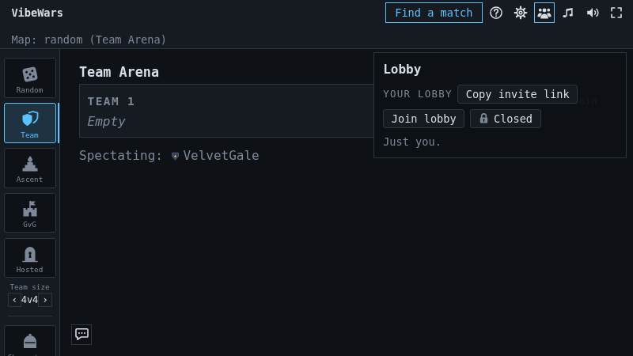

# モード

各マップは1つのモードでプレイされます。モードは、メイン画面の左側にあるレールの項目です。マップのモードを選ぶ人はいませんが、ホストするレールの項目によって、そのロビーのマップがプレイするモードが決まります。 **チームアリーナ**は殲滅、キルカウント、司祭殲滅、 **ヒーローズアセント**はレリックラン、King of the Hill、拠点制圧、 **GvG**はギルドバトルです。 **ホストゲーム**ではすべてのマップが選べます。 **ランダムアリーナ**はマップを選んでくれ、それによってモードも決まりますが、ギルドバトル、レリックラン、King of the Hill、拠点制圧になることはありません。チームアリーナはマッチごとにマップの1つを引き、ヒーローズアセントは最初のマップから始まり、ホストがマップを選べるのはホストゲームだけです。ほかのモードの画面には次のマップは表示されず、マッチの読み込み中に表示されます。

制限の厳しいネットワークの背後にいる2人のプレイヤーは、キューで互いにマッチできません。そのためキューは、あなたとマッチできるプレイヤーだけを数え、そのことを伝えます。**オプション → リレー (TURN)** のリレーが役立ちます。

どのマップも特定のチーム人数用に作られていて、モードはその人数用に作られたマップしかプレイしません。8v8が1v1用のアリーナにひしめくことはありません。レールの**チーム人数**は、表示中のモードがプレイする人数だけを切り替えます。

| モード             | チーム人数    | マップ                                     |
| ------------------ | ------------- | ------------------------------------------ |
| ランダムアリーナ   | 1v1, 2v2, 4v4 | 自動で引かれる。人数に合わせて作られたもの |
| チームアリーナ     | 2v2, 4v4, 8v8 | マッチごとに引かれる。人数用に作られたもの |
| ヒーローズアセント | 8v8           | 英雄の間まで、マップを順番に               |
| GvG                | 8v8           | Guild Hall Isle                            |
| ホストゲーム       | 任意          | 人数用に作られたものをホストが選ぶ         |

ギルドバトル、レリックラン、King of the Hill、拠点制圧では、画面外やHUDの下にある目標には、画面の端に輪郭付きの矢印が表示されます。旗台や祠は所有者の色で、誰のものでもなければ灰色で、祭壇は金色です。プレイヤーの塗りつぶされた矢印はその上に描かれます。

試合は全員が出現地点の近くに留められた状態で始まります。出現地点の周りのきらめく壁が、どこまで行けるかを示します。数歩は歩けますし、エンチャント、スタンス、回復など、自分や味方へのスキルで準備もできますが、攻撃したり敵にスキルを使ったりはできません。待っている間もエナジーとヘルスは回復し、ボットも準備をします。上部の行が試合の読み込みを終えたプレイヤーを数えます。全員の読み込みが終わると10秒のカウントダウンの後に試合が始まり、試合時間も動き出します。20秒たっても読み込みが終わっていないプレイヤーは待ちません。カウントダウンはそのプレイヤー抜きで始まり、後から参加することもできます。

## 殲滅

**敵を全滅させる。** 死んだ者は味方が蘇生させるまで倒れたままで、死ぬたびにモラルが下がります。相手チームを全滅させると勝ちです。8分たつと、モラルが最も多く残っているチームが勝ちます。

Canyon、Crossroads、Long Hallでプレイされ、ほかにCanyonと同じくらいの大きさの小さなアリーナが2つあります。**Sandstone Steps**（1v1、2600x1940）は、段々になった砂漠の町で、一段低い井戸の中庭があり、通りの上には屋上、その下にはレバーで開く地下通路があります。**Frozen Crossing**（2v2、2600x1940）は、2つの高い岸の間を流れる凍った川で、飛び石か、中央の板をレバーで上げる丸太橋で渡ります。大人数のチーム向けには、**Ashen Courtyard**（4v4、5120x3840）は、壁に囲まれた焼け焦げた中庭で、上には城壁の通路と塔、下には一段低い井戸の中庭があり、門楼の落とし格子は城壁の上から操作します。**Moss Vale**（8v8、5000x2600）は、深い水車用水路で二つに分かれた段々の谷で、渡れるのは跳ね橋、水車小屋、その下の地下通路だけです。**Canthan Terraces**（1v1、2400x2100）は小さいながら険しく、丘の斜面を廃墟の仏塔まで棚田が上っていき、その下には水門のレバーで開くと中央への3つ目の道になる水没した暗渠があります。**Sunken Bastion**（2v2、2700x1900）は小さいながらも高さのあるアリーナです。半ば水没した要塞で、中庭を堀が二分しています。堀を渡るには、両岸のレバーで動く跳ね橋か、北側の城壁沿いの歩廊か、堀の下の水没した地下室を通ります。そして大人数のチーム向けには、**Shiverpeak Pass**（4v4、5100x3450）は、深い裂け目で二つに分かれた雪の峠で、2つの崖の岩棚の間に架かり、どちらの岩棚のレバーでも引ける吊り橋を渡るか、裂け目の下の洞窟を抜けるか、裂け目の先端にある氷の壁を壊して回り込んで越えます。**Elonian Plateau**（8v8、5520x3360）は、乾いた峡谷の川床を4つのメサが囲む砂漠の台地です。時間で動くリフトが3つのメサに上り、北の2つは天然のアーチでつながり、中央の岩稜の下には通路が通っていて、その門は上のレバーで開きます。

## キルカウント

**3分間で最も多くキルする。** 死んだ者は8秒後にスポーンで復活し、死んでもモラルは下がりません。最初に15キルに達したチームがその場で勝ちます。時間切れでは、キルが多いチームが勝ち、同数なら引き分けです。

Ember Pitsでプレイされます。石橋が架かる溶岩の流れ、溶岩トンネル、玄武岩の柱を上るレバー式リフト、蒸気の噴出口があり、すべてのチーム人数に対応しています。

## 司祭殲滅

**敵と司祭を全滅させる。** 各チームには、スポーンの後ろの祠に司祭がいます。司祭は移動も攻撃もしませんが、隣にいる全員を回復します。敵もです。2分ごとに、司祭が生きているチームは、死んだ者がヘルスとエナジーが満タンの状態で祠に戻ってきます。先に司祭を倒せば、相手チームは倒れたままになります。

全プレイヤーと司祭が死ぬと、そのチームの負けです。12分たつと、モラルが最も多いチームが勝ちます。

Jungle Ruins（2v2〜8v8、5400x2800）でプレイされます。ジャングルの川で分断された、草木に覆われた神殿の遺跡です。浅瀬を歩いて渡る、丸太橋を渡る、中央の階段ピラミッドに登る、あるいは中庭のレバーで扉が開いたあとに、その下の隠し通路を通ることができます。つるの壁は切り倒せます。

## ギルドバトル

**敵のギルドロードを倒す。** 8対8です。各拠点は2つの門のある壁の後ろにあり、ギルドロードはロードの部屋の奥に立ち、見えた敵を弓で撃ちます。各拠点は衛兵が守っています。ロードのそばにKnightとBodyguard、ロードの部屋の奥にArcher、各門にFootmanとArcherがいます。衛兵は持ち場の近くの敵と戦い、持ち場へ歩いて戻ります。Bodyguardが生きている間、そのロードが受けるダメージは20%減るので、先に倒しましょう。2分ごとに、各チームの祠が死んだ者を復活させます。

各チームの拠点には**旗**があり、中央には**旗台**があります。自分の旗をターゲットにして**Space**を押すと拾います。旗台まで運び、旗台をターゲットにして**Space**を押すと立てます。旗の運び手は歩みが遅くなり、攻撃も攻撃スキルの使用もできません。死んだとき、武器を持ち替えたとき、ヘルスバーの上の**旗を捨てる**を押したときに旗を落とします。自分の旗を旗台に立てると、そこにあった敵の旗は拠点に戻ります。自分の旗が旗台にある2分ごとに、チームのモラルが10%上がります。

ギルドロードが死んだチームはその場で負けます。最低のモラルで全プレイヤーが死んだチームも同様です。28分たつと、敵のギルドロードに最も多くのダメージを与えたチームが勝ちます。そこで同点なら、引き分けはないので両チームの負けです。

スコアボードには、各ギルドロードのヘルス（自分のチームが先）、旗台を確保しているチームとそのブーストまでの時間、祠が次に死者を復活させるまでの時間、そして最後の3分間には各チームが敵のロードに与えたダメージが表示されます。その下には、旗を運んでいる人の名前が1行で表示されます。ブーストは「モラルブースト! +10%」または「敵のモラルブースト」としてポップアップします。コンパスでは、♛が各ギルドロードを、⚑が各旗を、◎が旗台を示します。

Guild Hall Isle（8v8、6000x2600）でプレイされます。海に浮かぶ島です。各Guild Lordは城壁の奥、ホールの上に立っています。外へは門楼を抜けるか、城壁を越えるか、桟橋を通ります。門楼の扉は敵の城壁にあるレバーで開きます。旗の台座は中央の壇上にあります。

## レリックラン

**レリックを祭壇へ運ぶ。** 各チームの拠点には**レリック**があり、中央には**祭壇**があります。祭壇はどちらの拠点からも、北か南のルートで同じ距離にあり、コンパスには◆で表示されます。自分のレリックをターゲットにして**Space**を押すと拾います。祭壇の上まで運ぶとすぐに1点が入り、レリックは自分の拠点に戻ります。得点はすべてアナウンスされ、自分たちの得点では上がり、相手の得点では下がるファンファーレが鳴ります。運び手は歩みが遅くなり、攻撃も攻撃スキルの使用もできません。自分のチームの中は通り抜けられますが、敵には阻まれます。死んだときやヘルスバーの上の**レリックを捨てる**を押したときにレリックを落とし、レリックは誰かがたどり着くまで落ちた場所に残ります。自分のチームはそこから拾えます。手が空いている敵がたどり着くと、拠点に戻されます。拠点にある敵のレリックには触れられません。

死んだ者は味方が蘇生させるまで倒れたままで、死ぬたびにモラルが下がります。相手チームを全滅させるとその場で勝ちです。8分たつと、得点の多いチームが勝ち、同点なら引き分けです。キルは得点になりません。

スコアボードには、得点（自分のチームが先）と時間が表示されます。その下には、レリックごとに1行で居場所が表示されます。運び手が持っていれば`✦ 名前`、地面にあれば`✦ 落下`、拠点にあれば`✦ 拠点`です。

ボットもレリックを運びます。あなたが自分で拾おうとしているのでなければ、自分のレリックに最も近いボットが取りに行きます。戦闘中でないボットが優先されます。全員が戦闘中のときは、最も近いボットが戦闘を離れてレリックに向かうので、祭壇でのにらみ合いで得点が止まることはありません。ヒーラーやひどく傷ついたボットは、ほかに誰も行けないときだけ行き、戦闘中には決して行きません。落ちた敵のレリックに最も近いボットがそれを拠点に送り返し、残りは祭壇のそばで待ちます。自分のレリックを運ぶボットはまっすぐ祭壇へ向かいます。ほかのボットがレリックから離れるのは、スペルの射程内に来た敵と戦うときだけです。

Broken Tower（4v4と8v8、5400x2800）でプレイされます。高地の丘に倒れた塔です。がれきの段丘を階段で登って塔の根元の上にある祭壇へ向かうか、段丘のレバーで扉が開いたあとに丘の下の地下室を通れます。がれきの壁は壊せます。

### Cinder Sanctum

ここでは、ヒーローズアセントのレリックランが逆の形でプレイされます。各拠点にはそのチームのレリックとゴーストヒーローがいて、祭壇はありません。**敵の拠点から敵のレリックを奪い、自分のゴーストヒーローのところへ持ち帰る**と1点です。ゴーストは生きていなければならず、持ち場から動きません。自分のレリックは運べません。落ちた場所で拾うと拠点に戻ります。**3点リードしたチームがその場で勝ちます**。8分たつと得点の多いチームが勝ち、同点なら最後に得点したチームの勝ちです。各拠点は2分ごとに死んだ者とゴーストを復活させます。ボットはそろって敵のレリックを狙い、持ち帰ります。

Cinder Sanctum(8v8、5600x2800)がこのモードです。二筋の溶岩の川に挟まれた、火山の山腹の神殿です。橋か土手道を渡って前庭の上の聖域へ向かいます。前庭のレバーで聖域の下の隠し通路が開き、灰の壁は壊せます。溶岩は焼けます。

## King of the Hill

**ゴーストヒーローを祭壇へ導き、確保し続ける。** 各チームの拠点には**ゴーストヒーロー**がいます。斧で戦う、誰もプレイしないゴーストです。**祭壇**は中央にあり、どちらの拠点からも同じ距離です。**Threefold Keep**では、3チーム（3つ目のチームが空いていなければ2チーム）が、壁に囲まれた城塞の塔の上で祭壇を奪い合います。1チームの得点は最大12点で、すべての敵のモラルが-60%なら、その場で勝ちです。ヒーローズアセントの最後を飾るマップである**英雄の間**（8v8、5000x4400）は、3チームのための黄金の広間です。祭壇は柱の並ぶ6つの階段のある壇の上にあり、その壇は台座の上にあって、拠点と拠点の間ごとに台座から回廊が伸びています。各拠点からは床下を地下墓所が通り、台座の中へと上っています。地下墓所の扉は最初は閉じていて、どのチームのレバーでも3つすべてが開きます。ゴーストを**右クリック**でターゲットにして**Space**を押すと、ついてくるよう指示できます。ゴーストはあなたと一緒に歩き、あなたが戦う相手と戦います。もう一度ゴーストにSpaceを押すと、その場にとどまり、近づいてきた敵と戦います。あなたが死んだり離れたりすると、ゴーストはとどまります。ゴーストをターゲットにしていると、そのフレームに誰についていっているか、またはとどまっていることが表示されます。ゴーストヒーローがついていく相手が変わるたびに、トーストでそれが知らされ、頭上の名前にリーダーが表示されます。

ゴーストのヘルスは640で、ついていくときもとどまるときも、**Cyclone Axe**、**Disrupting Chop**、**Swift Chop**で斧を振るいます。アセントを上へ進むほど強くなり、Threefold Keepではレベル24、英雄の間では28です。**相手チームのゴーストを倒す**と、チームの全員が **+10%のモラルブースト** を得ます。これはまず死亡ペナルティを打ち消し、+10%を超えることはありません。復活した後にもう一度倒せば、もう一度得られます。

ゴーストを祭壇の上へ、または祭壇を越えて導くと、ゴーストは祭壇に上がってそこにとどまります。そこでは隣にいる敵と戦いますが、敵を追って降りることはありません。祭壇の上のゴーストは、自分で祭壇を確保します。5秒間じっと立ち、詠唱バーが満ちていき、その間は誰とも戦いません。中断やダウンで確保は途切れ、可能になり次第やり直します。確保できるのは、誰も祭壇を確保していないとき、または確保しているチームのゴーストが死んでいるときだけです。確保が完了すると、祭壇はあなたのチームのものです。

祭壇を確保しているチームは、別のチームが確保するまで、確保している30秒ごとに1点を得ます。自分のゴーストが死んでいる間もです。得点はすべて、レリックの得点と同じようにアナウンスされます。死んだゴーストは、ここでもレリックランでも、2分後に拠点で復活し、その場にとどまります。拠点制圧では、拠点の次のウェーブで復活します。司祭のいるマップでは、代わりに司祭の次のウェーブで復活しますが、そのチームの司祭が生きている間だけです。それ以外のマップでは、死んだゴーストは死んだままで、その+10%は一度しか得られません。ゴーストはプレイヤーではありません。死んでもモラルは下がらず、全滅の判定にも数えられません。

死んだ者は味方が蘇生させるまで倒れたままで、死ぬたびにモラルが下がります。相手チームを全滅させるとその場で勝ちです。8分たつと、得点の多いチームが勝ち、同点なら引き分けです。キルは得点になりません。

スコアボードには、得点（自分のチームが先）、続いて祭壇が表示されます。確保しているチームの色で`▲`と確保チームの次の得点までの時間が、誰も確保していないときは灰色の`▲ —`が表示されます。

ボットも祭壇を目指します。あなたのチームが祭壇を確保していない間は、あなたが自分でゴーストを連れて行こうとしているのでなければ、ゴーストヒーローに最も近いボットがゴーストを連れに行きます。ヒーラーやひどく傷ついたボットは、ほかに誰も行けないときだけ行きます。そのボットはゴーストを祭壇の上へ導いてそこにとどまるよう指示し、残りは祭壇のそばで待ちます。ゴーストを導いているボットは、途中で立ち止まって戦いません。ほかのボットが祭壇から離れるのは、スペルの射程内に来た敵と戦うときだけです。あなたのチームが祭壇を確保していない間は、相手チームのゴーストヒーローが祭壇の上に立って射程内にいれば、すべてのボットがまずそれを倒します。あなたのゴーストが祭壇を確保するのを妨げている唯一の敵だからです。

Threefold Keep（4v4と8v8、5000x4400）でプレイされます。高地の丘の上に建つ、3チームのための城塞です。自分の門の脇の階段で城壁の歩廊に上り、土手道を渡って丘へ向かい、塔の上の祭壇まで登ります。各中庭のレバーで4つの門がすべて開きます。城壁の下を通る自分の門の通路と、丘の下を通る遠回りの道である地下聖堂です。

## 拠点制圧

**祠を確保する。** マップには5つの**祠**があります。各拠点のそばに1つずつと、その間に3つで、中央のものは開けた場所にあります。祠の上に立つと制圧できます。祠の上にいる自分のチームの1人1人が**ピップ**で、ゴーストヒーローは4つです。ペット、ミニオン、スピリットは数えられません。ピップが4つなら中立の祠は8秒で、2つなら16秒で、1人なら32秒で自分のものになります。4つより多くても速くはなりません。祠の上の敵は、あなたのピップを1対1で打ち消します。3人対2人なら1ピップで32秒、8人対2人なら4ピップで制圧でき、ピップが等しければ祠は動きません。3チームの場合は、最も強いチームが、自分のピップからほかの2チームのピップの合計を引いた分だけ進めます。ほかの2チームの合計の方が多ければ誰も制圧できず、誰かが所有している祠は中立に戻されるだけです。別のチームが所有している祠は、まず中立まで戻され、それからあなたのために満たされるので、奪うには2倍の時間がかかります。離れると、進行状況はその場で止まります。自分の祠は、敵が奪うまで自分のものです。祠はコンパスに、所有者の色の□で表示されます。

30秒ごとに、チームが所有する祠1つにつき1点が入り、トーストと効果音で各チームの得点が知らされます。マッチの時計で60秒ごとに、モラルが最低でなければ、チームの死んだ者は、拠点の祠でヘルスとエナジーが満タンの状態で復活します。そこに敵が立っていてもです。スコアボードは次のウェーブまでカウントダウンします。死ぬたびにモラルが下がり、ゴーストも同じウェーブで、自分の場所に復活します。ほかのすべてのチームに**20点差**をつけると、その場で勝ちです。全滅してもマッチは終わりませんが、プレイヤーが全員抜けたチームは脱落です。8分たつと、得点の多いチームが勝ちます。同点なら、より多くの祠を確保しているチーム、次に最後に単独でリードしていたチームが勝ち、どのチームも一度もリードしていなければ引き分けです。キルは得点になりません。

各祠は地面の輪で、所有者の色で表示され、誰のものでもない間は灰色です。その周りの弧が、奪おうとしているチームに向けてどこまで進んだかを示します。スコアボードには、得点（自分のチームが先）と時間が表示されます。

ボットは、チームがまだ所有していない祠に散らばり、奪うまでその上に立ちます。スペルの射程内に敵がいても、誘い出されません。届く範囲の祠に乗り、そこから戦います。

Scarred Earth（4v4と8v8、5400x2800）でプレイされます。夕暮れのクレーターだらけの戦場です。祠は壊れた攻城塔の上にあり、中央の祠は大きな塔の甲板の上、どれもクレーターのそばにあります。塔のレバーで野の下の2本の塹壕が開き、壊れた柵は壊せます。

ヒーローズアセントでは、The Warden's Gallery（8v8, 5200x2500）でプレイされます。天窓の下の日当たりのよい彫刻ギャラリーです。中央の祠は大台座の頂上にあり、各チームの玄関ホールの近くにも3つずつあり、そのうち1つは台座の上です。大台座のレバーで床下の2つの地下室が開き、倒れた像は壊せます。

## チームロビー

ホストしたロビーは、全員の準備ができてもすぐにはマッチを始めません。まずチームロビーを開き、そこで各チームが一緒にチームビルドを1つ選び、そのキャラクターを分け合います。ヒーローズアセントとGvGでは、1チームはそのモードのチームの人数（8人）で、サイドバーの**チーム人数**にロックされて表示されます。チームアリーナでは、パーティーがキューに入っていない間、パーティーリーダーが矢印で2v2、4v4、8v8を選び、パーティーのほかのメンバーにはロックされて表示されます。人数は、リーダーがチームアリーナで最後に選んだもの（最初は4v4）で始まります。パーティーがプレイヤー数より小さい人数を選ぶことはなく、人数と同じだけのプレイヤーがいるパーティーにはそれ以上誰も入れません（「パーティーは満員です。」）。2つのパーティーは同じ人数でしか対戦せず、トップバーのキューアイコンのウィンドウにその人数が表示されます: 「チームアリーナ 2v2」。ホストゲームでは、チームロビーの前にホストが矢印でチーム人数を1v1～8v8に設定し、両チームともちょうどその人数でプレイします。チームロビーにはチーム人数は表示されません。ゲストにはホストの人数がロックされて表示されます。ホストのマップ一覧には、その人数用に作られたマップだけが表示され、人数がマップに合わなければ、ロビーは合う最初のマップに移ります。人数がチームのプレイヤー数を下回ることはなく、チーム人数と同じだけのプレイヤーがいるチームにはそれ以上誰も入れません。1v1では自分のキャラクターがすべて並び、チームのメンバーにはそのチームの名前が付きます。1人をクリックしてそのキャラクターでプレイするか、待って現在のキャラクターでプレイします。チームの**離脱**を押すと、ロビーを離れずにチームから外れます。キューに入ったパーティー（チームアリーナ、ヒーローズアセント、GvGでの[マッチを探す](getting-started.md#マッチのホストと参加)）は、パーティーの人数にかかわらず、そのモードのチームの人数（チームアリーナでは選んだ人数、ほかは8人）で、自分のチームだけのチームロビーを持ちます。誰も確保しなかった席はボットがプレイします。キューに入っている間はほかのモードを見て回れます。パーティーはキューを離れるまで、そのモードと人数を保ちます。チームアリーナとGvGでは、30秒待ったパーティーは、キューに入ったまま、チームが見つかるまでボットとウォームアップをプレイします（[ウォームアップ](getting-started.md#マッチのホストと参加)）。各段階は30秒続き、チームロビーの全員の準備ができると早く終わります。投票したり席を取ったりすると、準備完了になります。

**投票。** チームの誰でも、ちょうどそのチームの人数のチームビルドを、1人1つ提案できます。チームビルドは右側の**チームビルド**タブから開きます。名前で検索し、1つクリックしてメンバーを見てから、**このビルドを提案**を押します。自分の提案では**提案を取り下げる**が使えます。Escで閉じます。表示されるのは、その人数で問題のない自分のチームビルドだけです。ドロワーには、ほかの人数のものがいくつ除外されているかが表示されます。誰でも、自分のチームの提案の1つに投票できます。自分の提案にもです。各提案はカードで、各メンバーが武器を持ち、そのスキルと、投票した人のイニシャルが表示されます。カードをクリックすると投票し、別のカードをクリックすると投票を変えられます。投票は取り消せません。あなたの代わりに何かが提案されることはありません。メニューはチームビルドを作って編集するだけです。新しい提案は以前の提案と入れ替わり、それへの投票はゼロに戻ります。最も票の多いものが選ばれます。同票なら、キャプテンの票で決まります。ホストのチームではホスト、相手チームでは最も早く参加した人です。提案があって票がなければ、ランダムに1つが選ばれます。提案がなければ、そのチームは、チーム編集で最初に用意されるのと同じ種類の、その人数のランダムなプリセットチームでプレイします。1人のチームは、ランダムなスタータービルドでプレイします。チームの計画が受け入れられなかったキューのパーティー（席が欠けている、不正なビルドがあるなど）も、ランダムなプリセットチームでプレイし、マッチの開始時にそれが知らされます。各チームは別々に引くので、両方が同じチームになることもあります。どちらのチームにも、相手の提案、投票、選択は見えません。

**確保。** 選ばれたビルドのキャラクターが席になります。各席は、武器を持ったキャラクターとその下のスキルです。空いている席をクリックすると取り、別の空いている席をクリックすると移ります。早い者勝ちで、1人1席です。何も確保しなかった人は最初の空席に入り、残りはキャラクターの名前でボットがプレイします。その後マッチが始まるか、キューのパーティーならキューに入ります。

チームロビーの間に抜けた人のキャラクターはボットに引き継がれるので、チームの人数は保たれます。その時点で参加した人は観戦するだけです。

キューで見つかったチームマッチの後、勝者は20秒後に自動で再びキューに入り、敗者（引き分けも）はメニューに戻ります。コードで参加したロビーのマッチでは、全員がロビーに戻ります。結果の下のボタンで待ち時間を飛ばすか、勝者ならキューに入らずに離れられます。
チームアリーナの勝者は、パーティがその後変わっていなければ（誰かが抜けた、離席した、加わった場合を除き）、チームロビーなしで次のマッチもチームビルドと各プレイヤーの席をそのまま使います。変わっていれば、チームを選び直します。自分のチームが勝てなかったときは、「停止」でそのカウントダウンを止めて結果を読めます。準備ができたら、ボタンで先へ進みます。

## ヒーローズアセント

キューで参加するヒーローズアセントは、GW1のマップをその順番で上っていく道のりです: Elite Zaishen Battle、The Underworld、Fetid River、Burial Mounds、Unholy Temples、Forgotten Shrines、Golden Gates、The Courtyard、Antechamber、（The Vault、）そして英雄の間。入っているのはこれまでに作られたマップだけなので、現在は9ラウンドです: The Hollow Deep（殲滅）、Blackwater Ford（司祭殲滅）、Barrow Field（司祭殲滅）、Cinder Sanctum（レリックラン、Unholy Templesの代わり）、Mosslit Cairns（拠点制圧、Forgotten Shrinesの代わり）、The Brazen Causeway（司祭殲滅）、Threefold Keep（King of the Hill）、The Warden's Gallery（拠点制圧、Antechamberの代わり）、そして英雄の間。チームを探している間、トップバーのキューアイコンに現在地 `ヒーローズアセント · ラウンド2` が表示され、ロビーウィンドウにはそのラウンドのマップが表示されます。対戦するのは常に同じラウンドのチームだけで、見つかるまでいつまでも待ちます。ボットが代わりに入ることはありません。唯一の例外として、ラウンド2以降、自分のラウンドで60秒間ほかにチームがいないチームは先へ飛ばせます。英雄の間より前の、より後のラウンドで待っているチームと対戦し、両者は後ろのチームのマップでプレイし、勝者はそこから先へ進みます。3チーム用に作られたマップのラウンドでは3チームを待ちます。3つ目のチームを30秒待った2チームは、代わりに互いに対戦します。3つ目のチームがロビーに現れなかった2チームも同様です。勝てば、パーティーは20秒後に自動で次のマップへ上ります。英雄の間で勝てば、そこにとどまって防衛します。負けるか、マッチが終わる前に抜けると、次のアセントはラウンド1からやり直しです。キューやパーティーを離れた場合も同じです。ホストが抜けたことで負けたマッチでは、ラウンドは保たれます。

英雄の間では、マッチごとに3つのモード（King of the Hill、レリックラン、拠点制圧）から1つが、2チームまたは3チーム用に引かれます。2チームの場合、3つ目の拠点は閉じたままで、その拠点の2つの回廊にある制圧ポイントも閉じます。英雄の間のマッチは11分続き、得点の最も多いチームが勝ちます。拠点制圧は20点のリードでも早く終わります。死んでもモラルは下がりません。死んだ者はマッチの時計で1分ちょうどごとに、そろって拠点に戻ってくるので、全滅したチームも負けではありません。ただし、プレイヤーが全員抜けたチームは脱落です。King of the Hillでは、祭壇を確保しているチームは、ゴーストが死んだ後も別のチームが確保するまで得点し続け、その死んだ者は祭壇の上に戻ってきます。同点の場合は最後に得点したチーム、拠点制圧では最も直近にキルしたチームの勝ちです。

**宝物庫。** 英雄の間は、UTC時刻の12分ごと、:00、:12、:24、:36、:48にだけ開かれます。それまでパーティーは宝物庫で待ちます。キューアイコンに、次の開放までの時間と英雄の間の保持者が表示されます。開放のたびに、保持者が最大2つの挑戦者と対戦します。誰も保持していなければ、最大3つの挑戦者が対戦します。参加できるのは開放前から待っているパーティーだけで、席からあふれたパーティーは次の開放を待ちます。対戦相手のいない保持者は英雄の間を保ったまま待ち、勝利には数えられません。挑戦者が1つだけの場合も待ちます。パーティーが英雄の間で勝つと、開いているすべてのゲームに今の保持者が表示されます。そのリーダー、またはパーティーの半数より多くが同じギルドタグを持っていればそのギルドタグです。

どの挑戦も**Elite Zaishen Battle**から始まり、キューはありません。あなたのパーティーが、ボットがプレイする6人のZaishen（Monk 2人、Elementalist 1人、ほか3人）と戦います。舞台は儀式用のアリーナ（8v8, 5400x2400）です。北と南に段になった観客席があり、沈んだ床には台座に載った像が並び、各観客席の下には地下室があって、その落とし格子は向かいの観客席にあるレバーで開きます。時計は、誰かがアリーナ中央のスタートラインを越えるか、最初のZaishenが死ぬか、どちらか早い方で動き始めます。6人全員を30秒未満で倒せば、パーティーはモラル+10%で挑戦を始めます。60秒未満なら+8%、80秒未満なら+6%、100秒未満なら+4%、120秒未満なら+2%、それより遅ければ何もありません。勝てば、パーティーは自動で最初のマップのキューに入ります。全滅するか、8分の制限時間に達した時点でZaishenがまだ生きていると、挑戦は終わりです。

挑戦中の勝利ごとに**名声**が得られます。最初の13勝で1、2、3、4、6、8、12、16、20、24、28、32、36、その後は1勝ごとに40で、1日最大300です（日付は15:00 UTCに変わります）。Elite Zaishen Battleでは得られません。名声の合計が**ヒーローランク**を決めます。25名声のランク1から100,000名声のランク15までで、名前の横に★と数字で表示されます。オプション > プレイヤーで両方を確認できます。どちらもあなたの端末に保存されます。

モラルは挑戦の間ずっと引き継がれます。勝ったマップを終えたときの死亡ペナルティやブーストが、次のマップの開始時の値になります。範囲は−60%から+10%です。挑戦が終わったとき、または途中で参加したプレイヤーは、0から始まります。これは自分のタブが、閉じるまで覚えています。

チームは最初のマップのチームロビーで一度だけ選び、挑戦の残りの間、そのチームビルドと席を保ちます。勝った後は、投票も確保もなく再びキューに入ります。途中で抜けた人の席は空きますが、そのビルドはそのままです。マップの合間にパーティーに加わった新しい人は、空いている席の確保だけを行い（**空席: Monkビルド**）、その席のビルドでプレイします。誰も確保しない空席はボットのものです。負けるとやり直しで、次の挑戦では再び投票します。ホストについて別のパーティーに移った場合も同じです。そのパーティーのホストは前の挑戦を保証できないからです。ラウンドはパーティーのホストが、タブを閉じるまでだけ覚えています。コードで参加したヒーローズアセントのロビーは、ラウンド1のマップをプレイします。

8人未満のパーティーは、チームビルドを使い、空いている席にボットを入れてキューに入ります。ただし、どのチームにも必ず1人以上の人間がいて、ボットだけのチームが対戦相手になることはありません。チームの最後の人間がマッチを抜けると、そのチームは棄権となり、挑戦は終わります。

**Barrow Field**（8v8, 5400x2600）はアセントのアリーナで、ホストゲームでも選べます。夕暮れの墳墓の荒野で行う司祭殲滅で、司祭は2分ごとに死んだ者を復活させます。塚に登って高所を取るか、奥の塚のレバーが門を開けたら、その下の塚の通路を進みましょう。自分の旗を中央の**嵐のビーコン**の上に運ぶと、ビーコンは、相手チームがそこに旗を立てるまで、声の届く範囲にいるランダムな敵1人に2.5秒ごとに50の雷ダメージを与えます。各攻撃はビーコンから当たった相手への稲妻として、両チームに見えます。

3つのアセントのアリーナもホストゲームで選べます: **The Hollow Deep**（暗い洞窟での8v8の殲滅、6200x2400。裂け目に架かる吊り橋を渡るか、中央の岩棚を越えるか、岩棚のレバーで門が開いたらその下の地下道を通ります）、**Blackwater Ford**（暗い川の浅瀬での8v8の司祭殲滅、5200x2800。浅瀬を歩いて渡るか、水車小屋の上に橋脚で立つ壊れた橋を渡るか、水車小屋のレバーで門が開いたら橋の下の暗渠を通ります。司祭は2分ごとに死んだ者を復活させます）、**Mosslit Cairns**（夕暮れに苔が光る5つのケルンの丘での8v8の拠点制圧、5400x3000。階段でケルンに登るか、中央の大ケルンを守るか、北のケルンのレバーで門が開いたら南の丘の下の根のトンネルを進みます。根の壁は壊せます）。4つ目は**The Brazen Causeway**です（夕暮れの沼地に架かる高い石の土手道での8v8の司祭殲滅、5600x2800。奥の門楼のレバーで青銅の門が開いたら土手道を進むか、沼地を渡って中ほどの階段へ向かうか、その下の暗渠をすり抜けます。司祭は2分ごとに死んだ者を復活させます）。

マップには**門**があることがあります。閉じている間は体、射撃、視線をさえぎる壁です。門の圧力プレートの上に立つと開きます。プレートの上に誰もいなくなると閉じ、出入り口にいる人を近い方へ押し出し、通り抜けようとしている射撃を止めます。閉じた後0.5秒間は再び開けません。チームの色のプレートは、そのチームにしか反応しません。ボットは、近くに敵がいないとき、自分のチームのプレートの上に立ちます。

## 3チーム戦

3チームのマッチでは、3つ目のチームは、自分のチームの青と相手チームの赤に加えてレモンライム色で描かれ、ネームタグ、スコアの行、マッチ終了時の表の名前の前に◆が付きます。そのため、色だけで見分けることにはなりません。スコアボードは自分のチームを先に、続いてほかのチームを順に表示し、マッチ終了時の表は自分のチームを先に、次に勝者を表示します。

## マッチ記録

最後までプレイされたすべてのマッチは、どのモードでも、ボットを含むものでも、ホストによって、ゲームが使うNostrリレー上に公開のマッチ記録として公開されます。誰でも読むことができ、オプトアウトはできません。記録には、モード、マップ、マッチの終了時刻と長さ、勝者とその理由、そして各プレイヤーのゲーム内の名前、ギルドタグ、ビルド（そのGW1テンプレートコード: 職業、属性、スキルバー。装備は含まない）が含まれ、ボットはボットとして示されます。すべての人間の公開プレイヤーキーも含まれ、名前の横の盾であるシグネットを描きます。シグネットは、マッチのホストが報告したキーにすぎません。あなたのゲーム内の名前とキーは、あなたがプレイしたマッチのすべての記録に載るので、誰でもそれらのマッチを互いに結び付けることができます。あなたを特定できるそれ以外のものは載りません。アドレスも、ピアIDも、ロビーもありません。ホストが抜けたために終わったマッチや、全員が抜けたマッチは公開されません。記録はホストが報告するので、ホストが誤ることもあります。マッチと照合して確認するものはありません。

記録はチーム編集の下の**マッチ**ページで見られます。過去7日間の最新50件が新しい順に並び、プレイされると新しいものが現れます。1行が1件です。各チームのプレイヤーがメイン職業のアイコンで表示され（カーソルを合わせると名前）、2チームまたは3チームで、勝者には下線が引かれ、マップ、時間、日時が続きます。すべての行に**ホスト報告**の印が付きます。1行をクリックすると、チームが1チームにつき1つのタブで、勝者を先に表示されます。これがチームカードです。**複製**は、終了したマッチのチームをチームビルドにコピーし、各プレイヤーのビルドをその名前で保存して開きます。1v1のチームでは、チームビルドは2、4、8人なので、複製はプレイヤーのビルドを新しいキャラクターとして保存して開きます。

各行はそのモードのアイコンで始まり、アイコンと行の左端はモードの色です: ランダムはオレンジ、チームは青、アセントは金、GvGは紫、ホストは緑。一覧の上のチップで、**種類**（ランダム、チーム、アセント、GvG、ホスト）と**人数**（1v1、2v2、4v4、8v8）で絞り込めます。いくつでも押せて、押した種類の1つと押した人数の1つに合うマッチが表示されます。何も押していないグループはすべてを通します。人数は、ボットを含めて最も大きいチームの人数なので、3v2のホストゲームはどの人数にも合いません。チップは、ページを再読み込みするまで、そのままの状態に保たれます。

チップの後ろにある**自分の対戦**は、代わりにあなた自身の対戦を一覧にします: このブラウザが現在のプレイヤーキーについて保存した直近50件で、新しい順に、古さを問わず、公開されたかどうかも問わず、Elite Zaishen Battleも含みます。種類と人数で引き続き絞り込め、あなたのチームには**あなた**の印が付きます。開くと3つのタブがあります: **ビルド**は各チームで、上と同じく複製できます。**統計**は終了パネルに表示されたスコア表、**グラフ**はそのグラフです。保存されるのはこのブラウザだけです。

チップの上の**英雄の間**の帯には、最新の20回の保持が新しい順に並びます。保持者（ギルドタグまたはリーダーの名前）、勝ったチームのメンバー、最新の勝利が終わった日時、そして2勝以上なら何連勝か、です。保持とは、1つの保持者による途切れない英雄の間での連勝です。この帯はこのページの記録を読み、チップは無視し、どれも英雄の間での勝利でなければ非表示になります。ほかの記録と同じく、各マッチのホストが報告したもので、確認するものはありません。

## ランク戦

ボットのいないキューの試合はランク戦です。[ランキング](ranking.md)を参照してください。
