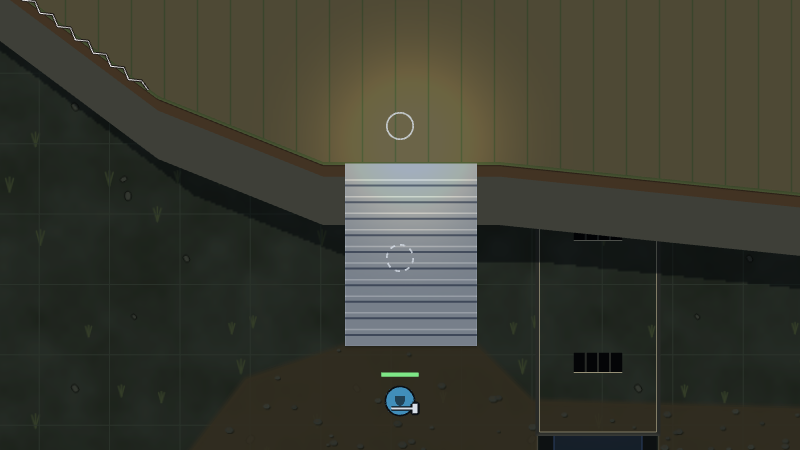

# Ovládanie

Každý kláves v tabuľke nižšie môžeš zmeniť v **Nastaveniach** v sekcii
**ovládanie**; Esc, Enter, F10 a tlačidlá myši sú pevné. Vyber tam
**Predvoľbu** alebo klikni na pole klávesu a stlač kláves, ktorý chceš;
kláves, ktorý sa už používa, prejde na novú akciu a obrazovka povie, ktorá
ho stratila. Zmeny sa ukladajú okamžite.

## Klávesy

Predvolená predvoľba je **Klasické**, pre ruky zvyknuté na GW1. **VibeWars** zosiela ľavou rukou a pohybuje sa šípkami.

| Akcia                                | Klasické            | VibeWars         |
| ------------------------------------ | ------------------- | ---------------- |
| Schopnosti 1 až 8                    | 1 až 8              | Q W E R, A S D F |
| Pohyb                                | W A S D alebo šípky | šípky            |
| Sady zbraní 1 až 4                   | F1 až F4            | 1 až 4           |
| Útok alebo použitie vlajky           | Space               | Space            |
| Ďalší nepriateľ (Shift: predošlý)    | Tab                 | Tab              |
| Najbližší nepriateľ                  | C                   | C                |
| Nepriateľ určený tvojím tímom        | T                   | T                |
| Ty sám                               | F alebo G           | G                |
| Zobraziť mená (podržať)              | Shift               | Shift            |
| Stlmiť                               | M                   | M                |
| Položiť vlajku, relikviu alebo popol | žiadny              | žiadny           |

Tieto klávesy sú pevné:

- **Esc** zruší to, čo práve robíš: zosielanie, útok, chôdzu. Po ďalšom
  stlačení zruší cieľ. Zatvára aj Pomoc a Nastavenia.
- **Enter** otvorí chat, alebo klikni na ikonu chatu vľavo dole;
  Enter odosiela a Esc ho zatvorí. Začni riadok znakom `!`, ak chceš hovoriť so
  všetkými, alebo `#` len pre svoj tím. Zatvorený chat ukazuje len svoje
  najnovšie riadky, ktoré po niekoľkých sekundách vyblednú, a kliknutia ním
  prechádzajú.
- **F10** sa opýta, či chceš opustiť zápas.

## Myš

- **Ľavým kliknutím** na zem tam dôjdeš. Bez Shiftu ľavé tlačidlo len chodí.
- Na mapách s vyvýšenými plošinami ide ľavé kliknutie na povrch, ktorý vidíš, a **Alt + ľavé kliknutie** na zem pod ním. Krúžok pod kurzorom označuje plošinu, čiarkovaný krúžok zem. Nad tunelom ide ľavé kliknutie na úroveň, na ktorej si. **Alt + ľavé kliknutie** nikdy nejde nad úroveň, na ktorej stojíš: zo zeme ide do tunela a v tuneli v ňom zostane.

- **Pravým kliknutím** na nepriateľa alebo spojenca ho zameriaš. Ďalším
  rýchlym pravým kliknutím na toho istého nepriateľa naňho zaútočíš.
- **Pravým kliknutím** na vlajku alebo na stojan na vlajku, v Cechovej bitke
  alebo na Barrow Field, ich zameriaš; **Space** tam dôjde a vlajku zdvihne
  alebo zapichne.
- **Pravým kliknutím** na páku ju zameriaš; **Space** k nej dôjde a prepne ju, čím otvorí alebo zatvorí brány, ktoré ovláda.
- Ak vojdeš do **portálu**, prenesie ťa k svojmu výstupu. Páka ho môže zapínať a vypínať; po prenose 5 s odpočíva, kým ťa vezme znova.
- **Trblietavá brána** zastaví telá, šípy aj iné strely; kúzlo zoslané priamo na cieľ prejde. **Popraskaný múr** sa dá rozbiť: klikni naň pravým tlačidlom a potom naň zaútoč alebo ho zasiahni schopnosťou, ktorá spôsobuje zranenie.
- **Kliknutím kolieskom** na nepriateľa ho určíš svojmu tímu: ich **T** ho
  zameria. Na zemi alebo spojencovi to miesto označí signálom. Alebo klikni
  na lištu cieľa hore, aby si určil nepriateľa, ktorého máš zameraného.
- Kliknutím na kompas označíš to miesto signálom pre svoj tím; ťahaním po
  ňom nakreslíš čiaru, ktorú na niekoľko sekúnd uvidia.
- **Koliesko** približuje. **Ťahaním pravým tlačidlom** sa rozhliadaš; keď
  pustíš, pohľad sa plynule vráti k tebe.
- Kliknutím na schopnosť na lište ju použiješ a kliknutím na meno v okne
  družiny zameriaš daného spojenca.
- Podrž **Zobraziť mená** (Shift) a zobrazia sa všetky mená, pri každom hráčovi
  s jeho pečaťou pred menom: malým štítom, ktorý je pre toho istého hráča vždy
  rovnaký, a svoju nájdeš v **Nastavenia › Hráč**. Kým držíš, kliknutie na meno
  postavy funguje ako kliknutie na jej telo. Pravé kliknutie len zameriava, aj
  dvakrát; ľavé kliknutie naraz zameria a zaútočí; kliknutie kolieskom určí
  cieľ alebo označí signálom. Meno, ktoré by kliknutie zasiahlo, je zvýraznené.

## Dotyk

Na telefóne alebo tablete, v zápase aj na cvičisku:

- **Ťuknutím** na zem tam dôjdeš.
- **Ťuknutím** na nepriateľa, spojenca, vlajku, stojan na vlajku, páku alebo
  popraskaný múr ho zameriaš; ťuknutie na postavu nikdy nechodí. Ďalším
  rýchlym ťuknutím na toho istého nepriateľa naňho zaútočíš. Ťuknutie tesne
  vedľa postavy ju stále nájde. Ťuknutie na seba ťa dovedie na to miesto
  alebo zameria stojan na vlajku či páku, na ktorej stojíš.
- **Ťahom** jedným prstom sa obzeráš; po pustení sa pohľad plynule vráti
  k tebe. **Stiahnutím** prstov približuješ.
- **Ťuknutím** na schopnosť na lište ju použiješ na svoj cieľ.

## Horná lišta

Mimo zápasu sú na hornej lište **[?]** (táto Pomoc), **⚙** (Nastavenia),
**Lobby** (tvoj pozývací odkaz, Pripojiť sa k lobby, Otvorené/Zatvorené, Odísť a kto je v tvojom lobby; odznak ich spočíta),
**♪** (hudba: čo hrá a ako nahlas), stlmenie zvuku a celá obrazovka. V zápase sú tie isté tlačidlá,
okrem Lobby, vpravo hore na obrazovke. V úzkom okne sa tieto ikony a
ostatné tlačidlá obrazovky zbalia do **⋯**; vonku zostane len jej hlavné tlačidlo.
⚙ otvorí Nastavenia ako okno pod lištou, obrazovka zostáva za ním; Esc, × alebo kliknutie mimo ho zatvorí.
[?] otvorí Pomoc rovnako, ako okno pod ním s výberom stránky hore; zápas za ním beží ďalej.
Pomoc sa zatvára svojím krížikom ×, klávesom Esc, kliknutím mimo alebo ďalším stlačením [?].

**Zdieľaj beat so svojím lobby.** V editore beatov (♪, potom **Upraviť**)
**Zdieľať v lobby** pošle to, čo si napísal, uložené aj neuložené, všetkým
ostatným v lobby, ktoré si hostil alebo ku ktorému si sa pripojil cez odkaz
(nikdy v tom, ktoré našla fronta; najviac 8 KB, jedno zdieľanie za desať
sekúnd). Uvidia odznak na ♪ a v jeho okne pod **Zdieľané s tebou** riadok za
každého hráča, „Ann · Ember Deep“, s tlačidlom **Prehrať**. Nič nehrá, kým
nestlačíš Prehrať, a len mimo zápasu; **Späť na moju hudbu** vráti tvoju.
Zdieľaný beat sa nikdy neuloží: keď opustíš lobby alebo znova načítaš
stránku, je preč.

V režime Auto zdieľajú menu jednu pieseň, ktorá sa stupňuje, ako ideš hlbšie, a každá mapa má vždy vlastnú pieseň.
