# First-time tutorial: the playbook

A build spec for developers (epic #3187). Not a player page: it is not translated. The in-game
strings go through `t()` when the stations are built. The illustrations are mock-ups
(`img/`, regenerated by `node scripts/assets/tutorial-playbook.mjs docs/tutorial/img`); the
real HUD is the authority.

**Tone.** Role-playing, minimal text, very interactive and playful. The guide speaks in
character, never as a manual: at most one line of 12 words or fewer per beat, plus the key
caps. Teach by doing: no station is read-only, no "Got it" buttons, no paragraphs. A fact
the player needs is met in play (a bar drops, a pip appears) and the guide reacts in one line.

## 0. The frame

- **Who.** A first-time player: no `${STORAGE_NAMESPACE}.tutorial` record in **localStorage**
  (pattern: `apps/web/src/ui/touch-notice-preference.ts`). Values are `done` and `skipped`;
  anything else is discarded and counts as absent. It is not the splash's sessionStorage flag.
- **Start.** The splash's second input (`apps/web/src/ui/splash-screen.ts` `end()`, "Press any
  key to begin"). For a first-timer a card offers **Learn to play** or **Skip**. Skip is today's
  menu, and records `skipped`.
- **Entry.** The title fades, a second screen flash, and the camera drops into the live
  background fight (`ui/splash-fight.ts`). The player stands in a **bubble**: a lit,
  translucent dome. The fight goes on around it and nothing crosses it until the last station.
- **The guide.** A teammate from that fight walks out of the battle into the bubble: "There you
  are. We're losing the line. First, show me you can stand." Name and profession are an
  **open question for the operator review** (proposal: a Monk, named in the playbook once the
  operator picks; no GW1 character names).
- **Always.** A **Skip tutorial** button sits in a fixed corner on every station. Esc does not
  skip, because Esc means cancel in the game. Each station shows one short line and the key or
  keys **as bound in the player's current keymap** (Classic, VibeWars or rebinds, read from
  `input/keymap.ts`, never hard-coded).
- **Rhythm per station.** Guide line, highlight (a pulsing outline on the HUD element or a
  ground marker), the player acts, success check, one line of praise, next. No timer fails the
  player. A hint repeats after 10 s of nothing.

## 1. Walk

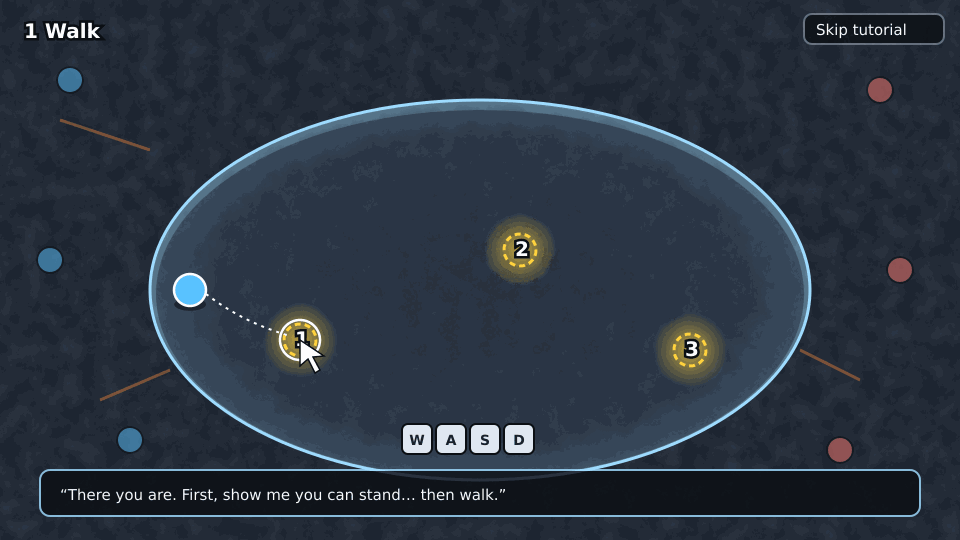

- **Teach.** Left click on the ground walks. The move keys (WASD or arrows) walk too.
- **Do.** Walk to three glowing markers inside the bubble, in order.
- **Check.** The player's body reaches each marker.

## 2. Up and down (layers)

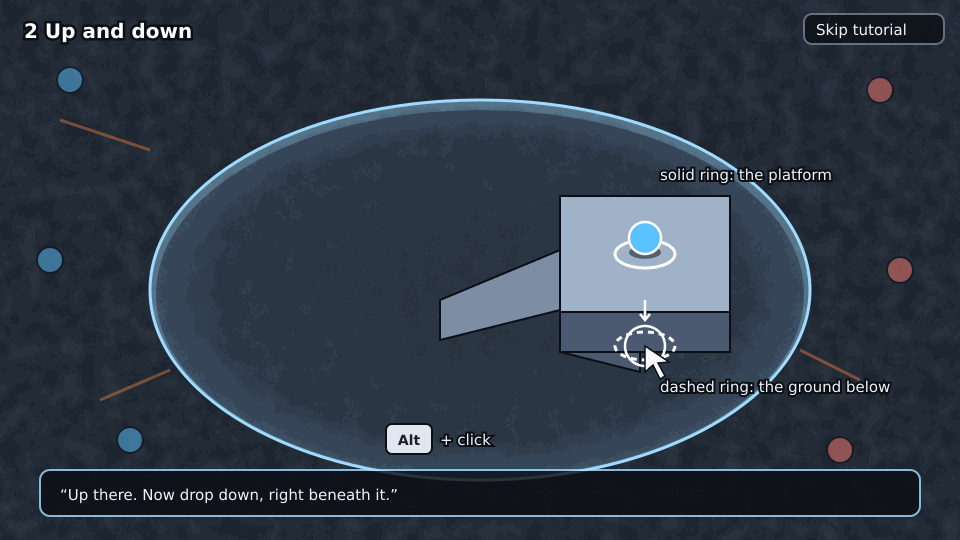

- The bubble holds a small raised platform with a ramp.
- **Teach.** A ring under the cursor marks the platform and a dashed ring the ground below it.
  **Alt + click** walks to the ground under a platform.
- **Do.** Walk up the ramp onto the platform, then Alt+click the ground beneath it.
- **Check.** The player is on the platform layer, then on the ground layer under it.

## 3. Look around

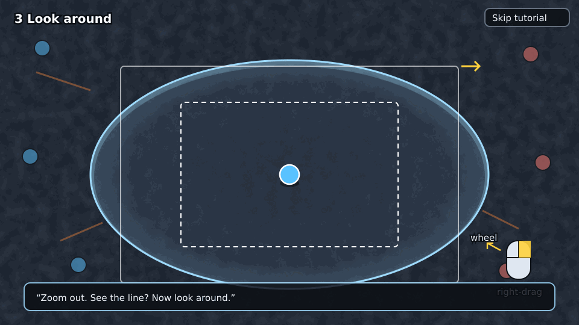

- **Teach.** The wheel zooms. Right-drag looks around, and the view glides back.
- **Do.** Zoom out once, then look around.
- **Check.** The zoom changed and a right-drag happened.

## 4. Target and attack

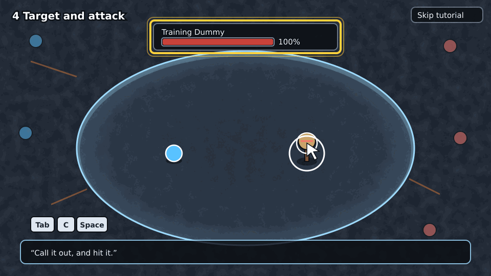

- The guide calls in a **training dummy**, a harmless foe body that does not fight back.
- **Teach.** Right click targets. Right click it again, quickly, to attack. **Tab** is the next
  foe, **C** the closest foe, **Space** attacks.
- **Do.** Target the dummy, then attack it.
- **Check.** The dummy is targeted, then hit by a weapon attack.
- **HUD.** Highlight the **target frame** (`ui/hud.ts` target part: name, health %, what it casts).

## 5. Your bars (taught in play)

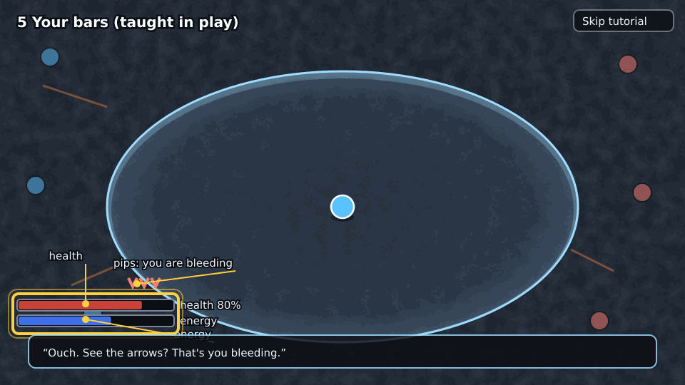

- No station of its own. Health, energy and pips are pointed at the moment they move: energy
  when station 6's first cast spends it ("That's your energy. Spend it wisely."), and health
  and pips when station 7's hit lands ("Ouch. See the arrows? That's you bleeding."). One
  highlight each, the first time only.

## 6. Use a skill

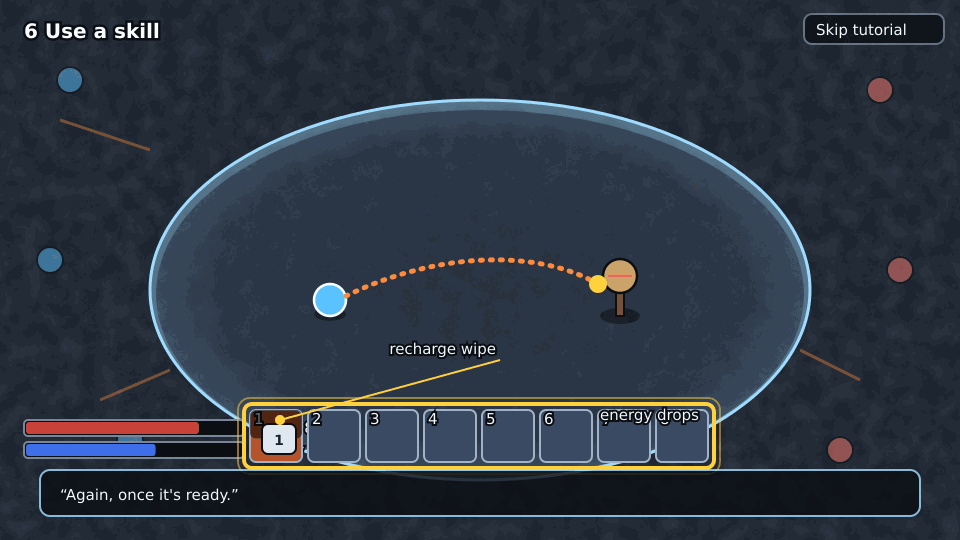

- **Teach.** The **skill bar**, keys 1 to 8 (or as bound). A skill costs energy, has a cast
  time, then a recharge (the wipe over the slot). Moving or Esc cancels a cast.
- **Do.** Use an attack skill on the dummy, then use it again after its recharge.
- **Check.** Two casts complete on the dummy.
- **HUD.** The skill bar, the recharge overlay and the energy bar dropping.

## 7. Damage and healing

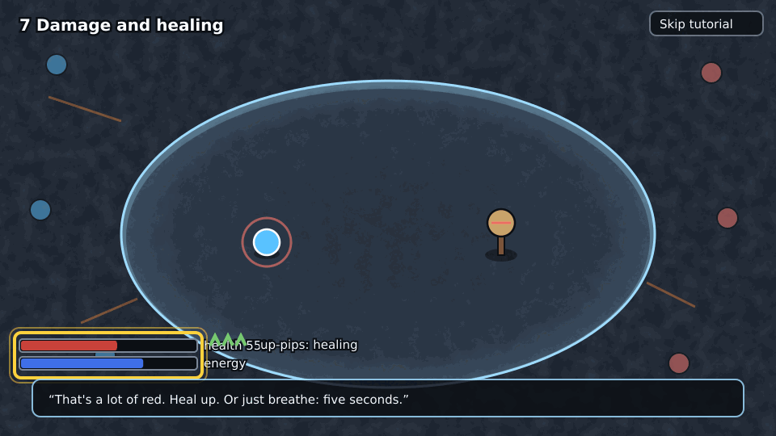

- The dummy now hits back lightly, or a "hurt" pulse drops the player to about 60 %.
- **Teach.** Damage lowers health. The guide heals you: watch the bar and the up-pips. Health
  also returns after 5 s out of combat.
- **Do.** Use your own heal skill if your build has one, otherwise just watch.
- **Check.** Health is back above 90 %.

## 8. Conditions

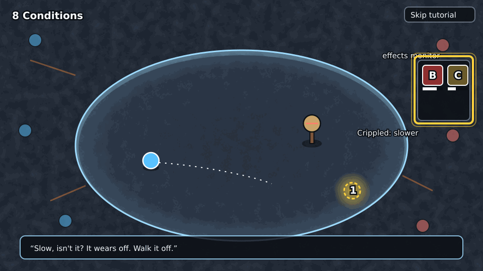

- The dummy applies **Bleeding**, then **Crippled**.
- **Teach.** The **effects monitor** (icons with draining bars, `ui/effects-monitor.ts`), what
  the down-pips mean, that Crippled slows you, and that conditions run out or get removed.
- **Do.** Walk to a marker while Crippled.
- **Check.** The marker is reached and the condition has expired.

## 9. Calling targets and pings

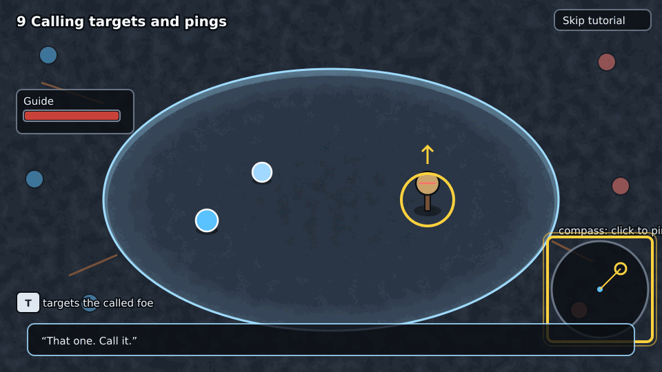

- **Teach.** Wheel-click a foe to call it for your team (the guide attacks it). Clicking the
  target bar calls your current target. **T** targets the team's called foe. Wheel-click the
  ground, or click the **compass**, to ping. Dragging on the compass draws a line.
- **Do.** Call the dummy, then ping a spot on the compass.
- **Check.** A call and a ping happened.
- **HUD.** The compass and the party window (the guide's health there).

## 10. Down, not out

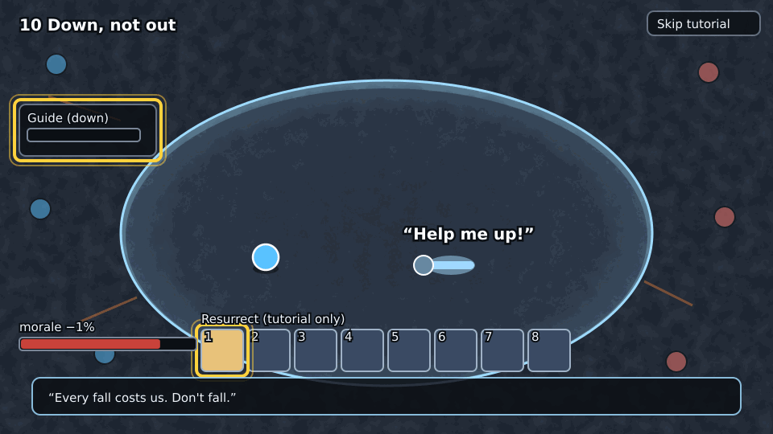

- The guide takes a big hit and falls: "Help me up!" A **Resurrect** skill lights up in the
  player's bar (granted for the tutorial only).
- **Do.** Target the guide (click their name in the party window), then use Resurrect.
- **Check.** The guide is alive. The guide, one line: "Every fall costs us morale. Don't
  fall." The morale % next to health pulses once.

## 11. To the front

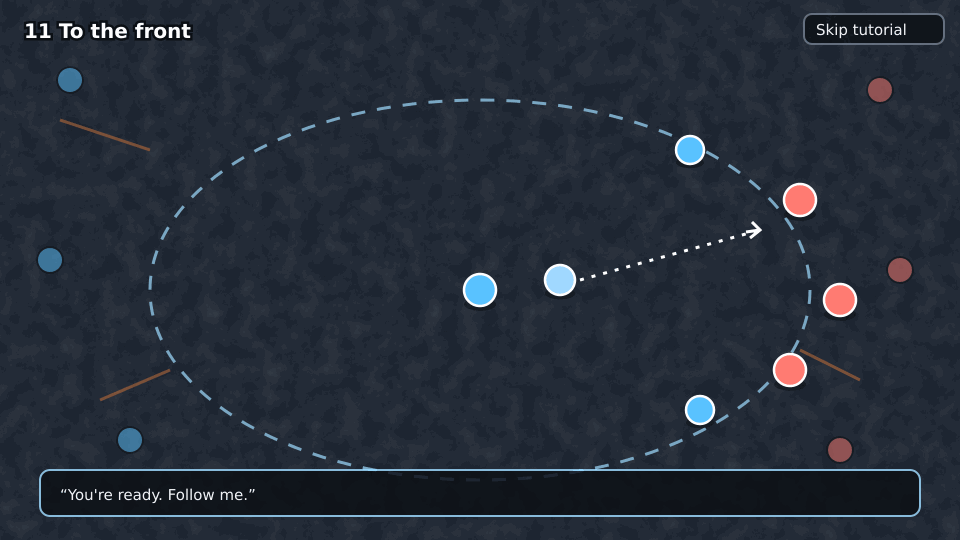

- The guide: "You're ready. Follow me." The bubble opens and the player joins the background
  fight on the guide's team (bots), now a normal bot match.
- The mode is the background fight's. A win or loss screen ends it and leads to the menu.
  Record `done`.
- **Out.** The tutorial is never offered again unless the record is cleared. **Options →
  Replay tutorial** is a proposal for the review.

## Cross-cutting rules for the build cards

- Every string goes through `t()`, in every locale (ADR-0050).
- Stations are data: an ordered list in `apps/web` (id, highlight target, success predicate
  over the session state), not a hand-written flow. `game-core` gets nothing tutorial-specific
  beyond, at most, a generic "invulnerable dome" zone if the bubble needs one (decide in the
  build card).
- The bubble and the dummy follow `docs/art/visual-style.md` and the map-look rule: lit,
  readable, 2.5D.
- Touch devices are out of scope for v1 (the game shows its touch notice already).

## Edge cases

- The player skips mid-way: record `skipped`, straight to the menu.
- The tab is closed mid-way: no record, so it is offered again next visit.
- The player joined by an invite link: the splash is already skipped, so no offer.
- Reduced motion: no flash, fades only.
- The player rebinds keys: the instructions follow the keymap.

## Out of scope

Any code, translations of the playbook, mode-specific teaching (flags, relics, Guild Lord),
and the builds and equipment screens.
