# First-time tutorial: the playbook

A build spec for developers (epic #3187). Not a player page: it is not translated. The in-game
strings go through `t()` when the stations are built. The illustrations are mock-ups
(`img/`, regenerated by `node scripts/assets/tutorial-playbook.mjs docs/tutorial/img`); the
real HUD is the authority.

## 0. The frame

- **Who.** A first-time player: no `${STORAGE_NAMESPACE}.tutorial` record in **localStorage**
  (pattern: `apps/web/src/ui/touch-notice-preference.ts`). Values are `done` and `skipped`;
  anything else is discarded and counts as absent. It is not the splash's sessionStorage flag.
- **Start.** The splash's second input (`apps/web/src/ui/splash-screen.ts` `end()`, "Press any
  key to begin"). For a first-timer a card offers **Learn to play** or **Skip**. Skip is today's
  menu, and records `skipped`.
- **Entry.** The title fades and the camera drops into the live background fight
  (`ui/splash-fight.ts`). No dome: the player stands in the war.
- **The story.** The war is endless. The **tutor**, a teammate from that fight, comes to the
  player and says so, and that there must be a better way to fight. The way: a **teleporter**
  in the north, outside the first view. It drops the pair into the **tutorial world**, a misty
  canyon with lava, where everything is learnt by doing. At the end the canyon leads behind the
  enemy lines and into the real fight. Name and profession of the tutor are an **open question
  for the operator review** (proposal: a Monk; no GW1 character names).
- **Always.** A **Skip tutorial** button sits in a fixed corner on every station. Esc does not
  skip, because Esc means cancel in the game. Each station shows one short line and the key or
  keys **as bound in the player's current keymap** (Classic, VibeWars or rebinds, read from
  `input/keymap.ts`, never hard-coded).
- **Rhythm per station.** Tutor line, highlight (a pulsing outline on the HUD element or a
  ground marker), the player acts, success check, one line of praise, next. No timer fails the
  player. A hint repeats after 10 s of nothing.
- **Tone.** Role-playing, minimal text, playful. At most one line of 12 words or fewer per beat.
  No station is read-only. A fact is met in play (a bar drops, a pip appears) and the tutor
  reacts in one line.

## Part A: the battlefield

## 1. Walk

- The tutor walks over: "This war never ends. Walk with me; I have an idea."
- **Teach.** Left click on the ground walks. WASD or the arrows walk too.
- **Do.** Walk to the glowing mark by the tutor.
- **Check.** The player's body reaches the mark.

## 2. Look around

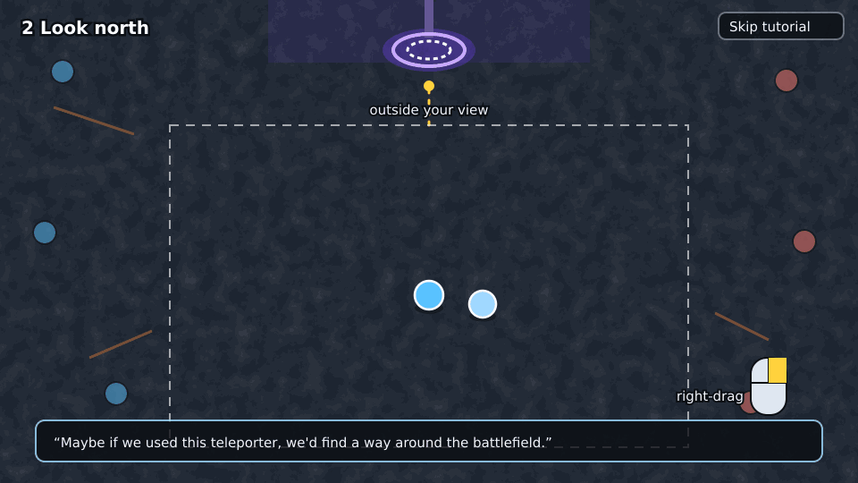

- The tutor: "Maybe if we used this teleporter, we'd find a way around the battlefield." The
  **teleporter is in the north, outside the view**: the player must look there.
- **Teach.** The wheel zooms. Right-drag looks around, and the view glides back.
- **Do.** Zoom out once, then right-drag until the teleporter is on screen.
- **Check.** A zoom and a right-drag happened and the teleporter is in view.

## 3. Step in

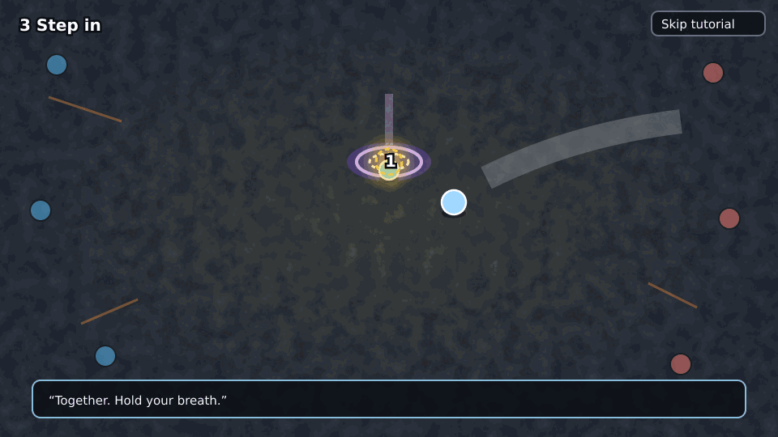

- **Do.** Walk into the teleporter. The tutor follows: "Together. Hold your breath."
- **Check.** The player is on the pad. A flash (fade only under reduced motion) and the scene
  switches to the canyon.

## Part B: the canyon

The tutorial world: a **misty canyon with lava**, built to the map look rule (lit, 2.5D, one
biome, see `docs/art/visual-style.md`). A trail of stations in order. The tutor stays with the
player and reacts. Lava is scenery to look at and a ground effect to avoid, never a kill that
fails the tutorial: it hurts, the tutor jokes, the player walks on.

## 4. Dodge the boulders

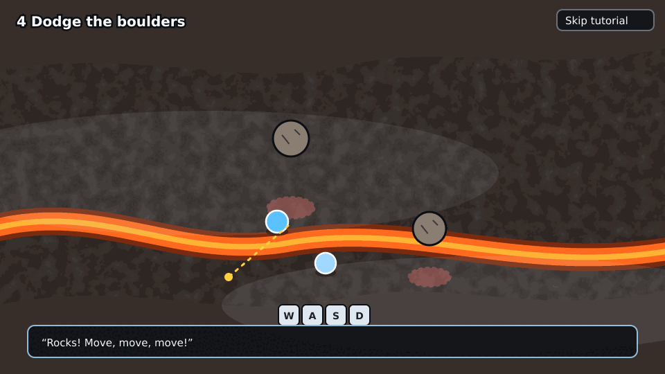

- **Teach.** Movement under pressure. A red ring on the ground shows where a boulder lands in
  about 1.5 s.
- **Do.** Step out of three rings in a row.
- **Check.** Three boulders landed without hitting the player.

## 5. Break the wall

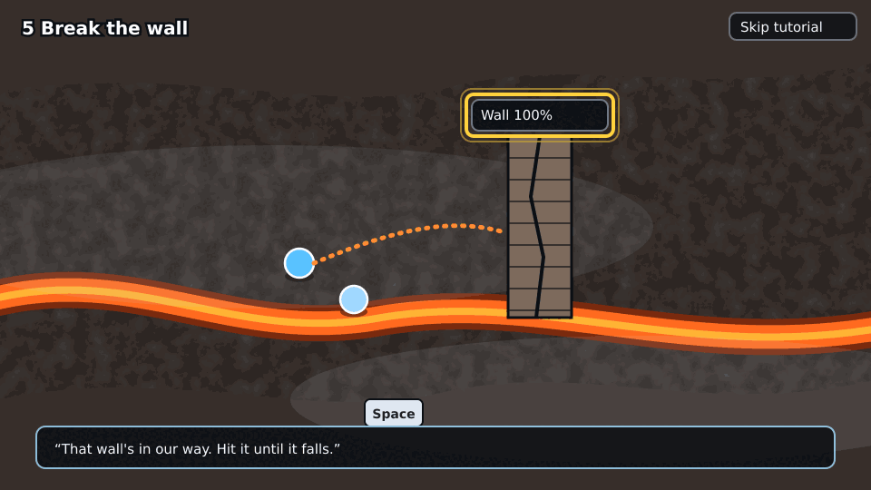

- **Teach.** Right click targets, right click again to attack, **Space** attacks. A wall is a
  target with a health bar and falls when emptied.
- **Do.** Target the wall and attack it until it falls.
- **Check.** The wall is destroyed and the way opens.
- **HUD.** Highlight the **target frame** (`ui/hud.ts`: name, health %, what it casts).

## 6. Heal the tutor

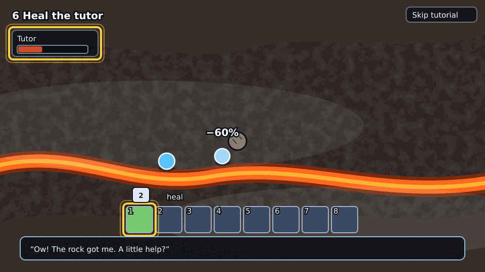

- A boulder hits the **tutor**: "Ow! The rock got me. A little help?" The tutor's health drops
  in the party window.
- **Teach.** The **skill bar** (keys 1 to 8, or as bound): a skill costs energy, takes a moment,
  then recharges. Target an ally with a click on their name in the party window or on them.
  Your health and energy bars, and the pips on them, are pointed at the first time they move.
- **Do.** Target the tutor and use the heal skill (granted for the tutorial if the build has
  none).
- **Check.** The heal lands on the tutor after the boulder has hit it (#3303): a check on
  health would tie the tutorial to max health and regeneration.

## 7. Cross the bad ground

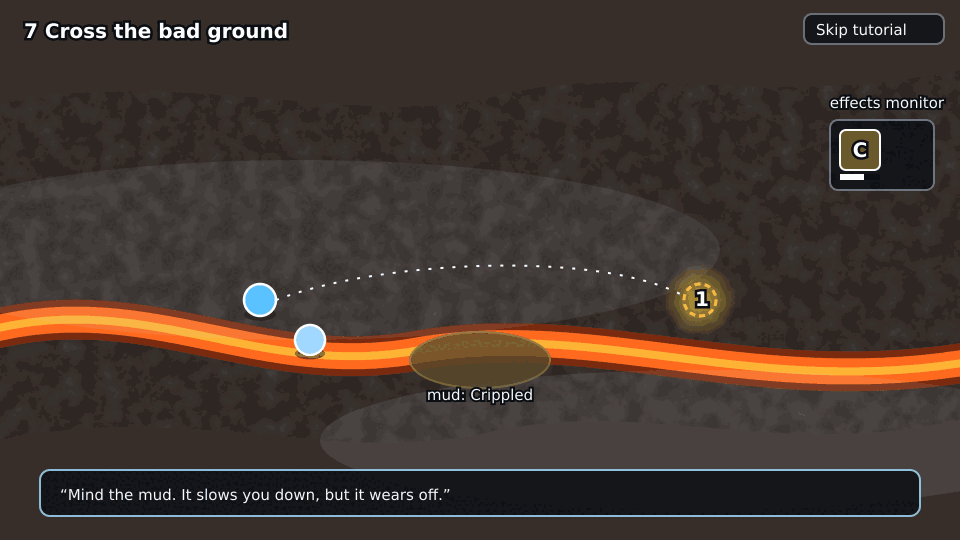

- **Teach.** Ground effects: mud slows (Crippled), lava burns. The **effects monitor**
  (`ui/effects-monitor.ts`) shows the icons with draining bars, and conditions run out.
- **Do.** Walk to the marker on the far side, through the mud or around it.
- **Check.** The marker is reached. If the player crossed the mud, the Crippled icon was shown.

## 8. Rats

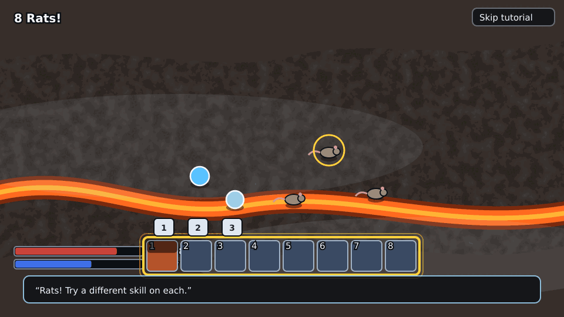

- Three rats. Each takes a different skill to finish quickly: one a ranged skill, one a
  melee/area skill, one a condition.
- **Teach.** Different skills, different jobs. Target with right click, **Tab** is the next foe,
  **C** the closest.
- **Do.** Kill all three rats using at least two different skills.
- **Check.** Three rats dead, two or more distinct skill ids cast.

## 9. Climb a layer

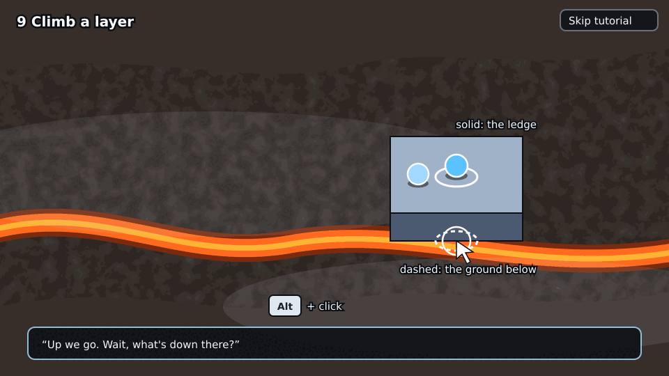

- **Teach.** A ring under the cursor marks the ledge, a dashed ring the ground below it.
  **Alt + click** walks to the ground under a ledge.
- **Do.** Reach the ledge, then Alt+click the ground beneath it.
- **Check.** The player is on the upper layer, then on the lower one under it.

## 10. Up the ramp

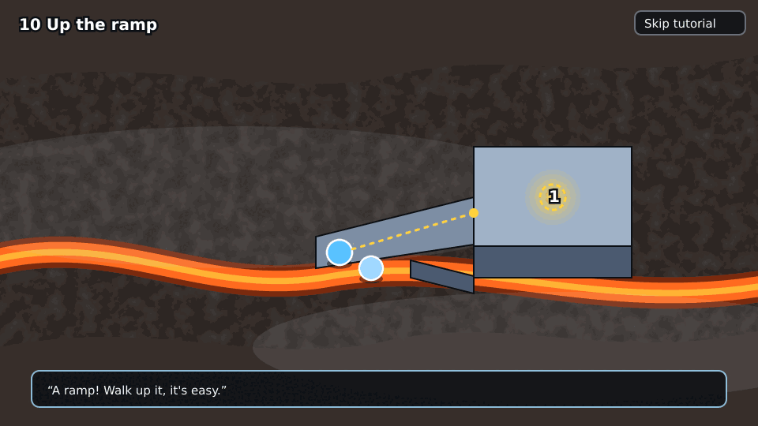

- **Teach.** A ramp joins two layers: walk onto it and it carries you up.
- **Do.** Walk up the ramp to the marker on the high ground.
- **Check.** The player stands on the high layer.

## 11. Sneak through the tunnel

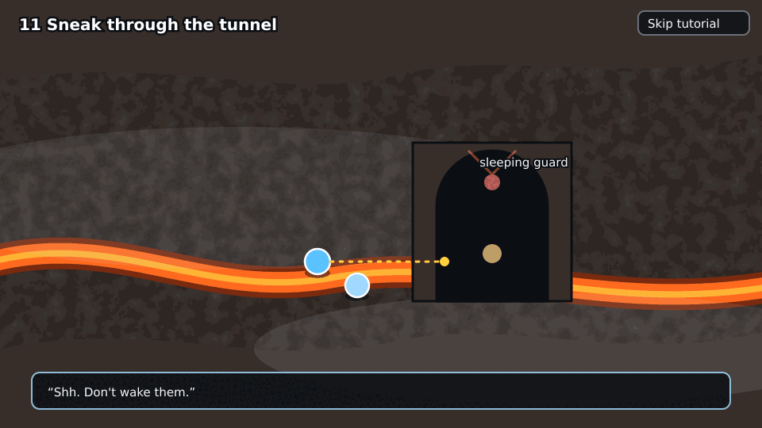

- **Teach.** A tunnel is a path under the rock, and the guard above it does not see in. The
  tutor: "Shh. Don't wake them."
- **Do.** Walk through the tunnel without leaving it.
- **Check.** The player came out the far side. No stealth system is needed: the guard is
  scenery, and the tunnel is a layer under the rock (the build card decides).

## 12. Call a target

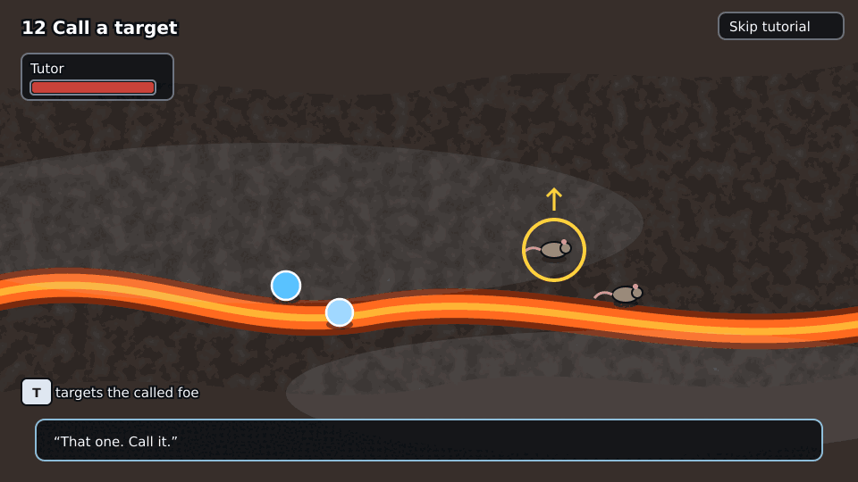

- **Teach.** Wheel-click a foe to call it for the team (the tutor attacks it). Clicking the
  target bar calls the current target. **T** targets the team's called foe.
- **Do.** Call one of two rats.
- **Check.** A call happened and the tutor attacked that rat.
- **HUD.** The party window (the tutor's health there).

## 13. Ping the way

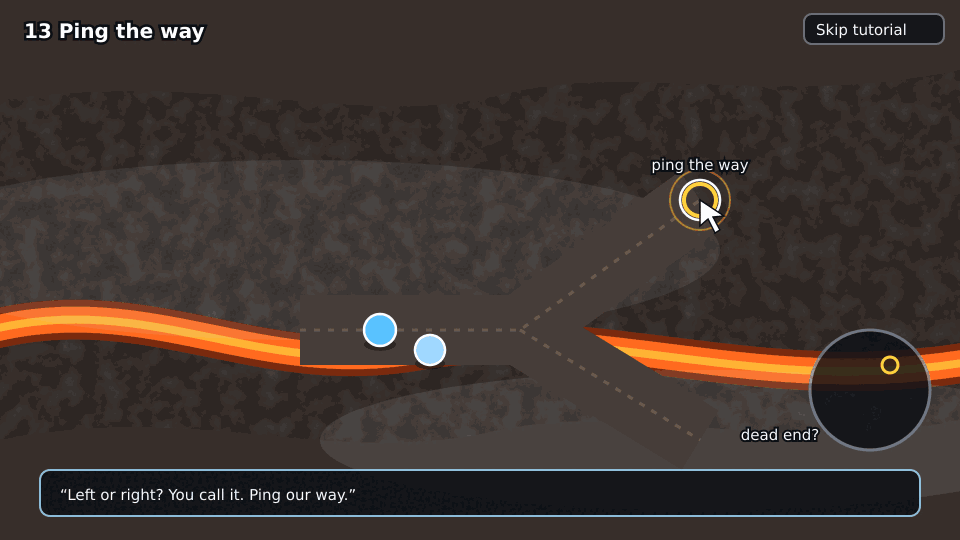

- At a **Y-junction** the tutor: "Left or right? You call it."
- **Teach.** Wheel-click the ground, or click the **compass**, to ping. Dragging on the compass
  draws a line.
- **Do.** Ping the branch you pick.
- **Check.** A ping happened on either branch. The tutor follows the pinged one. (The other
  branch is a short dead end with a joke, so a wrong pick costs nothing.)

## 14. Back to the front

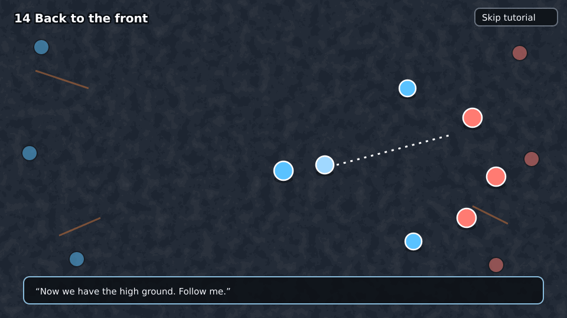

- The canyon opens behind the enemy lines. The tutor: "Now we have the high ground. Follow me."
  The player joins the background fight on the tutor's team (bots), now a normal bot match.
- The mode is the background fight's. A win or loss screen ends it and leads to the menu.
  Record `done`.
- **Out.** The tutorial is never offered again unless the record is cleared. **Options →
  Replay tutorial** is a proposal for the review.
- **Down, not out** (resurrecting a fallen ally) was dropped from this storyboard; it can be
  added to the canyon as a station before 14 if the operator wants it.

## Cross-cutting rules for the build cards

- Every string goes through `t()`, in every locale (ADR-0050).
- Stations are data: an ordered list in `apps/web` (id, highlight target, success predicate
  over the session state), not a hand-written flow. `game-core` gets nothing tutorial-specific
  beyond what the canyon needs (boulders, a destructible wall, a heal-able ally), decided in the
  build cards.
- The canyon, the teleporter, the boulders, the wall and the rats follow `docs/art/visual-style.md` and the map-look rule: lit,
  readable, 2.5D.
- Touch devices are out of scope for v1 (the game shows its touch notice already).

## Edge cases

- The player skips mid-way: record `skipped`, straight to the menu.
- The tab is closed mid-way: no record, so it is offered again next visit.
- The player joined by an invite link: the splash is already skipped, so no offer.
- Reduced motion: no flash, fades only.
- The player rebinds keys: the instructions follow the keymap.

## Out of scope

Any code, translations of the playbook, mode-specific teaching (flags, relics, Guild Lord),
and the builds and equipment screens.
